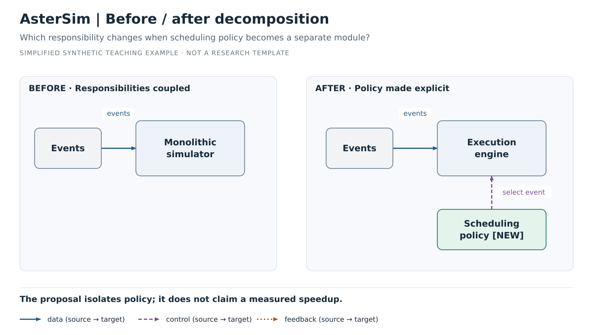

# Arch Diagram Lab

**给体系结构新生的读图、选图、画图与改图项目。** AI 可以辅助，但人的研究判断是主线。

我们研究的是：成熟研究者如何选择抽象、安排信息、表达机制和控制读者的误解。目标不是复制某个实验室的配色，也不是让每篇论文套同一套框图。

## 从这里开始

1. **先理解成熟图的判断**：[真实论文对照](corpus/expert-comparisons.md) → [跨组复核与反例](corpus/synthesis-review.md)。
2. **不知道论文该画哪些图**：读[选图指南](docs/figure-selection.md)，先写贡献和读者问题。
3. **刚开始学画图**：按[学习路径](docs/learning-path.md)完成[练习与答案](docs/exercises.md)。不用安装工具也能学习。
4. **想知道默认风格与规范**：看[风格与约定](docs/style-and-conventions.md)。严格区分会务硬要求、出版指导、样本惯例与项目可选默认。
5. **想让 AI 按规则辅助**：使用[研究 Prompt](docs/research-prompt.md)、[标注协议](docs/annotation-guide.md)和[质量检查表](docs/quality-checklist.md)。

## 研究边界

纳入系统与微架构、机制、数据流/控制流、逻辑时序、状态、布局、映射及设计对照等**解释性示意图**；明确包含 Simulator。

**不研究实验结果图**，不包括性能、能耗、准确率、消融曲线或统计结果图。机制图中的地址位段、步骤编号和示意时序仍可纳入。混合图按子图划界。

长期来源范围为 OSDI、ISCA、MICRO、DAC、HPCA、ASPLOS、ATC、IPDPS；目前的材料不是八会代表性抽样，更不是已经完成的 100 篇综述。

## 第一批证据与当前限制

- 原始种子：FireSim、Ray、AIFM，**3 篇 / 9 图**，见[来源与字段说明](corpus/README.md)。
- 对照样本：Eyeriss、RowClone、Plasticine，**3 篇 / 9 图**，见[逐图记录](corpus/expert-papers.json)。
- 合计 **6 篇 / 18 幅**原论文非实验图经过像素、图注与相关正文检查。跨组复核另有[具体异议与修订记录](corpus/synthesis-review.md)，不以意见一致冒充实验验证。
- 这些是有目的选择的历史样本，主要来自 ISCA、MICRO、OSDI，偏向模拟器、系统、加速器与存内操作。没有统一风格频率、阅读效果或录用率结论。
- 公开仓库保存链接、图号和原创分析，不重新分发第三方 PDF 或论文原图。

### 目前值得带走的判断

> **专业感来自对技术信息的控制，而不只是简洁或漂亮。**

- 图中的方框究竟表示硬件、步骤、状态还是数据格式，必须先确定。
- 重复的面板可能是同一阵列的不同数据流，也可能是同一电路的前后状态，不一定是多套硬件。
- 省略细节要有理由，并说明示意规模与真实规模的区别。
- 颜色和线宽若承担信息编码，必须先确定含义；最后调整的只是具体视觉参数。
- 总览不必永远排在最前，少画框也不必然更专业。看它是否帮助解释当前贡献。

这些判断有适用条件和反例，请结合原论文链接阅读，不把它们当无条件戒律。

## 原创教学示例：用于练习，不是顶会模板

同一个虚构的 AsterSim 机制分别用总览、执行步骤和前后对照表达，展示为什么一套机制需要不同视图。**不代表真实研究系统，也不声称证明性能收益。**



- [总览 SVG](generated/01-overview.svg) / [PDF](generated/01-overview.pdf) / [规格](examples/01-overview.json)
- [机制 SVG](generated/02-mechanism.svg) / [PDF](generated/02-mechanism.pdf) / [规格](examples/02-mechanism.json)
- [对照 SVG](generated/03-before-after.svg) / [PDF](generated/03-before-after.pdf) / [规格](examples/03-before-after.json)
- [修改示例](generated/04-edited-overview.svg)：改名称并重新布置反馈路径。
- [单色检查](generated/05-before-after-monochrome.svg)：去除颜色后仍保留新增模块和边类型。

SVG 内文字、节点和连线可分别编辑。JSON 保留语义和显式坐标；不是把 PNG 包进 SVG。

## 可选工具：运行、检查、重画

核心支持 Python 3.9+，本次在 Python 3.12 下测试，使用标准库。PNG/PDF 预览需要另外安装的 Inkscape；没有它仍能生成 SVG。

```bash
python -m unittest discover -s tests -v
python scripts/validate_corpus.py
python scripts/build_examples.py
# 本机已有 Inkscape 时可生成 PNG/PDF：
python scripts/build_examples.py --preview
python scripts/mutation_demo.py --preview

PYTHONPATH=src python -m arch_diagram_lab validate examples/01-overview.json
PYTHONPATH=src python -m arch_diagram_lab render examples/01-overview.json -o generated/01-overview.svg
PYTHONPATH=src python -m arch_diagram_lab edit examples/01-overview.json --node scheduler --label 'Epoch arbiter' -o generated/renamed.json
```

完整规格见 [templates/SPEC.md](templates/SPEC.md)，起点见 [templates/starter.json](templates/starter.json)。

工具检查 ID、引用、边角色及部分几何约束；**不证明技术机制正确，不自动规划论文图组，也不提供完整的自动布局或碰撞检测。**当前教学例图采用显式坐标。原图检查、证据解释与人类评审仍不可省略。

## 项目结构与下一步

| 路径 | 内容 |
|---|---|
| `corpus/` | 可追溯原论文记录、逐图解读、对照与反例 |
| `docs/` | 新生教程、项目方案、研究 Prompt、模式与检查规范 |
| `examples/`、`templates/` | 原创可编辑规格和语义契约 |
| `src/`、`scripts/`、`tests/` | 最小生成/验证工具和回归测试 |
| `generated/` | 原创示例 SVG、PNG、PDF |

[完整计划](docs/project-plan.md)：先验证小规模学习和绘制闭环，再扩展到 12–20 篇试点，之后有条件扩充至约 100 篇。重点补充 CPU/cache/coherence、不同 Simulator、编译和协议等对象，并保留不支持原假设的例子。

### 贡献与权利边界

新案例需要原论文来源、图号、页码、实际查看深度与明确/推断语义的区分。新增“规范”须注明是官方要求、样本观察还是建议。请不要提交未获许可的论文 PDF、裁剪原图、用户私稿或任何凭据。

此版本尚未选择开源许可证；公开可见不等于授予额外再许可。第三方论文与图像的权利属于各自权利人。
