# 体系结构与系统非实验原图图库

**32篇 / 157张非实验图**。仅收录系统抽象、架构、机制、数据/控制流、示意时序与形式定义；排除实验结果、测量照片和未分离的混合图。

[筛选界面](index.html)可下载后在浏览器打开；GitHub文件预览不执行HTML。[100篇来源目录](../catalog/README.md)不代表全部原图已获许可或研究全部完成。[逐图署名与许可](licenses.json)。

## [LVM · MICRO 2025](papers/micro-2025-lvm.md)
缓存、地址转换与DRAM系统 · 学习式虚拟内存翻译子系统 · 6张

[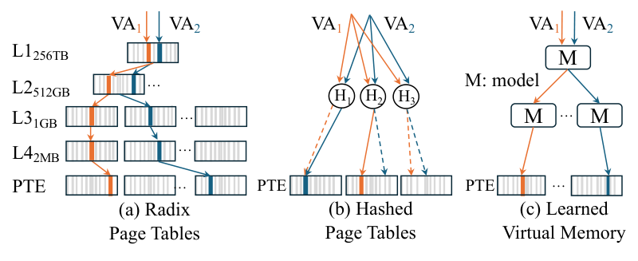](papers/micro-2025-lvm.md)

## [OmniSim · MICRO 2025](papers/micro-2025-omnisim.md)
模拟器与仿真平台 · HLS功能与周期联合模拟器 · 5张

[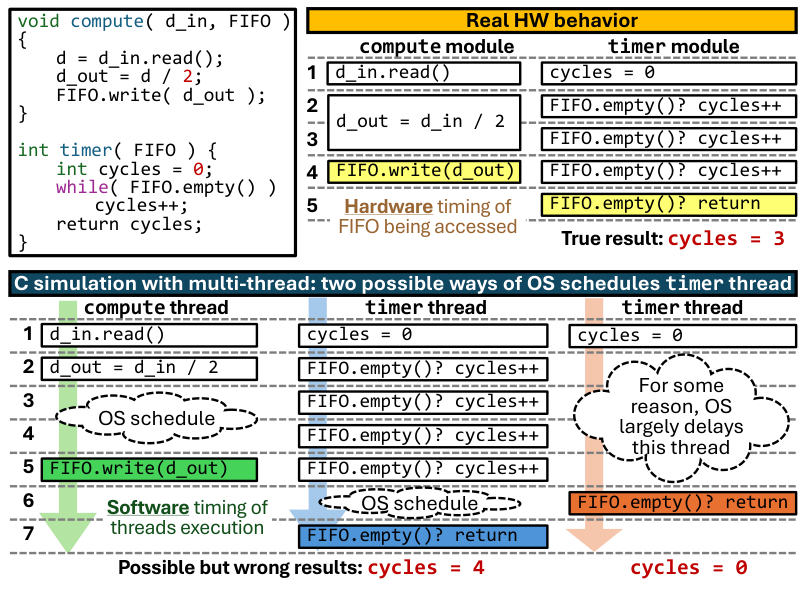](papers/micro-2025-omnisim.md)

## [Compass · ASPLOS 2026](papers/asplos-2026-compass.md)
RTL验证、生成与修复工具 · Compass RTL信息流污点验证工具 · 4张

[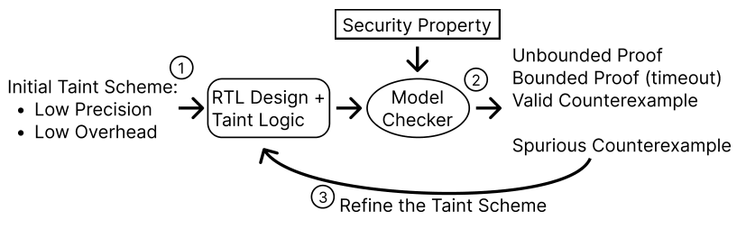](papers/asplos-2026-compass.md)

## [PCcheck · ASPLOS 2025](papers/asplos-2025-pccheck.md)
运行时与调度系统 · PCcheck持久并发检查点运行时 · 5张

[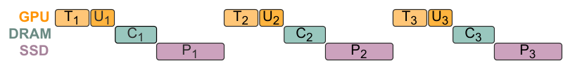](papers/asplos-2025-pccheck.md)

## [CXL model · ASPLOS 2026](papers/asplos-2026-cxlmodel.md)
并发与故障语义模型 · CXL0并发与故障编程语义模型 · 4张

[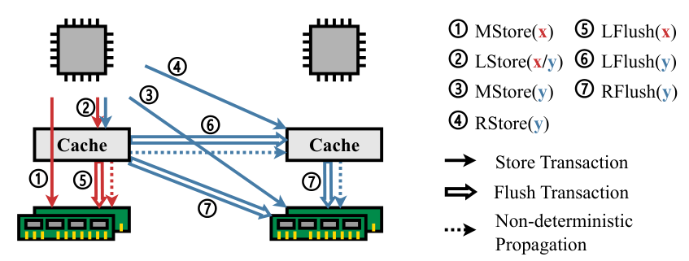](papers/asplos-2026-cxlmodel.md)

## [MAGE · DAC 2025 / arXiv v1](papers/dac-2025-mage.md)
RTL验证、生成与修复工具 · MAGE多代理RTL代码生成与调试系统 · 2张

[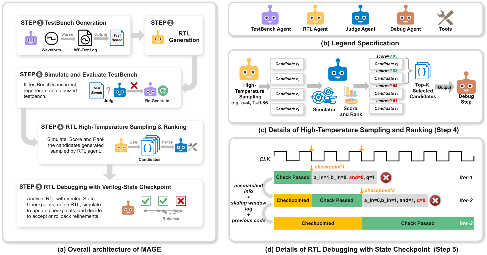](papers/dac-2025-mage.md)

## [StreamTensor · MICRO 2025](papers/micro-2025-streamtensor.md)
编译器、语言与中间表示 · 流式张量编译器与itensor IR · 8张

[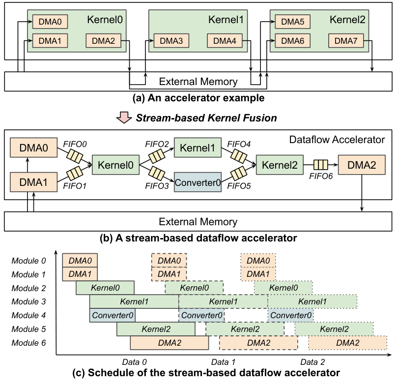](papers/micro-2025-streamtensor.md)

## [Tally · ASPLOS 2025](papers/asplos-2025-tally.md)
运行时与调度系统 · Tally GPU共享与优先级调度运行时 · 3张

[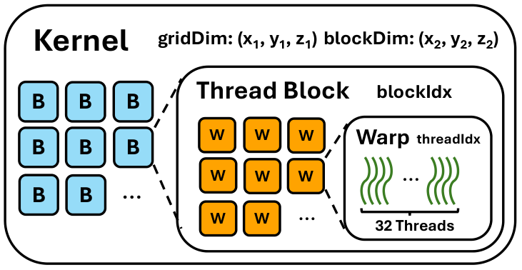](papers/asplos-2025-tally.md)

## [Cxlalloc · ASPLOS 2026](papers/asplos-2026-cxlalloc.md)
操作系统、内存分配与硬件管理层 · cxlalloc CXL共享内存分配器 · 6张

[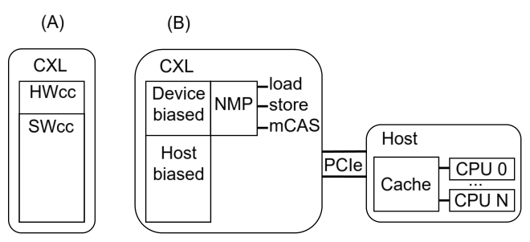](papers/asplos-2026-cxlalloc.md)

## [Quartz · MICRO 2025](papers/micro-2025-quartz.md)
专用加速器与可重构/存内计算平台 · 分布式SRAM可重构稀疏加速器 · 11张

[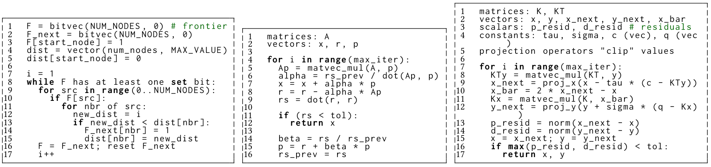](papers/micro-2025-quartz.md)

## [RTeAAL Sim · ASPLOS 2026](papers/asplos-2026-rteaal.md)
模拟器与仿真平台 · RTeAAL Sim张量表示RTL仿真器 · 11张

[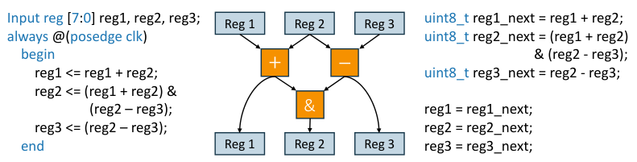](papers/asplos-2026-rteaal.md)

## [CHERI-SIMT · ASPLOS 2026](papers/asplos-2026-naylor.md)
内存保护与资源隔离构件 · CHERI-SIMT GPU能力内存保护构件 · 5张

[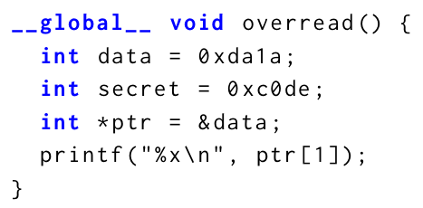](papers/asplos-2026-naylor.md)

## [Virtuoso · ASPLOS 2025 / arXiv v2](papers/asplos-2025-virtuoso.md)
模拟器与仿真平台 · Virtuoso操作系统与体系结构协同仿真平台 · 4张

[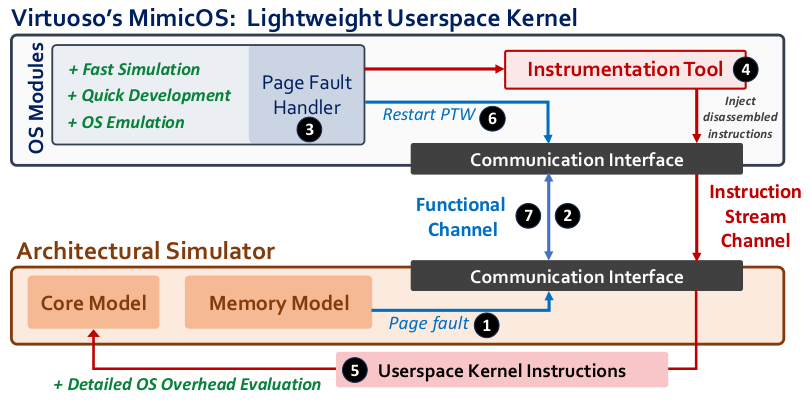](papers/asplos-2025-virtuoso.md)

## [Chassis · ASPLOS 2025 / arXiv v3](papers/asplos-2025-chassis.md)
编译器、语言与中间表示 · Chassis目标感知数值表达式编译器 · 6张

[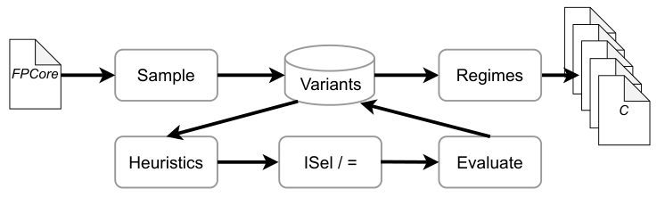](papers/asplos-2025-chassis.md)

## [STeP · ASPLOS 2026](papers/asplos-2026-step.md)
编译器、语言与中间表示 · STeP动态张量程序流式语言抽象 · 8张

[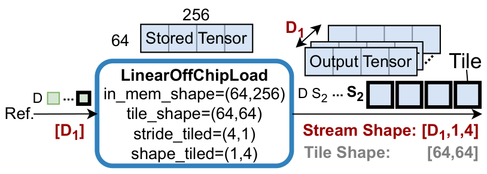](papers/asplos-2026-step.md)

## [Rights / AssertSolver · DAC 2025](papers/dac-2025-rights.md)
RTL验证、生成与修复工具 · AssertSolver RTL断言修复模型与工具链 · 1张

[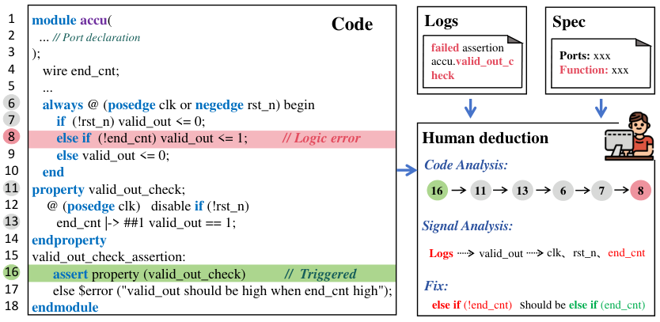](papers/dac-2025-rights.md)

## [ATR · MICRO 2025](papers/micro-2025-atr.md)
CPU/GPU处理器与执行构件 · 乱序CPU物理寄存器管理单元 · 6张

[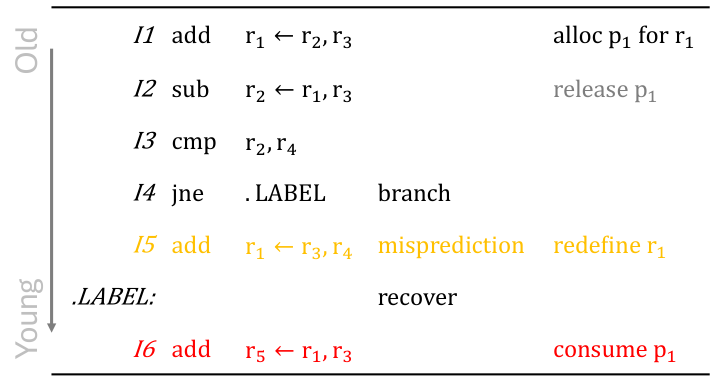](papers/micro-2025-atr.md)

## [LoopFrog · MICRO 2025](papers/micro-2025-loopfrog.md)
CPU/GPU处理器与执行构件 · 支持threadlet的单核乱序处理器 · 4张

[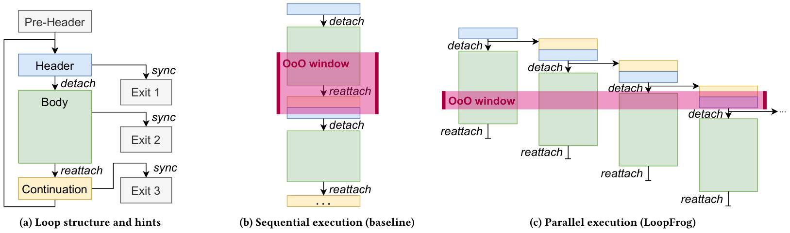](papers/micro-2025-loopfrog.md)

## [Radshield · ASPLOS 2026](papers/asplos-2026-radshield.md)
运行时与调度系统 · Radshield软件辐射容错运行时 · 4张

[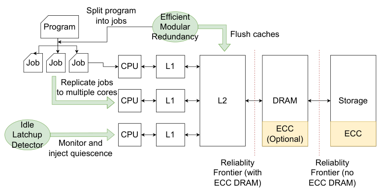](papers/asplos-2026-radshield.md)

## [ColumnDisturb · MICRO 2025](papers/micro-2025-columndisturb.md)
缓存、地址转换与DRAM系统 · 真实DRAM芯片及列方向读扰动 · 2张

[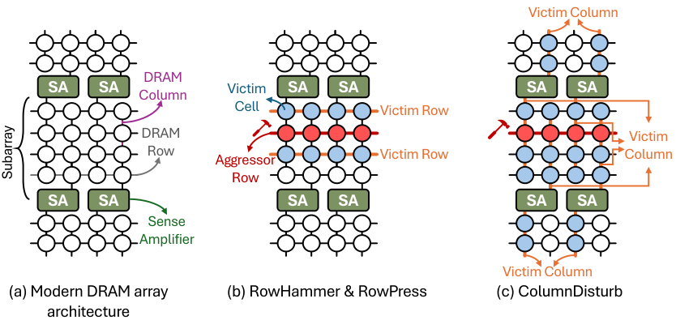](papers/micro-2025-columndisturb.md)

## [LeakyHammer · MICRO 2025](papers/micro-2025-leakyhammer.md)
缓存、地址转换与DRAM系统 · DRAM RowHammer防护构件及其时间泄漏 · 1张

[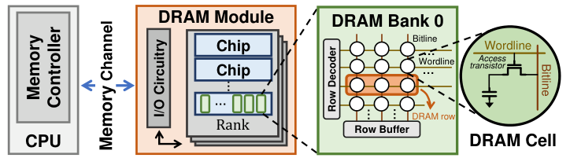](papers/micro-2025-leakyhammer.md)

## [NetSparse · MICRO 2025](papers/micro-2025-netsparse.md)
互连、网络接口与数据通路 · SNIC与交换机协同的稀疏通信数据通路 · 10张

[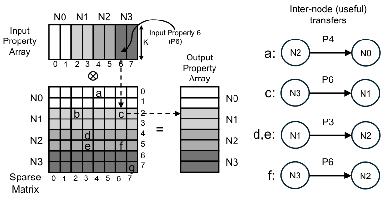](papers/micro-2025-netsparse.md)

## [StackEngine · MICRO 2025](papers/micro-2025-stackengine.md)
CPU/GPU处理器与执行构件 · 商用CPU栈引擎及其隐藏状态 · 3张

[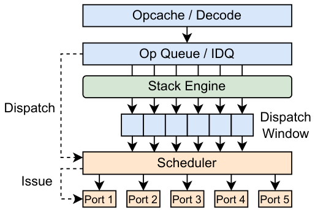](papers/micro-2025-stackengine.md)

## [Diffuse / Fusion · ASPLOS 2025](papers/asplos-2025-fusion.md)
编译器、语言与中间表示 · Diffuse分布式任务与内核融合IR及编译系统 · 8张

[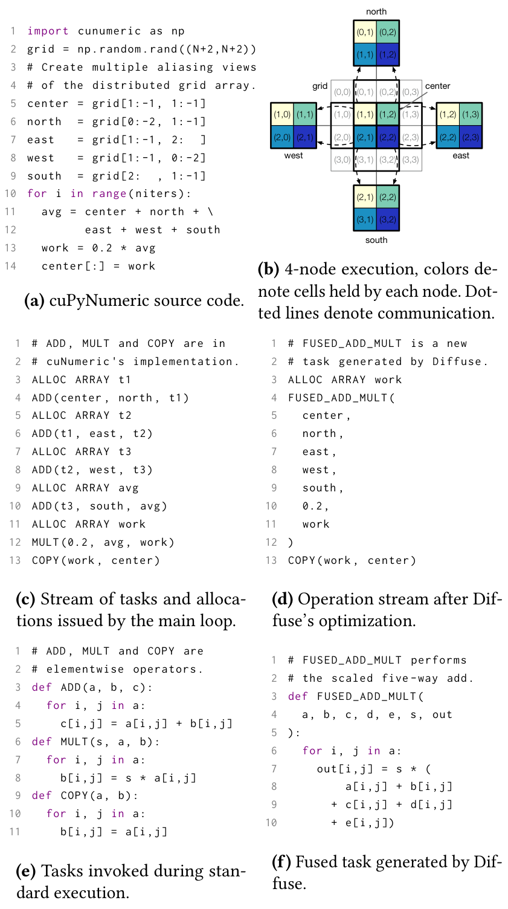](papers/asplos-2025-fusion.md)

## [VLA Quantum · IPDPS 2026 / arXiv v3](papers/ipdps2026-vla-quantum.md)
模拟器与仿真平台 · Qsim-SVE量子状态向量模拟器 · 4张

[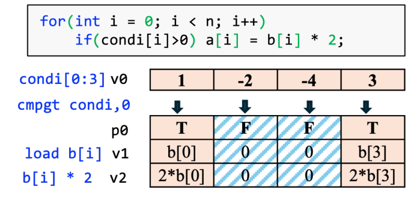](papers/ipdps2026-vla-quantum.md)

## [DICE PHY · ISCA 2026 / arXiv v2](papers/isca-2026-dicephy.md)
模拟器与仿真平台 · 芯粒互连PHY运行时模型 · 5张

[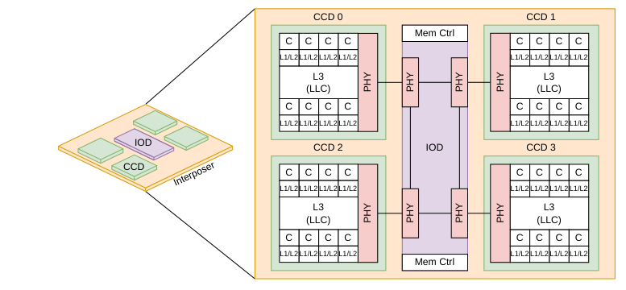](papers/isca-2026-dicephy.md)

## [ZK-Flex · DAC 2026](papers/dac-2026-zkflex.md)
专用加速器与可重构/存内计算平台 · ZK-Flex可重构证明生成加速器 · 3张

[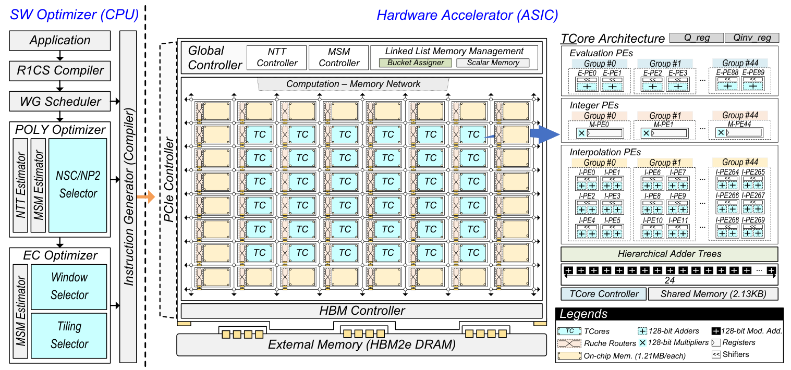](papers/dac-2026-zkflex.md)

## [Q-Pilot · arXiv v3 / DAC 2024](papers/dac-2024-qpilot.md)
编译器、语言与中间表示 · Q-Pilot可移动中性原子阵列量子编译器 · 8张

[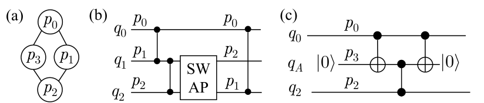](papers/dac-2024-qpilot.md)

## [TRACE · arXiv v3](papers/dac-2026-trace.md)
EDA工具与电路设计表示 · TRACE电路图表示学习模型 · 3张

[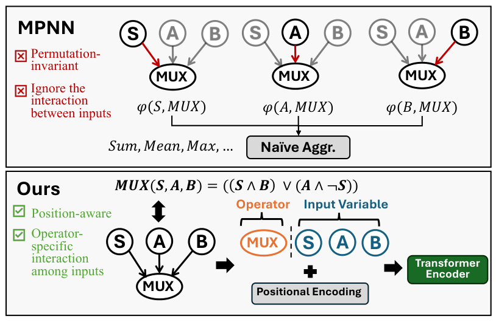](papers/dac-2026-trace.md)

## [ucTrace · IPDPS 2026 / arXiv v1](papers/ipdps2026-uctrace.md)
程序与网络分析、测试、追踪工具 · ucTrace UCX通信剖析工具 · 2张

[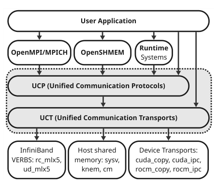](papers/ipdps2026-uctrace.md)

## [Loaded Dice · ISCA 2026 / arXiv v1](papers/isca-2026-loadeddice.md)
缓存、地址转换与DRAM系统 · PrISM DRAM行扰动防护构件 · 2张

[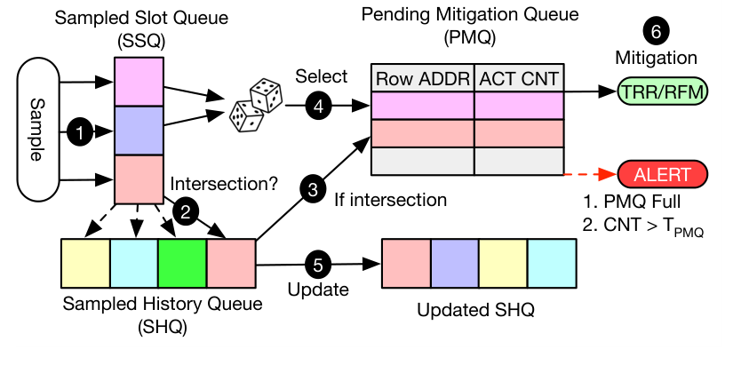](papers/isca-2026-loadeddice.md)

## [Sandwich · DAC 2026](papers/dac-2026-sandwich.md)
运行时与调度系统 · Sandwich CPU LLM配置搜索与热切换运行时 · 3张

[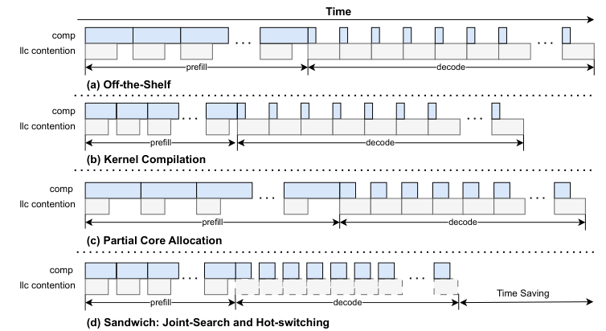](papers/dac-2026-sandwich.md)

