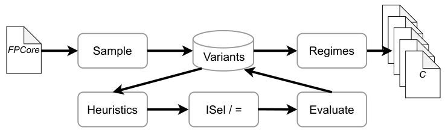
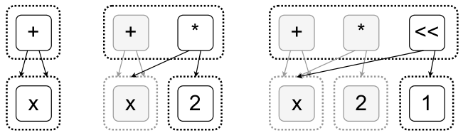
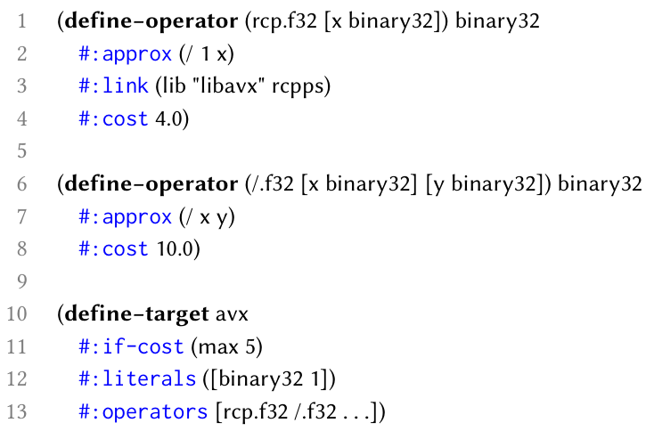
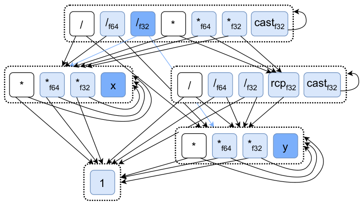
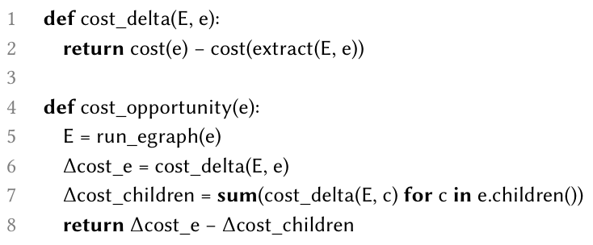
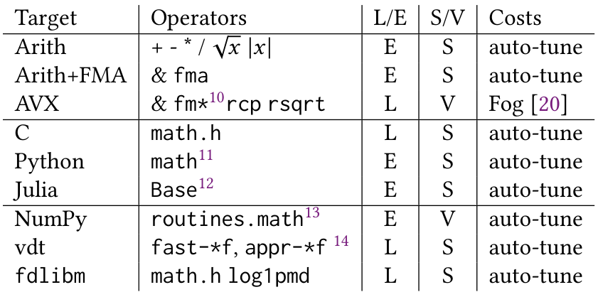

# Target-Aware Implementation of Real Expressions

[返回图集](../README.md) · Chassis · ASPLOS 2025 / arXiv v3 · 6张非实验图

研究对象：编译器、语言与中间表示 / Chassis目标感知数值表达式编译器

本页仅显示以下非实验图，不包含原论文全部图组。混合图在子图分离复核完成前暂不收录。

版本许可依据：[来源](https://arxiv.org/abs/2410.14025v3)。源PDF SHA256：`5c9ffb562d8987c3421610fb76efb59b090329c57ce20c17335296fc2d7c5a01`。PDF不随库分发。

## 图号导航

[F1](#f1) · [F2](#f2) · [F3](#f3) · [F4](#f4) · [F5](#f5) · [F6](#f6)

## F1

**非实验图 · 目标感知数值编译流程图**

[原文物理页 3](https://arxiv.org/pdf/2410.14025v3#page=3) · [许可证 CC BY 4.0](https://creativecommons.org/licenses/by/4.0/)

署名：Brett Saiki, Jackson Brough, Jonas Regehr, Jesús Ponce, Varun Pradeep, Aditya Akhileshwaran, Zachary Tatlock, Pavel Panchekha. Target-Aware Implementation of Real Expressions. ASPLOS 2025; arXiv author version. DOI: https://doi.org/10.1145/3669940.3707277. Version: arXiv:2410.14025v3, 31 October 2024; 14-page author manuscript, not publisher PDF. Source: https://arxiv.org/pdf/2410.14025v3. CC BY 4.0: https://creativecommons.org/licenses/by/4.0/. Whole figures cropped from this exact PDF and rasterized at 240 dpi; captions excluded, all figure content unchanged. No endorsement implied.

修改说明：Whole figure cropped from the specified source PDF and rasterized at 240 dpi; numbered caption excluded, figure content unchanged.

## F2

**非实验图 · 等价图重写步骤图**

[原文物理页 4](https://arxiv.org/pdf/2410.14025v3#page=4) · [许可证 CC BY 4.0](https://creativecommons.org/licenses/by/4.0/)

署名：Brett Saiki, Jackson Brough, Jonas Regehr, Jesús Ponce, Varun Pradeep, Aditya Akhileshwaran, Zachary Tatlock, Pavel Panchekha. Target-Aware Implementation of Real Expressions. ASPLOS 2025; arXiv author version. DOI: https://doi.org/10.1145/3669940.3707277. Version: arXiv:2410.14025v3, 31 October 2024; 14-page author manuscript, not publisher PDF. Source: https://arxiv.org/pdf/2410.14025v3. CC BY 4.0: https://creativecommons.org/licenses/by/4.0/. Whole figures cropped from this exact PDF and rasterized at 240 dpi; captions excluded, all figure content unchanged. No endorsement implied.

修改说明：Whole figure cropped from the specified source PDF and rasterized at 240 dpi; numbered caption excluded, figure content unchanged.

## F3

**非实验图 · 目标指令描述代码图**

[原文物理页 5](https://arxiv.org/pdf/2410.14025v3#page=5) · [许可证 CC BY 4.0](https://creativecommons.org/licenses/by/4.0/)

署名：Brett Saiki, Jackson Brough, Jonas Regehr, Jesús Ponce, Varun Pradeep, Aditya Akhileshwaran, Zachary Tatlock, Pavel Panchekha. Target-Aware Implementation of Real Expressions. ASPLOS 2025; arXiv author version. DOI: https://doi.org/10.1145/3669940.3707277. Version: arXiv:2410.14025v3, 31 October 2024; 14-page author manuscript, not publisher PDF. Source: https://arxiv.org/pdf/2410.14025v3. CC BY 4.0: https://creativecommons.org/licenses/by/4.0/. Whole figures cropped from this exact PDF and rasterized at 240 dpi; captions excluded, all figure content unchanged. No endorsement implied.

修改说明：Whole figure cropped from the specified source PDF and rasterized at 240 dpi; numbered caption excluded, figure content unchanged.

## F4

**非实验图 · 混合精度等价图示意图**

[原文物理页 6](https://arxiv.org/pdf/2410.14025v3#page=6) · [许可证 CC BY 4.0](https://creativecommons.org/licenses/by/4.0/)

署名：Brett Saiki, Jackson Brough, Jonas Regehr, Jesús Ponce, Varun Pradeep, Aditya Akhileshwaran, Zachary Tatlock, Pavel Panchekha. Target-Aware Implementation of Real Expressions. ASPLOS 2025; arXiv author version. DOI: https://doi.org/10.1145/3669940.3707277. Version: arXiv:2410.14025v3, 31 October 2024; 14-page author manuscript, not publisher PDF. Source: https://arxiv.org/pdf/2410.14025v3. CC BY 4.0: https://creativecommons.org/licenses/by/4.0/. Whole figures cropped from this exact PDF and rasterized at 240 dpi; captions excluded, all figure content unchanged. No endorsement implied.

修改说明：Whole figure cropped from the specified source PDF and rasterized at 240 dpi; numbered caption excluded, figure content unchanged.

## F5

**非实验图 · 成本机会启发式伪代码图**

[原文物理页 7](https://arxiv.org/pdf/2410.14025v3#page=7) · [许可证 CC BY 4.0](https://creativecommons.org/licenses/by/4.0/)

署名：Brett Saiki, Jackson Brough, Jonas Regehr, Jesús Ponce, Varun Pradeep, Aditya Akhileshwaran, Zachary Tatlock, Pavel Panchekha. Target-Aware Implementation of Real Expressions. ASPLOS 2025; arXiv author version. DOI: https://doi.org/10.1145/3669940.3707277. Version: arXiv:2410.14025v3, 31 October 2024; 14-page author manuscript, not publisher PDF. Source: https://arxiv.org/pdf/2410.14025v3. CC BY 4.0: https://creativecommons.org/licenses/by/4.0/. Whole figures cropped from this exact PDF and rasterized at 240 dpi; captions excluded, all figure content unchanged. No endorsement implied.

修改说明：Whole figure cropped from the specified source PDF and rasterized at 240 dpi; numbered caption excluded, figure content unchanged.

## F6

**非实验图 · 编译目标特性分类图**

[原文物理页 8](https://arxiv.org/pdf/2410.14025v3#page=8) · [许可证 CC BY 4.0](https://creativecommons.org/licenses/by/4.0/)

署名：Brett Saiki, Jackson Brough, Jonas Regehr, Jesús Ponce, Varun Pradeep, Aditya Akhileshwaran, Zachary Tatlock, Pavel Panchekha. Target-Aware Implementation of Real Expressions. ASPLOS 2025; arXiv author version. DOI: https://doi.org/10.1145/3669940.3707277. Version: arXiv:2410.14025v3, 31 October 2024; 14-page author manuscript, not publisher PDF. Source: https://arxiv.org/pdf/2410.14025v3. CC BY 4.0: https://creativecommons.org/licenses/by/4.0/. Whole figures cropped from this exact PDF and rasterized at 240 dpi; captions excluded, all figure content unchanged. No endorsement implied.

修改说明：Whole figure cropped from the specified source PDF and rasterized at 240 dpi; numbered caption excluded, figure content unchanged.

