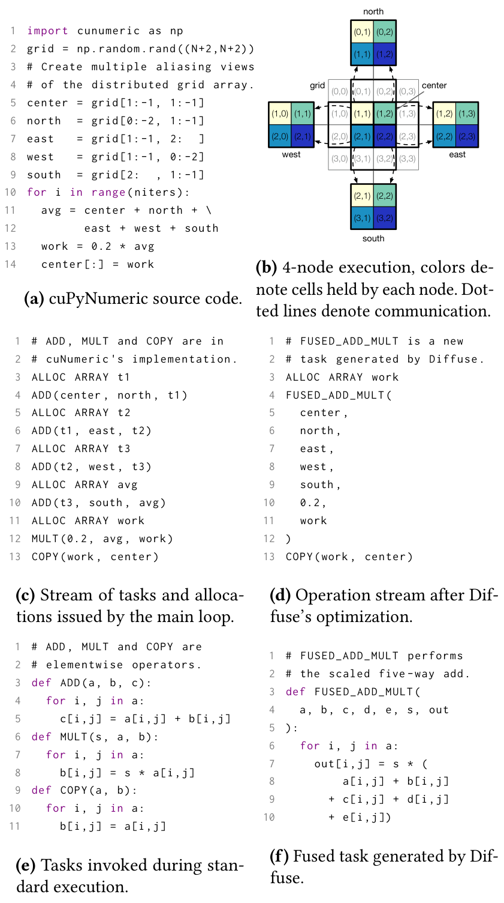
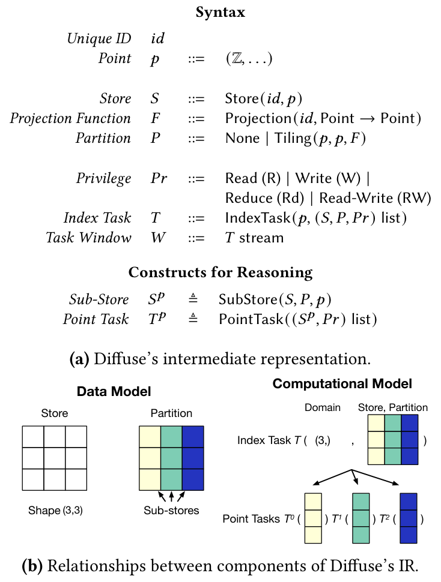
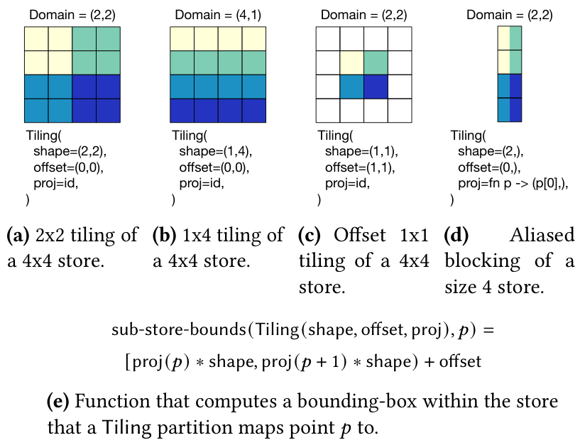
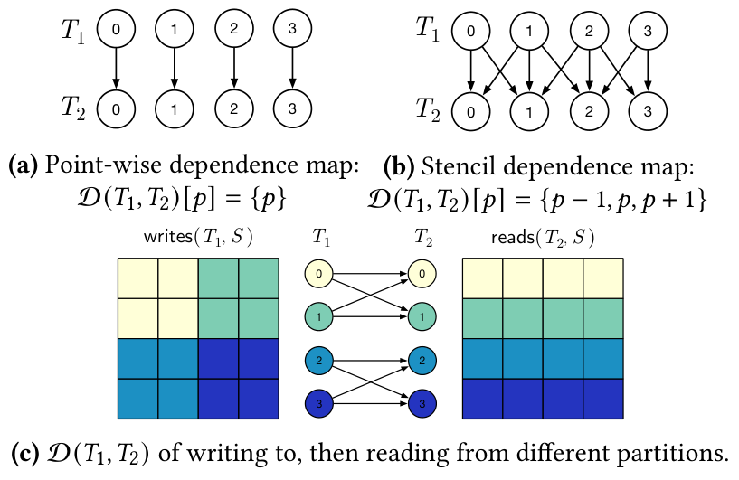
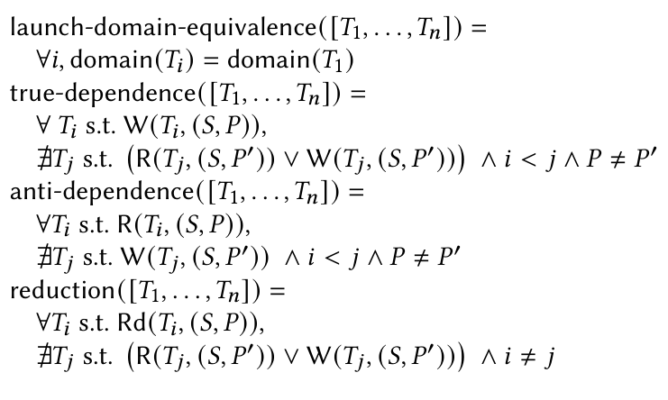
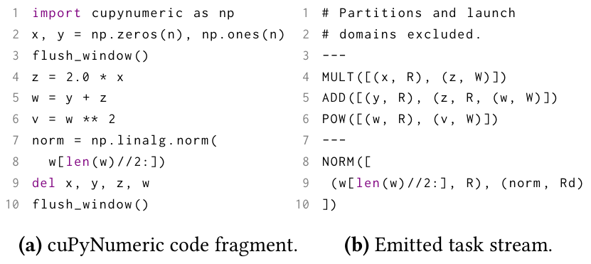
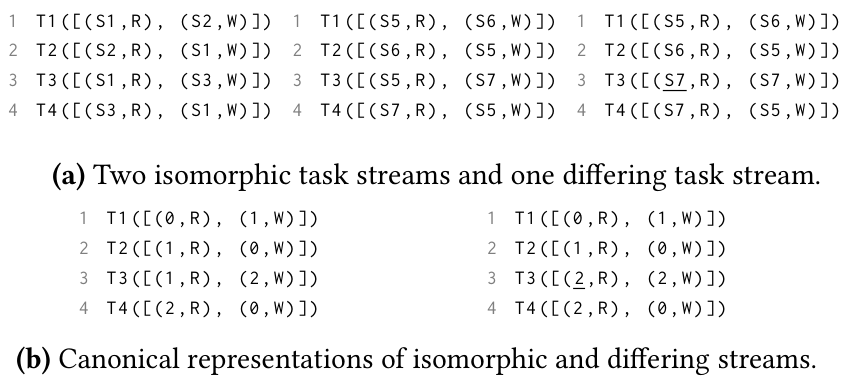
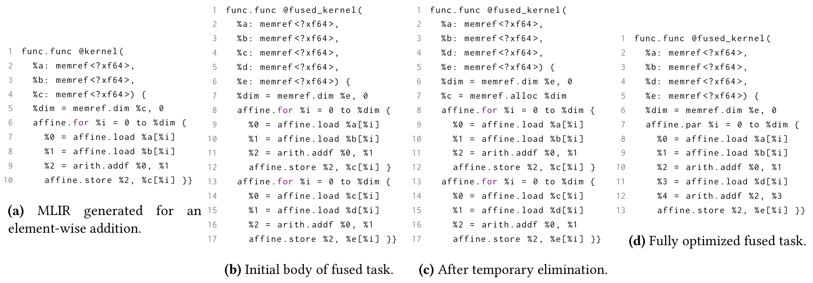

# Composing Distributed Computations Through Task and Kernel Fusion

[返回图集](../README.md) · Diffuse / Fusion · ASPLOS 2025 · 8张非实验图

研究对象：编译器、语言与中间表示 / Diffuse分布式任务与内核融合IR及编译系统

本页仅显示以下非实验图，不包含原论文全部图组。混合图在子图分离复核完成前暂不收录。

版本许可依据：[来源](https://rohany.github.io/publications/asplos2025-fusion.pdf#page=1)。源PDF SHA256：`0eb2eba96c8a4804e454c4ca55e828ce4e612280f7f0281a4d559ca52061e1e0`。PDF不随库分发。

## 图号导航

[F1](#f1) · [F2](#f2) · [F3](#f3) · [F4](#f4) · [F5](#f5) · [F6](#f6) · [F7](#f7) · [F8](#f8)

## F1

**非实验图 · 分布式融合执行示例**

[原文物理页 2](https://rohany.github.io/publications/asplos2025-fusion.pdf#page=2) · [许可证 CC BY 4.0](https://creativecommons.org/licenses/by/4.0/)

署名：Rohan Yadav, Shiv Sundram, Wonchan Lee, Michael Garland, Michael Bauer, Alex Aiken, Fredrik Kjolstad. Composing Distributed Computations Through Task and Kernel Fusion. ASPLOS 2025, Volume 1. DOI: https://doi.org/10.1145/3669940.3707216. Version: Exact preserved 16-page conference-layout author PDF. Source: https://rohany.github.io/publications/asplos2025-fusion.pdf. CC BY 4.0: https://creativecommons.org/licenses/by/4.0/. Whole figures cropped from this exact PDF and rasterized at 240 dpi; captions excluded, all figure content unchanged. No endorsement implied.

修改说明：Whole figure cropped from the specified source PDF and rasterized at 240 dpi; numbered caption excluded, figure content unchanged.

## F2

**非实验图 · 中间表示与数据模型**

[原文物理页 3](https://rohany.github.io/publications/asplos2025-fusion.pdf#page=3) · [许可证 CC BY 4.0](https://creativecommons.org/licenses/by/4.0/)

署名：Rohan Yadav, Shiv Sundram, Wonchan Lee, Michael Garland, Michael Bauer, Alex Aiken, Fredrik Kjolstad. Composing Distributed Computations Through Task and Kernel Fusion. ASPLOS 2025, Volume 1. DOI: https://doi.org/10.1145/3669940.3707216. Version: Exact preserved 16-page conference-layout author PDF. Source: https://rohany.github.io/publications/asplos2025-fusion.pdf. CC BY 4.0: https://creativecommons.org/licenses/by/4.0/. Whole figures cropped from this exact PDF and rasterized at 240 dpi; captions excluded, all figure content unchanged. No endorsement implied.

修改说明：Whole figure cropped from the specified source PDF and rasterized at 240 dpi; numbered caption excluded, figure content unchanged.

## F3

**非实验图 · 数据分块映射**

[原文物理页 4](https://rohany.github.io/publications/asplos2025-fusion.pdf#page=4) · [许可证 CC BY 4.0](https://creativecommons.org/licenses/by/4.0/)

署名：Rohan Yadav, Shiv Sundram, Wonchan Lee, Michael Garland, Michael Bauer, Alex Aiken, Fredrik Kjolstad. Composing Distributed Computations Through Task and Kernel Fusion. ASPLOS 2025, Volume 1. DOI: https://doi.org/10.1145/3669940.3707216. Version: Exact preserved 16-page conference-layout author PDF. Source: https://rohany.github.io/publications/asplos2025-fusion.pdf. CC BY 4.0: https://creativecommons.org/licenses/by/4.0/. Whole figures cropped from this exact PDF and rasterized at 240 dpi; captions excluded, all figure content unchanged. No endorsement implied.

修改说明：Whole figure cropped from the specified source PDF and rasterized at 240 dpi; numbered caption excluded, figure content unchanged.

## F4

**非实验图 · 任务依赖映射**

[原文物理页 5](https://rohany.github.io/publications/asplos2025-fusion.pdf#page=5) · [许可证 CC BY 4.0](https://creativecommons.org/licenses/by/4.0/)

署名：Rohan Yadav, Shiv Sundram, Wonchan Lee, Michael Garland, Michael Bauer, Alex Aiken, Fredrik Kjolstad. Composing Distributed Computations Through Task and Kernel Fusion. ASPLOS 2025, Volume 1. DOI: https://doi.org/10.1145/3669940.3707216. Version: Exact preserved 16-page conference-layout author PDF. Source: https://rohany.github.io/publications/asplos2025-fusion.pdf. CC BY 4.0: https://creativecommons.org/licenses/by/4.0/. Whole figures cropped from this exact PDF and rasterized at 240 dpi; captions excluded, all figure content unchanged. No endorsement implied.

修改说明：Whole figure cropped from the specified source PDF and rasterized at 240 dpi; numbered caption excluded, figure content unchanged.

## F5

**非实验图 · 融合合法性约束**

[原文物理页 6](https://rohany.github.io/publications/asplos2025-fusion.pdf#page=6) · [许可证 CC BY 4.0](https://creativecommons.org/licenses/by/4.0/)

署名：Rohan Yadav, Shiv Sundram, Wonchan Lee, Michael Garland, Michael Bauer, Alex Aiken, Fredrik Kjolstad. Composing Distributed Computations Through Task and Kernel Fusion. ASPLOS 2025, Volume 1. DOI: https://doi.org/10.1145/3669940.3707216. Version: Exact preserved 16-page conference-layout author PDF. Source: https://rohany.github.io/publications/asplos2025-fusion.pdf. CC BY 4.0: https://creativecommons.org/licenses/by/4.0/. Whole figures cropped from this exact PDF and rasterized at 240 dpi; captions excluded, all figure content unchanged. No endorsement implied.

修改说明：Whole figure cropped from the specified source PDF and rasterized at 240 dpi; numbered caption excluded, figure content unchanged.

## F6

**非实验图 · 任务流与临时变量**

[原文物理页 7](https://rohany.github.io/publications/asplos2025-fusion.pdf#page=7) · [许可证 CC BY 4.0](https://creativecommons.org/licenses/by/4.0/)

署名：Rohan Yadav, Shiv Sundram, Wonchan Lee, Michael Garland, Michael Bauer, Alex Aiken, Fredrik Kjolstad. Composing Distributed Computations Through Task and Kernel Fusion. ASPLOS 2025, Volume 1. DOI: https://doi.org/10.1145/3669940.3707216. Version: Exact preserved 16-page conference-layout author PDF. Source: https://rohany.github.io/publications/asplos2025-fusion.pdf. CC BY 4.0: https://creativecommons.org/licenses/by/4.0/. Whole figures cropped from this exact PDF and rasterized at 240 dpi; captions excluded, all figure content unchanged. No endorsement implied.

修改说明：Whole figure cropped from the specified source PDF and rasterized at 240 dpi; numbered caption excluded, figure content unchanged.

## F7

**非实验图 · 任务流规范化**

[原文物理页 8](https://rohany.github.io/publications/asplos2025-fusion.pdf#page=8) · [许可证 CC BY 4.0](https://creativecommons.org/licenses/by/4.0/)

图 7(b) 的 T3 读取索引存在源内疑点；未经运行或作者勘误确认，原图不修改。

署名：Rohan Yadav, Shiv Sundram, Wonchan Lee, Michael Garland, Michael Bauer, Alex Aiken, Fredrik Kjolstad. Composing Distributed Computations Through Task and Kernel Fusion. ASPLOS 2025, Volume 1. DOI: https://doi.org/10.1145/3669940.3707216. Version: Exact preserved 16-page conference-layout author PDF. Source: https://rohany.github.io/publications/asplos2025-fusion.pdf. CC BY 4.0: https://creativecommons.org/licenses/by/4.0/. Whole figures cropped from this exact PDF and rasterized at 240 dpi; captions excluded, all figure content unchanged. No endorsement implied.

修改说明：Whole figure cropped from the specified source PDF and rasterized at 240 dpi; numbered caption excluded, figure content unchanged.

## F8

**非实验图 · 内核融合编译过程**

[原文物理页 9](https://rohany.github.io/publications/asplos2025-fusion.pdf#page=9) · [许可证 CC BY 4.0](https://creativecommons.org/licenses/by/4.0/)

图 8(d) 的 %4 计算后接 %2 写入存在源内疑点；原样保留。

署名：Rohan Yadav, Shiv Sundram, Wonchan Lee, Michael Garland, Michael Bauer, Alex Aiken, Fredrik Kjolstad. Composing Distributed Computations Through Task and Kernel Fusion. ASPLOS 2025, Volume 1. DOI: https://doi.org/10.1145/3669940.3707216. Version: Exact preserved 16-page conference-layout author PDF. Source: https://rohany.github.io/publications/asplos2025-fusion.pdf. CC BY 4.0: https://creativecommons.org/licenses/by/4.0/. Whole figures cropped from this exact PDF and rasterized at 240 dpi; captions excluded, all figure content unchanged. No endorsement implied.

修改说明：Whole figure cropped from the specified source PDF and rasterized at 240 dpi; numbered caption excluded, figure content unchanged.

