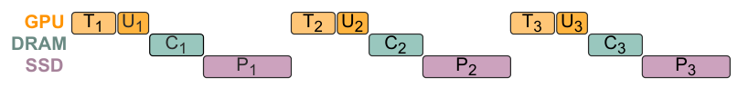
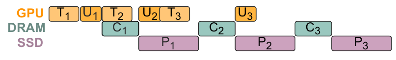
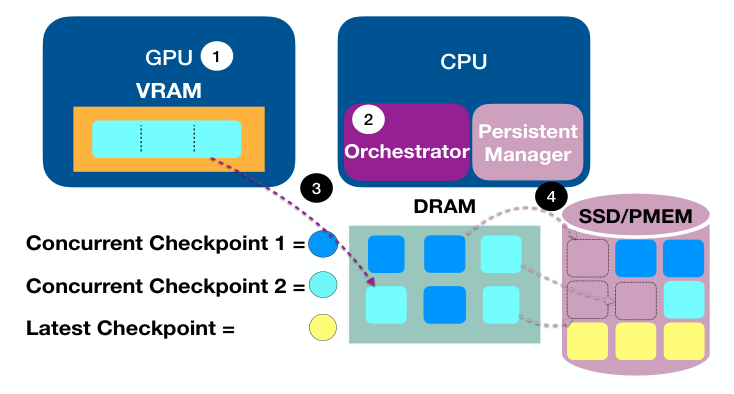
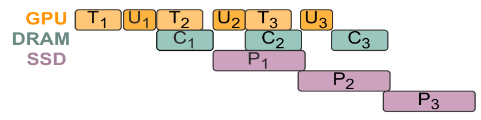
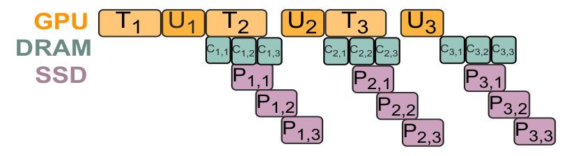

# PCcheck: Persistent Concurrent Checkpointing for ML

[返回图集](../README.md) · PCcheck · ASPLOS 2025 · 5张非实验图

研究对象：运行时与调度系统 / PCcheck持久并发检查点运行时

本页仅显示以下非实验图，不包含原论文全部图组。混合图在子图分离复核完成前暂不收录。

版本许可依据：[来源](https://anakli.inf.ethz.ch/papers/PCcheck_asplos25.pdf#page=1)。源PDF SHA256：`263bc02b09b850a99c4adabc2eb9df99606c456dbf62244ccf6a698ddb16cd61`。PDF不随库分发。

## 图号导航

[F3](#f3) · [F4](#f4) · [F5](#f5) · [F6](#f6) · [F7](#f7)

## F3

**非实验图 · 传统检查点执行时序图**

[原文物理页 3](https://anakli.inf.ethz.ch/papers/PCcheck_asplos25.pdf#page=3) · [许可证 CC BY 4.0](https://creativecommons.org/licenses/by/4.0/)

署名：Foteini Strati, Michal Friedman, Ana Klimovic. PCcheck: Persistent Concurrent Checkpointing for ML. ASPLOS 2025, Volume 1. DOI: https://doi.org/10.1145/3669940.3707255. Version: Exact frozen author-hosted ACM conference-layout PDF, printed pages 811–827; publisher binary equivalence not asserted. Source: https://anakli.inf.ethz.ch/papers/PCcheck_asplos25.pdf. CC BY 4.0: https://creativecommons.org/licenses/by/4.0/. Whole figures cropped from this exact PDF and rasterized at 240 dpi; captions excluded, all figure content unchanged. No endorsement implied.

修改说明：Whole figure cropped from the specified source PDF and rasterized at 240 dpi; numbered caption excluded, figure content unchanged.

## F4

**非实验图 · 训练与检查点复制重叠图**

[原文物理页 3](https://anakli.inf.ethz.ch/papers/PCcheck_asplos25.pdf#page=3) · [许可证 CC BY 4.0](https://creativecommons.org/licenses/by/4.0/)

署名：Foteini Strati, Michal Friedman, Ana Klimovic. PCcheck: Persistent Concurrent Checkpointing for ML. ASPLOS 2025, Volume 1. DOI: https://doi.org/10.1145/3669940.3707255. Version: Exact frozen author-hosted ACM conference-layout PDF, printed pages 811–827; publisher binary equivalence not asserted. Source: https://anakli.inf.ethz.ch/papers/PCcheck_asplos25.pdf. CC BY 4.0: https://creativecommons.org/licenses/by/4.0/. Whole figures cropped from this exact PDF and rasterized at 240 dpi; captions excluded, all figure content unchanged. No endorsement implied.

修改说明：Whole figure cropped from the specified source PDF and rasterized at 240 dpi; numbered caption excluded, figure content unchanged.

## F5

**非实验图 · 并发检查点系统架构图**

[原文物理页 4](https://anakli.inf.ethz.ch/papers/PCcheck_asplos25.pdf#page=4) · [许可证 CC BY 4.0](https://creativecommons.org/licenses/by/4.0/)

署名：Foteini Strati, Michal Friedman, Ana Klimovic. PCcheck: Persistent Concurrent Checkpointing for ML. ASPLOS 2025, Volume 1. DOI: https://doi.org/10.1145/3669940.3707255. Version: Exact frozen author-hosted ACM conference-layout PDF, printed pages 811–827; publisher binary equivalence not asserted. Source: https://anakli.inf.ethz.ch/papers/PCcheck_asplos25.pdf. CC BY 4.0: https://creativecommons.org/licenses/by/4.0/. Whole figures cropped from this exact PDF and rasterized at 240 dpi; captions excluded, all figure content unchanged. No endorsement implied.

修改说明：Whole figure cropped from the specified source PDF and rasterized at 240 dpi; numbered caption excluded, figure content unchanged.

## F6

**非实验图 · 并发检查点执行时序图**

[原文物理页 5](https://anakli.inf.ethz.ch/papers/PCcheck_asplos25.pdf#page=5) · [许可证 CC BY 4.0](https://creativecommons.org/licenses/by/4.0/)

署名：Foteini Strati, Michal Friedman, Ana Klimovic. PCcheck: Persistent Concurrent Checkpointing for ML. ASPLOS 2025, Volume 1. DOI: https://doi.org/10.1145/3669940.3707255. Version: Exact frozen author-hosted ACM conference-layout PDF, printed pages 811–827; publisher binary equivalence not asserted. Source: https://anakli.inf.ethz.ch/papers/PCcheck_asplos25.pdf. CC BY 4.0: https://creativecommons.org/licenses/by/4.0/. Whole figures cropped from this exact PDF and rasterized at 240 dpi; captions excluded, all figure content unchanged. No endorsement implied.

修改说明：Whole figure cropped from the specified source PDF and rasterized at 240 dpi; numbered caption excluded, figure content unchanged.

## F7

**非实验图 · 分块检查点流水线图**

[原文物理页 5](https://anakli.inf.ethz.ch/papers/PCcheck_asplos25.pdf#page=5) · [许可证 CC BY 4.0](https://creativecommons.org/licenses/by/4.0/)

署名：Foteini Strati, Michal Friedman, Ana Klimovic. PCcheck: Persistent Concurrent Checkpointing for ML. ASPLOS 2025, Volume 1. DOI: https://doi.org/10.1145/3669940.3707255. Version: Exact frozen author-hosted ACM conference-layout PDF, printed pages 811–827; publisher binary equivalence not asserted. Source: https://anakli.inf.ethz.ch/papers/PCcheck_asplos25.pdf. CC BY 4.0: https://creativecommons.org/licenses/by/4.0/. Whole figures cropped from this exact PDF and rasterized at 240 dpi; captions excluded, all figure content unchanged. No endorsement implied.

修改说明：Whole figure cropped from the specified source PDF and rasterized at 240 dpi; numbered caption excluded, figure content unchanged.

