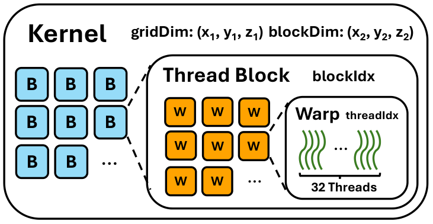
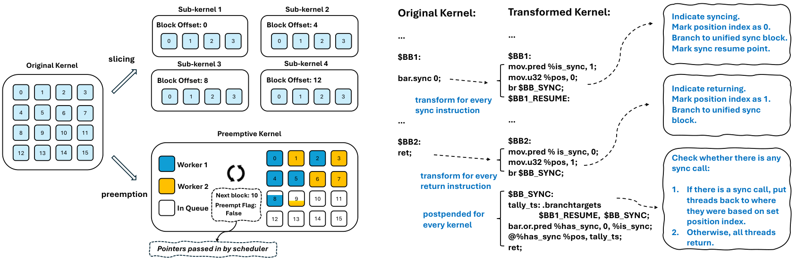
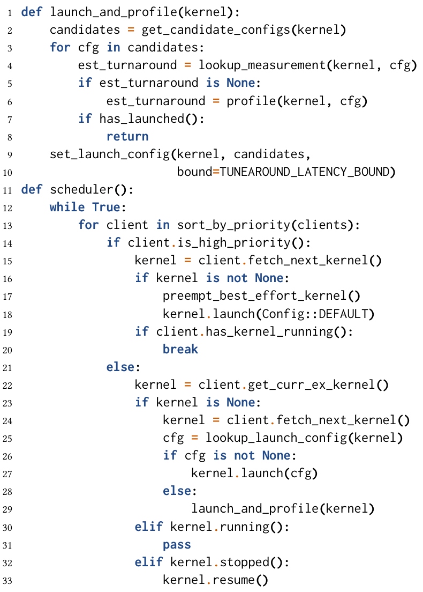

# Tally: Non-Intrusive Performance Isolation for Concurrent Deep Learning Workloads

[返回图集](../README.md) · Tally · ASPLOS 2025 · 3张非实验图

研究对象：运行时与调度系统 / Tally GPU共享与优先级调度运行时

本页仅显示以下非实验图，不包含原论文全部图组。混合图在子图分离复核完成前暂不收录。

未收录图片不代表获得公开再分发许可。 本图库当前收录3张非实验图：F1、F3、F4。

版本许可依据：[来源](https://arxiv.org/abs/2410.07381v3)。源PDF SHA256：`27e82c82b0659d49207e91cb4ad9addfd92e48658f4c987ad5f5c5057f6de95d`。PDF不随库分发。

## 图号导航

[F1](#f1) · [F3](#f3) · [F4](#f4)

## F1

**非实验图 · GPU线程层级示意图**

[原文物理页 3](https://arxiv.org/pdf/2410.07381v3#page=3) · [许可证 CC BY 4.0](https://creativecommons.org/licenses/by/4.0/)

署名：Wei Zhao, Anand Jayarajan, Gennady Pekhimenko. Tally: Non-Intrusive Performance Isolation for Concurrent Deep Learning Workloads. ASPLOS 2025, Volume 1. DOI: https://doi.org/10.1145/3669940.3707282. Version: arXiv:2410.07381v3, 28 February 2025; exact frozen conference-layout manuscript. Source: https://arxiv.org/pdf/2410.07381v3. CC BY 4.0: https://creativecommons.org/licenses/by/4.0/. Whole figures cropped from this exact PDF and rasterized at 240 dpi; captions excluded, all figure content unchanged. No endorsement implied.

修改说明：Whole figure cropped from the specified source PDF and rasterized at 240 dpi; numbered caption excluded, figure content unchanged.

## F3

**非实验图 · 内核切分与抢占变换图**

[原文物理页 6](https://arxiv.org/pdf/2410.07381v3#page=6) · [许可证 CC BY 4.0](https://creativecommons.org/licenses/by/4.0/)

署名：Wei Zhao, Anand Jayarajan, Gennady Pekhimenko. Tally: Non-Intrusive Performance Isolation for Concurrent Deep Learning Workloads. ASPLOS 2025, Volume 1. DOI: https://doi.org/10.1145/3669940.3707282. Version: arXiv:2410.07381v3, 28 February 2025; exact frozen conference-layout manuscript. Source: https://arxiv.org/pdf/2410.07381v3. CC BY 4.0: https://creativecommons.org/licenses/by/4.0/. Whole figures cropped from this exact PDF and rasterized at 240 dpi; captions excluded, all figure content unchanged. No endorsement implied.

修改说明：Whole figure cropped from the specified source PDF and rasterized at 240 dpi; numbered caption excluded, figure content unchanged.

## F4

**非实验图 · 优先级调度伪代码图**

[原文物理页 7](https://arxiv.org/pdf/2410.07381v3#page=7) · [许可证 CC BY 4.0](https://creativecommons.org/licenses/by/4.0/)

署名：Wei Zhao, Anand Jayarajan, Gennady Pekhimenko. Tally: Non-Intrusive Performance Isolation for Concurrent Deep Learning Workloads. ASPLOS 2025, Volume 1. DOI: https://doi.org/10.1145/3669940.3707282. Version: arXiv:2410.07381v3, 28 February 2025; exact frozen conference-layout manuscript. Source: https://arxiv.org/pdf/2410.07381v3. CC BY 4.0: https://creativecommons.org/licenses/by/4.0/. Whole figures cropped from this exact PDF and rasterized at 240 dpi; captions excluded, all figure content unchanged. No endorsement implied.

修改说明：Whole figure cropped from the specified source PDF and rasterized at 240 dpi; numbered caption excluded, figure content unchanged.

