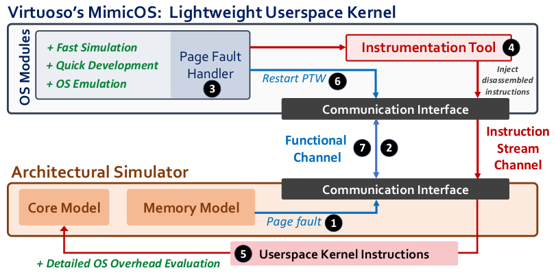
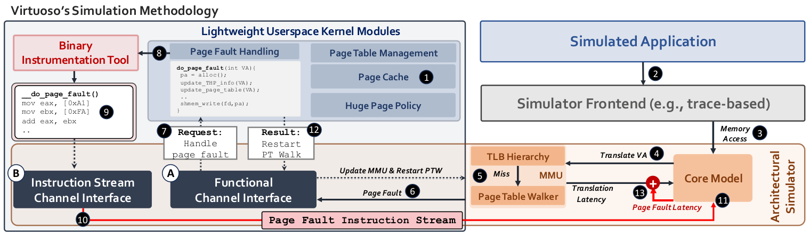
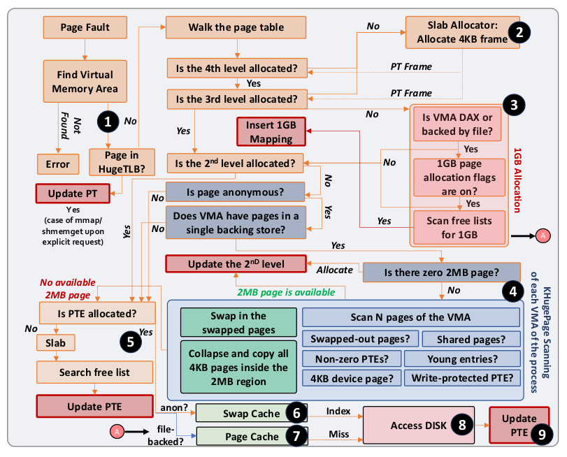
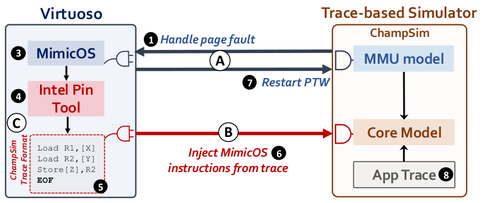

# Virtuoso: Enabling Fast and Accurate Virtual Memory Research via an Imitation-based Operating System Simulation Methodology

[返回图集](../README.md) · Virtuoso · ASPLOS 2025 / arXiv v2 · 4张非实验图

研究对象：模拟器与仿真平台 / Virtuoso操作系统与体系结构协同仿真平台

本页仅显示以下非实验图，不包含原论文全部图组。混合图在子图分离复核完成前暂不收录。

版本许可依据：[来源](https://arxiv.org/abs/2403.04635v2)。源PDF SHA256：`4e02b4c93066ef4891ddf3730aebb46c0caeae329b63afd72f4ca84f480b61f9`。PDF不随库分发。

## 图号导航

[F4](#f4) · [F5](#f5) · [F6](#f6) · [F7](#f7)

## F4

**非实验图 · 轻量内核仿真系统架构图**

[原文物理页 6](https://arxiv.org/pdf/2403.04635v2#page=6) · [许可证 CC0 1.0](https://creativecommons.org/publicdomain/zero/1.0/)

署名：Konstantinos Kanellopoulos, Konstantinos Sgouras, F. Nisa Bostanci, Andreas Kosmas Kakolyris, Berkin Kerim Konar, Rahul Bera, Mohammad Sadrosadati, Rakesh Kumar, Nandita Vijaykumar, Onur Mutlu. Virtuoso: Enabling Fast and Accurate Virtual Memory Research via an Imitation-based Operating System Simulation Methodology. ASPLOS 2025; arXiv author version. DOI: https://doi.org/10.1145/3676641.3716027. Version: arXiv:2403.04635v2, 27 March 2025, 22-page author manuscript; publisher binary equivalence not asserted. Source: https://arxiv.org/pdf/2403.04635v2. CC0 1.0 Universal: https://creativecommons.org/publicdomain/zero/1.0/. Whole figures cropped from this exact PDF and rasterized at 240 dpi; captions excluded, all figure content unchanged. No endorsement implied.

修改说明：Whole figure cropped from the specified source PDF and rasterized at 240 dpi; numbered caption excluded, figure content unchanged.

## F5

**非实验图 · 缺页处理仿真工作流图**

[原文物理页 8](https://arxiv.org/pdf/2403.04635v2#page=8) · [许可证 CC0 1.0](https://creativecommons.org/publicdomain/zero/1.0/)

署名：Konstantinos Kanellopoulos, Konstantinos Sgouras, F. Nisa Bostanci, Andreas Kosmas Kakolyris, Berkin Kerim Konar, Rahul Bera, Mohammad Sadrosadati, Rakesh Kumar, Nandita Vijaykumar, Onur Mutlu. Virtuoso: Enabling Fast and Accurate Virtual Memory Research via an Imitation-based Operating System Simulation Methodology. ASPLOS 2025; arXiv author version. DOI: https://doi.org/10.1145/3676641.3716027. Version: arXiv:2403.04635v2, 27 March 2025, 22-page author manuscript; publisher binary equivalence not asserted. Source: https://arxiv.org/pdf/2403.04635v2. CC0 1.0 Universal: https://creativecommons.org/publicdomain/zero/1.0/. Whole figures cropped from this exact PDF and rasterized at 240 dpi; captions excluded, all figure content unchanged. No endorsement implied.

修改说明：Whole figure cropped from the specified source PDF and rasterized at 240 dpi; numbered caption excluded, figure content unchanged.

## F6

**非实验图 · 内存管理决策流程图**

[原文物理页 8](https://arxiv.org/pdf/2403.04635v2#page=8) · [许可证 CC0 1.0](https://creativecommons.org/publicdomain/zero/1.0/)

署名：Konstantinos Kanellopoulos, Konstantinos Sgouras, F. Nisa Bostanci, Andreas Kosmas Kakolyris, Berkin Kerim Konar, Rahul Bera, Mohammad Sadrosadati, Rakesh Kumar, Nandita Vijaykumar, Onur Mutlu. Virtuoso: Enabling Fast and Accurate Virtual Memory Research via an Imitation-based Operating System Simulation Methodology. ASPLOS 2025; arXiv author version. DOI: https://doi.org/10.1145/3676641.3716027. Version: arXiv:2403.04635v2, 27 March 2025, 22-page author manuscript; publisher binary equivalence not asserted. Source: https://arxiv.org/pdf/2403.04635v2. CC0 1.0 Universal: https://creativecommons.org/publicdomain/zero/1.0/. Whole figures cropped from this exact PDF and rasterized at 240 dpi; captions excluded, all figure content unchanged. No endorsement implied.

修改说明：Whole figure cropped from the specified source PDF and rasterized at 240 dpi; numbered caption excluded, figure content unchanged.

## F7

**非实验图 · 轨迹驱动模拟器集成图**

[原文物理页 9](https://arxiv.org/pdf/2403.04635v2#page=9) · [许可证 CC0 1.0](https://creativecommons.org/publicdomain/zero/1.0/)

署名：Konstantinos Kanellopoulos, Konstantinos Sgouras, F. Nisa Bostanci, Andreas Kosmas Kakolyris, Berkin Kerim Konar, Rahul Bera, Mohammad Sadrosadati, Rakesh Kumar, Nandita Vijaykumar, Onur Mutlu. Virtuoso: Enabling Fast and Accurate Virtual Memory Research via an Imitation-based Operating System Simulation Methodology. ASPLOS 2025; arXiv author version. DOI: https://doi.org/10.1145/3676641.3716027. Version: arXiv:2403.04635v2, 27 March 2025, 22-page author manuscript; publisher binary equivalence not asserted. Source: https://arxiv.org/pdf/2403.04635v2. CC0 1.0 Universal: https://creativecommons.org/publicdomain/zero/1.0/. Whole figures cropped from this exact PDF and rasterized at 240 dpi; captions excluded, all figure content unchanged. No endorsement implied.

修改说明：Whole figure cropped from the specified source PDF and rasterized at 240 dpi; numbered caption excluded, figure content unchanged.

