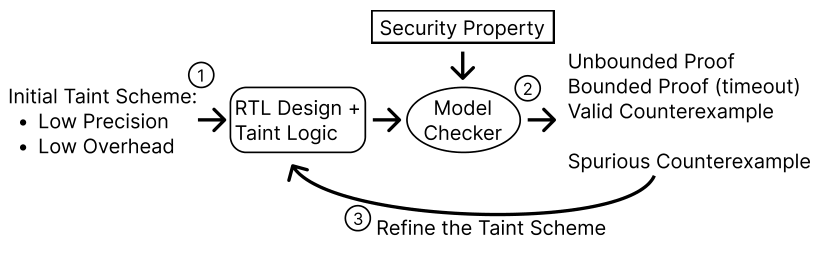
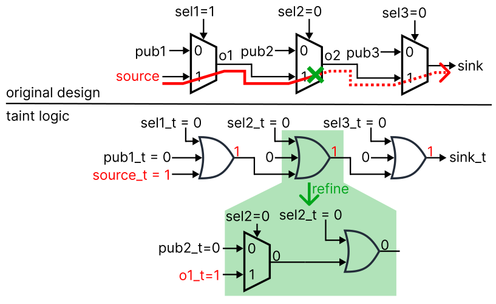
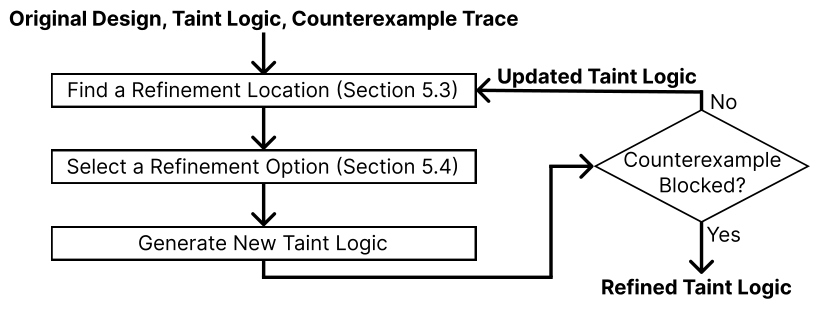
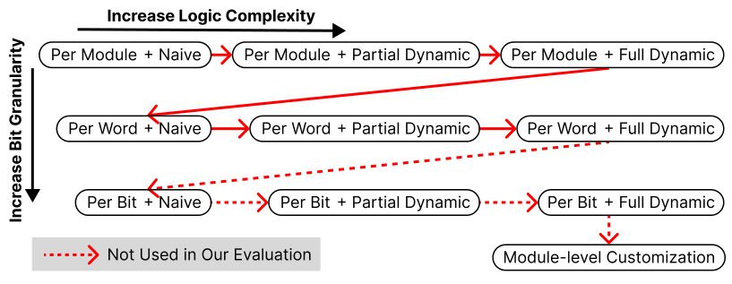

# Compass: Navigating the Design Space of Taint Schemes for RTL Security Verification

[返回图集](../README.md) · Compass · ASPLOS 2026 · 4张非实验图

研究对象：RTL验证、生成与修复工具 / Compass RTL信息流污点验证工具

本页仅显示以下非实验图，不包含原论文全部图组。混合图在子图分离复核完成前暂不收录。

版本许可依据：[来源](https://people.csail.mit.edu/mengjia/data/2026.ASPLOS.Compass.pdf#page=1)。源PDF SHA256：`476e9189151318b8d0d4da1b28efebb479da55e316c1ebfe18fd3c57914846be`。PDF不随库分发。

## 图号导航

[F1](#f1) · [F2](#f2) · [F3](#f3) · [F4](#f4)

## F1

**非实验图 · 污点验证总体流程图**

[原文物理页 5](https://people.csail.mit.edu/mengjia/data/2026.ASPLOS.Compass.pdf#page=5) · [许可证 CC BY 4.0](https://creativecommons.org/licenses/by/4.0/)

署名：Yuheng Yang, Qinhan Tan, Thomas Bourgeat, Sharad Malik, Mengjia Yan. Compass: Navigating the Design Space of Taint Schemes for RTL Security Verification. ASPLOS 2026, Volume 2. DOI: https://doi.org/10.1145/3779212.3790144. Version: Exact author-hosted ACM ASPLOS 2026 Volume 2 conference-layout PDF; no publisher-binary equivalence claimed. Copyright 2026 the owner/authors. Source: https://people.csail.mit.edu/mengjia/data/2026.ASPLOS.Compass.pdf. CC BY 4.0: https://creativecommons.org/licenses/by/4.0/. Whole figures cropped from this exact PDF and rasterized at 240 dpi; numbered captions excluded, figure content unchanged. No endorsement implied.

修改说明：Whole figure cropped from the specified source PDF and rasterized at 240 dpi; numbered caption excluded, figure content unchanged.

## F2

**非实验图 · 污点传播与细化电路示例**

[原文物理页 6](https://people.csail.mit.edu/mengjia/data/2026.ASPLOS.Compass.pdf#page=6) · [许可证 CC BY 4.0](https://creativecommons.org/licenses/by/4.0/)

署名：Yuheng Yang, Qinhan Tan, Thomas Bourgeat, Sharad Malik, Mengjia Yan. Compass: Navigating the Design Space of Taint Schemes for RTL Security Verification. ASPLOS 2026, Volume 2. DOI: https://doi.org/10.1145/3779212.3790144. Version: Exact author-hosted ACM ASPLOS 2026 Volume 2 conference-layout PDF; no publisher-binary equivalence claimed. Copyright 2026 the owner/authors. Source: https://people.csail.mit.edu/mengjia/data/2026.ASPLOS.Compass.pdf. CC BY 4.0: https://creativecommons.org/licenses/by/4.0/. Whole figures cropped from this exact PDF and rasterized at 240 dpi; numbered captions excluded, figure content unchanged. No endorsement implied.

修改说明：Whole figure cropped from the specified source PDF and rasterized at 240 dpi; numbered caption excluded, figure content unchanged.

## F3

**非实验图 · 污点方案迭代细化流程图**

[原文物理页 7](https://people.csail.mit.edu/mengjia/data/2026.ASPLOS.Compass.pdf#page=7) · [许可证 CC BY 4.0](https://creativecommons.org/licenses/by/4.0/)

署名：Yuheng Yang, Qinhan Tan, Thomas Bourgeat, Sharad Malik, Mengjia Yan. Compass: Navigating the Design Space of Taint Schemes for RTL Security Verification. ASPLOS 2026, Volume 2. DOI: https://doi.org/10.1145/3779212.3790144. Version: Exact author-hosted ACM ASPLOS 2026 Volume 2 conference-layout PDF; no publisher-binary equivalence claimed. Copyright 2026 the owner/authors. Source: https://people.csail.mit.edu/mengjia/data/2026.ASPLOS.Compass.pdf. CC BY 4.0: https://creativecommons.org/licenses/by/4.0/. Whole figures cropped from this exact PDF and rasterized at 240 dpi; numbered captions excluded, figure content unchanged. No endorsement implied.

修改说明：Whole figure cropped from the specified source PDF and rasterized at 240 dpi; numbered caption excluded, figure content unchanged.

## F4

**非实验图 · 细化策略优先级图**

[原文物理页 8](https://people.csail.mit.edu/mengjia/data/2026.ASPLOS.Compass.pdf#page=8) · [许可证 CC BY 4.0](https://creativecommons.org/licenses/by/4.0/)

署名：Yuheng Yang, Qinhan Tan, Thomas Bourgeat, Sharad Malik, Mengjia Yan. Compass: Navigating the Design Space of Taint Schemes for RTL Security Verification. ASPLOS 2026, Volume 2. DOI: https://doi.org/10.1145/3779212.3790144. Version: Exact author-hosted ACM ASPLOS 2026 Volume 2 conference-layout PDF; no publisher-binary equivalence claimed. Copyright 2026 the owner/authors. Source: https://people.csail.mit.edu/mengjia/data/2026.ASPLOS.Compass.pdf. CC BY 4.0: https://creativecommons.org/licenses/by/4.0/. Whole figures cropped from this exact PDF and rasterized at 240 dpi; numbered captions excluded, figure content unchanged. No endorsement implied.

修改说明：Whole figure cropped from the specified source PDF and rasterized at 240 dpi; numbered caption excluded, figure content unchanged.

