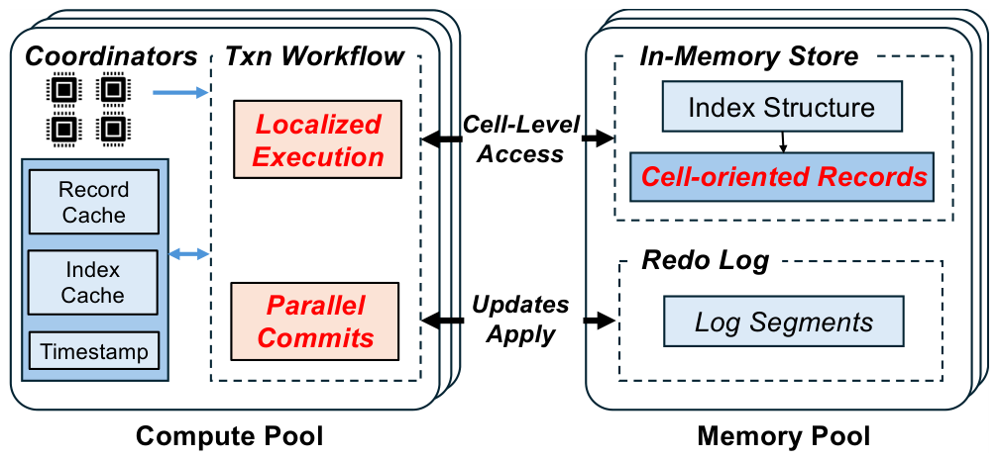
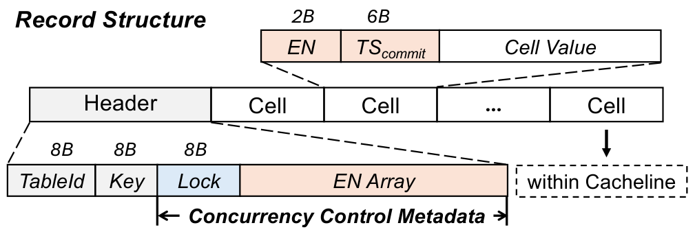

# CREST: High-Performance Contention Resolution for Disaggregated Transactions

[返回图集](../README.md) · CREST · ASPLOS 2026 · 样本外补充

研究对象：并发与故障语义模型 / CREST分离式内存事务系统的cell级并发控制（样本外补充）

18个物理页的作者Git版本，含一页ACM封面，正文版权页为物理p2；仅收完整非实验F5/F6。样本外补充，不计入固定100篇；不混用去封面后的页码。

读图路径：F5 → F6。先找谁发起 RDMA 访问、记录和 redo log 放在哪里，再看记录头的汇集元数据与各 cell 的 EN、提交时间戳和值如何分开。这里的 cell 是记录中的列字段，不是计算核心。

对照 [XTRA F3](sosp-2026-xtra.md#f3)：XTRA 在共享 CXL 池中设置独立的 Coordination Directory 存锁与版本；CREST 在记录头聚合 Lock 与 EN Array，并在各 cell 中保留版本和值。练习：分别圈出协调者取得同步状态需要访问的区域。比较的是布局与访问边界，不说明两者协议等价，也不能据图推导性能优劣。

版本与许可：[固定作者Git文件](https://github.com/millyz/millyz.github.io/blob/e912ce27ad0908808186bdd3156081217e56853b/pubs/asplos26crest.pdf)，2,974,646字节、18个物理页（ACM封面加17页正文）。物理第2页可见 CC BY 4.0、作者版权声明及 DOI 10.1145/3779212.3790148。Git blob：`58431c04f1616ff0ef59373d12551f7a9ad89be0`；源PDF SHA-256：`8959c95983881113fa914d9ef6afae5b50ad462b15b307d323b755578dd5eb03`。已目视核对版权页、物理p5/p6整页、图注和最终裁图，并核对 §3、§4.1–4.2；未发现F5/F6中的第三方署名或单图许可例外。不上传PDF，不声称已对其余图完成审核。

## F5

**非实验图 · 计算池与内存池的事务架构**

[原文物理页5](https://raw.githubusercontent.com/millyz/millyz.github.io/e912ce27ad0908808186bdd3156081217e56853b/pubs/asplos26crest.pdf#page=5) · [许可证 CC BY 4.0](https://creativecommons.org/licenses/by/4.0/)

先在计算池找协调器、记录缓存、索引缓存与时间戳，再沿跨池访问追到内存池中的 cell-oriented records 和 redo log。结合 §3：本地执行把未提交结果写到本节点记录缓存，平行提交使用跟踪依赖的 redo logging；图中的工作流与存储区域是职责分工，不是性能测量。 样本外补充，不计入固定100篇覆盖。

署名：Qihan Kang, Mi Zhang, Patrick P. C. Lee, and Yongkang Hu. CREST: High-Performance Contention Resolution for Disaggregated Transactions. ASPLOS 2026. DOI: https://doi.org/10.1145/3779212.3790148. Copyright 2026 held by the owner/author(s). Source: https://github.com/millyz/millyz.github.io/blob/e912ce27ad0908808186bdd3156081217e56853b/pubs/asplos26crest.pdf. Version: 18-physical-page author-hosted ASPLOS 2026 PDF (one ACM cover plus 17 article pages), Git commit e912ce27ad0908808186bdd3156081217e56853b, blob 58431c04f1616ff0ef59373d12551f7a9ad89be0; not independently asserted publisher-byte-identical. CC BY 4.0: https://creativecommons.org/licenses/by/4.0/. Whole figure cropped from the exact author-hosted PDF and rasterized at 300 dpi; caption and adjacent figures/text excluded, all diagram labels and boundaries retained; no redrawing or recoloring. No endorsement implied.

修改说明：Whole figure cropped from the exact author-hosted PDF and rasterized at 300 dpi; caption and adjacent figures/text excluded, all diagram labels and boundaries retained; no redrawing or recoloring.

## F6

**非实验图 · 记录头与 cell 的元数据布局**

[原文物理页6](https://raw.githubusercontent.com/millyz/millyz.github.io/e912ce27ad0908808186bdd3156081217e56853b/pubs/asplos26crest.pdf#page=6) · [许可证 CC BY 4.0](https://creativecommons.org/licenses/by/4.0/)

把 F5 的记录放大：记录头含 TableId、Key、Lock 和 EN Array；Lock 聚合各 cell 的锁位，EN Array 汇集各 cell 的 epoch number。每个 cell 自身含 EN、提交时间戳 TScommit 与值；结合 §4.1–4.2，版本和值在 cacheline 内协同访问，记录头的汇集元数据支持多 cell 锁定与验证。图中字段宽度标签是布局信息，不是耗时。 样本外补充，不计入固定100篇覆盖。

署名：Qihan Kang, Mi Zhang, Patrick P. C. Lee, and Yongkang Hu. CREST: High-Performance Contention Resolution for Disaggregated Transactions. ASPLOS 2026. DOI: https://doi.org/10.1145/3779212.3790148. Copyright 2026 held by the owner/author(s). Source: https://github.com/millyz/millyz.github.io/blob/e912ce27ad0908808186bdd3156081217e56853b/pubs/asplos26crest.pdf. Version: 18-physical-page author-hosted ASPLOS 2026 PDF (one ACM cover plus 17 article pages), Git commit e912ce27ad0908808186bdd3156081217e56853b, blob 58431c04f1616ff0ef59373d12551f7a9ad89be0; not independently asserted publisher-byte-identical. CC BY 4.0: https://creativecommons.org/licenses/by/4.0/. Whole figure cropped from the exact author-hosted PDF and rasterized at 300 dpi; caption and adjacent figures/text excluded, all diagram labels and boundaries retained; no redrawing or recoloring. No endorsement implied.

修改说明：Whole figure cropped from the exact author-hosted PDF and rasterized at 300 dpi; caption and adjacent figures/text excluded, all diagram labels and boundaries retained; no redrawing or recoloring.
