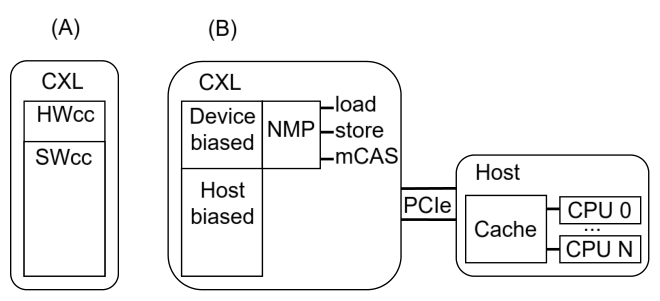
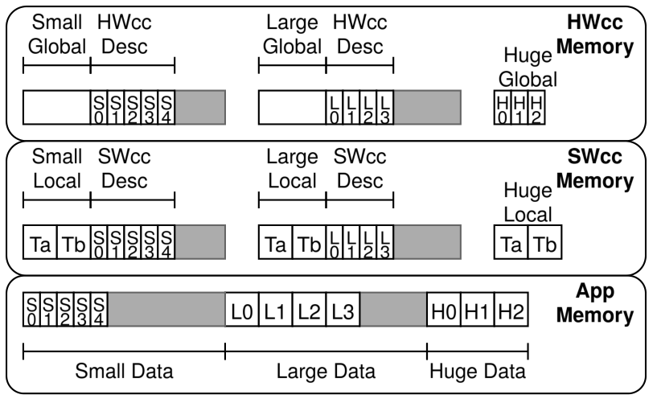
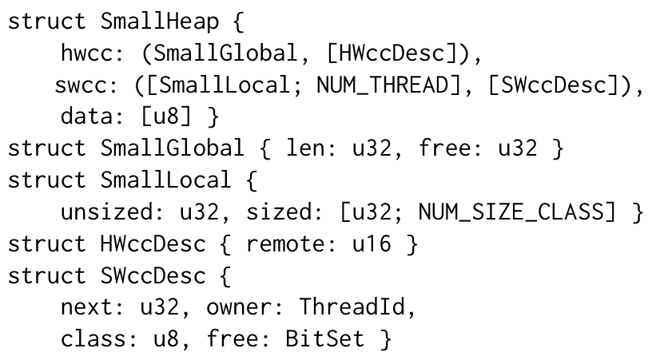
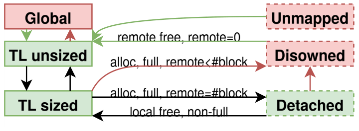
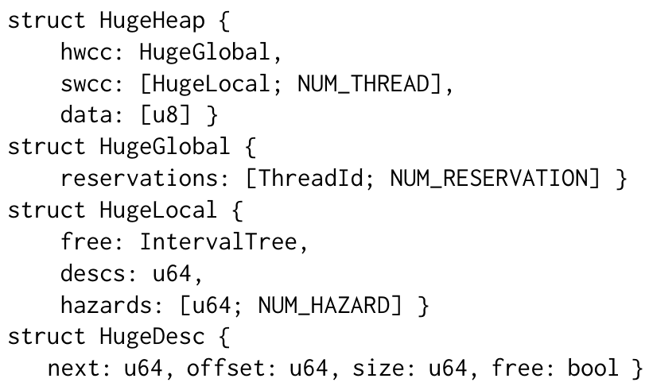
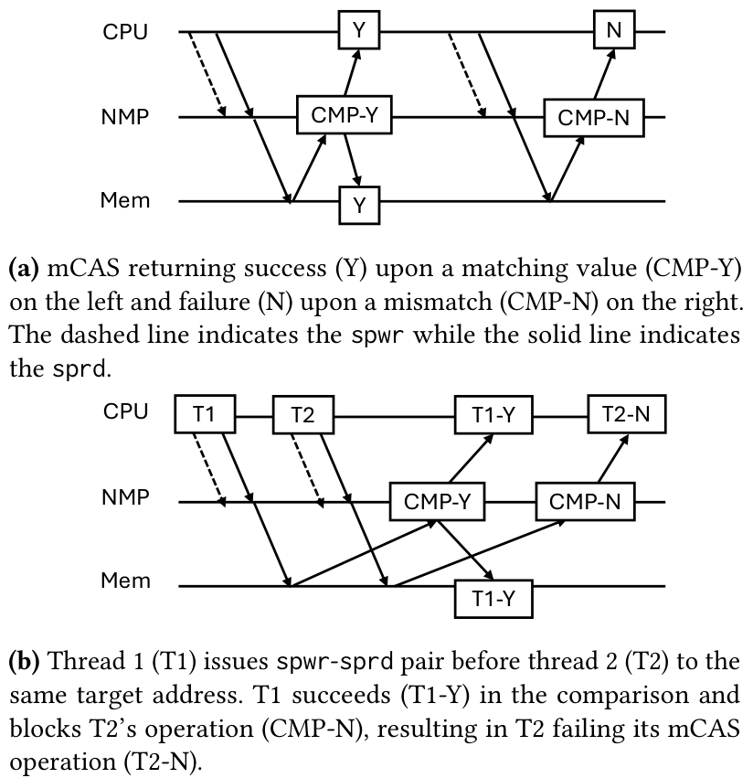

# Cxlalloc: Safe and Efficient Memory Allocation for a CXL Pod

[返回图集](../README.md) · Cxlalloc · ASPLOS 2026 · 6张非实验图

研究对象：操作系统、内存分配与硬件管理层 / cxlalloc CXL共享内存分配器

本页仅显示以下非实验图，不包含原论文全部图组。混合图在子图分离复核完成前暂不收录。

版本许可依据：[来源](https://www.cs.utexas.edu/~witchel/pubs/ni26asplos-cxlalloc.pdf#page=1)。源PDF SHA256：`a9e62da5a59eac73045e7203aa6448c6528f185570c7c0916b22bf46e2ed1454`。PDF不随库分发。

## 图号导航

[F1](#f1) · [F2](#f2) · [F3](#f3) · [F4](#f4) · [F5](#f5) · [F6](#f6)

## F1

**非实验图 · CXL一致性与设备拓扑图**

[原文物理页 3](https://www.cs.utexas.edu/~witchel/pubs/ni26asplos-cxlalloc.pdf#page=3) · [许可证 CC BY 4.0](https://creativecommons.org/licenses/by/4.0/)

署名：Newton Ni, Yan Sun, Zhiting Zhu, Emmett Witchel. Cxlalloc: Safe and Efficient Memory Allocation for a CXL Pod. ASPLOS 2026, Volume 2. DOI: https://doi.org/10.1145/3779212.3790149. Version: Exact frozen author-hosted ACM-layout PDF; publisher equivalence and version date not asserted. Source: https://www.cs.utexas.edu/~witchel/pubs/ni26asplos-cxlalloc.pdf. CC BY 4.0: https://creativecommons.org/licenses/by/4.0/. Whole figures cropped from this exact PDF and rasterized at 240 dpi; captions excluded, all figure content unchanged. No endorsement implied.

修改说明：Whole figure cropped from the specified source PDF and rasterized at 240 dpi; numbered caption excluded, figure content unchanged.

## F2

**非实验图 · 共享堆内存布局图**

[原文物理页 4](https://www.cs.utexas.edu/~witchel/pubs/ni26asplos-cxlalloc.pdf#page=4) · [许可证 CC BY 4.0](https://creativecommons.org/licenses/by/4.0/)

署名：Newton Ni, Yan Sun, Zhiting Zhu, Emmett Witchel. Cxlalloc: Safe and Efficient Memory Allocation for a CXL Pod. ASPLOS 2026, Volume 2. DOI: https://doi.org/10.1145/3779212.3790149. Version: Exact frozen author-hosted ACM-layout PDF; publisher equivalence and version date not asserted. Source: https://www.cs.utexas.edu/~witchel/pubs/ni26asplos-cxlalloc.pdf. CC BY 4.0: https://creativecommons.org/licenses/by/4.0/. Whole figures cropped from this exact PDF and rasterized at 240 dpi; captions excluded, all figure content unchanged. No endorsement implied.

修改说明：Whole figure cropped from the specified source PDF and rasterized at 240 dpi; numbered caption excluded, figure content unchanged.

## F3

**非实验图 · 小对象堆类型定义图**

[原文物理页 4](https://www.cs.utexas.edu/~witchel/pubs/ni26asplos-cxlalloc.pdf#page=4) · [许可证 CC BY 4.0](https://creativecommons.org/licenses/by/4.0/)

署名：Newton Ni, Yan Sun, Zhiting Zhu, Emmett Witchel. Cxlalloc: Safe and Efficient Memory Allocation for a CXL Pod. ASPLOS 2026, Volume 2. DOI: https://doi.org/10.1145/3779212.3790149. Version: Exact frozen author-hosted ACM-layout PDF; publisher equivalence and version date not asserted. Source: https://www.cs.utexas.edu/~witchel/pubs/ni26asplos-cxlalloc.pdf. CC BY 4.0: https://creativecommons.org/licenses/by/4.0/. Whole figures cropped from this exact PDF and rasterized at 240 dpi; captions excluded, all figure content unchanged. No endorsement implied.

修改说明：Whole figure cropped from the specified source PDF and rasterized at 240 dpi; numbered caption excluded, figure content unchanged.

## F4

**非实验图 · 内存块状态转换图**

[原文物理页 5](https://www.cs.utexas.edu/~witchel/pubs/ni26asplos-cxlalloc.pdf#page=5) · [许可证 CC BY 4.0](https://creativecommons.org/licenses/by/4.0/)

署名：Newton Ni, Yan Sun, Zhiting Zhu, Emmett Witchel. Cxlalloc: Safe and Efficient Memory Allocation for a CXL Pod. ASPLOS 2026, Volume 2. DOI: https://doi.org/10.1145/3779212.3790149. Version: Exact frozen author-hosted ACM-layout PDF; publisher equivalence and version date not asserted. Source: https://www.cs.utexas.edu/~witchel/pubs/ni26asplos-cxlalloc.pdf. CC BY 4.0: https://creativecommons.org/licenses/by/4.0/. Whole figures cropped from this exact PDF and rasterized at 240 dpi; captions excluded, all figure content unchanged. No endorsement implied.

修改说明：Whole figure cropped from the specified source PDF and rasterized at 240 dpi; numbered caption excluded, figure content unchanged.

## F5

**非实验图 · 大对象堆类型定义图**

[原文物理页 5](https://www.cs.utexas.edu/~witchel/pubs/ni26asplos-cxlalloc.pdf#page=5) · [许可证 CC BY 4.0](https://creativecommons.org/licenses/by/4.0/)

署名：Newton Ni, Yan Sun, Zhiting Zhu, Emmett Witchel. Cxlalloc: Safe and Efficient Memory Allocation for a CXL Pod. ASPLOS 2026, Volume 2. DOI: https://doi.org/10.1145/3779212.3790149. Version: Exact frozen author-hosted ACM-layout PDF; publisher equivalence and version date not asserted. Source: https://www.cs.utexas.edu/~witchel/pubs/ni26asplos-cxlalloc.pdf. CC BY 4.0: https://creativecommons.org/licenses/by/4.0/. Whole figures cropped from this exact PDF and rasterized at 240 dpi; captions excluded, all figure content unchanged. No endorsement implied.

修改说明：Whole figure cropped from the specified source PDF and rasterized at 240 dpi; numbered caption excluded, figure content unchanged.

## F6

**非实验图 · 内存原子比较交换时序图**

[原文物理页 9](https://www.cs.utexas.edu/~witchel/pubs/ni26asplos-cxlalloc.pdf#page=9) · [许可证 CC BY 4.0](https://creativecommons.org/licenses/by/4.0/)

署名：Newton Ni, Yan Sun, Zhiting Zhu, Emmett Witchel. Cxlalloc: Safe and Efficient Memory Allocation for a CXL Pod. ASPLOS 2026, Volume 2. DOI: https://doi.org/10.1145/3779212.3790149. Version: Exact frozen author-hosted ACM-layout PDF; publisher equivalence and version date not asserted. Source: https://www.cs.utexas.edu/~witchel/pubs/ni26asplos-cxlalloc.pdf. CC BY 4.0: https://creativecommons.org/licenses/by/4.0/. Whole figures cropped from this exact PDF and rasterized at 240 dpi; captions excluded, all figure content unchanged. No endorsement implied.

修改说明：Whole figure cropped from the specified source PDF and rasterized at 240 dpi; numbered caption excluded, figure content unchanged.

