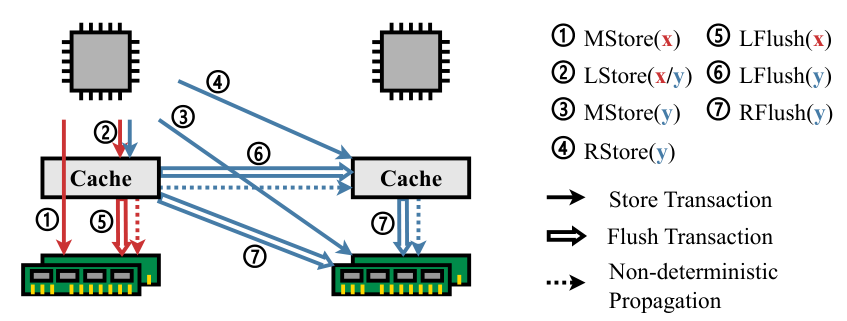
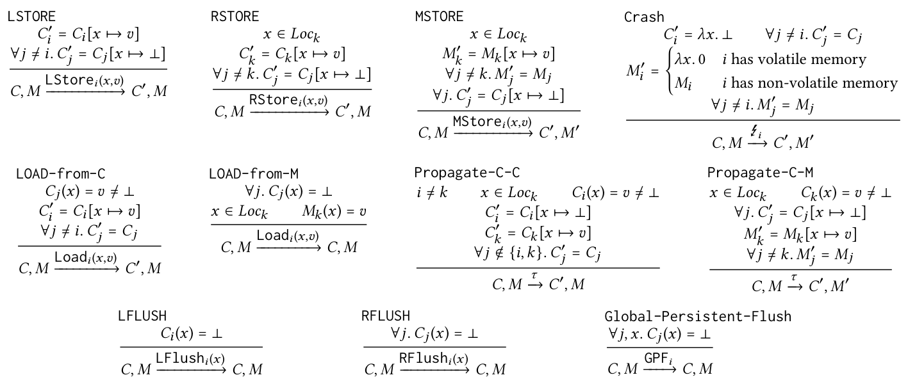
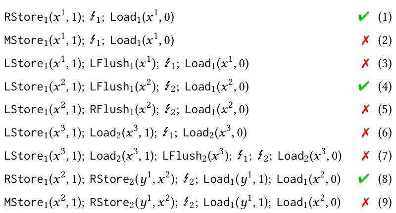
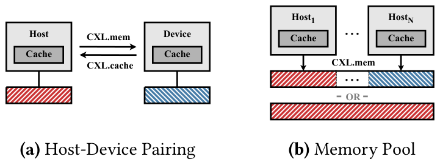

# A Programming Model for Disaggregated Memory over CXL

[返回图集](../README.md) · CXL model · ASPLOS 2026 · 4张非实验图

研究对象：并发与故障语义模型 / CXL0并发与故障编程语义模型

本页仅显示以下非实验图，不包含原论文全部图组。混合图在子图分离复核完成前暂不收录。

版本许可依据：[来源](https://www.cs.tau.ac.il/~orilahav/papers/asplos26.pdf#page=1)。源PDF SHA256：`a48a89e102bc9be9710d2e72dd20489db3f93502b1a6269fb1e574b797084942`。PDF不随库分发。

## 图号导航

[F1](#f1) · [F2](#f2) · [F3](#f3) · [F4](#f4)

## F1

**非实验图 · CXL存储与刷新语义示意图**

[原文物理页 5](https://www.cs.tau.ac.il/~orilahav/papers/asplos26.pdf#page=5) · [许可证 CC BY 4.0](https://creativecommons.org/licenses/by/4.0/)

署名：Gal Assa, Moritz Lumme, Lucas Bürgi, Michal Friedman, Ori Lahav. A Programming Model for Disaggregated Memory over CXL. ASPLOS 2026. DOI: https://doi.org/10.1145/3779212.3790121. Version: Exact frozen author-hosted ACM conference-layout PDF; publisher binary equivalence not asserted. Source: https://www.cs.tau.ac.il/~orilahav/papers/asplos26.pdf. CC BY 4.0: https://creativecommons.org/licenses/by/4.0/. Whole figures cropped from this exact PDF and rasterized at 240 dpi; captions excluded, all figure content unchanged. No endorsement implied.

修改说明：Whole figure cropped from the specified source PDF and rasterized at 240 dpi; numbered caption excluded, figure content unchanged.

## F2

**非实验图 · CXL操作语义规则图**

[原文物理页 7](https://www.cs.tau.ac.il/~orilahav/papers/asplos26.pdf#page=7) · [许可证 CC BY 4.0](https://creativecommons.org/licenses/by/4.0/)

署名：Gal Assa, Moritz Lumme, Lucas Bürgi, Michal Friedman, Ori Lahav. A Programming Model for Disaggregated Memory over CXL. ASPLOS 2026. DOI: https://doi.org/10.1145/3779212.3790121. Version: Exact frozen author-hosted ACM conference-layout PDF; publisher binary equivalence not asserted. Source: https://www.cs.tau.ac.il/~orilahav/papers/asplos26.pdf. CC BY 4.0: https://creativecommons.org/licenses/by/4.0/. Whole figures cropped from this exact PDF and rasterized at 240 dpi; captions excluded, all figure content unchanged. No endorsement implied.

修改说明：Whole figure cropped from the specified source PDF and rasterized at 240 dpi; numbered caption excluded, figure content unchanged.

## F3

**非实验图 · 崩溃一致性判例图**

[原文物理页 8](https://www.cs.tau.ac.il/~orilahav/papers/asplos26.pdf#page=8) · [许可证 CC BY 4.0](https://creativecommons.org/licenses/by/4.0/)

署名：Gal Assa, Moritz Lumme, Lucas Bürgi, Michal Friedman, Ori Lahav. A Programming Model for Disaggregated Memory over CXL. ASPLOS 2026. DOI: https://doi.org/10.1145/3779212.3790121. Version: Exact frozen author-hosted ACM conference-layout PDF; publisher binary equivalence not asserted. Source: https://www.cs.tau.ac.il/~orilahav/papers/asplos26.pdf. CC BY 4.0: https://creativecommons.org/licenses/by/4.0/. Whole figures cropped from this exact PDF and rasterized at 240 dpi; captions excluded, all figure content unchanged. No endorsement implied.

修改说明：Whole figure cropped from the specified source PDF and rasterized at 240 dpi; numbered caption excluded, figure content unchanged.

## F4

**非实验图 · CXL系统拓扑对比图**

[原文物理页 9](https://www.cs.tau.ac.il/~orilahav/papers/asplos26.pdf#page=9) · [许可证 CC BY 4.0](https://creativecommons.org/licenses/by/4.0/)

署名：Gal Assa, Moritz Lumme, Lucas Bürgi, Michal Friedman, Ori Lahav. A Programming Model for Disaggregated Memory over CXL. ASPLOS 2026. DOI: https://doi.org/10.1145/3779212.3790121. Version: Exact frozen author-hosted ACM conference-layout PDF; publisher binary equivalence not asserted. Source: https://www.cs.tau.ac.il/~orilahav/papers/asplos26.pdf. CC BY 4.0: https://creativecommons.org/licenses/by/4.0/. Whole figures cropped from this exact PDF and rasterized at 240 dpi; captions excluded, all figure content unchanged. No endorsement implied.

修改说明：Whole figure cropped from the specified source PDF and rasterized at 240 dpi; numbered caption excluded, figure content unchanged.

