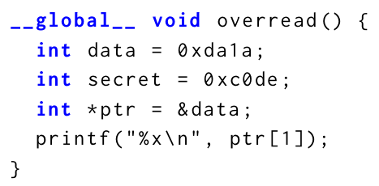
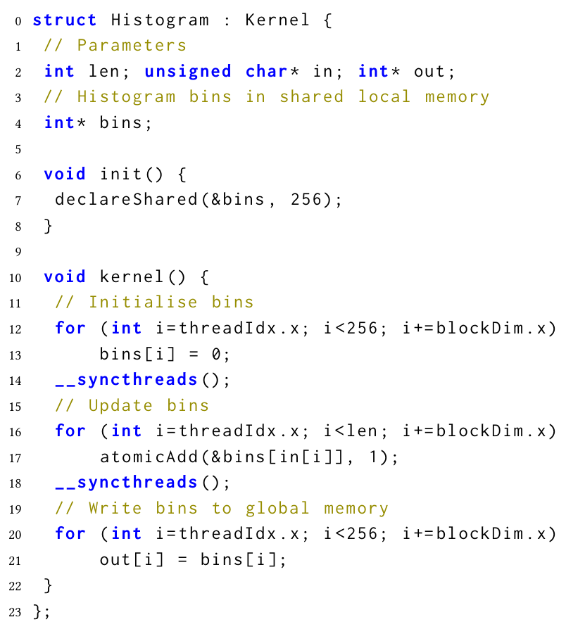
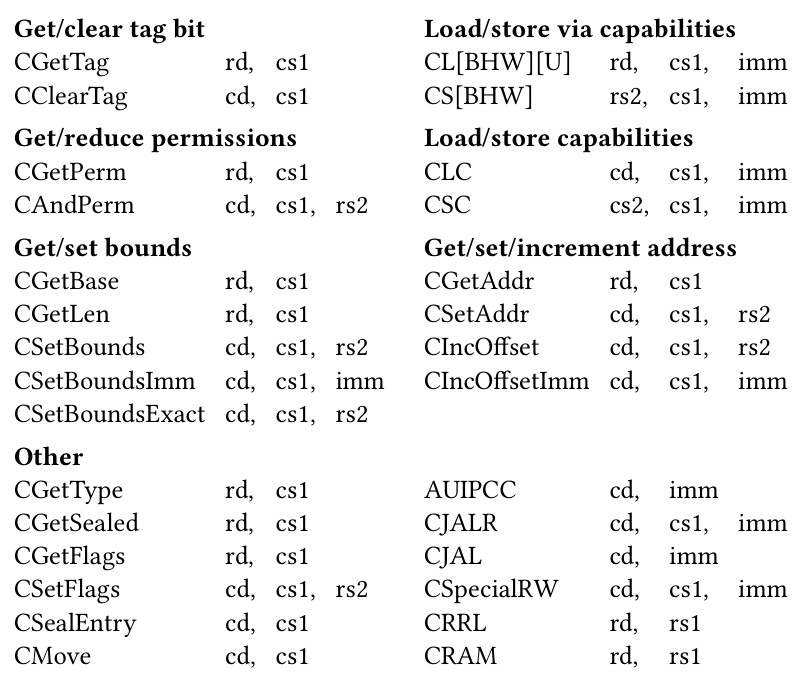
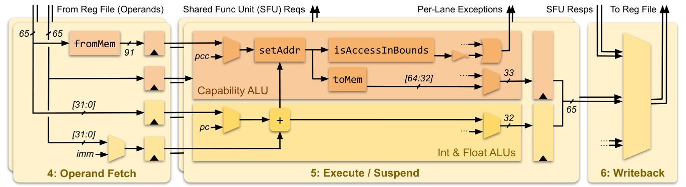
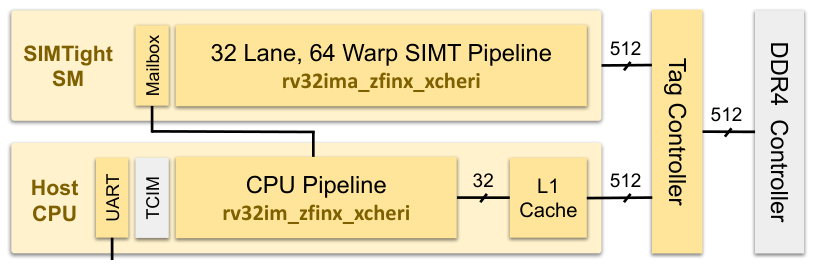

# CHERI-SIMT: Implementing Capability Memory Protection in GPUs

[返回图集](../README.md) · CHERI-SIMT · ASPLOS 2026 · 5张非实验图

研究对象：内存保护与资源隔离构件 / CHERI-SIMT GPU能力内存保护构件

本页仅显示以下非实验图，不包含原论文全部图组。混合图在子图分离复核完成前暂不收录。

未收录图片不代表获得公开再分发许可。 本图库当前收录5张非实验图：F1、F3、F4、F8、F9。

版本许可依据：[来源](https://www.cl.cam.ac.uk/~tmj32/papers/docs/naylor26-asplos.pdf#page=1)。源PDF SHA256：`44b526baa9ff8db9bee6da5677020b7b85af8d1acab9dfb615bda310ceddc0b7`。PDF不随库分发。

## 图号导航

[F1](#f1) · [F3](#f3) · [F4](#f4) · [F8](#f8) · [F9](#f9)

## F1

**非实验图 · GPU越界读取代码示例图**

[原文物理页 2](https://www.cl.cam.ac.uk/~tmj32/papers/docs/naylor26-asplos.pdf#page=2) · [许可证 CC BY 4.0](https://creativecommons.org/licenses/by/4.0/)

署名：Matthew Naylor, Alexandre Joannou, A. Theodore Markettos, Paul Metzger, Simon W. Moore, Timothy M. Jones. CHERI-SIMT: Implementing Capability Memory Protection in GPUs. ASPLOS 2026, Volume 1. DOI: https://doi.org/10.1145/3760250.3762234. Version: Exact frozen author-hosted ACM-layout conference manuscript; publisher binary equivalence not asserted. Source: https://www.cl.cam.ac.uk/~tmj32/papers/docs/naylor26-asplos.pdf. CC BY 4.0: https://creativecommons.org/licenses/by/4.0/. Whole figures cropped from this exact PDF and rasterized at 240 dpi; captions excluded, all figure content unchanged. No endorsement implied.

修改说明：Whole figure cropped from the specified source PDF and rasterized at 240 dpi; numbered caption excluded, figure content unchanged.

## F3

**非实验图 · 直方图并行内核代码图**

[原文物理页 4](https://www.cl.cam.ac.uk/~tmj32/papers/docs/naylor26-asplos.pdf#page=4) · [许可证 CC BY 4.0](https://creativecommons.org/licenses/by/4.0/)

署名：Matthew Naylor, Alexandre Joannou, A. Theodore Markettos, Paul Metzger, Simon W. Moore, Timothy M. Jones. CHERI-SIMT: Implementing Capability Memory Protection in GPUs. ASPLOS 2026, Volume 1. DOI: https://doi.org/10.1145/3760250.3762234. Version: Exact frozen author-hosted ACM-layout conference manuscript; publisher binary equivalence not asserted. Source: https://www.cl.cam.ac.uk/~tmj32/papers/docs/naylor26-asplos.pdf. CC BY 4.0: https://creativecommons.org/licenses/by/4.0/. Whole figures cropped from this exact PDF and rasterized at 240 dpi; captions excluded, all figure content unchanged. No endorsement implied.

修改说明：Whole figure cropped from the specified source PDF and rasterized at 240 dpi; numbered caption excluded, figure content unchanged.

## F4

**非实验图 · 能力指令分类图**

[原文物理页 5](https://www.cl.cam.ac.uk/~tmj32/papers/docs/naylor26-asplos.pdf#page=5) · [许可证 CC BY 4.0](https://creativecommons.org/licenses/by/4.0/)

署名：Matthew Naylor, Alexandre Joannou, A. Theodore Markettos, Paul Metzger, Simon W. Moore, Timothy M. Jones. CHERI-SIMT: Implementing Capability Memory Protection in GPUs. ASPLOS 2026, Volume 1. DOI: https://doi.org/10.1145/3760250.3762234. Version: Exact frozen author-hosted ACM-layout conference manuscript; publisher binary equivalence not asserted. Source: https://www.cl.cam.ac.uk/~tmj32/papers/docs/naylor26-asplos.pdf. CC BY 4.0: https://creativecommons.org/licenses/by/4.0/. Whole figures cropped from this exact PDF and rasterized at 240 dpi; captions excluded, all figure content unchanged. No endorsement implied.

修改说明：Whole figure cropped from the specified source PDF and rasterized at 240 dpi; numbered caption excluded, figure content unchanged.

## F8

**非实验图 · 能力检查流水线扩展图**

[原文物理页 9](https://www.cl.cam.ac.uk/~tmj32/papers/docs/naylor26-asplos.pdf#page=9) · [许可证 CC BY 4.0](https://creativecommons.org/licenses/by/4.0/)

署名：Matthew Naylor, Alexandre Joannou, A. Theodore Markettos, Paul Metzger, Simon W. Moore, Timothy M. Jones. CHERI-SIMT: Implementing Capability Memory Protection in GPUs. ASPLOS 2026, Volume 1. DOI: https://doi.org/10.1145/3760250.3762234. Version: Exact frozen author-hosted ACM-layout conference manuscript; publisher binary equivalence not asserted. Source: https://www.cl.cam.ac.uk/~tmj32/papers/docs/naylor26-asplos.pdf. CC BY 4.0: https://creativecommons.org/licenses/by/4.0/. Whole figures cropped from this exact PDF and rasterized at 240 dpi; captions excluded, all figure content unchanged. No endorsement implied.

修改说明：Whole figure cropped from the specified source PDF and rasterized at 240 dpi; numbered caption excluded, figure content unchanged.

## F9

**非实验图 · GPU与主机评估系统图**

[原文物理页 9](https://www.cl.cam.ac.uk/~tmj32/papers/docs/naylor26-asplos.pdf#page=9) · [许可证 CC BY 4.0](https://creativecommons.org/licenses/by/4.0/)

署名：Matthew Naylor, Alexandre Joannou, A. Theodore Markettos, Paul Metzger, Simon W. Moore, Timothy M. Jones. CHERI-SIMT: Implementing Capability Memory Protection in GPUs. ASPLOS 2026, Volume 1. DOI: https://doi.org/10.1145/3760250.3762234. Version: Exact frozen author-hosted ACM-layout conference manuscript; publisher binary equivalence not asserted. Source: https://www.cl.cam.ac.uk/~tmj32/papers/docs/naylor26-asplos.pdf. CC BY 4.0: https://creativecommons.org/licenses/by/4.0/. Whole figures cropped from this exact PDF and rasterized at 240 dpi; captions excluded, all figure content unchanged. No endorsement implied.

修改说明：Whole figure cropped from the specified source PDF and rasterized at 240 dpi; numbered caption excluded, figure content unchanged.

