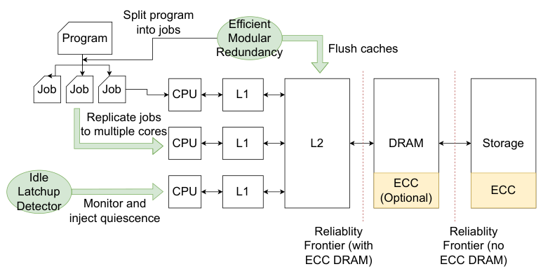
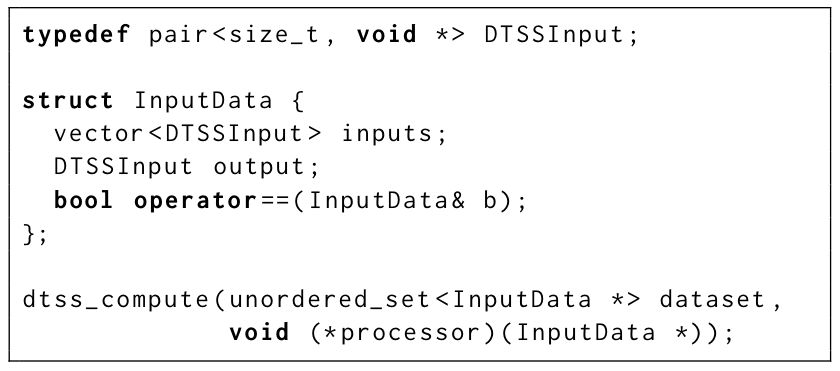
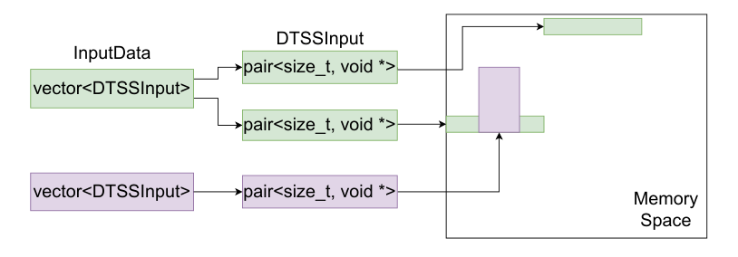

# Radshield: Software Radiation Protection for Commodity Hardware in Space

[返回图集](../README.md) · Radshield · ASPLOS 2026 · 4张非实验图

研究对象：运行时与调度系统 / Radshield软件辐射容错运行时

本页仅显示以下非实验图，不包含原论文全部图组。混合图在子图分离复核完成前暂不收录。

未收录图片不代表获得公开再分发许可。 本图库当前收录4张非实验图：F3、F4、F7、F8。

版本许可依据：[来源](https://www.asafcidon.com/uploads/5/9/7/0/59701649/radshield.pdf#page=2)。源PDF SHA256：`3b8775f0d3c066cc4b1aa16cc2980affe6ea36f7e02e6fa0e91cffe79ece34d3`。PDF不随库分发。

## 图号导航

[F3](#f3) · [F4](#f4) · [F7](#f7) · [F8](#f8)

## F3

**非实验图 · 软件抗辐射系统架构**

[原文物理页 5](https://www.asafcidon.com/uploads/5/9/7/0/59701649/radshield.pdf#page=5) · [许可证 CC BY 4.0](https://creativecommons.org/licenses/by/4.0/)

署名：Haoda Wang, Steven Myint, Vandi Verma, Yonatan Winetraub, Junfeng Yang, Asaf Cidon. Radshield: Software Radiation Protection for Commodity Hardware in Space. ASPLOS 2026. DOI: https://doi.org/10.1145/3760250.3762218. Version: Exact author-hosted publisher PDF; one publisher cover plus 15 article pages (219–233). Source: https://www.asafcidon.com/uploads/5/9/7/0/59701649/radshield.pdf. CC BY 4.0: https://creativecommons.org/licenses/by/4.0/. Whole figures cropped from this exact PDF and rasterized at 240 dpi; captions excluded, all figure content unchanged. No endorsement implied.

修改说明：Whole figure cropped from the specified source PDF and rasterized at 240 dpi; numbered caption excluded, figure content unchanged.

## F4

**非实验图 · 空闲期闩锁检测流程**

[原文物理页 6](https://www.asafcidon.com/uploads/5/9/7/0/59701649/radshield.pdf#page=6) · [许可证 CC BY 4.0](https://creativecommons.org/licenses/by/4.0/)

署名：Haoda Wang, Steven Myint, Vandi Verma, Yonatan Winetraub, Junfeng Yang, Asaf Cidon. Radshield: Software Radiation Protection for Commodity Hardware in Space. ASPLOS 2026. DOI: https://doi.org/10.1145/3760250.3762218. Version: Exact author-hosted publisher PDF; one publisher cover plus 15 article pages (219–233). Source: https://www.asafcidon.com/uploads/5/9/7/0/59701649/radshield.pdf. CC BY 4.0: https://creativecommons.org/licenses/by/4.0/. Whole figures cropped from this exact PDF and rasterized at 240 dpi; captions excluded, all figure content unchanged. No endorsement implied.

修改说明：Whole figure cropped from the specified source PDF and rasterized at 240 dpi; numbered caption excluded, figure content unchanged.

## F7

**非实验图 · 冗余执行接口代码**

[原文物理页 8](https://www.asafcidon.com/uploads/5/9/7/0/59701649/radshield.pdf#page=8) · [许可证 CC BY 4.0](https://creativecommons.org/licenses/by/4.0/)

署名：Haoda Wang, Steven Myint, Vandi Verma, Yonatan Winetraub, Junfeng Yang, Asaf Cidon. Radshield: Software Radiation Protection for Commodity Hardware in Space. ASPLOS 2026. DOI: https://doi.org/10.1145/3760250.3762218. Version: Exact author-hosted publisher PDF; one publisher cover plus 15 article pages (219–233). Source: https://www.asafcidon.com/uploads/5/9/7/0/59701649/radshield.pdf. CC BY 4.0: https://creativecommons.org/licenses/by/4.0/. Whole figures cropped from this exact PDF and rasterized at 240 dpi; captions excluded, all figure content unchanged. No endorsement implied.

修改说明：Whole figure cropped from the specified source PDF and rasterized at 240 dpi; numbered caption excluded, figure content unchanged.

## F8

**非实验图 · 输入数据与内存映射**

[原文物理页 8](https://www.asafcidon.com/uploads/5/9/7/0/59701649/radshield.pdf#page=8) · [许可证 CC BY 4.0](https://creativecommons.org/licenses/by/4.0/)

署名：Haoda Wang, Steven Myint, Vandi Verma, Yonatan Winetraub, Junfeng Yang, Asaf Cidon. Radshield: Software Radiation Protection for Commodity Hardware in Space. ASPLOS 2026. DOI: https://doi.org/10.1145/3760250.3762218. Version: Exact author-hosted publisher PDF; one publisher cover plus 15 article pages (219–233). Source: https://www.asafcidon.com/uploads/5/9/7/0/59701649/radshield.pdf. CC BY 4.0: https://creativecommons.org/licenses/by/4.0/. Whole figures cropped from this exact PDF and rasterized at 240 dpi; captions excluded, all figure content unchanged. No endorsement implied.

修改说明：Whole figure cropped from the specified source PDF and rasterized at 240 dpi; numbered caption excluded, figure content unchanged.

