# RTeAAL Sim: Using Tensor Algebra to Represent and Accelerate RTL Simulation (Extended Version)

[返回图集](../README.md) · RTeAAL Sim · ASPLOS 2026 · 11张非实验图

研究对象：模拟器与仿真平台 / RTeAAL Sim张量表示RTL仿真器

本页仅显示以下非实验图，不包含原论文全部图组。混合图在子图分离复核完成前暂不收录。

未收录图片不代表获得公开再分发许可。 本图库当前收录11张非实验图：F1、F2、F3、F4、F6、F9、F10、F11、F12、F13、F14。

版本许可依据：[来源](https://arxiv.org/abs/2601.18140v1)。源PDF SHA256：`801ca48e4362ae9c9f6b5414a8c94943d3e8a0c7358d29fa91dd12a908572a40`。PDF不随库分发。

## 图号导航

[F1](#f1) · [F2](#f2) · [F3](#f3) · [F4](#f4) · [F6](#f6) · [F9](#f9) · [F10](#f10) · [F11](#f11) · [F12](#f12) · [F13](#f13) · [F14](#f14)

## F1

**非实验图 · RTL到数据流与代码转换图**

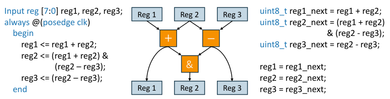

[原文物理页 2](https://arxiv.org/pdf/2601.18140v1#page=2) · [许可证 CC BY 4.0](https://creativecommons.org/licenses/by/4.0/)

署名：Yan Zhu, Boru Chen, Christopher W. Fletcher, Nandeeka Nayak. RTeAAL Sim: Using Tensor Algebra to Represent and Accelerate RTL Simulation (Extended Version). ASPLOS 2026; arXiv extended version. DOI: https://doi.org/10.1145/3779212.3790214. Version: arXiv:2601.18140v1, 26 January 2026, Extended Version; 20-page author manuscript, not publisher PDF. Source: https://arxiv.org/pdf/2601.18140v1. CC BY 4.0: https://creativecommons.org/licenses/by/4.0/. Whole figures cropped from this exact PDF and rasterized at 240 dpi; captions excluded, all figure content unchanged. No endorsement implied.

修改说明：Whole figure cropped from the specified source PDF and rasterized at 240 dpi; numbered caption excluded, figure content unchanged.

## F2

**非实验图 · 稀疏矩阵纤维树表示图**

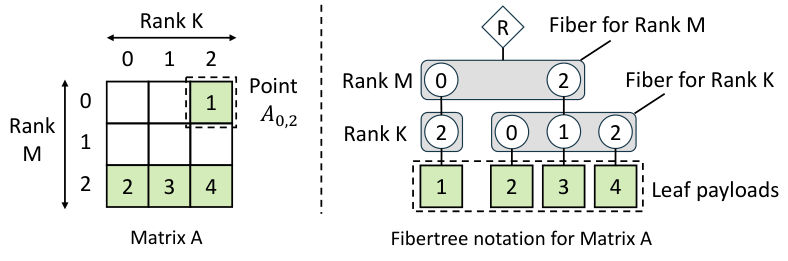

[原文物理页 2](https://arxiv.org/pdf/2601.18140v1#page=2) · [许可证 CC BY 4.0](https://creativecommons.org/licenses/by/4.0/)

署名：Yan Zhu, Boru Chen, Christopher W. Fletcher, Nandeeka Nayak. RTeAAL Sim: Using Tensor Algebra to Represent and Accelerate RTL Simulation (Extended Version). ASPLOS 2026; arXiv extended version. DOI: https://doi.org/10.1145/3779212.3790214. Version: arXiv:2601.18140v1, 26 January 2026, Extended Version; 20-page author manuscript, not publisher PDF. Source: https://arxiv.org/pdf/2601.18140v1. CC BY 4.0: https://creativecommons.org/licenses/by/4.0/. Whole figures cropped from this exact PDF and rasterized at 240 dpi; captions excluded, all figure content unchanged. No endorsement implied.

修改说明：Whole figure cropped from the specified source PDF and rasterized at 240 dpi; numbered caption excluded, figure content unchanged.

## F3

**非实验图 · 扩展Einsum计算分解图**

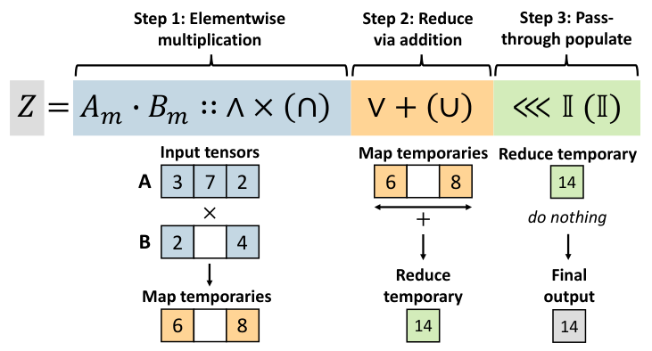

[原文物理页 3](https://arxiv.org/pdf/2601.18140v1#page=3) · [许可证 CC BY 4.0](https://creativecommons.org/licenses/by/4.0/)

署名：Yan Zhu, Boru Chen, Christopher W. Fletcher, Nandeeka Nayak. RTeAAL Sim: Using Tensor Algebra to Represent and Accelerate RTL Simulation (Extended Version). ASPLOS 2026; arXiv extended version. DOI: https://doi.org/10.1145/3779212.3790214. Version: arXiv:2601.18140v1, 26 January 2026, Extended Version; 20-page author manuscript, not publisher PDF. Source: https://arxiv.org/pdf/2601.18140v1. CC BY 4.0: https://creativecommons.org/licenses/by/4.0/. Whole figures cropped from this exact PDF and rasterized at 240 dpi; captions excluded, all figure content unchanged. No endorsement implied.

修改说明：Whole figure cropped from the specified source PDF and rasterized at 240 dpi; numbered caption excluded, figure content unchanged.

## F4

**非实验图 · 张量筛选与纤维树运算图**

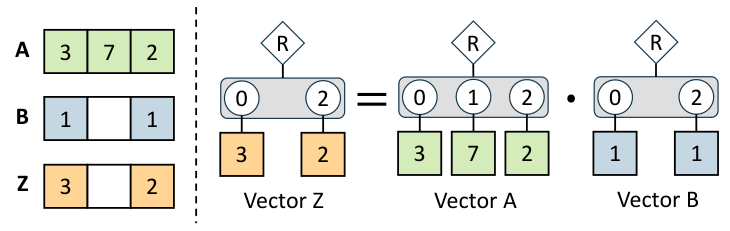

[原文物理页 3](https://arxiv.org/pdf/2601.18140v1#page=3) · [许可证 CC BY 4.0](https://creativecommons.org/licenses/by/4.0/)

署名：Yan Zhu, Boru Chen, Christopher W. Fletcher, Nandeeka Nayak. RTeAAL Sim: Using Tensor Algebra to Represent and Accelerate RTL Simulation (Extended Version). ASPLOS 2026; arXiv extended version. DOI: https://doi.org/10.1145/3779212.3790214. Version: arXiv:2601.18140v1, 26 January 2026, Extended Version; 20-page author manuscript, not publisher PDF. Source: https://arxiv.org/pdf/2601.18140v1. CC BY 4.0: https://creativecommons.org/licenses/by/4.0/. Whole figures cropped from this exact PDF and rasterized at 240 dpi; captions excluded, all figure content unchanged. No endorsement implied.

修改说明：Whole figure cropped from the specified source PDF and rasterized at 240 dpi; numbered caption excluded, figure content unchanged.

## F6

**非实验图 · 稀疏张量格式配置图**

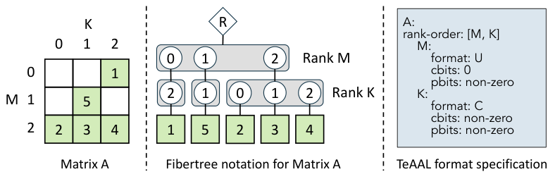

[原文物理页 4](https://arxiv.org/pdf/2601.18140v1#page=4) · [许可证 CC BY 4.0](https://creativecommons.org/licenses/by/4.0/)

署名：Yan Zhu, Boru Chen, Christopher W. Fletcher, Nandeeka Nayak. RTeAAL Sim: Using Tensor Algebra to Represent and Accelerate RTL Simulation (Extended Version). ASPLOS 2026; arXiv extended version. DOI: https://doi.org/10.1145/3779212.3790214. Version: arXiv:2601.18140v1, 26 January 2026, Extended Version; 20-page author manuscript, not publisher PDF. Source: https://arxiv.org/pdf/2601.18140v1. CC BY 4.0: https://creativecommons.org/licenses/by/4.0/. Whole figures cropped from this exact PDF and rasterized at 240 dpi; captions excluded, all figure content unchanged. No endorsement implied.

修改说明：Whole figure cropped from the specified source PDF and rasterized at 240 dpi; numbered caption excluded, figure content unchanged.

## F9

**非实验图 · 单层乘法数据流示意图**

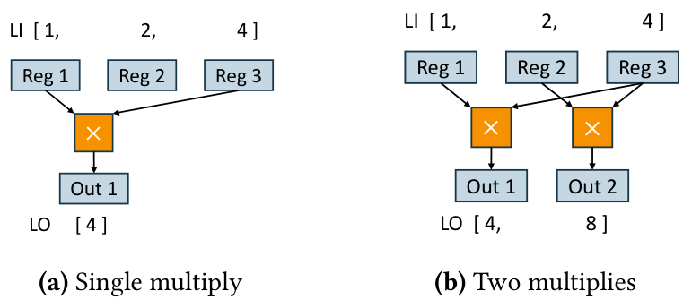

[原文物理页 6](https://arxiv.org/pdf/2601.18140v1#page=6) · [许可证 CC BY 4.0](https://creativecommons.org/licenses/by/4.0/)

署名：Yan Zhu, Boru Chen, Christopher W. Fletcher, Nandeeka Nayak. RTeAAL Sim: Using Tensor Algebra to Represent and Accelerate RTL Simulation (Extended Version). ASPLOS 2026; arXiv extended version. DOI: https://doi.org/10.1145/3779212.3790214. Version: arXiv:2601.18140v1, 26 January 2026, Extended Version; 20-page author manuscript, not publisher PDF. Source: https://arxiv.org/pdf/2601.18140v1. CC BY 4.0: https://creativecommons.org/licenses/by/4.0/. Whole figures cropped from this exact PDF and rasterized at 240 dpi; captions excluded, all figure content unchanged. No endorsement implied.

修改说明：Whole figure cropped from the specified source PDF and rasterized at 240 dpi; numbered caption excluded, figure content unchanged.

## F10

**非实验图 · 数据流张量编码示意图**

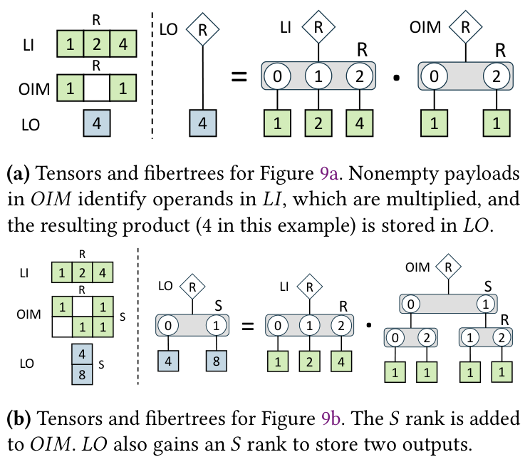

[原文物理页 6](https://arxiv.org/pdf/2601.18140v1#page=6) · [许可证 CC BY 4.0](https://creativecommons.org/licenses/by/4.0/)

署名：Yan Zhu, Boru Chen, Christopher W. Fletcher, Nandeeka Nayak. RTeAAL Sim: Using Tensor Algebra to Represent and Accelerate RTL Simulation (Extended Version). ASPLOS 2026; arXiv extended version. DOI: https://doi.org/10.1145/3779212.3790214. Version: arXiv:2601.18140v1, 26 January 2026, Extended Version; 20-page author manuscript, not publisher PDF. Source: https://arxiv.org/pdf/2601.18140v1. CC BY 4.0: https://creativecommons.org/licenses/by/4.0/. Whole figures cropped from this exact PDF and rasterized at 240 dpi; captions excluded, all figure content unchanged. No endorsement implied.

修改说明：Whole figure cropped from the specified source PDF and rasterized at 240 dpi; numbered caption excluded, figure content unchanged.

## F11

**非实验图 · 数据流分层预处理图**

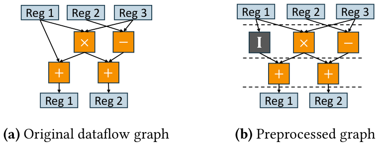

[原文物理页 7](https://arxiv.org/pdf/2601.18140v1#page=7) · [许可证 CC BY 4.0](https://creativecommons.org/licenses/by/4.0/)

署名：Yan Zhu, Boru Chen, Christopher W. Fletcher, Nandeeka Nayak. RTeAAL Sim: Using Tensor Algebra to Represent and Accelerate RTL Simulation (Extended Version). ASPLOS 2026; arXiv extended version. DOI: https://doi.org/10.1145/3779212.3790214. Version: arXiv:2601.18140v1, 26 January 2026, Extended Version; 20-page author manuscript, not publisher PDF. Source: https://arxiv.org/pdf/2601.18140v1. CC BY 4.0: https://creativecommons.org/licenses/by/4.0/. Whole figures cropped from this exact PDF and rasterized at 240 dpi; captions excluded, all figure content unchanged. No endorsement implied.

修改说明：Whole figure cropped from the specified source PDF and rasterized at 240 dpi; numbered caption excluded, figure content unchanged.

## F12

**非实验图 · 张量格式优化对比图**

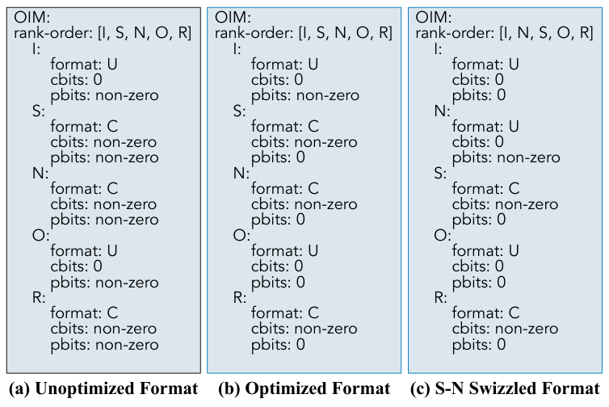

[原文物理页 8](https://arxiv.org/pdf/2601.18140v1#page=8) · [许可证 CC BY 4.0](https://creativecommons.org/licenses/by/4.0/)

署名：Yan Zhu, Boru Chen, Christopher W. Fletcher, Nandeeka Nayak. RTeAAL Sim: Using Tensor Algebra to Represent and Accelerate RTL Simulation (Extended Version). ASPLOS 2026; arXiv extended version. DOI: https://doi.org/10.1145/3779212.3790214. Version: arXiv:2601.18140v1, 26 January 2026, Extended Version; 20-page author manuscript, not publisher PDF. Source: https://arxiv.org/pdf/2601.18140v1. CC BY 4.0: https://creativecommons.org/licenses/by/4.0/. Whole figures cropped from this exact PDF and rasterized at 240 dpi; captions excluded, all figure content unchanged. No endorsement implied.

修改说明：Whole figure cropped from the specified source PDF and rasterized at 240 dpi; numbered caption excluded, figure content unchanged.

## F13

**非实验图 · 纤维树到数组存储映射图**

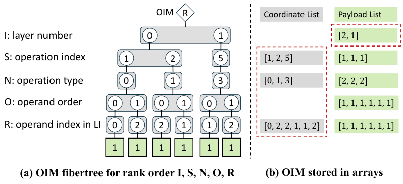

[原文物理页 8](https://arxiv.org/pdf/2601.18140v1#page=8) · [许可证 CC BY 4.0](https://creativecommons.org/licenses/by/4.0/)

署名：Yan Zhu, Boru Chen, Christopher W. Fletcher, Nandeeka Nayak. RTeAAL Sim: Using Tensor Algebra to Represent and Accelerate RTL Simulation (Extended Version). ASPLOS 2026; arXiv extended version. DOI: https://doi.org/10.1145/3779212.3790214. Version: arXiv:2601.18140v1, 26 January 2026, Extended Version; 20-page author manuscript, not publisher PDF. Source: https://arxiv.org/pdf/2601.18140v1. CC BY 4.0: https://creativecommons.org/licenses/by/4.0/. Whole figures cropped from this exact PDF and rasterized at 240 dpi; captions excluded, all figure content unchanged. No endorsement implied.

修改说明：Whole figure cropped from the specified source PDF and rasterized at 240 dpi; numbered caption excluded, figure content unchanged.

## F14

**非实验图 · 张量仿真编译工作流图**

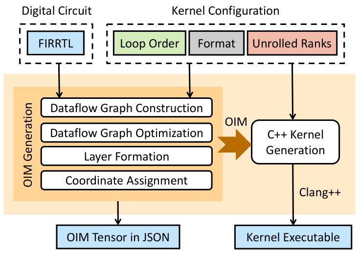

[原文物理页 10](https://arxiv.org/pdf/2601.18140v1#page=10) · [许可证 CC BY 4.0](https://creativecommons.org/licenses/by/4.0/)

署名：Yan Zhu, Boru Chen, Christopher W. Fletcher, Nandeeka Nayak. RTeAAL Sim: Using Tensor Algebra to Represent and Accelerate RTL Simulation (Extended Version). ASPLOS 2026; arXiv extended version. DOI: https://doi.org/10.1145/3779212.3790214. Version: arXiv:2601.18140v1, 26 January 2026, Extended Version; 20-page author manuscript, not publisher PDF. Source: https://arxiv.org/pdf/2601.18140v1. CC BY 4.0: https://creativecommons.org/licenses/by/4.0/. Whole figures cropped from this exact PDF and rasterized at 240 dpi; captions excluded, all figure content unchanged. No endorsement implied.

修改说明：Whole figure cropped from the specified source PDF and rasterized at 240 dpi; numbered caption excluded, figure content unchanged.

