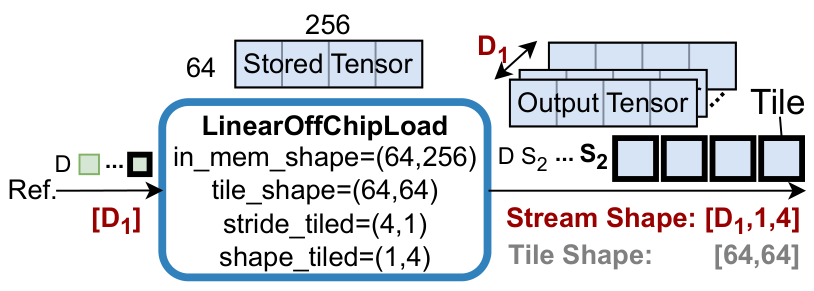
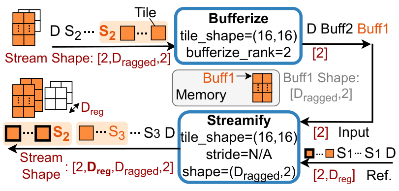
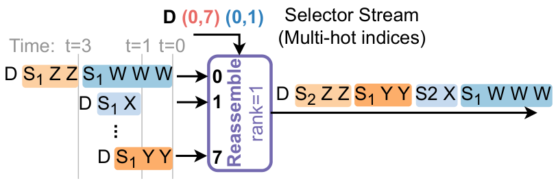
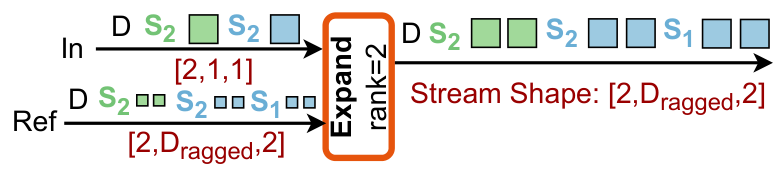
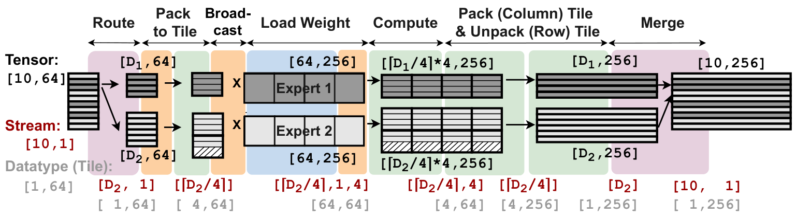
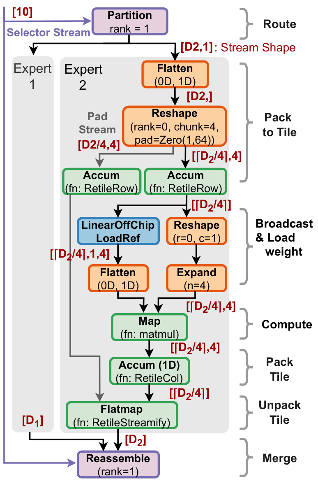
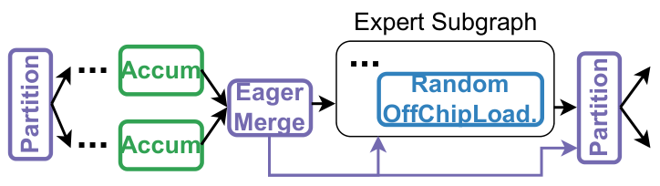
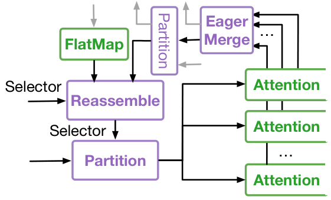

# Streaming Tensor Programs: A Streaming Abstraction for Dynamic Parallelism

[返回图集](../README.md) · STeP · ASPLOS 2026 · 8张非实验图

研究对象：编译器、语言与中间表示 / STeP动态张量程序流式语言抽象

本页仅显示以下非实验图，不包含原论文全部图组。混合图在子图分离复核完成前暂不收录。

版本许可依据：[来源](https://weiya711.github.io/publications/asplos2026step.pdf#page=1)。源PDF SHA256：`f14d0a95630b7f0602b150c3d3f28c4227e43556745ca3339387807c2377899b`。PDF不随库分发。

## 图号导航

[F2](#f2) · [F3](#f3) · [F4](#f4) · [F5](#f5) · [F6](#f6) · [F7](#f7) · [F11](#f11) · [F16](#f16)

## F2

**非实验图 · 片外张量流加载示意图**

[原文物理页 5](https://weiya711.github.io/publications/asplos2026step.pdf#page=5) · [许可证 CC BY 4.0](https://creativecommons.org/licenses/by/4.0/)

署名：Gina Sohn, Genghan Zhang, Konstantin Hossfeld, Jungwoo Kim, Nathan Sobotka, Nathan Zhang, Olivia Hsu, Kunle Olukotun. Streaming Tensor Programs: A Streaming Abstraction for Dynamic Parallelism. ASPLOS 2026. DOI: https://doi.org/10.1145/3779212.3790229. Version: Exact frozen author-hosted ACM-layout 21-page conference manuscript; publisher binary equivalence not asserted. Source: https://weiya711.github.io/publications/asplos2026step.pdf. CC BY 4.0: https://creativecommons.org/licenses/by/4.0/. Whole figures cropped from this exact PDF and rasterized at 240 dpi; captions excluded, all figure content unchanged. No endorsement implied.

修改说明：Whole figure cropped from the specified source PDF and rasterized at 240 dpi; numbered caption excluded, figure content unchanged.

## F3

**非实验图 · 流缓冲与还原算子示意图**

[原文物理页 5](https://weiya711.github.io/publications/asplos2026step.pdf#page=5) · [许可证 CC BY 4.0](https://creativecommons.org/licenses/by/4.0/)

署名：Gina Sohn, Genghan Zhang, Konstantin Hossfeld, Jungwoo Kim, Nathan Sobotka, Nathan Zhang, Olivia Hsu, Kunle Olukotun. Streaming Tensor Programs: A Streaming Abstraction for Dynamic Parallelism. ASPLOS 2026. DOI: https://doi.org/10.1145/3779212.3790229. Version: Exact frozen author-hosted ACM-layout 21-page conference manuscript; publisher binary equivalence not asserted. Source: https://weiya711.github.io/publications/asplos2026step.pdf. CC BY 4.0: https://creativecommons.org/licenses/by/4.0/. Whole figures cropped from this exact PDF and rasterized at 240 dpi; captions excluded, all figure content unchanged. No endorsement implied.

修改说明：Whole figure cropped from the specified source PDF and rasterized at 240 dpi; numbered caption excluded, figure content unchanged.

## F4

**非实验图 · 多路流重组示意图**

[原文物理页 6](https://weiya711.github.io/publications/asplos2026step.pdf#page=6) · [许可证 CC BY 4.0](https://creativecommons.org/licenses/by/4.0/)

署名：Gina Sohn, Genghan Zhang, Konstantin Hossfeld, Jungwoo Kim, Nathan Sobotka, Nathan Zhang, Olivia Hsu, Kunle Olukotun. Streaming Tensor Programs: A Streaming Abstraction for Dynamic Parallelism. ASPLOS 2026. DOI: https://doi.org/10.1145/3779212.3790229. Version: Exact frozen author-hosted ACM-layout 21-page conference manuscript; publisher binary equivalence not asserted. Source: https://weiya711.github.io/publications/asplos2026step.pdf. CC BY 4.0: https://creativecommons.org/licenses/by/4.0/. Whole figures cropped from this exact PDF and rasterized at 240 dpi; captions excluded, all figure content unchanged. No endorsement implied.

修改说明：Whole figure cropped from the specified source PDF and rasterized at 240 dpi; numbered caption excluded, figure content unchanged.

## F5

**非实验图 · 动态流扩展示意图**

[原文物理页 6](https://weiya711.github.io/publications/asplos2026step.pdf#page=6) · [许可证 CC BY 4.0](https://creativecommons.org/licenses/by/4.0/)

署名：Gina Sohn, Genghan Zhang, Konstantin Hossfeld, Jungwoo Kim, Nathan Sobotka, Nathan Zhang, Olivia Hsu, Kunle Olukotun. Streaming Tensor Programs: A Streaming Abstraction for Dynamic Parallelism. ASPLOS 2026. DOI: https://doi.org/10.1145/3779212.3790229. Version: Exact frozen author-hosted ACM-layout 21-page conference manuscript; publisher binary equivalence not asserted. Source: https://weiya711.github.io/publications/asplos2026step.pdf. CC BY 4.0: https://creativecommons.org/licenses/by/4.0/. Whole figures cropped from this exact PDF and rasterized at 240 dpi; captions excluded, all figure content unchanged. No endorsement implied.

修改说明：Whole figure cropped from the specified source PDF and rasterized at 240 dpi; numbered caption excluded, figure content unchanged.

## F6

**非实验图 · 混合专家张量执行流程图**

[原文物理页 7](https://weiya711.github.io/publications/asplos2026step.pdf#page=7) · [许可证 CC BY 4.0](https://creativecommons.org/licenses/by/4.0/)

署名：Gina Sohn, Genghan Zhang, Konstantin Hossfeld, Jungwoo Kim, Nathan Sobotka, Nathan Zhang, Olivia Hsu, Kunle Olukotun. Streaming Tensor Programs: A Streaming Abstraction for Dynamic Parallelism. ASPLOS 2026. DOI: https://doi.org/10.1145/3779212.3790229. Version: Exact frozen author-hosted ACM-layout 21-page conference manuscript; publisher binary equivalence not asserted. Source: https://weiya711.github.io/publications/asplos2026step.pdf. CC BY 4.0: https://creativecommons.org/licenses/by/4.0/. Whole figures cropped from this exact PDF and rasterized at 240 dpi; captions excluded, all figure content unchanged. No endorsement implied.

修改说明：Whole figure cropped from the specified source PDF and rasterized at 240 dpi; numbered caption excluded, figure content unchanged.

## F7

**非实验图 · 混合专家流算子计算图**

[原文物理页 7](https://weiya711.github.io/publications/asplos2026step.pdf#page=7) · [许可证 CC BY 4.0](https://creativecommons.org/licenses/by/4.0/)

署名：Gina Sohn, Genghan Zhang, Konstantin Hossfeld, Jungwoo Kim, Nathan Sobotka, Nathan Zhang, Olivia Hsu, Kunle Olukotun. Streaming Tensor Programs: A Streaming Abstraction for Dynamic Parallelism. ASPLOS 2026. DOI: https://doi.org/10.1145/3779212.3790229. Version: Exact frozen author-hosted ACM-layout 21-page conference manuscript; publisher binary equivalence not asserted. Source: https://weiya711.github.io/publications/asplos2026step.pdf. CC BY 4.0: https://creativecommons.org/licenses/by/4.0/. Whole figures cropped from this exact PDF and rasterized at 240 dpi; captions excluded, all figure content unchanged. No endorsement implied.

修改说明：Whole figure cropped from the specified source PDF and rasterized at 240 dpi; numbered caption excluded, figure content unchanged.

## F11

**非实验图 · 专家配置时分复用计算图**

[原文物理页 11](https://weiya711.github.io/publications/asplos2026step.pdf#page=11) · [许可证 CC BY 4.0](https://creativecommons.org/licenses/by/4.0/)

署名：Gina Sohn, Genghan Zhang, Konstantin Hossfeld, Jungwoo Kim, Nathan Sobotka, Nathan Zhang, Olivia Hsu, Kunle Olukotun. Streaming Tensor Programs: A Streaming Abstraction for Dynamic Parallelism. ASPLOS 2026. DOI: https://doi.org/10.1145/3779212.3790229. Version: Exact frozen author-hosted ACM-layout 21-page conference manuscript; publisher binary equivalence not asserted. Source: https://weiya711.github.io/publications/asplos2026step.pdf. CC BY 4.0: https://creativecommons.org/licenses/by/4.0/. Whole figures cropped from this exact PDF and rasterized at 240 dpi; captions excluded, all figure content unchanged. No endorsement implied.

修改说明：Whole figure cropped from the specified source PDF and rasterized at 240 dpi; numbered caption excluded, figure content unchanged.

## F16

**非实验图 · 动态并行注意力计算图**

[原文物理页 13](https://weiya711.github.io/publications/asplos2026step.pdf#page=13) · [许可证 CC BY 4.0](https://creativecommons.org/licenses/by/4.0/)

署名：Gina Sohn, Genghan Zhang, Konstantin Hossfeld, Jungwoo Kim, Nathan Sobotka, Nathan Zhang, Olivia Hsu, Kunle Olukotun. Streaming Tensor Programs: A Streaming Abstraction for Dynamic Parallelism. ASPLOS 2026. DOI: https://doi.org/10.1145/3779212.3790229. Version: Exact frozen author-hosted ACM-layout 21-page conference manuscript; publisher binary equivalence not asserted. Source: https://weiya711.github.io/publications/asplos2026step.pdf. CC BY 4.0: https://creativecommons.org/licenses/by/4.0/. Whole figures cropped from this exact PDF and rasterized at 240 dpi; captions excluded, all figure content unchanged. No endorsement implied.

修改说明：Whole figure cropped from the specified source PDF and rasterized at 240 dpi; numbered caption excluded, figure content unchanged.

