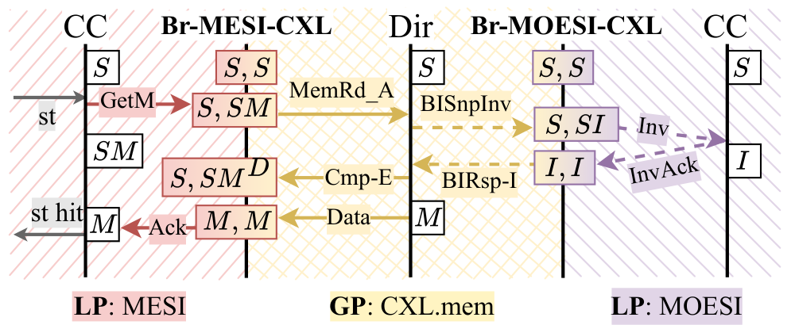
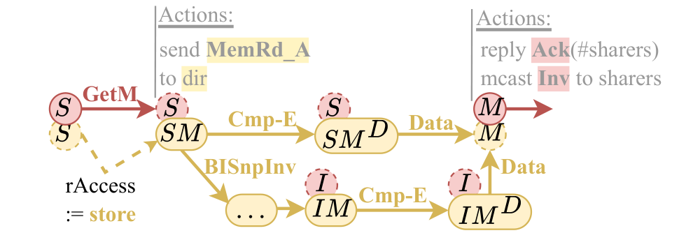

# vCXLGen: Automated Synthesis and Verification of CXL Bridges for Heterogeneous Architectures

[返回图集](../README.md) · vCXLGen · ASPLOS 2026 · 样本外补充

研究对象：RTL验证、生成与修复工具 / vCXLGen异构缓存一致性协议桥的自动合成与验证（样本外补充）

20页作者Git稿，样本外补充，不计入固定100篇；仅收完整非实验F4/F6，不上传PDF，不声称与出版社文件字节一致。

F4（物理p5）追一次跨域事务 → 原文F5（物理p7，仅链接）看桥合成过程 → F6（物理p7）追 (S,S)+GetM 的状态分支。

读图练习：F4 中本地 GetM 为什么不能立即回复？到 F6 找出全局请求、响应和本地 Ack 对应的转换及动作；图中的状态对分别记录本地目录与全局缓存视角，不能把每个状态当作另一台机器。消息时序和转换分支提供不同视角，不替代形式验证。

[F5：合成流程与输入事务（原文物理p7，仅链接）](https://raw.githubusercontent.com/NicCarp11/niccarp11.github.io/7d759dda2b5628601d8338c563449a7fbd31edeb/papers/vcxlgen-asplos26-preprint.pdf#page=7)。它解释如何把本地和全局输入协议组合成桥，不把生成的 SLICC 模型称作运行生成器的宿主硬件。

### 后续阅读：SYNAPSE 的策略如何约束协议

SYNAPSE（MICRO 2026）是另一个控制器合成工作；以下只链接 TUM 的16页 PDF，不将其当作 vCXLGen 的同一工具。先沿 [F4(a)（物理p5）](https://dse.in.tum.de/wp-content/uploads/2026/10/Synapse_MICRO26.pdf#page=5)读 inclusive LLC 的读缺失：来自下层的 GetS 在数据或权限不足时经 client 向上继续请求。再到 [F5–F7 与 §VI-B（物理p8）](https://dse.in.tum.de/wp-content/uploads/2026/10/Synapse_MICRO26.pdf#page=8)，分别找到 coherence protocol、cache policy、system topology 三项独立输入。

练习：用 F6 的抽象策略去匹配 F7 的 MESIF 事务，为什么 F、E 两个终态都能留下？§VI-B 的例子要求最终可读且数据存在；F 提供读权限，E 提供读写权限，两者的标签都与策略要求兼容，所以合成保留两条结束路径。这不是同一次事务同时停在两个状态，也不是按性能选择胜者。

分开看三层证据：控制器 FSM 合成产生状态机；Murφ 检查生成的有限系统模型中的安全性与活性；SLICC 后端让控制器进入 gem5 模拟。后两者不等于 RTL 生成或真实硬件实测，也不把有限模型检查推广为任意规模系统的保证。此处核对正文、图注与页码，未新作视觉审核；不描述字体、画法或布局，不复制图，不据代码许可证推断图的转载权。

来源：[精确作者Git文件](https://github.com/NicCarp11/niccarp11.github.io/blob/7d759dda2b5628601d8338c563449a7fbd31edeb/papers/vcxlgen-asplos26-preprint.pdf)。首页可见 CC BY 4.0、DOI 10.1145/3779212.3790245；20页作者稿，不推定与正式出版社文件字节相同。源PDF SHA-256：`7b94d57e9f5e67e92cf3acf554c45b77e9877838ada07aeaad484acf32228113`；Git blob：`155054ad656dec2d65d69f81d3c4b57b7660d60c`。已目视核对首页、图页、图注和最终裁图，未发现这两图的第三方署名或许可例外。PDF不随库分发。

## 图号导航

[F4](#f4) · [F6](#f6)

## F4

读图练习：本地 Ack 等哪条跨域响应？结合 §5.2，桥须收到嵌套全局事务的 Cmp-E 后才向本地回复；F4 的具体路径还画出了 Data 返回，再到 Ack。按事件依赖读，不把消息间距读成延迟。

对照 Avicenna 作者版 [F2（物理p5）](https://khiemn.com/publication/avicenna/avicenna-eurosys26.pdf#page=5)：同样先读事件顺序，间距不代表耗时。再看 [F4 与 §4.4（物理p9）](https://khiemn.com/publication/avicenna/avicenna-eurosys26.pdf#page=9)，从发请求到 RealCommitted 是提交延迟，到 ProposeReply 才是端到端延迟；必须先确定终点，才能比较“完成”。[F5（物理p10）](https://khiemn.com/publication/avicenna/avicenna-eurosys26.pdf#page=10)才是有数轴的观测延迟分布，仅作为原文证据链接，不收入非实验原图库。两篇处理的问题不同，不能把协议响应与事务提交事件视为同一实现。

**非实验图 · 事务消息时序图**

[原文物理页 5](https://raw.githubusercontent.com/NicCarp11/niccarp11.github.io/7d759dda2b5628601d8338c563449a7fbd31edeb/papers/vcxlgen-asplos26-preprint.pdf#page=5) · [许可证 CC BY 4.0](https://creativecommons.org/licenses/by/4.0/)

共享状态下的 store miss 先触发本地 GetM，再由桥发送全局 MemRd_A；沿另一主机的失效及响应路径返回，最后本地 Ack 才让请求完成。纵向位置示意消息先后，不是实测时间刻度；图中桥状态同时包含本地与全局协议状态。 样本外补充，不计入固定100篇样本或其分类覆盖完成量。

署名：Anatole Lefort, Julian Pritzi, Nicolò Carpentieri, David Schall, Simon Dittrich, Soham Chakraborty, Nicolai Oswald, Pramod Bhatotia. vCXLGen: Automated Synthesis and Verification of CXL Bridges for Heterogeneous Architectures. ASPLOS 2026. DOI: https://doi.org/10.1145/3779212.3790245. Copyright 2026 held by the owner/authors. Source: https://github.com/NicCarp11/niccarp11.github.io/blob/7d759dda2b5628601d8338c563449a7fbd31edeb/papers/vcxlgen-asplos26-preprint.pdf. Version: 20-page ASPLOS 2026 author preprint in Git commit 7d759dda2b5628601d8338c563449a7fbd31edeb, blob 155054ad656dec2d65d69f81d3c4b57b7660d60c; not asserted publisher-byte-identical. CC BY 4.0: https://creativecommons.org/licenses/by/4.0/. Whole figure cropped from the exact author preprint and rasterized at 300 dpi; caption excluded, all protocol labels, states, message arrows and action annotations retained; no redrawing or recoloring. No endorsement implied.

修改说明：Whole figure cropped from the exact author preprint and rasterized at 300 dpi; caption excluded, all protocol labels, states, message arrows and action annotations retained; no redrawing or recoloring.

## F6

**非实验图 · 协议状态转换图**

[原文物理页 7](https://raw.githubusercontent.com/NicCarp11/niccarp11.github.io/7d759dda2b5628601d8338c563449a7fbd31edeb/papers/vcxlgen-asplos26-preprint.pdf#page=7) · [许可证 CC BY 4.0](https://creativecommons.org/licenses/by/4.0/)

把 (S,S)+GetM 展开成桥的转换图，沿 Cmp-E、Data 以及可能到来的 BISnpInv 追踪不同分支；动作注释分别说明发出全局请求和向本地回复。该图展示合成结果的一部分，不是仅靠这张图就证明整个协议正确。 样本外补充，不计入固定100篇样本或其分类覆盖完成量。

署名：Anatole Lefort, Julian Pritzi, Nicolò Carpentieri, David Schall, Simon Dittrich, Soham Chakraborty, Nicolai Oswald, Pramod Bhatotia. vCXLGen: Automated Synthesis and Verification of CXL Bridges for Heterogeneous Architectures. ASPLOS 2026. DOI: https://doi.org/10.1145/3779212.3790245. Copyright 2026 held by the owner/authors. Source: https://github.com/NicCarp11/niccarp11.github.io/blob/7d759dda2b5628601d8338c563449a7fbd31edeb/papers/vcxlgen-asplos26-preprint.pdf. Version: 20-page ASPLOS 2026 author preprint in Git commit 7d759dda2b5628601d8338c563449a7fbd31edeb, blob 155054ad656dec2d65d69f81d3c4b57b7660d60c; not asserted publisher-byte-identical. CC BY 4.0: https://creativecommons.org/licenses/by/4.0/. Whole figure cropped from the exact author preprint and rasterized at 300 dpi; caption excluded, all protocol labels, states, message arrows and action annotations retained; no redrawing or recoloring. No endorsement implied.

修改说明：Whole figure cropped from the exact author preprint and rasterized at 300 dpi; caption excluded, all protocol labels, states, message arrows and action annotations retained; no redrawing or recoloring.
