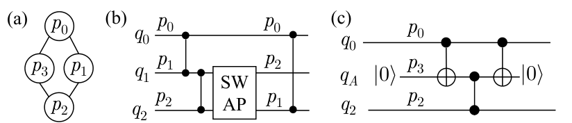
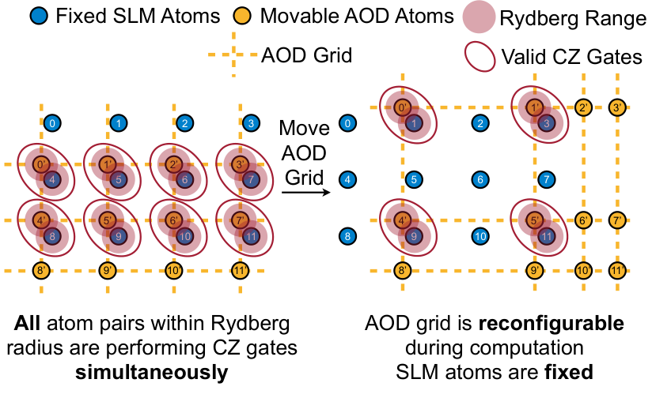
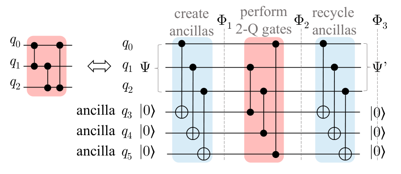
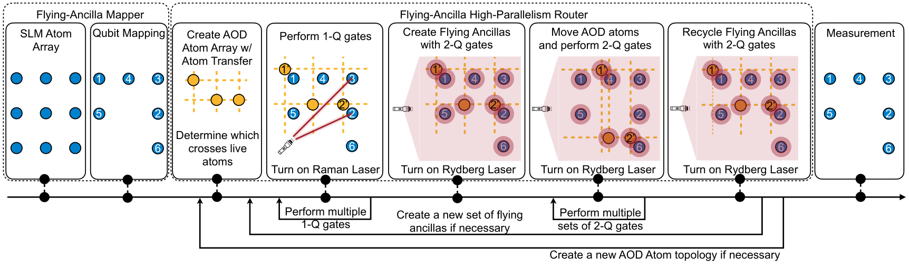
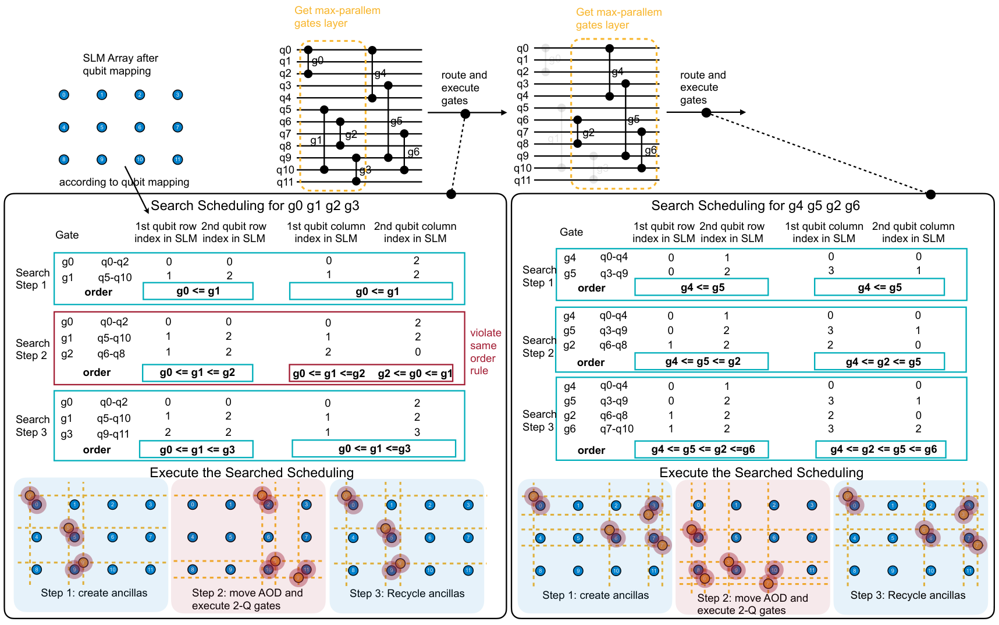
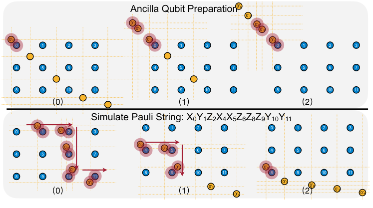
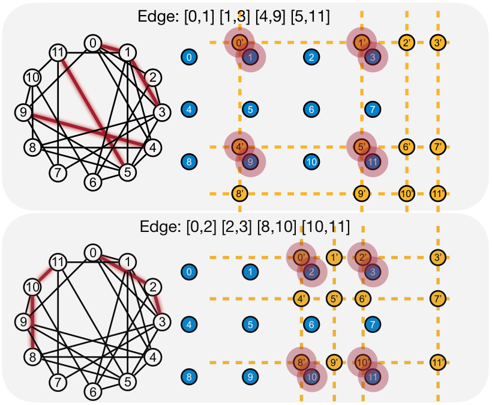
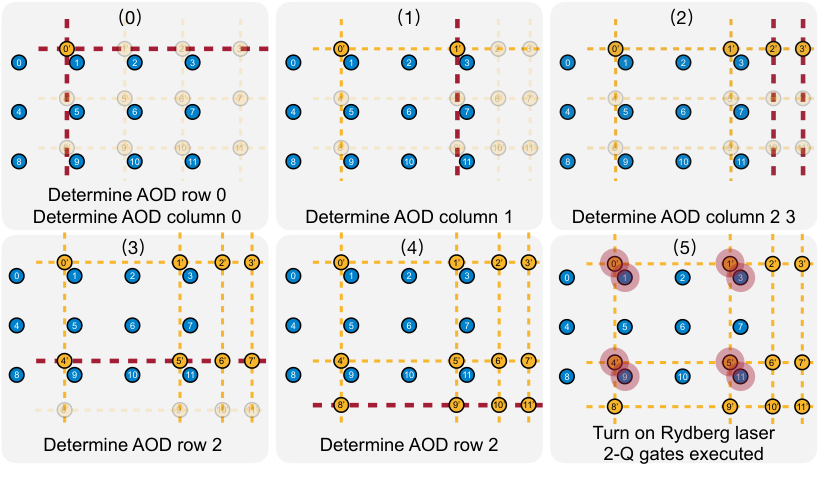

# Q-Pilot: Field Programmable Qubit Array Compilation with Flying Ancillas

[返回图集](../README.md) · Q-Pilot · arXiv v3 / DAC 2024 · 8张非实验图

研究对象：编译器、语言与中间表示 / Q-Pilot可移动中性原子阵列量子编译器

本页仅显示以下非实验图，不包含原论文全部图组。混合图在子图分离复核完成前暂不收录。

使用 2024-09-11 的 arXiv v3 十页扩展稿（16图），不等同六页正式版。 本图库当前收录8张非实验图：F1、F2、F3、F4、F5、F6、F7、F8。

版本许可依据：[来源](https://arxiv.org/abs/2311.16190v3)。源PDF SHA256：`3cafdce9a205fe6de84497b4446ce0d4fe529e99487c4922bd64dc911e5ee331`。PDF不随库分发。

## 图号导航

[F1](#f1) · [F2](#f2) · [F3](#f3) · [F4](#f4) · [F5](#f5) · [F6](#f6) · [F7](#f7) · [F8](#f8)

## F1

**非实验图 · 量子门映射与辅助位**

[原文物理页 1](https://scopex-asu.github.io/files/publications/Quant_DAC2024_Gu.pdf#page=1) · [许可证 CC BY 4.0](https://creativecommons.org/licenses/by/4.0/)

署名：Hanrui Wang, Daniel Bochen Tan, Pengyu Liu, Yilian Liu, Jiaqi Gu, Jason Cong, Song Han. Q-Pilot: Field Programmable Qubit Array Compilation with Flying Ancillas. DAC 2024; author extended manuscript arXiv:2311.16190v3, 11 September 2024, 10 pages (not the six-page proceedings edition). DOI: https://doi.org/10.1145/3649329.3658470. © 2024 the owner/authors. Source: https://scopex-asu.github.io/files/publications/Quant_DAC2024_Gu.pdf. CC BY 4.0: https://creativecommons.org/licenses/by/4.0/, as specified by the exact v3 article-rights metadata at https://arxiv.org/abs/2311.16190v3. Whole figures cropped from the specified PDF and rasterized at 240 dpi; captions excluded, figure contents unchanged. No endorsement implied.

修改说明：Whole figure cropped from the specified source PDF and rasterized at 240 dpi; numbered caption excluded, figure content unchanged.

## F2

**非实验图 · 可重构原子阵列**

[原文物理页 1](https://scopex-asu.github.io/files/publications/Quant_DAC2024_Gu.pdf#page=1) · [许可证 CC BY 4.0](https://creativecommons.org/licenses/by/4.0/)

署名：Hanrui Wang, Daniel Bochen Tan, Pengyu Liu, Yilian Liu, Jiaqi Gu, Jason Cong, Song Han. Q-Pilot: Field Programmable Qubit Array Compilation with Flying Ancillas. DAC 2024; author extended manuscript arXiv:2311.16190v3, 11 September 2024, 10 pages (not the six-page proceedings edition). DOI: https://doi.org/10.1145/3649329.3658470. © 2024 the owner/authors. Source: https://scopex-asu.github.io/files/publications/Quant_DAC2024_Gu.pdf. CC BY 4.0: https://creativecommons.org/licenses/by/4.0/, as specified by the exact v3 article-rights metadata at https://arxiv.org/abs/2311.16190v3. Whole figures cropped from the specified PDF and rasterized at 240 dpi; captions excluded, figure contents unchanged. No endorsement implied.

修改说明：Whole figure cropped from the specified source PDF and rasterized at 240 dpi; numbered caption excluded, figure content unchanged.

## F3

**非实验图 · 辅助位路由电路**

[原文物理页 2](https://scopex-asu.github.io/files/publications/Quant_DAC2024_Gu.pdf#page=2) · [许可证 CC BY 4.0](https://creativecommons.org/licenses/by/4.0/)

署名：Hanrui Wang, Daniel Bochen Tan, Pengyu Liu, Yilian Liu, Jiaqi Gu, Jason Cong, Song Han. Q-Pilot: Field Programmable Qubit Array Compilation with Flying Ancillas. DAC 2024; author extended manuscript arXiv:2311.16190v3, 11 September 2024, 10 pages (not the six-page proceedings edition). DOI: https://doi.org/10.1145/3649329.3658470. © 2024 the owner/authors. Source: https://scopex-asu.github.io/files/publications/Quant_DAC2024_Gu.pdf. CC BY 4.0: https://creativecommons.org/licenses/by/4.0/, as specified by the exact v3 article-rights metadata at https://arxiv.org/abs/2311.16190v3. Whole figures cropped from the specified PDF and rasterized at 240 dpi; captions excluded, figure contents unchanged. No endorsement implied.

修改说明：Whole figure cropped from the specified source PDF and rasterized at 240 dpi; numbered caption excluded, figure content unchanged.

## F4

**非实验图 · 编译与路由流程**

[原文物理页 3](https://scopex-asu.github.io/files/publications/Quant_DAC2024_Gu.pdf#page=3) · [许可证 CC BY 4.0](https://creativecommons.org/licenses/by/4.0/)

署名：Hanrui Wang, Daniel Bochen Tan, Pengyu Liu, Yilian Liu, Jiaqi Gu, Jason Cong, Song Han. Q-Pilot: Field Programmable Qubit Array Compilation with Flying Ancillas. DAC 2024; author extended manuscript arXiv:2311.16190v3, 11 September 2024, 10 pages (not the six-page proceedings edition). DOI: https://doi.org/10.1145/3649329.3658470. © 2024 the owner/authors. Source: https://scopex-asu.github.io/files/publications/Quant_DAC2024_Gu.pdf. CC BY 4.0: https://creativecommons.org/licenses/by/4.0/, as specified by the exact v3 article-rights metadata at https://arxiv.org/abs/2311.16190v3. Whole figures cropped from the specified PDF and rasterized at 240 dpi; captions excluded, figure contents unchanged. No endorsement implied.

修改说明：Whole figure cropped from the specified source PDF and rasterized at 240 dpi; numbered caption excluded, figure content unchanged.

## F5

**非实验图 · 通用路由调度示例**

[原文物理页 5](https://scopex-asu.github.io/files/publications/Quant_DAC2024_Gu.pdf#page=5) · [许可证 CC BY 4.0](https://creativecommons.org/licenses/by/4.0/)

署名：Hanrui Wang, Daniel Bochen Tan, Pengyu Liu, Yilian Liu, Jiaqi Gu, Jason Cong, Song Han. Q-Pilot: Field Programmable Qubit Array Compilation with Flying Ancillas. DAC 2024; author extended manuscript arXiv:2311.16190v3, 11 September 2024, 10 pages (not the six-page proceedings edition). DOI: https://doi.org/10.1145/3649329.3658470. © 2024 the owner/authors. Source: https://scopex-asu.github.io/files/publications/Quant_DAC2024_Gu.pdf. CC BY 4.0: https://creativecommons.org/licenses/by/4.0/, as specified by the exact v3 article-rights metadata at https://arxiv.org/abs/2311.16190v3. Whole figures cropped from the specified PDF and rasterized at 240 dpi; captions excluded, figure contents unchanged. No endorsement implied.

修改说明：Whole figure cropped from the specified source PDF and rasterized at 240 dpi; numbered caption excluded, figure content unchanged.

## F6

**非实验图 · 量子模拟专用路由**

[原文物理页 5](https://scopex-asu.github.io/files/publications/Quant_DAC2024_Gu.pdf#page=5) · [许可证 CC BY 4.0](https://creativecommons.org/licenses/by/4.0/)

署名：Hanrui Wang, Daniel Bochen Tan, Pengyu Liu, Yilian Liu, Jiaqi Gu, Jason Cong, Song Han. Q-Pilot: Field Programmable Qubit Array Compilation with Flying Ancillas. DAC 2024; author extended manuscript arXiv:2311.16190v3, 11 September 2024, 10 pages (not the six-page proceedings edition). DOI: https://doi.org/10.1145/3649329.3658470. © 2024 the owner/authors. Source: https://scopex-asu.github.io/files/publications/Quant_DAC2024_Gu.pdf. CC BY 4.0: https://creativecommons.org/licenses/by/4.0/, as specified by the exact v3 article-rights metadata at https://arxiv.org/abs/2311.16190v3. Whole figures cropped from the specified PDF and rasterized at 240 dpi; captions excluded, figure contents unchanged. No endorsement implied.

修改说明：Whole figure cropped from the specified source PDF and rasterized at 240 dpi; numbered caption excluded, figure content unchanged.

## F7

**非实验图 · QAOA图与阵列映射**

[原文物理页 5](https://scopex-asu.github.io/files/publications/Quant_DAC2024_Gu.pdf#page=5) · [许可证 CC BY 4.0](https://creativecommons.org/licenses/by/4.0/)

署名：Hanrui Wang, Daniel Bochen Tan, Pengyu Liu, Yilian Liu, Jiaqi Gu, Jason Cong, Song Han. Q-Pilot: Field Programmable Qubit Array Compilation with Flying Ancillas. DAC 2024; author extended manuscript arXiv:2311.16190v3, 11 September 2024, 10 pages (not the six-page proceedings edition). DOI: https://doi.org/10.1145/3649329.3658470. © 2024 the owner/authors. Source: https://scopex-asu.github.io/files/publications/Quant_DAC2024_Gu.pdf. CC BY 4.0: https://creativecommons.org/licenses/by/4.0/, as specified by the exact v3 article-rights metadata at https://arxiv.org/abs/2311.16190v3. Whole figures cropped from the specified PDF and rasterized at 240 dpi; captions excluded, figure contents unchanged. No endorsement implied.

修改说明：Whole figure cropped from the specified source PDF and rasterized at 240 dpi; numbered caption excluded, figure content unchanged.

## F8

**非实验图 · QAOA单阶段调度**

[原文物理页 6](https://scopex-asu.github.io/files/publications/Quant_DAC2024_Gu.pdf#page=6) · [许可证 CC BY 4.0](https://creativecommons.org/licenses/by/4.0/)

署名：Hanrui Wang, Daniel Bochen Tan, Pengyu Liu, Yilian Liu, Jiaqi Gu, Jason Cong, Song Han. Q-Pilot: Field Programmable Qubit Array Compilation with Flying Ancillas. DAC 2024; author extended manuscript arXiv:2311.16190v3, 11 September 2024, 10 pages (not the six-page proceedings edition). DOI: https://doi.org/10.1145/3649329.3658470. © 2024 the owner/authors. Source: https://scopex-asu.github.io/files/publications/Quant_DAC2024_Gu.pdf. CC BY 4.0: https://creativecommons.org/licenses/by/4.0/, as specified by the exact v3 article-rights metadata at https://arxiv.org/abs/2311.16190v3. Whole figures cropped from the specified PDF and rasterized at 240 dpi; captions excluded, figure contents unchanged. No endorsement implied.

修改说明：Whole figure cropped from the specified source PDF and rasterized at 240 dpi; numbered caption excluded, figure content unchanged.

