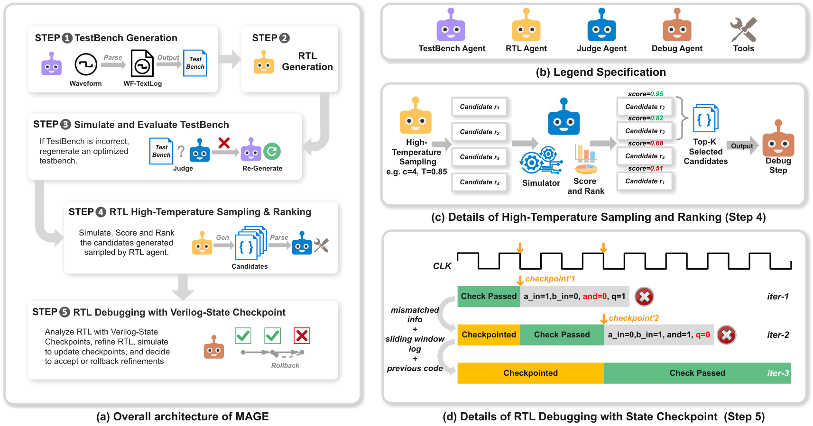
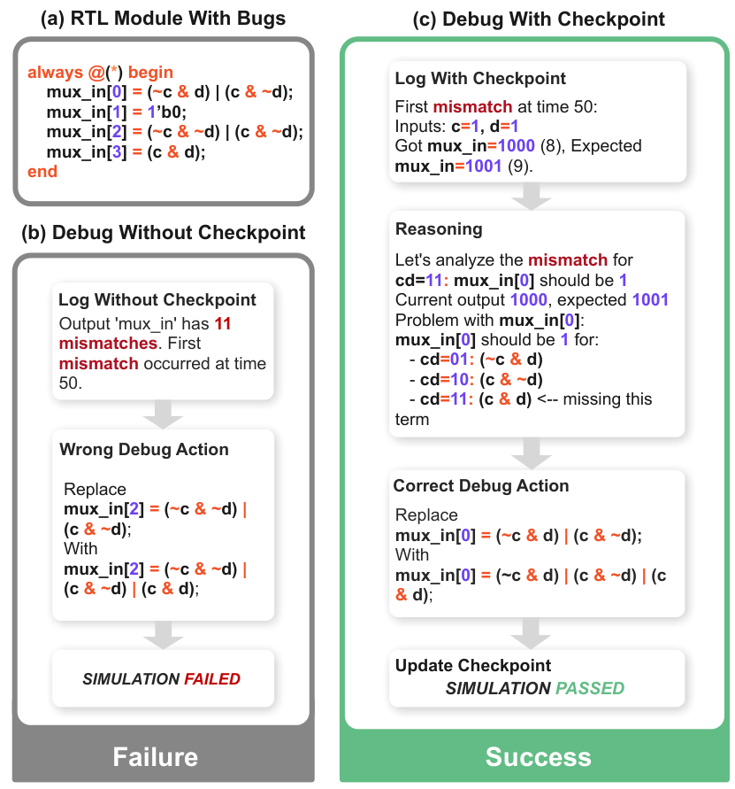

# MAGE: A Multi-Agent Engine for Automated RTL Code Generation

[返回图集](../README.md) · MAGE · DAC 2025 / arXiv v1 · 2张非实验图

研究对象：RTL验证、生成与修复工具 / MAGE多代理RTL代码生成与调试系统

本页仅显示以下非实验图，不包含原论文全部图组。混合图在子图分离复核完成前暂不收录。

版本许可依据：[来源](https://arxiv.org/abs/2412.07822v1)。源PDF SHA256：`2761814d5d60a34d1ca39410bb3190bd95017d3d0156ab842f353be8c13debcb`。PDF不随库分发。

## 图号导航

[F1](#f1) · [F3](#f3)

## F1

**非实验图 · 多智能体RTL生成架构图**

[原文物理页 3](https://arxiv.org/pdf/2412.07822v1#page=3) · [许可证 CC BY 4.0](https://creativecommons.org/licenses/by/4.0/)

原图 (c)/(d) 与图注对应描述顺序不一致，这里保留原样。

署名：Yujie Zhao, Hejia Zhang, Hanxian Huang, Zhongming Yu, Jishen Zhao. MAGE: A Multi-Agent Engine for Automated RTL Code Generation. DAC 2025; author manuscript 2024. DOI: https://doi.org/10.1109/DAC63849.2025.11133191. Version: arXiv:2412.07822v1, 10 December 2024; seven-page author manuscript, not a claim of final DAC PDF identity. Source: https://arxiv.org/pdf/2412.07822v1. CC BY 4.0: https://creativecommons.org/licenses/by/4.0/. Whole figures cropped from this exact PDF and rasterized at 240 dpi; captions excluded, all figure content unchanged. No endorsement implied.

修改说明：Whole figure cropped from the specified source PDF and rasterized at 240 dpi; numbered caption excluded, figure content unchanged.

## F3

**非实验图 · 检查点调试案例对比图**

[原文物理页 6](https://arxiv.org/pdf/2412.07822v1#page=6) · [许可证 CC BY 4.0](https://creativecommons.org/licenses/by/4.0/)

这是调试案例对比，不是总体统计。

署名：Yujie Zhao, Hejia Zhang, Hanxian Huang, Zhongming Yu, Jishen Zhao. MAGE: A Multi-Agent Engine for Automated RTL Code Generation. DAC 2025; author manuscript 2024. DOI: https://doi.org/10.1109/DAC63849.2025.11133191. Version: arXiv:2412.07822v1, 10 December 2024; seven-page author manuscript, not a claim of final DAC PDF identity. Source: https://arxiv.org/pdf/2412.07822v1. CC BY 4.0: https://creativecommons.org/licenses/by/4.0/. Whole figures cropped from this exact PDF and rasterized at 240 dpi; captions excluded, all figure content unchanged. No endorsement implied.

修改说明：Whole figure cropped from the specified source PDF and rasterized at 240 dpi; numbered caption excluded, figure content unchanged.

