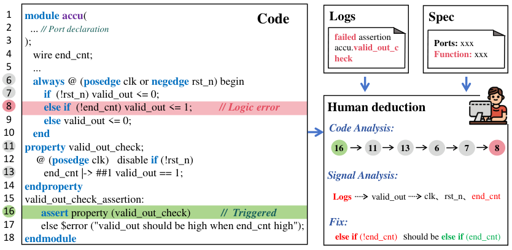

# Insights from Rights and Wrongs: A Large Language Model for Solving Assertion Failures in RTL Design

[返回图集](../README.md) · Rights / AssertSolver · DAC 2025 · 1张非实验图

研究对象：RTL验证、生成与修复工具 / AssertSolver RTL断言修复模型与工具链

本页仅显示以下非实验图，不包含原论文全部图组。混合图在子图分离复核完成前暂不收录。

未收录图片不代表获得公开再分发许可。 本图库当前收录1张非实验图：F1。

版本许可依据：[来源](https://eprints.whiterose.ac.uk/id/eprint/225387/)。源PDF SHA256：`190171f3a991aac3ec799ec88c6a6df8915ba5abf17092856e412a6c2f72ef14`。PDF不随库分发。

## 图号导航

[F1](#f1)

## F1

**非实验图 · 断言失败人工定位示意**

[原文物理页 1](https://arxiv.org/pdf/2503.04057v1#page=1) · [许可证 CC BY 2.5](https://creativecommons.org/licenses/by/2.5/)

署名：Jie Zhou, Youshu Ji, Ning Wang, Yuchen Hu, Xinyao Jiao, Bingkun Yao, Xinwei Fang, Shuai Zhao, Nan Guan, and Zhe Jiang. Insights from Rights and Wrongs: A Large Language Model for Solving Assertion Failures in RTL Design. DAC 2025. Author manuscript arXiv:2503.04057v1, 6 March 2025. DOI: https://doi.org/10.1109/DAC63849.2025.11133100. Source: https://arxiv.org/pdf/2503.04057v1. CC BY 2.5: https://creativecommons.org/licenses/by/2.5/, evidenced by the matching v1 accepted manuscript at https://eprints.whiterose.ac.uk/id/eprint/225387/. Whole figures cropped from the exact historical PDF and rasterized at 240 dpi; captions excluded and figure content unchanged. No endorsement implied.

修改说明：Whole figure cropped from the specified source PDF and rasterized at 240 dpi; numbered caption excluded, figure content unchanged.

