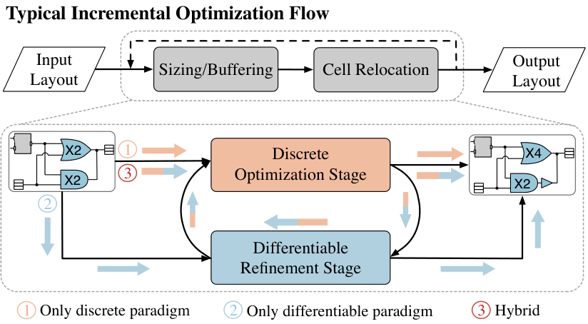
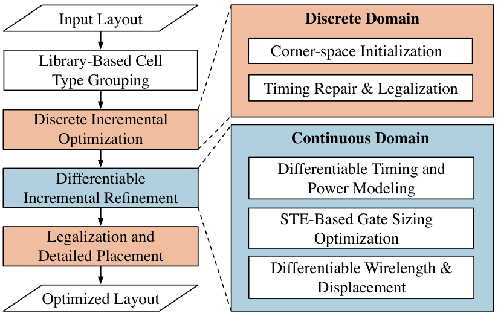
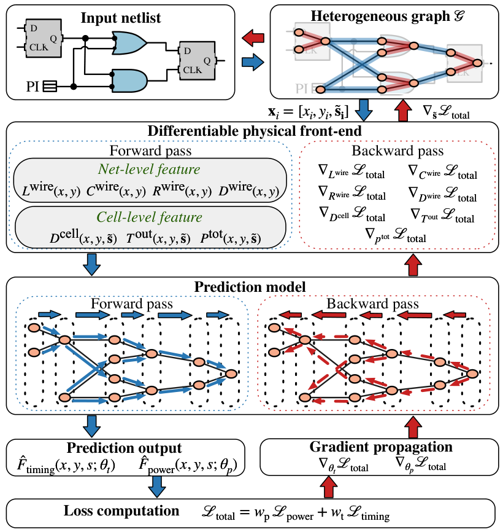

# HyPAS: A Hybrid Optimization Framework for Placement and Sizing Co-Optimization

[返回图集](../README.md) · HyPAS · DAC 2026 · 3张非实验图

研究对象：EDA工具与电路设计表示 / HyPAS增量布局与单元尺寸协同优化（DAC 2026样本外补充）

DAC 2026作者Git版本，7页；样本外补充，仅收F1–F3，不计入固定100篇或其分类覆盖完成量。F5测量图排除；机制图不是性能或收敛保证。

F1（物理第1页）比较优化范式 → F2（物理第2页）展开离散选择、可微细化与合法化 → F3（物理第3页）追踪时序/功耗代理模型及梯度。

读图练习：F2 中哪个阶段把连续细化结果送回合法布局？再沿 F3 找预测量和梯度路径，结合第3.4节回答当前实现更新哪些尺寸选择参数，而位置由谁优化。

版本许可依据：[精确作者 Git 文件](https://github.com/wuqian-tang/wuqian-tang.github.io/blob/2338615840ae4671ca06729e955f175c700e68f2/site/files/papers/2026-dac-hypas.pdf)，7页 PDF 首页明确 CC BY 4.0，DOI 10.1145/3770743.3804137。源 PDF SHA-256：`d843ea04b2746e449c7ded65ab06bb5f5d9d11f969251962c6feec7bdb930ca0`；git blob：`f93e5c110325d6d0029b5e8542f5cf77fab633f0`。PDF不随库分发。

## 图号导航

[F1](#f1) · [F2](#f2) · [F3](#f3)

## F1

**非实验图 · 增量布局优化范式对比图**

[原文物理页 1](https://raw.githubusercontent.com/wuqian-tang/wuqian-tang.github.io/2338615840ae4671ca06729e955f175c700e68f2/site/files/papers/2026-dac-hypas.pdf#page=1) · [许可证 CC BY 4.0](https://creativecommons.org/licenses/by/4.0/)

先看典型增量优化，再比较仅离散、仅可微与混合三种范式。连线表达优化阶段如何组合，不是芯片互连拓扑，也不是性能曲线。 样本外补充，不计入固定100篇样本或其分类覆盖完成量。

署名：Fangzhou Liu, Wuqian Tang, Bo-Ying Wang, An-Chieh Shen, Han-Wen Tsao, Yuyang Ye, Yun Shao, Chun-Yao Wang, Bei Yu. HyPAS: A Hybrid Optimization Framework for Placement and Sizing Co-Optimization. DAC 2026. DOI: https://doi.org/10.1145/3770743.3804137. Copyright 2026 held by the owner/authors. Source: https://github.com/wuqian-tang/wuqian-tang.github.io/blob/2338615840ae4671ca06729e955f175c700e68f2/site/files/papers/2026-dac-hypas.pdf. Version: 7-page DAC 2026 PDF in author repository commit 2338615840ae4671ca06729e955f175c700e68f2, blob f93e5c110325d6d0029b5e8542f5cf77fab633f0. CC BY 4.0: https://creativecommons.org/licenses/by/4.0/. Whole figure cropped from the exact author-hosted PDF and rasterized at 240 dpi; main caption excluded, all diagram boundaries and labels retained; no redrawing. No endorsement implied.

修改说明：Whole figure cropped from the exact author-hosted PDF and rasterized at 240 dpi; main caption excluded, all diagram boundaries and labels retained; no redrawing.

## F2

**非实验图 · 混合优化工作流图**

[原文物理页 2](https://raw.githubusercontent.com/wuqian-tang/wuqian-tang.github.io/2338615840ae4671ca06729e955f175c700e68f2/site/files/papers/2026-dac-hypas.pdf#page=2) · [许可证 CC BY 4.0](https://creativecommons.org/licenses/by/4.0/)

从输入布局出发，经单元候选类型分组与离散增量优化进入可微细化，最后合法化和详细布局。右侧展开离散与连续阶段的任务；可微阶段的输出仍需满足实际布局约束。 样本外补充，不计入固定100篇样本或其分类覆盖完成量。

署名：Fangzhou Liu, Wuqian Tang, Bo-Ying Wang, An-Chieh Shen, Han-Wen Tsao, Yuyang Ye, Yun Shao, Chun-Yao Wang, Bei Yu. HyPAS: A Hybrid Optimization Framework for Placement and Sizing Co-Optimization. DAC 2026. DOI: https://doi.org/10.1145/3770743.3804137. Copyright 2026 held by the owner/authors. Source: https://github.com/wuqian-tang/wuqian-tang.github.io/blob/2338615840ae4671ca06729e955f175c700e68f2/site/files/papers/2026-dac-hypas.pdf. Version: 7-page DAC 2026 PDF in author repository commit 2338615840ae4671ca06729e955f175c700e68f2, blob f93e5c110325d6d0029b5e8542f5cf77fab633f0. CC BY 4.0: https://creativecommons.org/licenses/by/4.0/. Whole figure cropped from the exact author-hosted PDF and rasterized at 240 dpi; main caption excluded, all diagram boundaries and labels retained; no redrawing. No endorsement implied.

修改说明：Whole figure cropped from the exact author-hosted PDF and rasterized at 240 dpi; main caption excluded, all diagram boundaries and labels retained; no redrawing.

## F3

**非实验图 · 可微时序功耗代理模型图**

[原文物理页 3](https://raw.githubusercontent.com/wuqian-tang/wuqian-tang.github.io/2338615840ae4671ca06729e955f175c700e68f2/site/files/papers/2026-dac-hypas.pdf#page=3) · [许可证 CC BY 4.0](https://creativecommons.org/licenses/by/4.0/)

从网表与异构图追到物理特征、时序/功耗预测和损失，再反向追梯度。结合第3.4节的实现边界：当前代理模型梯度仅用于尺寸选择的s-logits，单元位置仍由DREAMPlace优化；不要把图的抽象参数依赖当作所有参数都沿同一路径更新。 样本外补充，不计入固定100篇样本或其分类覆盖完成量。

署名：Fangzhou Liu, Wuqian Tang, Bo-Ying Wang, An-Chieh Shen, Han-Wen Tsao, Yuyang Ye, Yun Shao, Chun-Yao Wang, Bei Yu. HyPAS: A Hybrid Optimization Framework for Placement and Sizing Co-Optimization. DAC 2026. DOI: https://doi.org/10.1145/3770743.3804137. Copyright 2026 held by the owner/authors. Source: https://github.com/wuqian-tang/wuqian-tang.github.io/blob/2338615840ae4671ca06729e955f175c700e68f2/site/files/papers/2026-dac-hypas.pdf. Version: 7-page DAC 2026 PDF in author repository commit 2338615840ae4671ca06729e955f175c700e68f2, blob f93e5c110325d6d0029b5e8542f5cf77fab633f0. CC BY 4.0: https://creativecommons.org/licenses/by/4.0/. Whole figure cropped from the exact author-hosted PDF and rasterized at 240 dpi; main caption excluded, all diagram boundaries and labels retained; no redrawing. No endorsement implied.

修改说明：Whole figure cropped from the exact author-hosted PDF and rasterized at 240 dpi; main caption excluded, all diagram boundaries and labels retained; no redrawing.
