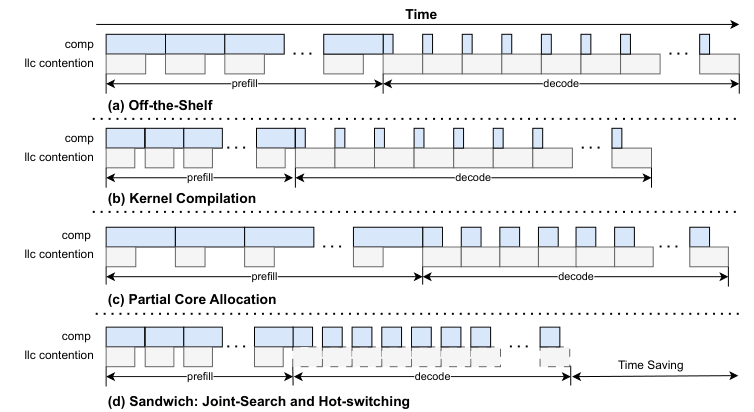
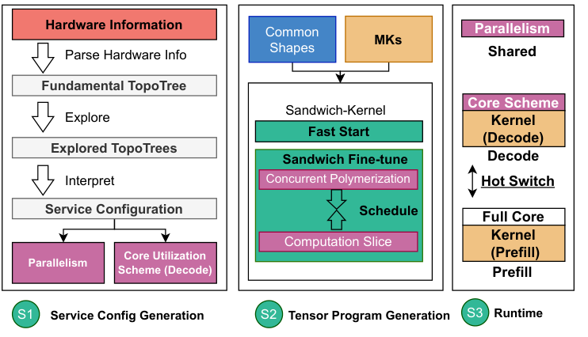
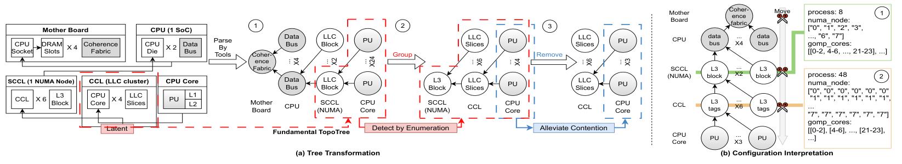

# Sandwich: Joint Configuration Search and Hot-Switching for Efficient CPU LLM Serving

[返回图集](../README.md) · Sandwich · DAC 2026 · 3张非实验图

研究对象：运行时与调度系统 / Sandwich CPU LLM配置搜索与热切换运行时

本页仅显示以下非实验图，不包含原论文全部图组。混合图在子图分离复核完成前暂不收录。

版本许可依据：[来源](https://i.cs.hku.hk/~cwu/papers/jtzhao-dac26.pdf#page=1)。源PDF SHA256：`fbfdbb92fe29b3860cbf7012df097e6129f6a466bb965c6bf3b266ac50304409`。PDF不随库分发。

## 图号导航

[F1](#f1) · [F5](#f5) · [F6](#f6)

## F1

**非实验图 · 执行时间示意对照**

[原文物理页 1](https://i.cs.hku.hk/~cwu/papers/jtzhao-dac26.pdf#page=1) · [许可证 CC BY 4.0](https://creativecommons.org/licenses/by/4.0/)

四条时间线对照现成方案、内核编译、部分核分配和联合搜索热切换；蓝色计算块与下方 LLC 争用块分别对应两类耗时。 在引言中把两个阶段的优化冲突画成可见的时间代价，为联合方案建立动机。 各行均从 prefill 进入 decode；编译主要缩短前者，部分核分配主要改善后者但会延长前者；末行用阶段切换兼顾两者，虚线标明节省的总时间。 这是机制化时间示意，没有坐标数值，不能从块宽直接读取实测加速比。

署名：Juntao Zhao, Jiuru Li, and Chuan Wu. Sandwich: Joint Configuration Search and Hot-Switching for Efficient CPU LLM Serving. DAC 2026. DOI: https://doi.org/10.1145/3770743.3803931. Copyright 2026 the owner/authors. Source: https://i.cs.hku.hk/~cwu/papers/jtzhao-dac26.pdf. CC BY 4.0: https://creativecommons.org/licenses/by/4.0/. Cropped and rasterized at 240 dpi; captions excluded and diagram content unchanged. No endorsement implied.

修改说明：Cropped from the author-hosted DAC 2026 formatted paper and rasterized at 240 dpi; captions excluded and diagram content unchanged.

## F5

**非实验图 · 离线生成与在线运行流程**

[原文物理页 3](https://i.cs.hku.hk/~cwu/papers/jtzhao-dac26.pdf#page=3) · [许可证 CC BY 4.0](https://creativecommons.org/licenses/by/4.0/)

S1 从硬件信息解析基本 TopoTree，经探索和解释生成共享并行方案与 decode 用核方案；S2 从常见形状和微内核生成各阶段内核；S3 在 prefill 全核与 decode 核方案间切换。 用三个竖直面板给出贡献的整体位置与阶段接口。 S1 的输出是配置而非新硬件；S2 内部 Fast Start 接 Finetune，调度与计算切片共同参与；S3 保留共享 parallelism，但 prefill/decode 内核及用核方式不同。 这是软件编译和运行流程，不是硬件框图；箭头不表示物理总线，三面板也不表示三台设备。

署名：Juntao Zhao, Jiuru Li, and Chuan Wu. Sandwich: Joint Configuration Search and Hot-Switching for Efficient CPU LLM Serving. DAC 2026. DOI: https://doi.org/10.1145/3770743.3803931. Copyright 2026 the owner/authors. Source: https://i.cs.hku.hk/~cwu/papers/jtzhao-dac26.pdf. CC BY 4.0: https://creativecommons.org/licenses/by/4.0/. Cropped and rasterized at 240 dpi; captions excluded and diagram content unchanged. No endorsement implied.

修改说明：Cropped from the author-hosted DAC 2026 formatted paper and rasterized at 240 dpi; captions excluded and diagram content unchanged.

## F6

**非实验图 · 硬件层次到树变换再到配置的抽象映射**

[原文物理页 5](https://i.cs.hku.hk/~cwu/papers/jtzhao-dac26.pdf#page=5) · [许可证 CC BY 4.0](https://creativecommons.org/licenses/by/4.0/)

左侧列出主板、SoC、NUMA、LLC cluster 和 CPU core；中部显示工具可见树、Group 加入隐藏共享层、Remove 减少用核；右侧对树取截面得到进程数与核心映射。 将真实 CPU 资源共享关系转化为可搜索对象，是该系统最重要的硬件抽象图。 叶 PU 是核／处理单元，内节点是共享资源；乘数标重复结构；Group 补充 LLC slice 层，Remove 将每组 PU 数从4变3。右侧不同横截面分别示例8与48进程方案。 树边表示层次归属／共享，不是数据流；删除节点是停用核的配置，不是物理切除硬件；示意没有画完整芯片互连。

署名：Juntao Zhao, Jiuru Li, and Chuan Wu. Sandwich: Joint Configuration Search and Hot-Switching for Efficient CPU LLM Serving. DAC 2026. DOI: https://doi.org/10.1145/3770743.3803931. Copyright 2026 the owner/authors. Source: https://i.cs.hku.hk/~cwu/papers/jtzhao-dac26.pdf. CC BY 4.0: https://creativecommons.org/licenses/by/4.0/. Cropped and rasterized at 240 dpi; captions excluded and diagram content unchanged. No endorsement implied.

修改说明：Cropped from the author-hosted DAC 2026 formatted paper and rasterized at 240 dpi; captions excluded and diagram content unchanged.

