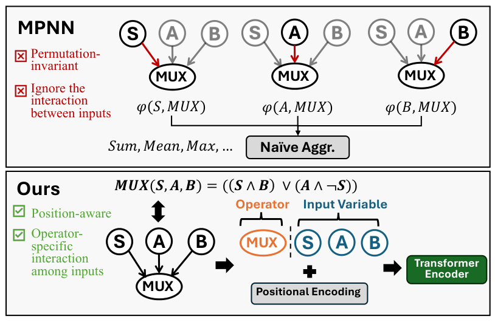
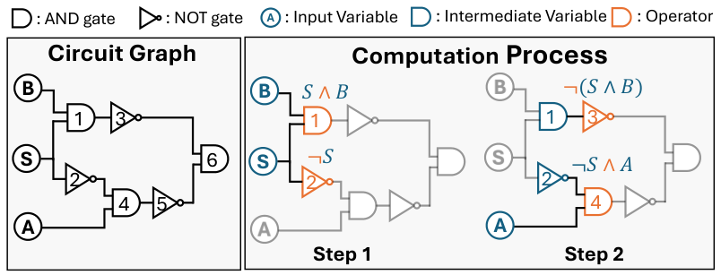
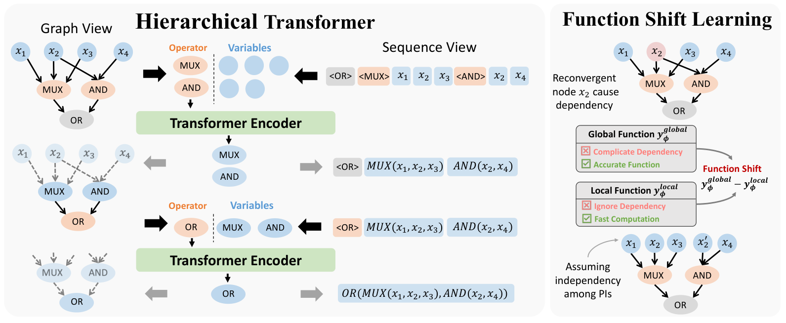

# TRACE: Learning to Compute on Circuit Graphs

[返回图集](../README.md) · TRACE · arXiv v3 · 3张非实验图

研究对象：EDA工具与电路设计表示 / TRACE电路图表示学习模型

本页仅显示以下非实验图，不包含原论文全部图组。混合图在子图分离复核完成前暂不收录。

本图集来源为8页arXiv v3作者预印本；首页会议名和ACM DOI为占位符，不能据此确认正式DAC出版版。 本图库当前收录3张非实验图：F1、F2、F3。

版本许可依据：[来源](https://arxiv.org/abs/2509.21886v3)。源PDF SHA256：`ad032b1cc8c78981fd721f67e78833cd52454316aa9acbe43dad8c8d53bee343`。PDF不随库分发。

## 图号导航

[F1](#f1) · [F2](#f2) · [F3](#f3)

## F1

**非实验图 · 节点连线图、模型框图**

[原文物理页 1](https://arxiv.org/pdf/2509.21886v3#page=1) · [许可证 CC BY 4.0](https://creativecommons.org/licenses/by/4.0/)

MUX示例对照普通聚合与位置/算子敏感表示，不是测量结果。

署名：Ziyang Zheng, Jiaying Zhu, Jingyi Zhou, Qiang Xu. TRACE: Learning to Compute on Circuit Graphs. Version: arXiv:2509.21886v3, 16 June 2026, 8 pages. Source: https://arxiv.org/pdf/2509.21886v3. CC BY 4.0: https://creativecommons.org/licenses/by/4.0/. Whole figure cropped from the specified exact source PDF and rasterized at 240 dpi; independent caption excluded and figure content unchanged. No relabeling or redrawing. No endorsement implied. Figure 1, physical PDF page 1.

修改说明：Whole figure cropped from the specified exact source PDF and rasterized at 240 dpi; independent caption excluded and figure content unchanged. No relabeling or redrawing. Exact crop rectangle in source PDF points: [316, 141, 560, 300]; RGB, alpha=false, annotations=true; output 814×530 pixels.

## F2

**非实验图 · 电路图、节点连线图**

[原文物理页 2](https://arxiv.org/pdf/2509.21886v3#page=2) · [许可证 CC BY 4.0](https://creativecommons.org/licenses/by/4.0/)

示例电路图及两步计算过程；颜色区分变量角色与算子，非实验曲线。

署名：Ziyang Zheng, Jiaying Zhu, Jingyi Zhou, Qiang Xu. TRACE: Learning to Compute on Circuit Graphs. Version: arXiv:2509.21886v3, 16 June 2026, 8 pages. Source: https://arxiv.org/pdf/2509.21886v3. CC BY 4.0: https://creativecommons.org/licenses/by/4.0/. Whole figure cropped from the specified exact source PDF and rasterized at 240 dpi; independent caption excluded and figure content unchanged. No relabeling or redrawing. No endorsement implied. Figure 2, physical PDF page 2.

修改说明：Whole figure cropped from the specified exact source PDF and rasterized at 240 dpi; independent caption excluded and figure content unchanged. No relabeling or redrawing. Exact crop rectangle in source PDF points: [316, 84, 557, 176]; RGB, alpha=false, annotations=true; output 804×307 pixels.

## F3

**非实验图 · 计算图、序列图、网络框图**

[原文物理页 3](https://arxiv.org/pdf/2509.21886v3#page=3) · [许可证 CC BY 4.0](https://creativecommons.org/licenses/by/4.0/)

左侧分层Transformer与右侧Function Shift Learning总览；图内公式和依赖关系按原图保留。

署名：Ziyang Zheng, Jiaying Zhu, Jingyi Zhou, Qiang Xu. TRACE: Learning to Compute on Circuit Graphs. Version: arXiv:2509.21886v3, 16 June 2026, 8 pages. Source: https://arxiv.org/pdf/2509.21886v3. CC BY 4.0: https://creativecommons.org/licenses/by/4.0/. Whole figure cropped from the specified exact source PDF and rasterized at 240 dpi; independent caption excluded and figure content unchanged. No relabeling or redrawing. No endorsement implied. Figure 3, physical PDF page 3.

修改说明：Whole figure cropped from the specified exact source PDF and rasterized at 240 dpi; independent caption excluded and figure content unchanged. No relabeling or redrawing. Exact crop rectangle in source PDF points: [64, 84, 541, 280]; RGB, alpha=false, annotations=true; output 1591×654 pixels.

