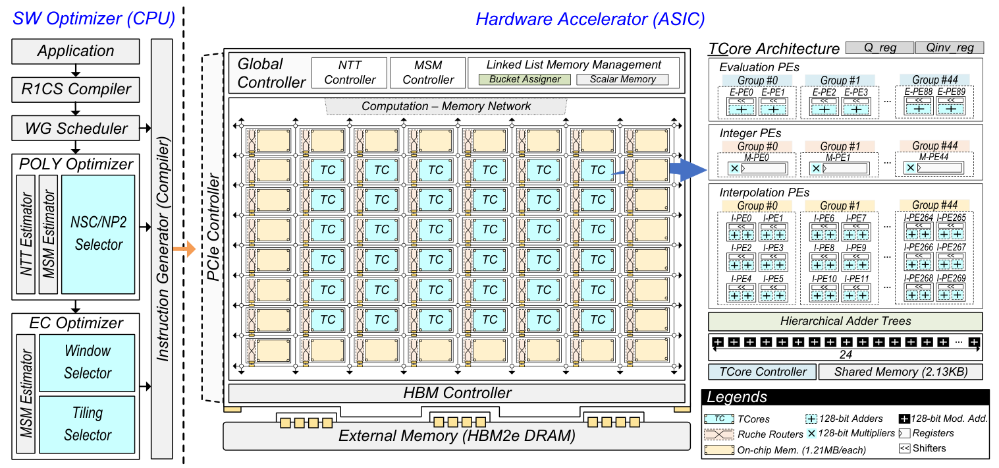
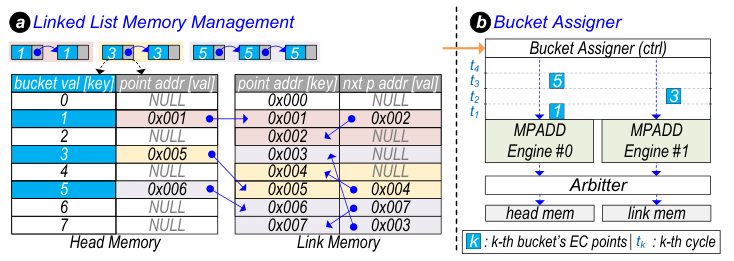

# ZK-Flex: A Flexible and Scalable Framework for Accelerating Zero-Knowledge Proofs

[返回图集](../README.md) · ZK-Flex · DAC 2026 · 3张非实验图

研究对象：专用加速器与可重构/存内计算平台 / ZK-Flex可重构证明生成加速器

本页仅显示以下非实验图，不包含原论文全部图组。混合图在子图分离复核完成前暂不收录。

版本许可依据：[来源](https://arxiv.org/abs/2606.03046v1)。源PDF SHA256：`c8c75bb1d6f47744c9b699dbc7cb5e75b39f04197238849fb32b57b82da6397e`。PDF不随库分发。

## 图号导航

[F4](#f4) · [F6](#f6) · [F7](#f7)

## F4

**非实验图 · 软硬件协同加速器架构图**

[原文物理页 3](https://arxiv.org/pdf/2606.03046v1#page=3) · [许可证 CC BY 4.0](https://creativecommons.org/licenses/by/4.0/)

署名：Adiwena Putra, Cuong Manh Duong, Anh Quang Pham, Joo-Young Kim. ZK-Flex: A Flexible and Scalable Framework for Accelerating Zero-Knowledge Proofs. DAC 2026. arXiv:2606.03046v1, 2 June 2026. DOI: https://doi.org/10.1145/3770743.3803941. © 2026 the owner/authors. Source: https://arxiv.org/pdf/2606.03046v1. CC BY 4.0: https://creativecommons.org/licenses/by/4.0/. Whole figures cropped from PDF and rasterized at 240 dpi; surrounding captions excluded. No redrawing, recoloring, relabeling or changes within figure content. No endorsement implied.

修改说明：Whole figure cropped from the specified source PDF and rasterized at 240 dpi; numbered caption excluded, figure content unchanged.

## F6

**非实验图 · 数论变换与椭圆曲线映射图**

[原文物理页 4](https://arxiv.org/pdf/2606.03046v1#page=4) · [许可证 CC BY 4.0](https://creativecommons.org/licenses/by/4.0/)

署名：Adiwena Putra, Cuong Manh Duong, Anh Quang Pham, Joo-Young Kim. ZK-Flex: A Flexible and Scalable Framework for Accelerating Zero-Knowledge Proofs. DAC 2026. arXiv:2606.03046v1, 2 June 2026. DOI: https://doi.org/10.1145/3770743.3803941. © 2026 the owner/authors. Source: https://arxiv.org/pdf/2606.03046v1. CC BY 4.0: https://creativecommons.org/licenses/by/4.0/. Whole figures cropped from PDF and rasterized at 240 dpi; surrounding captions excluded. No redrawing, recoloring, relabeling or changes within figure content. No endorsement implied.

修改说明：Whole figure cropped from the specified source PDF and rasterized at 240 dpi; numbered caption excluded, figure content unchanged.

## F7

**非实验图 · 链表存储与桶调度示意图**

[原文物理页 5](https://arxiv.org/pdf/2606.03046v1#page=5) · [许可证 CC BY 4.0](https://creativecommons.org/licenses/by/4.0/)

署名：Adiwena Putra, Cuong Manh Duong, Anh Quang Pham, Joo-Young Kim. ZK-Flex: A Flexible and Scalable Framework for Accelerating Zero-Knowledge Proofs. DAC 2026. arXiv:2606.03046v1, 2 June 2026. DOI: https://doi.org/10.1145/3770743.3803941. © 2026 the owner/authors. Source: https://arxiv.org/pdf/2606.03046v1. CC BY 4.0: https://creativecommons.org/licenses/by/4.0/. Whole figures cropped from PDF and rasterized at 240 dpi; surrounding captions excluded. No redrawing, recoloring, relabeling or changes within figure content. No endorsement implied.

修改说明：Whole figure cropped from the specified source PDF and rasterized at 240 dpi; numbered caption excluded, figure content unchanged.

