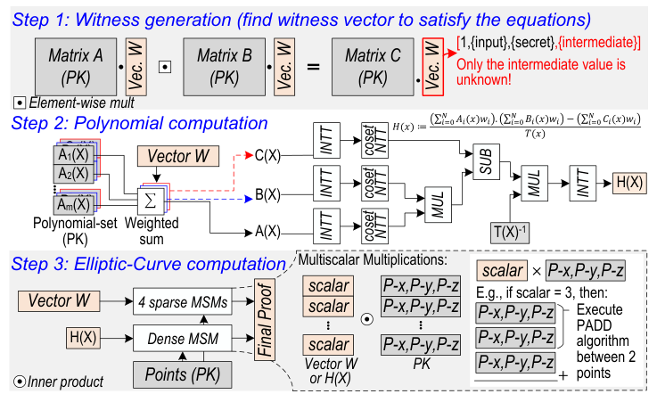
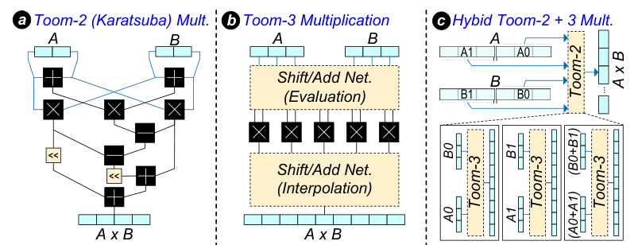
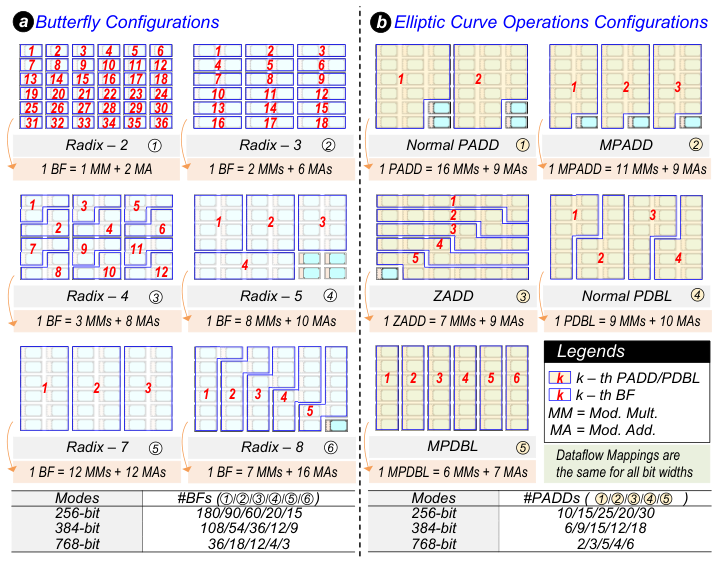

# ZK-Flex: A Flexible and Scalable Framework for Accelerating Zero-Knowledge Proofs

[返回图集](../README.md) · ZK-Flex · DAC 2026 · 5个非实验图示条目

研究对象：专用加速器与可重构/存内计算平台 / ZK-Flex可重构证明生成加速器

按本篇贡献选择解释视图；以下是已有图例，不是每篇论文都必须具备的模板。

F2 Step 1–3机制子区域（非整图，排除运行时间图） → F3(a–c)机制子区域（非整图，排除(d)面积结果） → F4 软硬件协同加速器架构图 → F6 数论变换与椭圆曲线映射图 → F7 链表存储与桶调度示意图

仅列出本图库保留的非实验图，未收录实验结果、测量照片及尚未分离的混合图。原文页链接可能包含同页其他内容，不代表那些图也已收录。 新增两个机制子区域均非整图，原混合整图仍暂缓；由留存原PNG整数像素裁剪重建，未重新读取或渲染原PDF。

## F2

### 图 2 的 Step 1–3 机制子区域（非整图）

**非实验图 · Groth16 证明生成的三个步骤**

[原文物理页 2](https://arxiv.org/pdf/2606.03046v1#page=2) · [CC BY 4.0](https://creativecommons.org/licenses/by/4.0/)

图 2 的 Step 1–3 机制子区域（非整图）。保留完整 Step 1–3：见证生成、多项式计算与椭圆曲线计算。排除下部运行时间比例图、图例、运行时间与 GEMM 规模标签。基于留存原PNG与整页证据重建；原PDF摘要仅继承历史记录，本次未重新读取或渲染原PDF。

署名：Adiwena Putra, Cuong Manh Duong, Anh Quang Pham, Joo-Young Kim. ZK-Flex: A Flexible and Scalable Framework for Accelerating Zero-Knowledge Proofs. DAC 2026. arXiv:2606.03046v1, 2 June 2026. DOI: https://doi.org/10.1145/3770743.3803941. © 2026 the owner/authors. Source: https://arxiv.org/pdf/2606.03046v1. CC BY 4.0: https://creativecommons.org/licenses/by/4.0/. Figure 2 subregion only, not the whole figure. Reconstructed by an integer-pixel boundary crop of a retained whole-figure PNG previously rasterized at 240 dpi. Retains Step 1–3; removes all runtime-distribution content. No resampling, redrawing, recoloring or relabeling. This reconstruction did not render or newly hash the original PDF. No endorsement implied.

修改说明：Figure 2 subregion only, not the whole figure. Reconstructed by an integer-pixel boundary crop of a retained whole-figure PNG previously rasterized at 240 dpi. Retains Step 1–3; removes all runtime-distribution content. No resampling, redrawing, recoloring or relabeling. This reconstruction did not render or newly hash the original PDF.

## F3

### 图 3 的 (a)–(c) 结构子区域（非整图）

**非实验图 · 多精度乘法实现结构**

[原文物理页 2](https://arxiv.org/pdf/2606.03046v1#page=2) · [CC BY 4.0](https://creativecommons.org/licenses/by/4.0/)

图 3 的 (a)–(c) 结构子区域（非整图）。保留完整 (a) Toom-2、(b) Toom-3 与 (c) Hybrid Toom-2+3 结构。排除 (d) 面积开销比较、百分比标注及绿色面积结论条。基于留存原PNG与整页证据重建；原PDF摘要仅继承历史记录，本次未重新读取或渲染原PDF。

署名：Adiwena Putra, Cuong Manh Duong, Anh Quang Pham, Joo-Young Kim. ZK-Flex: A Flexible and Scalable Framework for Accelerating Zero-Knowledge Proofs. DAC 2026. arXiv:2606.03046v1, 2 June 2026. DOI: https://doi.org/10.1145/3770743.3803941. © 2026 the owner/authors. Source: https://arxiv.org/pdf/2606.03046v1. CC BY 4.0: https://creativecommons.org/licenses/by/4.0/. Figure 3 subregion only, not the whole figure. Reconstructed by an integer-pixel boundary crop of a retained whole-figure PNG previously rasterized at 240 dpi. Retains panels (a)–(c); removes panel (d), area-comparison values and the bottom conclusion banner. No resampling, redrawing, recoloring or relabeling. This reconstruction did not render or newly hash the original PDF. No endorsement implied.

修改说明：Figure 3 subregion only, not the whole figure. Reconstructed by an integer-pixel boundary crop of a retained whole-figure PNG previously rasterized at 240 dpi. Retains panels (a)–(c); removes panel (d), area-comparison values and the bottom conclusion banner. No resampling, redrawing, recoloring or relabeling. This reconstruction did not render or newly hash the original PDF.

## F4

### 图 4

**非实验图 · 软硬件协同加速器架构图**

[原文物理页 3](https://arxiv.org/pdf/2606.03046v1#page=3) · [CC BY 4.0](https://creativecommons.org/licenses/by/4.0/)

署名：Adiwena Putra, Cuong Manh Duong, Anh Quang Pham, Joo-Young Kim. ZK-Flex: A Flexible and Scalable Framework for Accelerating Zero-Knowledge Proofs. DAC 2026. arXiv:2606.03046v1, 2 June 2026. DOI: https://doi.org/10.1145/3770743.3803941. © 2026 the owner/authors. Source: https://arxiv.org/pdf/2606.03046v1. CC BY 4.0: https://creativecommons.org/licenses/by/4.0/. Whole figures cropped from PDF and rasterized at 240 dpi; surrounding captions excluded. No redrawing, recoloring, relabeling or changes within figure content. No endorsement implied.

修改说明：Whole figure cropped from the specified source PDF and rasterized at 240 dpi; numbered caption excluded, figure content unchanged.

## F6

### 图 6

**非实验图 · 数论变换与椭圆曲线映射图**

[原文物理页 4](https://arxiv.org/pdf/2606.03046v1#page=4) · [CC BY 4.0](https://creativecommons.org/licenses/by/4.0/)

署名：Adiwena Putra, Cuong Manh Duong, Anh Quang Pham, Joo-Young Kim. ZK-Flex: A Flexible and Scalable Framework for Accelerating Zero-Knowledge Proofs. DAC 2026. arXiv:2606.03046v1, 2 June 2026. DOI: https://doi.org/10.1145/3770743.3803941. © 2026 the owner/authors. Source: https://arxiv.org/pdf/2606.03046v1. CC BY 4.0: https://creativecommons.org/licenses/by/4.0/. Whole figures cropped from PDF and rasterized at 240 dpi; surrounding captions excluded. No redrawing, recoloring, relabeling or changes within figure content. No endorsement implied.

修改说明：Whole figure cropped from the specified source PDF and rasterized at 240 dpi; numbered caption excluded, figure content unchanged.

## F7

### 图 7

**非实验图 · 链表存储与桶调度示意图**

[原文物理页 5](https://arxiv.org/pdf/2606.03046v1#page=5) · [CC BY 4.0](https://creativecommons.org/licenses/by/4.0/)

署名：Adiwena Putra, Cuong Manh Duong, Anh Quang Pham, Joo-Young Kim. ZK-Flex: A Flexible and Scalable Framework for Accelerating Zero-Knowledge Proofs. DAC 2026. arXiv:2606.03046v1, 2 June 2026. DOI: https://doi.org/10.1145/3770743.3803941. © 2026 the owner/authors. Source: https://arxiv.org/pdf/2606.03046v1. CC BY 4.0: https://creativecommons.org/licenses/by/4.0/. Whole figures cropped from PDF and rasterized at 240 dpi; surrounding captions excluded. No redrawing, recoloring, relabeling or changes within figure content. No endorsement implied.

修改说明：Whole figure cropped from the specified source PDF and rasterized at 240 dpi; numbered caption excluded, figure content unchanged.

