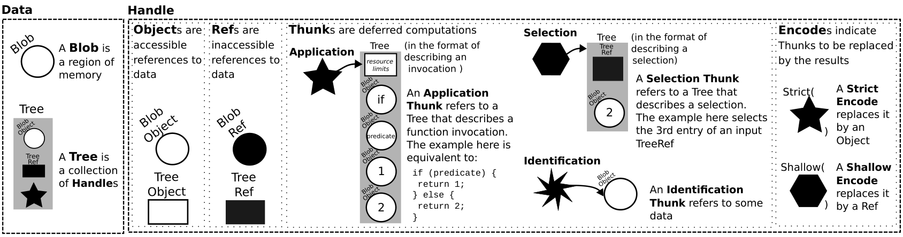
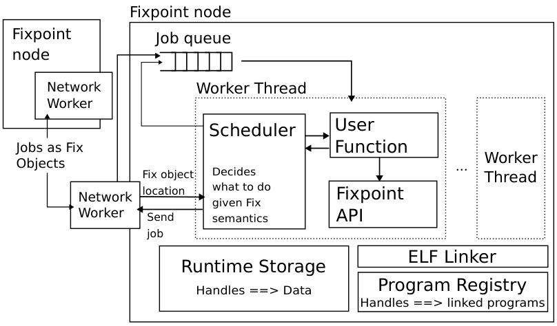

# Fix: externalizing network I/O in serverless computing

[返回图集](../README.md) · Fix · EuroSys 2026 · 2张非实验图

研究对象：运行时与调度系统 / Fix无服务器计算模型与Fixpoint运行时（样本外补充）

固定100篇样本外补充，不计入样本或其分类覆盖完成量。仅收 F1/F6，F7 等实验图不收。Arca 的 effects 接口与 Fix 的依赖表示可对照阅读，但不是同一实现。

F1（物理第5页）读可序列化的调用和依赖；F6（物理第7页）定位解释这些对象的调度器及网络工作者。

读图练习：F1 的 Ref 与 Object 在数据可访问性上有何区别？再在 F6 找出根据 Fix 语义决定下一步 I/O 与计算的组件。

对照 [Arca 原文链接指南](../../catalog/README.md#reading-guide-osdi2026-arca) 与 [Arca F2 原文物理第5页](https://www.usenix.org/system/files/osdi26-srivatsan.pdf#page=5)：Arca 展开传统 WASI、musl/POSIX 接口如何经适配器变为 effects，再由环境处理；Fix F1 则显式表示可序列化的调用及数据依赖，F6 定位检查并求值这些对象的调度器。两者关注的接口与表示层次不同，不能视为同一实现；此处仅链接 Arca，不转载其图。

版本许可依据：[精确作者 Git 文件](https://github.com/yhdengh/yhdengh.github.io/blob/a9ee71a85c58eb48c635725d2128188649144872/files/eurosys26.pdf)，16页 PDF 首页明确 CC BY 4.0，DOI 10.1145/3767295.3769387。源 PDF SHA-256：`e873108d7db61e45fbf9b2510e8aabdd8db100e23edb74645adfe09642486464`；git blob：`e0850a798517208e74c585615359abaa15a5480c`。PDF不随库分发。

## 图号导航

[F1](#f1) · [F6](#f6)

## F1

**非实验图 · 调用与数据依赖的可序列化表示图**

[原文物理页 5](https://raw.githubusercontent.com/yhdengh/yhdengh.github.io/a9ee71a85c58eb48c635725d2128188649144872/files/eurosys26.pdf#page=5) · [许可证 CC BY 4.0](https://creativecommons.org/licenses/by/4.0/)

先区分数据 Blob/Tree 与引用它们的 Handle，再读 Object、Ref、Thunk 和 Encode。调用及数据依赖用统一可序列化格式表达；Thunk 表示延迟计算，Strict/Shallow Encode 分别要求以求值结果的 Object/Ref 替换 Thunk。图是表示规则与示例，不是执行时间线。 样本外补充，不计入固定100篇样本或其分类覆盖完成量。

署名：Yuhan Deng, Akshay Srivatsan, Sebastian Ingino, Francis Chua, Yasmine Mitchell, Matthew Vilaysack, Keith Winstein. Fix: externalizing network I/O in serverless computing. EuroSys 2026. DOI: https://doi.org/10.1145/3767295.3769387. Copyright 2026 held by the owner/authors. Source: https://github.com/yhdengh/yhdengh.github.io/blob/a9ee71a85c58eb48c635725d2128188649144872/files/eurosys26.pdf. Version: 16-page EuroSys 2026 PDF in author repository commit a9ee71a85c58eb48c635725d2128188649144872, blob e0850a798517208e74c585615359abaa15a5480c. CC BY 4.0: https://creativecommons.org/licenses/by/4.0/. Whole figure cropped from the exact author-hosted PDF and rasterized at 240 dpi; main caption excluded, all diagram boundaries and labels retained; no redrawing. No endorsement implied.

修改说明：Whole figure cropped from the exact author-hosted PDF and rasterized at 240 dpi; main caption excluded, all diagram boundaries and labels retained; no redrawing.

## F6

**非实验图 · 无服务器运行时调度与网络架构图**

[原文物理页 7](https://raw.githubusercontent.com/yhdengh/yhdengh.github.io/a9ee71a85c58eb48c635725d2128188649144872/files/eurosys26.pdf#page=7) · [许可证 CC BY 4.0](https://creativecommons.org/licenses/by/4.0/)

在 Fixpoint 节点中找到作业队列、工作线程内的 Scheduler、用户函数与 Fixpoint API。调度器依据 Fix 语义决定求值所需的 I/O 和计算；运行时存储保存数据，网络工作者连接节点。对照 F1，问显式依赖如何成为平台可检查的对象，而非把结构框理解为实测性能。 样本外补充，不计入固定100篇样本或其分类覆盖完成量。

署名：Yuhan Deng, Akshay Srivatsan, Sebastian Ingino, Francis Chua, Yasmine Mitchell, Matthew Vilaysack, Keith Winstein. Fix: externalizing network I/O in serverless computing. EuroSys 2026. DOI: https://doi.org/10.1145/3767295.3769387. Copyright 2026 held by the owner/authors. Source: https://github.com/yhdengh/yhdengh.github.io/blob/a9ee71a85c58eb48c635725d2128188649144872/files/eurosys26.pdf. Version: 16-page EuroSys 2026 PDF in author repository commit a9ee71a85c58eb48c635725d2128188649144872, blob e0850a798517208e74c585615359abaa15a5480c. CC BY 4.0: https://creativecommons.org/licenses/by/4.0/. Whole figure cropped from the exact author-hosted PDF and rasterized at 240 dpi; main caption excluded, all diagram boundaries and labels retained; no redrawing. No endorsement implied.

修改说明：Whole figure cropped from the exact author-hosted PDF and rasterized at 240 dpi; main caption excluded, all diagram boundaries and labels retained; no redrawing.
