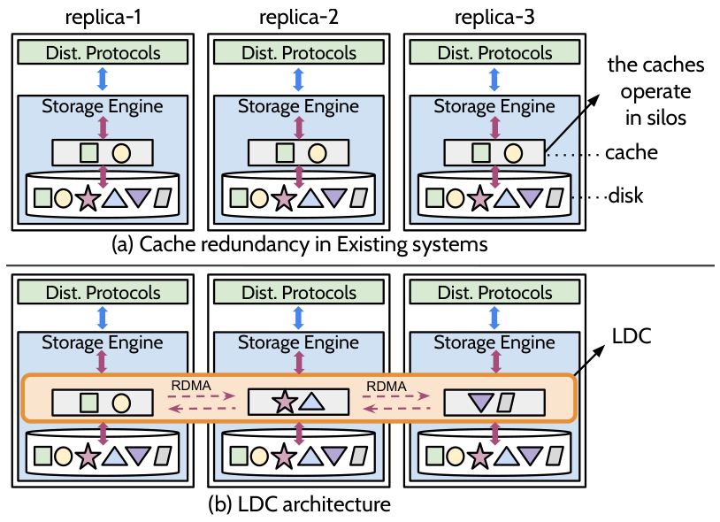
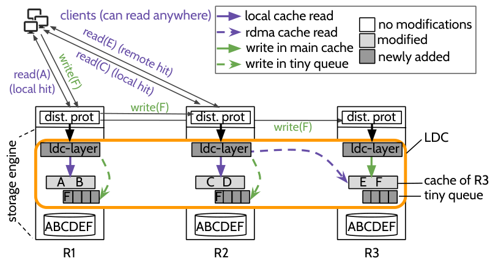

# A Logically Disaggregated Cache for Replicated Storage Systems

[返回图集](../README.md) · LDC · EuroSys 2026 · 2张非实验图

研究对象：文件、存储与缓存软件 / LDC复制存储系统中的逻辑分离缓存（EuroSys 2026样本外补充）

18页作者Git版，样本外补充，不计入固定100篇或其分类覆盖完成量。仅收F1/F4；F2/F3等实验图排除。逻辑池不等于物理集中，也不承诺所有对象始终无冗余。

F1（物理第2页）比较独立缓存与逻辑池 → F4（物理第6页）追 A 本地命中、E 远程命中和 F 写入。

读图练习：A、E 分别从哪一个副本的缓存返回？写 F 时，为什么只有 R3 更新主缓存，而 R1/R2 进入 tiny queue？先查写前是否已有 F，再追箭头；不能只按写请求的起点猜落点。结合原文 §3.2–3.3（物理第6–7页），远程读默认不将对象装入本地主缓存；后续 §3.4 的成本收益分析可选择冗余缓存热门对象，不把 F1 当作永久零冗余规则。

可对照 [Concord 读图练习](../../docs/reading-storage-figures.md)：同样追问控制信息与数据实际位置，但 Concord 的 home 目录命中与 LDC 的远程缓存命中不是同一条件，不能把两者路径直接替换。

版本许可依据：[精确作者 Git 文件](https://github.com/shreesha00/shreesha00.github.io/blob/9541333a7c61ead35ae2af0d5ad12de6d7e01f60/assets/papers/ldc_eurosys26.pdf)，18页 PDF 首页明确 CC BY 4.0，DOI 10.1145/3767295.3803608。源 PDF SHA-256：`0c18f5368823618b8bab286120632092092080fc047d8675863add7538c4b01d`；git blob：`237975d1776e471c120c094009c3327fb0bd253c`。PDF不随库分发。

## 图号导航

[F1](#f1) · [F4](#f4)

## F1

**非实验图 · 副本缓存组织方式对比图**

[原文物理页 2](https://raw.githubusercontent.com/shreesha00/shreesha00.github.io/9541333a7c61ead35ae2af0d5ad12de6d7e01f60/assets/papers/ldc_eurosys26.pdf#page=2) · [许可证 CC BY 4.0](https://creativecommons.org/licenses/by/4.0/)

比较 (a) 各副本独立缓存相同对象与 (b) 经 RDMA 访问逻辑缓存池。缓存仍物理分布在各副本；橙色连接范围不表示搬到一台集中缓存服务器，底层磁盘副本仍保留。图示意如何减少冗余，不是实测命中率或始终完全去重的保证。 样本外补充，不计入固定100篇样本或其分类覆盖完成量。

署名：Kiran Hombal, Henry Zhu, Shreesha G. Bhat, Neil Kaushikkar, Ramnatthan Alagappan, Aishwarya Ganesan. A Logically Disaggregated Cache for Replicated Storage Systems. EuroSys 2026. DOI: https://doi.org/10.1145/3767295.3803608. Copyright 2026 held by the owner/authors. Source: https://github.com/shreesha00/shreesha00.github.io/blob/9541333a7c61ead35ae2af0d5ad12de6d7e01f60/assets/papers/ldc_eurosys26.pdf. Version: 18-page EuroSys 2026 PDF in author repository commit 9541333a7c61ead35ae2af0d5ad12de6d7e01f60, blob 237975d1776e471c120c094009c3327fb0bd253c. CC BY 4.0: https://creativecommons.org/licenses/by/4.0/. Whole figure cropped from the exact author-hosted PDF and rasterized at 240 dpi; main caption excluded, all subfigures, legends, labels and replica boundaries retained; no redrawing. No endorsement implied.

修改说明：Whole figure cropped from the exact author-hosted PDF and rasterized at 240 dpi; main caption excluded, all subfigures, legends, labels and replica boundaries retained; no redrawing.

## F4

**非实验图 · 逻辑分离缓存架构与读写路径图**

[原文物理页 6](https://raw.githubusercontent.com/shreesha00/shreesha00.github.io/9541333a7c61ead35ae2af0d5ad12de6d7e01f60/assets/papers/ldc_eurosys26.pdf#page=6) · [许可证 CC BY 4.0](https://creativecommons.org/licenses/by/4.0/)

先沿 A 在 R1 的本地命中，再沿 R2 读取 E、经 RDMA 从 R3 取回的远程命中。写 F 的分流取决于写入前各副本主缓存是否已有 F：例中 R3 已有，直接更新主缓存；R1/R2 没有，加入各自 tiny queue 以便快速降级。tiny queue 从主缓存空间划出、各副本私有，队列对象周期性逐出并写盘。按图例区分读写路径与组件修改范围；这些箭头不是时延测量。 样本外补充，不计入固定100篇样本或其分类覆盖完成量。

署名：Kiran Hombal, Henry Zhu, Shreesha G. Bhat, Neil Kaushikkar, Ramnatthan Alagappan, Aishwarya Ganesan. A Logically Disaggregated Cache for Replicated Storage Systems. EuroSys 2026. DOI: https://doi.org/10.1145/3767295.3803608. Copyright 2026 held by the owner/authors. Source: https://github.com/shreesha00/shreesha00.github.io/blob/9541333a7c61ead35ae2af0d5ad12de6d7e01f60/assets/papers/ldc_eurosys26.pdf. Version: 18-page EuroSys 2026 PDF in author repository commit 9541333a7c61ead35ae2af0d5ad12de6d7e01f60, blob 237975d1776e471c120c094009c3327fb0bd253c. CC BY 4.0: https://creativecommons.org/licenses/by/4.0/. Whole figure cropped from the exact author-hosted PDF and rasterized at 240 dpi; main caption excluded, all subfigures, legends, labels and replica boundaries retained; no redrawing. No endorsement implied.

修改说明：Whole figure cropped from the exact author-hosted PDF and rasterized at 240 dpi; main caption excluded, all subfigures, legends, labels and replica boundaries retained; no redrawing.
