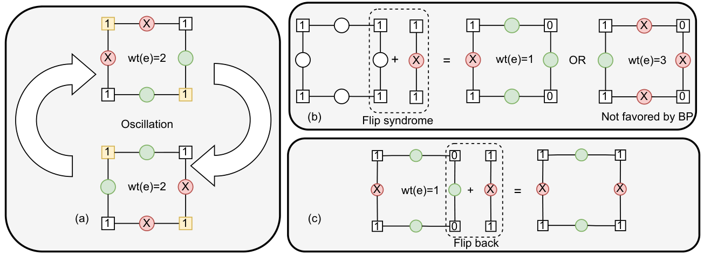
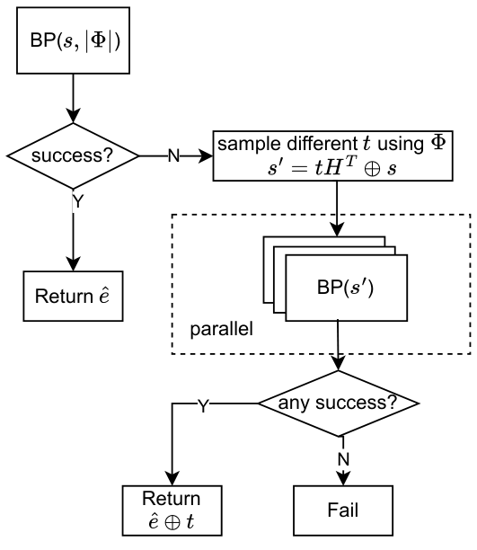

# Fully Parallelized BP Decoding for Quantum LDPC Codes Can Outperform BP-OSD

[返回图集](../README.md) · BP-SF · arXiv v3 · 2个非实验图示条目

研究对象：量子纠错解码算法与软件 / BP-SF量子LDPC解码器

可用机制例子解释状态变化，再用流程图明确并行任务与终止条件；这不是必须图模板。

F1 振荡与校验子翻转机制 → F4 并行BP-SF译码流程

BP-SF · arXiv v3固定版本；不独立断言正式会议身份或出版商版本一致。本轮仅F1/F4，其余图未在本轮审核范围。v3不是最新版。

## F1

### 图 1

**非实验图 · 译码振荡与校验子翻转机制图**

[原文物理页 3](https://arxiv.org/pdf/2507.00254v3#page=3) · [CC BY 4.0](https://creativecommons.org/licenses/by/4.0/)

用三个子图对照 BP 振荡、翻转校验子后的收敛及翻回比特恢复原校验约束。 红色错误位、黄色未满足校验与箭头表达状态变换；各子图为机制例子。 机制或架构示意，非实测性能结果；具体效果需阅读论文评估部分。 固定arXiv版本，不声称与出版社版一致；仅收录指定图，不代表其余图已审核或可再分发。 v3不是最新版；本图来自所列固定版本。

署名：Ming Wang, Ang Li, and Frank Mueller. Fully Parallelized BP Decoding for Quantum LDPC Codes Can Outperform BP-OSD. arXiv:2507.00254v3, 10 February 2026. Source: https://arxiv.org/abs/2507.00254v3. CC BY 4.0: https://creativecommons.org/licenses/by/4.0/. Cropped from exact version PDF and rasterized at 240 dpi; main caption excluded, diagram content unchanged. No endorsement implied.

修改说明：Cropped from exact version PDF and rasterized at 240 dpi; main caption excluded, diagram content unchanged.

## F4

### 图 4

**非实验图 · 并行BP-SF译码流程图**

[原文物理页 5](https://arxiv.org/pdf/2507.00254v3#page=5) · [CC BY 4.0](https://creativecommons.org/licenses/by/4.0/)

初始 BP 成功则返回，否则生成多个修改校验子并行译码，再选择成功结果或报告失败。 条件分支和并行框区分单次译码与候选探索。 机制或架构示意，非实测性能结果；具体效果需阅读论文评估部分。 固定arXiv版本，不声称与出版社版一致；仅收录指定图，不代表其余图已审核或可再分发。 v3不是最新版；本图来自所列固定版本。

署名：Ming Wang, Ang Li, and Frank Mueller. Fully Parallelized BP Decoding for Quantum LDPC Codes Can Outperform BP-OSD. arXiv:2507.00254v3, 10 February 2026. Source: https://arxiv.org/abs/2507.00254v3. CC BY 4.0: https://creativecommons.org/licenses/by/4.0/. Cropped from exact version PDF and rasterized at 240 dpi; main caption excluded, diagram content unchanged. No endorsement implied.

修改说明：Cropped from exact version PDF and rasterized at 240 dpi; main caption excluded, diagram content unchanged.

