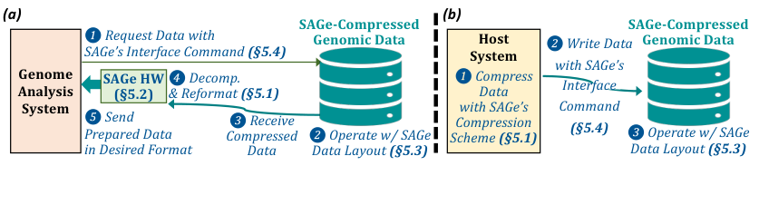
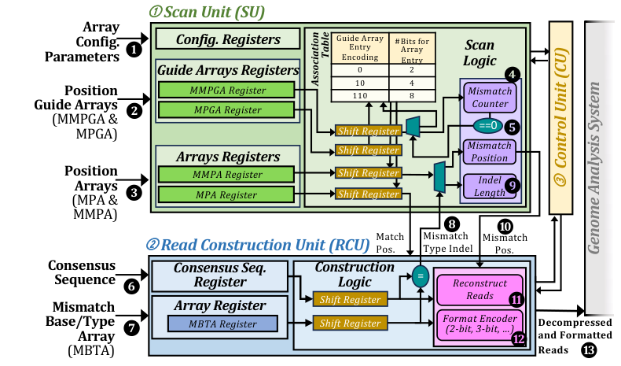
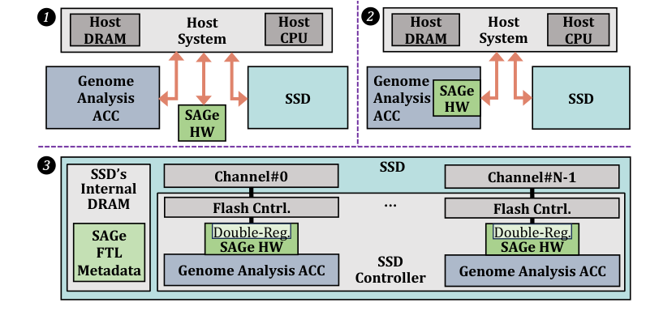

# SAGe: A Lightweight Algorithm-Architecture Co-Design for Mitigating the Data Preparation Bottleneck in Large-Scale Genome Sequence Analysis

[返回图集](../README.md) · SAGe · arXiv v4 · 3个非实验图示条目

研究对象：专用加速器与可重构/存内计算平台 / SAGe基因组数据解压加速平台

可先区分离线压缩与在线数据准备，再展开流式解压硬件，最后比较三种部署边界；示意流程解释方法，不代替实验结果，也不是必须图模板。

F5 数据准备与压缩存储流程 → F11 流式解压架构（读段构建单元） → F12 三种加速器集成方案

SAGe · arXiv v4固定版本；不独立断言正式会议身份或出版商版本一致。本轮仅F5/F11/F12，其他图未在本轮审核范围。

## F5

### 图 5

**非实验图 · 数据准备与压缩存储工作流图**

[原文物理页 6](https://arxiv.org/pdf/2504.03732v4#page=6) · [CC BY 4.0](https://creativecommons.org/licenses/by/4.0/)

子图 a 表达分析系统发起请求、存储读取、硬件解压与返回；子图 b 表达主机压缩及存储。 读写方向与编号步骤区分离线压缩和在线数据准备。 机制或架构示意，非实测性能结果；具体效果需阅读论文评估部分。 固定arXiv版本，不声称与出版社版一致；仅收录指定图，不代表其余图已审核或可再分发。

署名：Nika Mansouri Ghiasi, Talu Güloglu, Harun Mustafa, Can Firtina, Konstantina Koliogeorgi, Konstantinos Kanellopoulos, Haiyu Mao, Rakesh Nadig, Mohammad Sadrosadati, Jisung Park, and Onur Mutlu. SAGe: A Lightweight Algorithm-Architecture Co-Design for Mitigating the Data Preparation Bottleneck in Large-Scale Genome Sequence Analysis. arXiv:2504.03732v4, 22 January 2026. Source: https://arxiv.org/abs/2504.03732v4. CC BY 4.0: https://creativecommons.org/licenses/by/4.0/. Cropped from exact version PDF and rasterized at 240 dpi; main caption excluded, diagram content unchanged. No endorsement implied.

修改说明：Cropped from exact version PDF and rasterized at 240 dpi; main caption excluded, diagram content unchanged.

## F11

### 图 11

**非实验图 · 流式解压硬件架构图**

[原文物理页 9](https://arxiv.org/pdf/2504.03732v4#page=9) · [CC BY 4.0](https://creativecommons.org/licenses/by/4.0/)

扫描单元、读段构建单元和控制单元连接位置数组、引导数组、共识序列与输出序列。 编号路径连接扫描、计数、匹配位置处理、读段重构和输出；寄存器与计数器显示轻量硬件组成。 机制或架构示意，非实测性能结果；具体效果需阅读论文评估部分。 固定arXiv版本，不声称与出版社版一致；仅收录指定图，不代表其余图已审核或可再分发。

署名：Nika Mansouri Ghiasi, Talu Güloglu, Harun Mustafa, Can Firtina, Konstantina Koliogeorgi, Konstantinos Kanellopoulos, Haiyu Mao, Rakesh Nadig, Mohammad Sadrosadati, Jisung Park, and Onur Mutlu. SAGe: A Lightweight Algorithm-Architecture Co-Design for Mitigating the Data Preparation Bottleneck in Large-Scale Genome Sequence Analysis. arXiv:2504.03732v4, 22 January 2026. Source: https://arxiv.org/abs/2504.03732v4. CC BY 4.0: https://creativecommons.org/licenses/by/4.0/. Cropped from exact version PDF and rasterized at 240 dpi; main caption excluded, diagram content unchanged. No endorsement implied.

修改说明：Cropped from exact version PDF and rasterized at 240 dpi; main caption excluded, diagram content unchanged.

## F12

### 图 12

**非实验图 · 基因分析加速器集成方案对比图**

[原文物理页 10](https://arxiv.org/pdf/2504.03732v4#page=10) · [CC BY 4.0](https://creativecommons.org/licenses/by/4.0/)

并列展示独立总线设备、与分析系统同芯片以及 SSD 内部集成三种 SAGe 部署。 不同系统边界体现设备之间的数据流和硬件放置选择。 机制或架构示意，非实测性能结果；具体效果需阅读论文评估部分。 固定arXiv版本，不声称与出版社版一致；仅收录指定图，不代表其余图已审核或可再分发。

署名：Nika Mansouri Ghiasi, Talu Güloglu, Harun Mustafa, Can Firtina, Konstantina Koliogeorgi, Konstantinos Kanellopoulos, Haiyu Mao, Rakesh Nadig, Mohammad Sadrosadati, Jisung Park, and Onur Mutlu. SAGe: A Lightweight Algorithm-Architecture Co-Design for Mitigating the Data Preparation Bottleneck in Large-Scale Genome Sequence Analysis. arXiv:2504.03732v4, 22 January 2026. Source: https://arxiv.org/abs/2504.03732v4. CC BY 4.0: https://creativecommons.org/licenses/by/4.0/. Cropped from exact version PDF and rasterized at 240 dpi; main caption excluded, diagram content unchanged. No endorsement implied.

修改说明：Cropped from exact version PDF and rasterized at 240 dpi; main caption excluded, diagram content unchanged.

