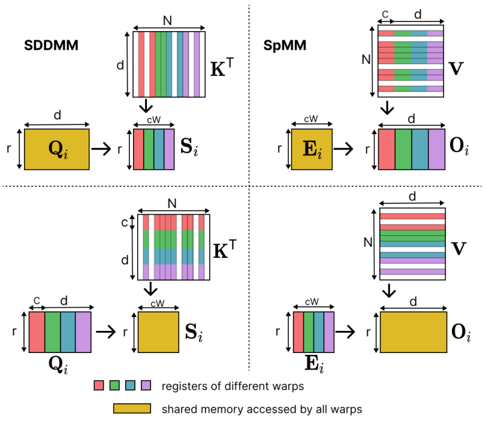
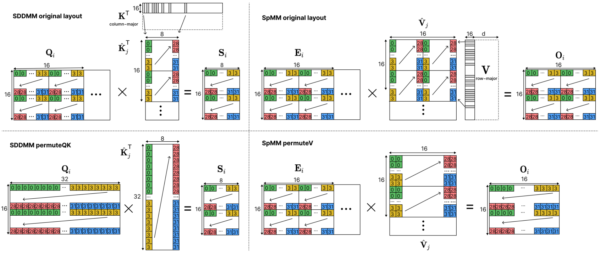

# Fused3S: Fast Sparse Attention on Tensor Cores

[返回图集](../README.md) · Fused3S · ICS 2025 · 2张非实验图

研究对象：矩阵与张量计算内核 / Fused3S稀疏注意力融合GPU内核（ICS 2025样本外补充）

ICS 2025样本外补充，仅收F3/F4；不增加固定100篇样本或其分类覆盖完成量。Voltrix是SpMM内核，本篇融合SDDMM、softmax和SpMM，不能据机制图比较性能或假定输入一致。

先读固定样本 Voltrix F4/F8 的均衡目标与SM分工，再读本篇 F3（物理第7页）的warp分工与 F4（物理第8页）的寄存器布局。

从固定样本出发：[Voltrix 原文链接指南](../../catalog/README.md#reading-guide-atc2025-voltrix)。先在 [Voltrix F4（物理第5页）](https://www.usenix.org/system/files/atc25-xia.pdf#page=5) 区分输入、输出与两者共同均衡的目标，再在 [F8（物理第9页）](https://www.usenix.org/system/files/atc25-xia.pdf#page=9) 追踪与 SM 对齐的任务分区、生产者和消费者的协调。本篇 F3/F4 则分别深入同一 thread block 的 warp 分工和寄存器布局；两篇并非相同输入或相同分工，也不在此比较性能。Voltrix 只链接原文，不转载图片。

读图练习：F3 哪种划分需要多个 warp 协作完成一个 tile？再从 F4 任一算子中找出布局置换前后的同一线程编号，观察它负责的数据位置怎样变化。

版本许可依据：[精确会议 Git 文件](https://github.com/HPCRL/ICS2025-webpage/blob/94c712ec96716e25cdea168e8e1a6e81a16dc547/program/Proceedings_ICS25/ics25-70.pdf)，15页 PDF 首页明确 CC BY 4.0，DOI 10.1145/3721145.3730430。源 PDF SHA-256：`ae75894a4490a20d41a5d3d6132bb55c20c5dc798acf7ffafffc4dc7796c0ef8`；git blob：`1ba1d4710ea0c6500912e8eecba36230b1880e72`。PDF不随库分发。

## 图号导航

[F3](#f3) · [F4](#f4)

## F3

**非实验图 · 线程块内warp任务划分示意图**

[原文物理页 7](https://raw.githubusercontent.com/HPCRL/ICS2025-webpage/94c712ec96716e25cdea168e8e1a6e81a16dc547/program/Proceedings_ICS25/ics25-70.pdf#page=7) · [许可证 CC BY 4.0](https://creativecommons.org/licenses/by/4.0/)

同一 thread block 内，上排 split-column 让各 warp 独立计算输出 tile，下排 split-row 让多个 warp 协作完成 tile。先跟踪 Q、K、V 到 S、O 的对应，再用图例区分各 warp 的寄存器与所有 warp 共享的内存；这些色块不是性能测量。 样本外补充，不计入固定100篇样本或其分类覆盖完成量。

署名：Zitong Li, Aparna Chandramowlishwaran. Fused3S: Fast Sparse Attention on Tensor Cores. ICS 2025. DOI: https://doi.org/10.1145/3721145.3730430. Copyright 2025 held by the owner/authors. Source: https://github.com/HPCRL/ICS2025-webpage/blob/94c712ec96716e25cdea168e8e1a6e81a16dc547/program/Proceedings_ICS25/ics25-70.pdf. Version: 15-page ICS 2025 PDF in conference repository commit 94c712ec96716e25cdea168e8e1a6e81a16dc547, blob 1ba1d4710ea0c6500912e8eecba36230b1880e72. CC BY 4.0: https://creativecommons.org/licenses/by/4.0/. Whole figure cropped from the exact conference-hosted PDF and rasterized at 240 dpi; main caption excluded, all diagram boundaries and labels retained; no redrawing. No endorsement implied.

修改说明：Whole figure cropped from the exact conference-hosted PDF and rasterized at 240 dpi; main caption excluded, all diagram boundaries and labels retained; no redrawing.

## F4

**非实验图 · SDDMM与SpMM寄存器重映射图**

[原文物理页 8](https://raw.githubusercontent.com/HPCRL/ICS2025-webpage/94c712ec96716e25cdea168e8e1a6e81a16dc547/program/Proceedings_ICS25/ics25-70.pdf#page=8) · [许可证 CC BY 4.0](https://creativecommons.org/licenses/by/4.0/)

左半展开 SDDMM，右半展开 SpMM；分别对照上方原始布局与下方置换后布局，追踪一个线程所取的数据如何排列。寄存器重映射服务于访存与算子布局约束，不改变目标计算；图中的编号与维度不是实测吞吐或耗时。 样本外补充，不计入固定100篇样本或其分类覆盖完成量。

署名：Zitong Li, Aparna Chandramowlishwaran. Fused3S: Fast Sparse Attention on Tensor Cores. ICS 2025. DOI: https://doi.org/10.1145/3721145.3730430. Copyright 2025 held by the owner/authors. Source: https://github.com/HPCRL/ICS2025-webpage/blob/94c712ec96716e25cdea168e8e1a6e81a16dc547/program/Proceedings_ICS25/ics25-70.pdf. Version: 15-page ICS 2025 PDF in conference repository commit 94c712ec96716e25cdea168e8e1a6e81a16dc547, blob 1ba1d4710ea0c6500912e8eecba36230b1880e72. CC BY 4.0: https://creativecommons.org/licenses/by/4.0/. Whole figure cropped from the exact conference-hosted PDF and rasterized at 240 dpi; main caption excluded, all diagram boundaries and labels retained; no redrawing. No endorsement implied.

修改说明：Whole figure cropped from the exact conference-hosted PDF and rasterized at 240 dpi; main caption excluded, all diagram boundaries and labels retained; no redrawing.
