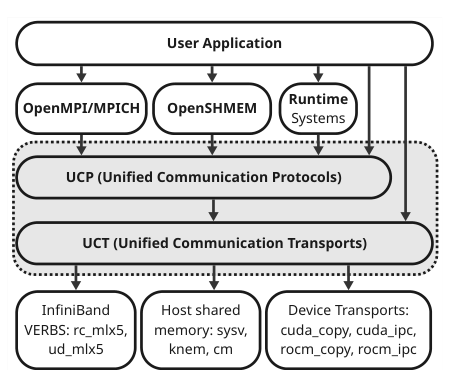
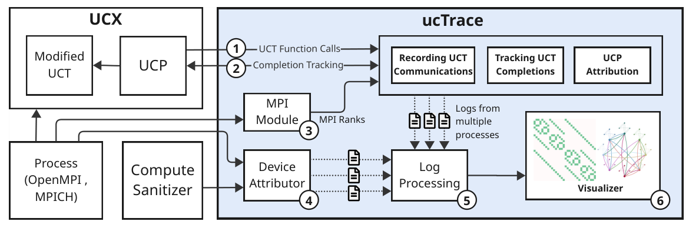

# ucTrace: A Multi-Layer Profiling Tool for UCX-driven Communication

[返回图集](../README.md) · ucTrace · IPDPS 2026 / arXiv v1 · 2张非实验图

研究对象：程序与网络分析、测试、追踪工具 / ucTrace UCX通信剖析工具

本页仅显示以下非实验图，不包含原论文全部图组。混合图在子图分离复核完成前暂不收录。

图像来自13页arXiv v1作者稿；元数据备注写11页，但PDF含参考文献共13页。以PDF和citation_author中的5位作者署名，不使用网页简介错误的作者人数。 本图库当前收录2张非实验图：F1、F2。

版本许可依据：[来源](https://arxiv.org/abs/2602.19084v1)。源PDF SHA256：`e8b5bd780665a9452a2879a1f801d59a135a326b0d07f165a505924f260fdee0`。PDF不随库分发。

## 图号导航

[F1](#f1) · [F2](#f2)

## F1

**非实验图 · 框图**

[原文物理页 2](https://arxiv.org/pdf/2602.19084v1#page=2) · [许可证 CC BY 4.0](https://creativecommons.org/licenses/by/4.0/)

应用、通信库与UCX协议/传输层的关系示意，非物理互连拓扑。

署名：Emir Gencer, Mohammad Kefah Taha Issa, Ilyas Turimbetov, James D. Trotter, Didem Unat. ucTrace: A Multi-Layer Profiling Tool for UCX-driven Communication. Version: arXiv:2602.19084v1, 22 February 2026, 13 physical PDF pages. Source: https://arxiv.org/pdf/2602.19084v1. CC BY 4.0: https://creativecommons.org/licenses/by/4.0/. Whole figure cropped from the specified exact source PDF and rasterized at 240 dpi; independent caption excluded and figure content unchanged. No relabeling or redrawing. No endorsement implied. Figure 1, physical PDF page 2.

修改说明：Whole figure cropped from the specified exact source PDF and rasterized at 240 dpi; independent caption excluded and figure content unchanged. No relabeling or redrawing. Exact crop rectangle in source PDF points: [47, 47, 182, 162]; RGB, alpha=false, annotations=true; output 451×384 pixels.

## F2

**非实验图 · 框图、流程图**

[原文物理页 2](https://arxiv.org/pdf/2602.19084v1#page=2) · [许可证 CC BY 4.0](https://creativecommons.org/licenses/by/4.0/)

ucTrace记录、完成事件跟踪、归因、日志处理与可视化的数据流示意。

署名：Emir Gencer, Mohammad Kefah Taha Issa, Ilyas Turimbetov, James D. Trotter, Didem Unat. ucTrace: A Multi-Layer Profiling Tool for UCX-driven Communication. Version: arXiv:2602.19084v1, 22 February 2026, 13 physical PDF pages. Source: https://arxiv.org/pdf/2602.19084v1. CC BY 4.0: https://creativecommons.org/licenses/by/4.0/. Whole figure cropped from the specified exact source PDF and rasterized at 240 dpi; independent caption excluded and figure content unchanged. No relabeling or redrawing. No endorsement implied. Figure 2, physical PDF page 2.

修改说明：Whole figure cropped from the specified exact source PDF and rasterized at 240 dpi; independent caption excluded and figure content unchanged. No relabeling or redrawing. Exact crop rectangle in source PDF points: [214, 47, 570, 163]; RGB, alpha=false, annotations=true; output 1187×388 pixels.

