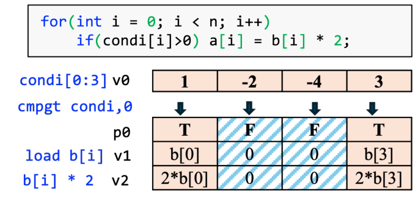
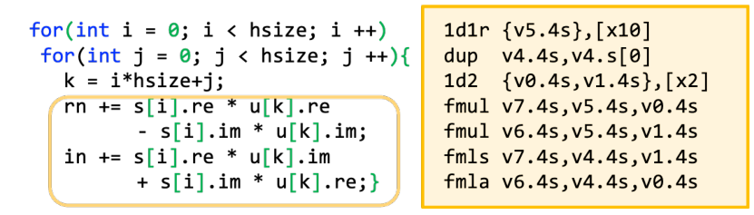
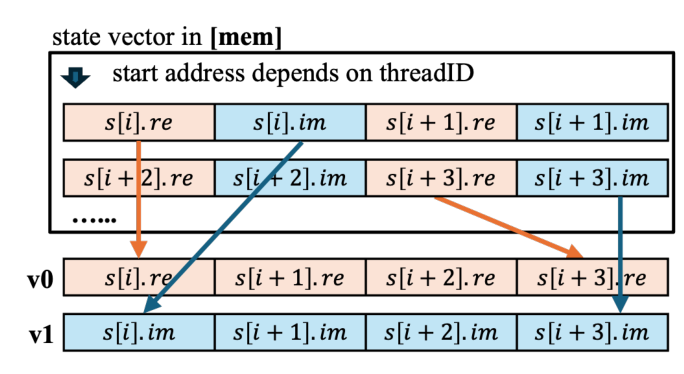
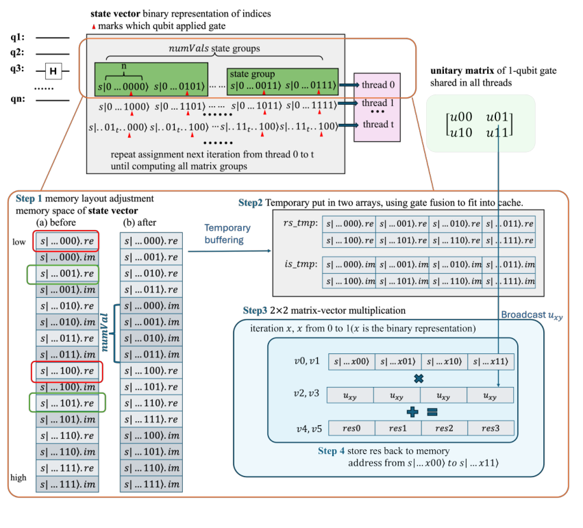

# High-performance Vector-length Agnostic Quantum Circuit Simulations on ARM Processors

[返回图集](../README.md) · VLA Quantum · IPDPS 2026 / arXiv v3 · 4张非实验图

研究对象：模拟器与仿真平台 / Qsim-SVE量子状态向量模拟器

本页仅显示以下非实验图，不包含原论文全部图组。混合图在子图分离复核完成前暂不收录。

版本许可依据：[来源](https://arxiv.org/abs/2602.09604v3)。源PDF SHA256：`7847557e313b7ad7873ccab6d9f2f3e0d7544317bfb476bff32e31e9c85b264e`。PDF不随库分发。

## 图号导航

[F1](#f1) · [F3](#f3) · [F4](#f4) · [F5](#f5)

## F1

**非实验图 · 谓词向量化示例**

[原文物理页 3](https://arxiv.org/pdf/2602.09604v3#page=3) · [许可证 CC BY 4.0](https://creativecommons.org/licenses/by/4.0/)

署名：Ruimin Shi, Gabin Schieffer, Pei-Hung Lin, Maya Gokhale, Andreas Herten, Ivy Peng. High-performance Vector-length Agnostic Quantum Circuit Simulations on ARM Processors. IPDPS 2026 author manuscript. DOI: https://doi.org/10.48550/arXiv.2602.09604. Version: arXiv:2602.09604v3, 12 March 2026, 14 pages. Source: https://arxiv.org/pdf/2602.09604v3. CC BY 4.0: https://creativecommons.org/licenses/by/4.0/. Whole figures cropped from this exact PDF and rasterized at 240 dpi; captions excluded, all figure content unchanged. No endorsement implied.

修改说明：Whole figure cropped from the specified source PDF and rasterized at 240 dpi; numbered caption excluded, figure content unchanged.

## F3

**非实验图 · 内核源码与汇编**

[原文物理页 4](https://arxiv.org/pdf/2602.09604v3#page=4) · [许可证 CC BY 4.0](https://creativecommons.org/licenses/by/4.0/)

署名：Ruimin Shi, Gabin Schieffer, Pei-Hung Lin, Maya Gokhale, Andreas Herten, Ivy Peng. High-performance Vector-length Agnostic Quantum Circuit Simulations on ARM Processors. IPDPS 2026 author manuscript. DOI: https://doi.org/10.48550/arXiv.2602.09604. Version: arXiv:2602.09604v3, 12 March 2026, 14 pages. Source: https://arxiv.org/pdf/2602.09604v3. CC BY 4.0: https://creativecommons.org/licenses/by/4.0/. Whole figures cropped from this exact PDF and rasterized at 240 dpi; captions excluded, all figure content unchanged. No endorsement implied.

修改说明：Whole figure cropped from the specified source PDF and rasterized at 240 dpi; numbered caption excluded, figure content unchanged.

## F4

**非实验图 · 交错访存模式**

[原文物理页 4](https://arxiv.org/pdf/2602.09604v3#page=4) · [许可证 CC BY 4.0](https://creativecommons.org/licenses/by/4.0/)

署名：Ruimin Shi, Gabin Schieffer, Pei-Hung Lin, Maya Gokhale, Andreas Herten, Ivy Peng. High-performance Vector-length Agnostic Quantum Circuit Simulations on ARM Processors. IPDPS 2026 author manuscript. DOI: https://doi.org/10.48550/arXiv.2602.09604. Version: arXiv:2602.09604v3, 12 March 2026, 14 pages. Source: https://arxiv.org/pdf/2602.09604v3. CC BY 4.0: https://creativecommons.org/licenses/by/4.0/. Whole figures cropped from this exact PDF and rasterized at 240 dpi; captions excluded, all figure content unchanged. No endorsement implied.

修改说明：Whole figure cropped from the specified source PDF and rasterized at 240 dpi; numbered caption excluded, figure content unchanged.

## F5

**非实验图 · 向量化状态布局**

[原文物理页 4](https://arxiv.org/pdf/2602.09604v3#page=4) · [许可证 CC BY 4.0](https://creativecommons.org/licenses/by/4.0/)

署名：Ruimin Shi, Gabin Schieffer, Pei-Hung Lin, Maya Gokhale, Andreas Herten, Ivy Peng. High-performance Vector-length Agnostic Quantum Circuit Simulations on ARM Processors. IPDPS 2026 author manuscript. DOI: https://doi.org/10.48550/arXiv.2602.09604. Version: arXiv:2602.09604v3, 12 March 2026, 14 pages. Source: https://arxiv.org/pdf/2602.09604v3. CC BY 4.0: https://creativecommons.org/licenses/by/4.0/. Whole figures cropped from this exact PDF and rasterized at 240 dpi; captions excluded, all figure content unchanged. No endorsement implied.

修改说明：Whole figure cropped from the specified source PDF and rasterized at 240 dpi; numbered caption excluded, figure content unchanged.

