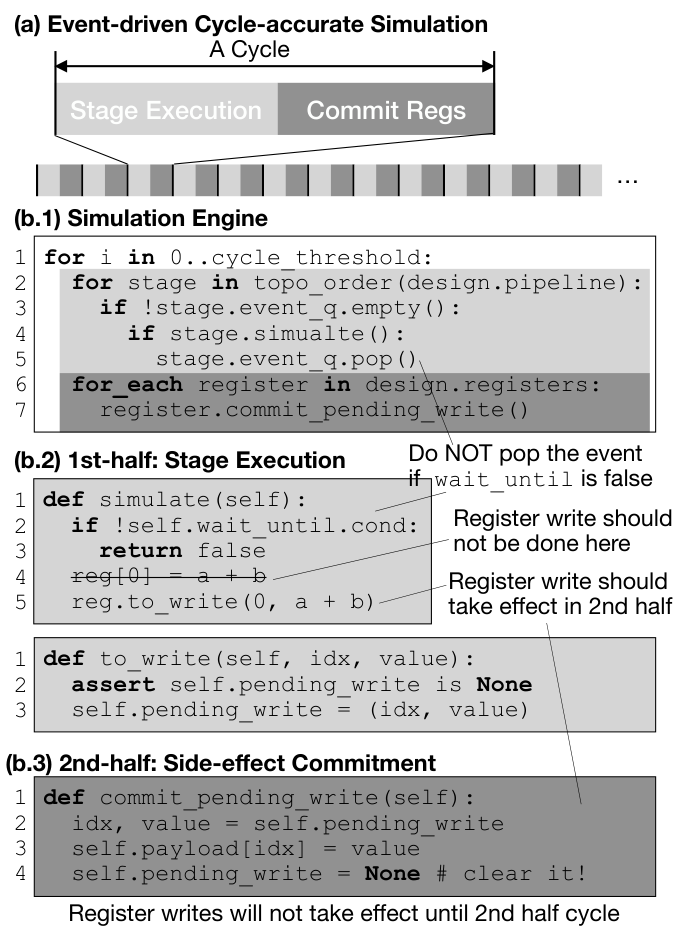
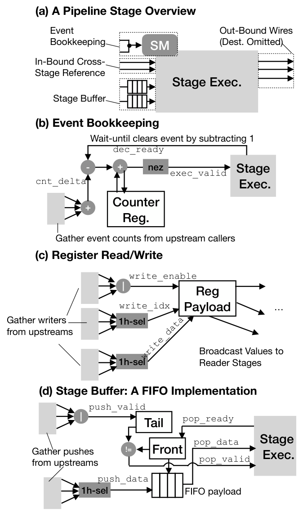

# Assassyn: A Unified Abstraction for Architectural Simulation and Implementation

[返回图集](../README.md) · Assassyn · ISCA 2025 · 2张非实验图

研究对象：编译器、语言与中间表示 / Assassyn统一硬件抽象与仿真／RTL代码生成工具链

固定100篇样本外补充，不增加该样本完成数。

F9 先读一个周期内的 stage 执行与寄存器提交；F10 再找事件计数器、寄存器和 FIFO 的 RTL 实现。

固定100篇样本外补充；仅收录精确作者仓库版本的 F9/F10（物理第8页）。F9 是生成的 Rust 仿真器，F10 是生成的 SystemVerilog RTL，后者不是运行前者的平台。

读图练习：F9 在 wait_until 为假时为何保留事件？在 F10(b) 中，哪条条件路径会令事件计数减一？对照事件消费条件，不把软件队列和硬件计数器视为同一结构。

版本许可依据：[精确作者仓库版本](https://github.com/were/were.github.io/blob/2b510990e04d5a7ba213af6c21049b303869dd56/pdfs/isca25-18.pdf)，16页 PDF 首页明确 CC BY 4.0。源 PDF SHA-256：`25f4c9c011703b3bcb557a231860bedb3d9aa4c930fbe0530c7df598e0a66ee2`；git blob：`8623bdf88f94c8b9584042b4c60eb7fd713d5f9c`。PDF不随库分发。

## 图号导航

[F9](#f9) · [F10](#f10)

## F9

**非实验图 · 周期精确仿真调度与提交机制图**

[原文物理页 8](https://raw.githubusercontent.com/were/were.github.io/2b510990e04d5a7ba213af6c21049b303869dd56/pdfs/isca25-18.pdf#page=8) · [许可证 CC BY 4.0](https://creativecommons.org/licenses/by/4.0/)

F9 展示生成的 Rust 周期精确仿真器：先按拓扑顺序执行 stage，再提交寄存器写入。wait_until 为假时事件不出队；待写值到后半周期才生效。这是调度与提交机制，不是测量时间线。

署名：Jian Weng, Boyang Han, Derui Gao, Ruijie Gao, Wanning Zhang, An Zhong, Ceyu Xu, Jihao Xin, Yangzhixin Luo, Lisa Wu Wills, Marco Canini. Assassyn: A Unified Abstraction for Architectural Simulation and Implementation. ISCA 2025. DOI: https://doi.org/10.1145/3695053.3731004. Source: https://github.com/were/were.github.io/blob/2b510990e04d5a7ba213af6c21049b303869dd56/pdfs/isca25-18.pdf. Version: 16-page ISCA 2025 PDF in author repository commit 2b510990e04d5a7ba213af6c21049b303869dd56, blob 8623bdf88f94c8b9584042b4c60eb7fd713d5f9c. CC BY 4.0: https://creativecommons.org/licenses/by/4.0/. Whole figure cropped from the exact author-hosted PDF and rasterized at 240 dpi; main caption excluded, all subfigure labels and annotations retained; figure content unchanged. No endorsement implied.

修改说明：Whole figure cropped from the exact author-hosted PDF and rasterized at 240 dpi; main caption excluded, all subfigure labels and annotations retained; figure content unchanged.

## F10

**非实验图 · RTL阶段事件与存储结构图**

[原文物理页 8](https://raw.githubusercontent.com/were/were.github.io/2b510990e04d5a7ba213af6c21049b303869dd56/pdfs/isca25-18.pdf#page=8) · [许可证 CC BY 4.0](https://creativecommons.org/licenses/by/4.0/)

F10 展示生成的 SystemVerilog RTL：stage 执行逻辑配合事件计数器、寄存器读写选择与 FIFO stage buffer。它实现硬件语义，不是运行 Rust 仿真器的平台；四个子图分别展开这些结构。

署名：Jian Weng, Boyang Han, Derui Gao, Ruijie Gao, Wanning Zhang, An Zhong, Ceyu Xu, Jihao Xin, Yangzhixin Luo, Lisa Wu Wills, Marco Canini. Assassyn: A Unified Abstraction for Architectural Simulation and Implementation. ISCA 2025. DOI: https://doi.org/10.1145/3695053.3731004. Source: https://github.com/were/were.github.io/blob/2b510990e04d5a7ba213af6c21049b303869dd56/pdfs/isca25-18.pdf. Version: 16-page ISCA 2025 PDF in author repository commit 2b510990e04d5a7ba213af6c21049b303869dd56, blob 8623bdf88f94c8b9584042b4c60eb7fd713d5f9c. CC BY 4.0: https://creativecommons.org/licenses/by/4.0/. Whole figure cropped from the exact author-hosted PDF and rasterized at 240 dpi; main caption excluded, all subfigure labels and annotations retained; figure content unchanged. No endorsement implied.

修改说明：Whole figure cropped from the exact author-hosted PDF and rasterized at 240 dpi; main caption excluded, all subfigure labels and annotations retained; figure content unchanged.
