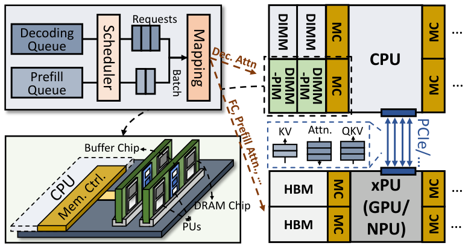
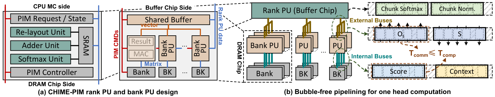

# CHIME: A Case for Efficient Long-Context Attention-FC Disaggregated Inference with DIMM-PIM

[返回图集](../README.md) · CHIME · arXiv v2 · 2个非实验图示条目

研究对象：专用加速器与可重构/存内计算平台 / CHIME GPU–DIMM-PIM推理平台

若贡献涉及跨设备分工，可用总览图明确系统边界、数据路径与工作分配；部件或流水图用于展开关键机制。这是本篇示例，不是必备图模板。

F6 GPU–DIMM-PIM系统总览 → F7 处理单元与无气泡流水机制

CHIME · arXiv v2固定版本；不独立断言正式会议身份或出版商版本一致。本轮仅F6/F7，其余图未在本轮审核范围。

## F6

### 图 6

**非实验图 · GPU–DIMM-PIM系统总览图**

[原文物理页 6](https://arxiv.org/pdf/2504.17584v2#page=6) · [CC BY 4.0](https://creativecommons.org/licenses/by/4.0/)

调度与请求映射模块连接 CPU、DIMM-PIM 和 GPU/NPU；局部放大展示 DIMM 芯片与处理单元。 将解码注意力分配到 DIMM-PIM，将 FC 与预填充注意力分配到 xPU，PCIe 路径连接设备。 是逻辑系统架构，不是芯片版图或实验吞吐量结果。 固定arXiv版本，不声称与出版社版一致；仅收录本页指定图，不代表其余图已审核或可再分发。

署名：Qingyuan Liu, Liyan Chen, Haocheng Wang, Yanning Yang, Dong Du, Zhigang Mao, Naifeng Jing, Yubin Xia, and Haibo Chen. CHIME: A Case for Efficient Long-Context Attention-FC Disaggregated Inference with DIMM-PIM. arXiv:2504.17584v2, 7 August 2026. Source: https://arxiv.org/abs/2504.17584v2. CC BY 4.0: https://creativecommons.org/licenses/by/4.0/. Cropped from the exact arXiv version PDF and rasterized at 240 dpi; main caption excluded, diagram content unchanged. No endorsement implied.

修改说明：Cropped from the exact arXiv version PDF and rasterized at 240 dpi; main caption excluded, diagram content unchanged.

## F7

### 图 7

**非实验图 · PIM处理单元设计与无气泡流水机制图**

[原文物理页 7](https://arxiv.org/pdf/2504.17584v2#page=7) · [CC BY 4.0](https://creativecommons.org/licenses/by/4.0/)

子图 a 展开 rank PU、bank PU、共享缓冲和控制路径；子图 b 展示单头计算的无气泡流水。 外部和内部总线分别承担跨芯片传输与 bank 计算访存，分块 softmax 与 context 计算构成流水。 包含机制性的通信与计算时间关系，不是实测性能图；两个子图整体保留。 固定arXiv版本，不声称与出版社版一致；仅收录本页指定图，不代表其余图已审核或可再分发。

署名：Qingyuan Liu, Liyan Chen, Haocheng Wang, Yanning Yang, Dong Du, Zhigang Mao, Naifeng Jing, Yubin Xia, and Haibo Chen. CHIME: A Case for Efficient Long-Context Attention-FC Disaggregated Inference with DIMM-PIM. arXiv:2504.17584v2, 7 August 2026. Source: https://arxiv.org/abs/2504.17584v2. CC BY 4.0: https://creativecommons.org/licenses/by/4.0/. Cropped from the exact arXiv version PDF and rasterized at 240 dpi; main caption excluded, diagram content unchanged. No endorsement implied.

修改说明：Cropped from the exact arXiv version PDF and rasterized at 240 dpi; main caption excluded, diagram content unchanged.

