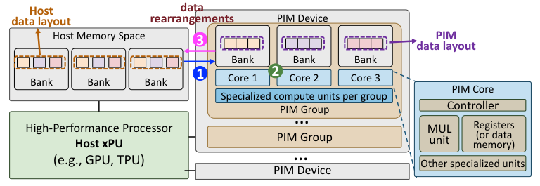
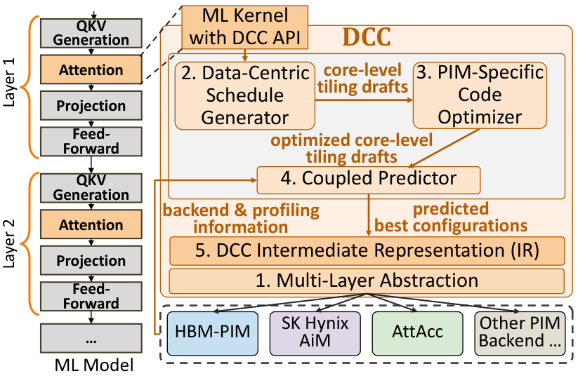
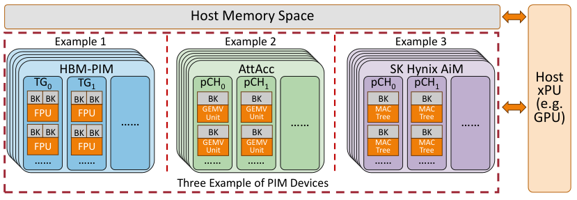
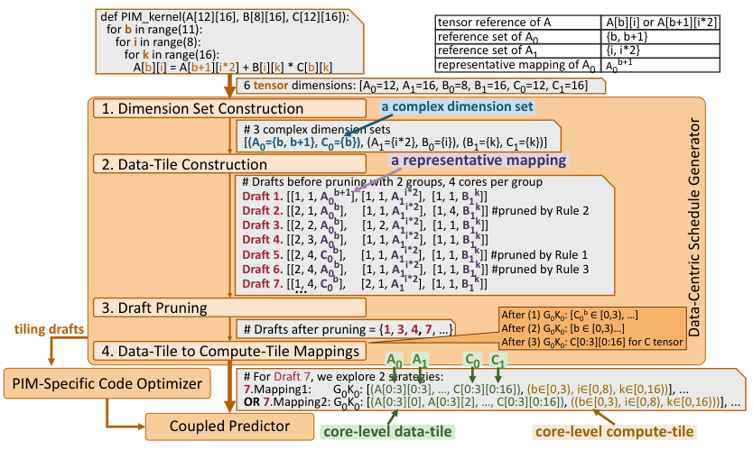

# DCC: Data-Centric Compilation of Machine Learning Kernels for Processing-In-Memory Architectures

[返回图集](../README.md) · DCC · arXiv v5 · 4个非实验图示条目

研究对象：编译器、语言与中间表示 / DCC PIM内核编译器

这四个例子解释硬件抽象、编译组织、多后端映射及调度生成；按论文贡献选择，不是必备模板。

F1 近存硬件与数据重排 → F3 编译器架构与工作流 → F4 三类PIM后端多层硬件抽象 → F5 数据中心调度生成示例

仅固定arXiv:2511.15503v5，不声称出版商版本一致。F2是实验时间分解，不纳入；其他图未在本轮审核范围。

## F1

### 图 1

**非实验图 · 近存计算硬件抽象与数据重排流程图**

[原文物理页 3](https://arxiv.org/pdf/2511.15503v5#page=3) · [CC BY 4.0](https://creativecommons.org/licenses/by/4.0/)

DCC · arXiv v5（2511.15503v5，2026-08-28），PDF物理页3。主机XPU和内存空间连接PIM设备；设备包含组、核心、本地bank与专用计算单元。三个编号说明输入重排、PIM计算、输出重排。 是通用近bank架构抽象，不代表某一实际设备的完整电路或实测开销。 固定版本，不声称与出版社版一致；本轮只收录F1/F3/F4/F5，F2为实验图，其余图未在本轮审核范围。

署名：Peiming Yang, Sankeerth Durvasula, Ivan Fernandez, Mohammad Sadrosadati, Onur Mutlu, Gennady Pekhimenko, and Christina Giannoula. DCC: Data-Centric Compilation of Machine Learning Kernels for Processing-In-Memory Architectures. arXiv:2511.15503v5, 28 August 2026. Source: https://arxiv.org/abs/2511.15503v5. CC BY 4.0: https://creativecommons.org/licenses/by/4.0/. Cropped and rasterized at 240 dpi; caption excluded and diagram content unchanged. No endorsement implied.

修改说明：Cropped from the exact arXiv v5 PDF and rasterized at 240 dpi; caption excluded and diagram content unchanged.

## F3

### 图 3

**非实验图 · 编译器总体架构图**

[原文物理页 4](https://arxiv.org/pdf/2511.15503v5#page=4) · [CC BY 4.0](https://creativecommons.org/licenses/by/4.0/)

DCC · arXiv v5（2511.15503v5，2026-08-28），PDF物理页4。ML内核通过DCC API进入以数据为中心的调度生成器，形成核心级tiling drafts，经过代码优化器和耦合预测器，落到IR与多层抽象及不同PIM后端。 这是编译器工作流，不应把其中模块误画成硬件计算单元。 固定版本，不声称与出版社版一致；本轮只收录F1/F3/F4/F5，F2为实验图，其余图未在本轮审核范围。

署名：Peiming Yang, Sankeerth Durvasula, Ivan Fernandez, Mohammad Sadrosadati, Onur Mutlu, Gennady Pekhimenko, and Christina Giannoula. DCC: Data-Centric Compilation of Machine Learning Kernels for Processing-In-Memory Architectures. arXiv:2511.15503v5, 28 August 2026. Source: https://arxiv.org/abs/2511.15503v5. CC BY 4.0: https://creativecommons.org/licenses/by/4.0/. Cropped and rasterized at 240 dpi; caption excluded and diagram content unchanged. No endorsement implied.

修改说明：Cropped from the exact arXiv v5 PDF and rasterized at 240 dpi; caption excluded and diagram content unchanged.

## F4

### 图 4

**非实验图 · 多层PIM硬件后端实例映射图**

[原文物理页 5](https://arxiv.org/pdf/2511.15503v5#page=5) · [CC BY 4.0](https://creativecommons.org/licenses/by/4.0/)

DCC · arXiv v5（2511.15503v5，2026-08-28），PDF物理页5。共同Host Memory Space和Host XPU连接三个示例PIM设备：HBM-PIM、AttAcc与SK Hynix AiM；不同设备通过组、核心、bank和计算单元呈现共同层级。 图为抽象实例，并非厂商原始版图或全部实现细节。 固定版本，不声称与出版社版一致；本轮只收录F1/F3/F4/F5，F2为实验图，其余图未在本轮审核范围。

署名：Peiming Yang, Sankeerth Durvasula, Ivan Fernandez, Mohammad Sadrosadati, Onur Mutlu, Gennady Pekhimenko, and Christina Giannoula. DCC: Data-Centric Compilation of Machine Learning Kernels for Processing-In-Memory Architectures. arXiv:2511.15503v5, 28 August 2026. Source: https://arxiv.org/abs/2511.15503v5. CC BY 4.0: https://creativecommons.org/licenses/by/4.0/. Cropped and rasterized at 240 dpi; caption excluded and diagram content unchanged. No endorsement implied.

修改说明：Cropped from the exact arXiv v5 PDF and rasterized at 240 dpi; caption excluded and diagram content unchanged.

## F5

### 图 5

**非实验图 · 以数据为中心的调度生成示例流程图**

[原文物理页 6](https://arxiv.org/pdf/2511.15503v5#page=6) · [CC BY 4.0](https://creativecommons.org/licenses/by/4.0/)

DCC · arXiv v5（2511.15503v5，2026-08-28），PDF物理页6。输入内核循环与张量信息进入维度集构造、数据tile构造、草案剪枝和数据到计算tile映射；下游PIM代码优化与预测评估形成反馈。 这是具体符号化算法示例，不是性能结果图，也不是固定适用于所有后端的最优配置。 固定版本，不声称与出版社版一致；本轮只收录F1/F3/F4/F5，F2为实验图，其余图未在本轮审核范围。

署名：Peiming Yang, Sankeerth Durvasula, Ivan Fernandez, Mohammad Sadrosadati, Onur Mutlu, Gennady Pekhimenko, and Christina Giannoula. DCC: Data-Centric Compilation of Machine Learning Kernels for Processing-In-Memory Architectures. arXiv:2511.15503v5, 28 August 2026. Source: https://arxiv.org/abs/2511.15503v5. CC BY 4.0: https://creativecommons.org/licenses/by/4.0/. Cropped and rasterized at 240 dpi; caption excluded and diagram content unchanged. No endorsement implied.

修改说明：Cropped from the exact arXiv v5 PDF and rasterized at 240 dpi; caption excluded and diagram content unchanged.

