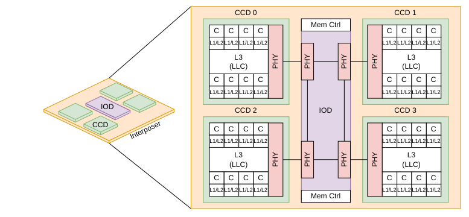
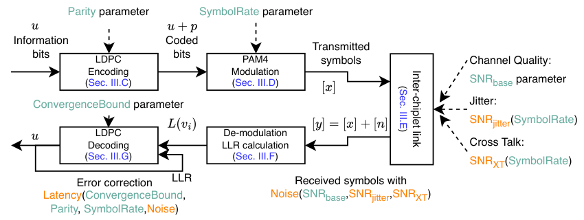
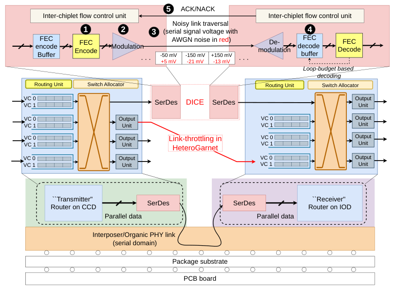
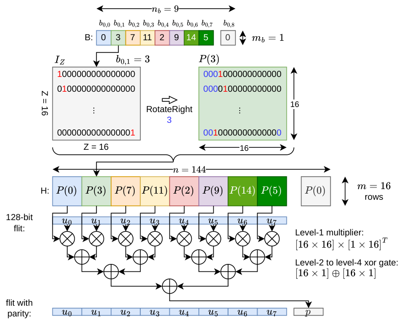
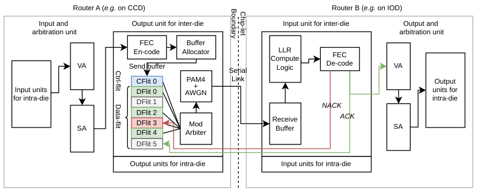

# DICE: Detailed Inter-Chiplet End-to-End PHY Modeling for Accurate Chiplet Simulation

[返回图集](../README.md) · DICE PHY · ISCA 2026 / arXiv v2 · 5张非实验图

研究对象：模拟器与仿真平台 / 芯粒互连PHY运行时模型

本页仅显示以下非实验图，不包含原论文全部图组。混合图在子图分离复核完成前暂不收录。

图7的密集网表尚未通过完整可读性审核。 本图库当前收录5张非实验图：F1、F2、F4、F6、F11。

版本许可依据：[来源](https://arxiv.org/abs/2607.24221v2)。源PDF SHA256：`51b4500eacf8b0183f528ebd0ce3b18a1510472c892548f51944459883862992`。PDF不随库分发。

## 图号导航

[F1](#f1) · [F2](#f2) · [F4](#f4) · [F6](#f6) · [F11](#f11)

## F1

**非实验图 · 芯粒体系结构示例**

[原文物理页 1](https://arxiv.org/pdf/2607.24221v2#page=1) · [许可证 CC BY 4.0](https://creativecommons.org/licenses/by/4.0/)

署名：Rashid Aligholipour, Stefanos Kaxiras, Yuan Yao. DICE: Detailed Inter-Chiplet End-to-End PHY Modeling for Accurate Chiplet Simulation. ISCA 2026 author manuscript. DOI: https://doi.org/10.48550/arXiv.2607.24221. Version: arXiv:2607.24221v2, 28 July 2026, 15 pages. Source: https://arxiv.org/pdf/2607.24221v2. CC BY 4.0: https://creativecommons.org/licenses/by/4.0/. Whole figures cropped from this exact PDF and rasterized at 240 dpi; captions excluded, all figure content unchanged. No endorsement implied.

修改说明：Whole figure cropped from the specified source PDF and rasterized at 240 dpi; numbered caption excluded, figure content unchanged.

## F2

**非实验图 · 端到端PHY模型**

[原文物理页 1](https://arxiv.org/pdf/2607.24221v2#page=1) · [许可证 CC BY 4.0](https://creativecommons.org/licenses/by/4.0/)

署名：Rashid Aligholipour, Stefanos Kaxiras, Yuan Yao. DICE: Detailed Inter-Chiplet End-to-End PHY Modeling for Accurate Chiplet Simulation. ISCA 2026 author manuscript. DOI: https://doi.org/10.48550/arXiv.2607.24221. Version: arXiv:2607.24221v2, 28 July 2026, 15 pages. Source: https://arxiv.org/pdf/2607.24221v2. CC BY 4.0: https://creativecommons.org/licenses/by/4.0/. Whole figures cropped from this exact PDF and rasterized at 240 dpi; captions excluded, all figure content unchanged. No endorsement implied.

修改说明：Whole figure cropped from the specified source PDF and rasterized at 240 dpi; numbered caption excluded, figure content unchanged.

## F4

**非实验图 · PHY与路由器集成**

[原文物理页 4](https://arxiv.org/pdf/2607.24221v2#page=4) · [许可证 CC BY 4.0](https://creativecommons.org/licenses/by/4.0/)

署名：Rashid Aligholipour, Stefanos Kaxiras, Yuan Yao. DICE: Detailed Inter-Chiplet End-to-End PHY Modeling for Accurate Chiplet Simulation. ISCA 2026 author manuscript. DOI: https://doi.org/10.48550/arXiv.2607.24221. Version: arXiv:2607.24221v2, 28 July 2026, 15 pages. Source: https://arxiv.org/pdf/2607.24221v2. CC BY 4.0: https://creativecommons.org/licenses/by/4.0/. Whole figures cropped from this exact PDF and rasterized at 240 dpi; captions excluded, all figure content unchanged. No endorsement implied.

修改说明：Whole figure cropped from the specified source PDF and rasterized at 240 dpi; numbered caption excluded, figure content unchanged.

## F6

**非实验图 · FEC编码示例**

[原文物理页 5](https://arxiv.org/pdf/2607.24221v2#page=5) · [许可证 CC BY 4.0](https://creativecommons.org/licenses/by/4.0/)

署名：Rashid Aligholipour, Stefanos Kaxiras, Yuan Yao. DICE: Detailed Inter-Chiplet End-to-End PHY Modeling for Accurate Chiplet Simulation. ISCA 2026 author manuscript. DOI: https://doi.org/10.48550/arXiv.2607.24221. Version: arXiv:2607.24221v2, 28 July 2026, 15 pages. Source: https://arxiv.org/pdf/2607.24221v2. CC BY 4.0: https://creativecommons.org/licenses/by/4.0/. Whole figures cropped from this exact PDF and rasterized at 240 dpi; captions excluded, all figure content unchanged. No endorsement implied.

修改说明：Whole figure cropped from the specified source PDF and rasterized at 240 dpi; numbered caption excluded, figure content unchanged.

## F11

**非实验图 · PHY路由器微架构**

[原文物理页 8](https://arxiv.org/pdf/2607.24221v2#page=8) · [许可证 CC BY 4.0](https://creativecommons.org/licenses/by/4.0/)

署名：Rashid Aligholipour, Stefanos Kaxiras, Yuan Yao. DICE: Detailed Inter-Chiplet End-to-End PHY Modeling for Accurate Chiplet Simulation. ISCA 2026 author manuscript. DOI: https://doi.org/10.48550/arXiv.2607.24221. Version: arXiv:2607.24221v2, 28 July 2026, 15 pages. Source: https://arxiv.org/pdf/2607.24221v2. CC BY 4.0: https://creativecommons.org/licenses/by/4.0/. Whole figures cropped from this exact PDF and rasterized at 240 dpi; captions excluded, all figure content unchanged. No endorsement implied.

修改说明：Whole figure cropped from the specified source PDF and rasterized at 240 dpi; numbered caption excluded, figure content unchanged.

