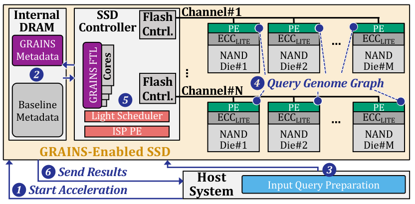

# GRAINS: Storage-Aware Algorithm-Architecture Co-Design Enabling High-Performance and Low-Cost Graph-Based Genome Analysis

[返回图集](../README.md) · GRAINS · arXiv v1 · 1个非实验图示条目

研究对象：专用加速器与可重构/存内计算平台 / 基因图查询计算型SSD

若贡献涉及跨设备分工，可用总览图明确系统边界、数据路径与工作分配；部件或流水图用于展开关键机制。这是本篇示例，不是必备图模板。

F6 计算型SSD系统总览与编号数据流

GRAINS · arXiv v1固定版本；不独立断言正式会议身份或出版商版本一致。本轮仅F6，其余图未在本轮审核范围。

## F6

### 图 6

**非实验图 · 计算型SSD系统总览与数据流图**

[原文物理页 7](https://arxiv.org/pdf/2606.26468v1#page=7) · [CC BY 4.0](https://creativecommons.org/licenses/by/4.0/)

主机输入查询连接包含 DRAM、FTL、调度器、ISP PE 和各 NAND die 内 PE 的 SSD。 编号箭头依次连接启动、元数据准备、查询传输、图查询、存内处理与结果返回，突出主机/控制器/闪存边界。 这是算法与架构协同的系统示意，不是实际 SSD 布线或实验结果。 固定arXiv版本，不声称与出版社版一致；仅收录本页指定图，不代表其余图已审核或可再分发。

署名：Nika Mansouri Ghiasi, Harun Mustafa, Talu Güloglu, Rakesh Nadig, Konstantina Koliogeorgi, Susana Rebolledo Ruiz, Marc Rautmann, Furkan Eris, Mohammad Sadrosadati, Jisung Park, and Onur Mutlu. GRAINS: Storage-Aware Algorithm-Architecture Co-Design Enabling High-Performance and Low-Cost Graph-Based Genome Analysis. arXiv:2606.26468v1, 25 June 2026. Source: https://arxiv.org/abs/2606.26468v1. CC BY 4.0: https://creativecommons.org/licenses/by/4.0/. Cropped from the exact arXiv version PDF and rasterized at 240 dpi; main caption excluded, diagram content unchanged. No endorsement implied.

修改说明：Cropped from the exact arXiv version PDF and rasterized at 240 dpi; main caption excluded, diagram content unchanged.

