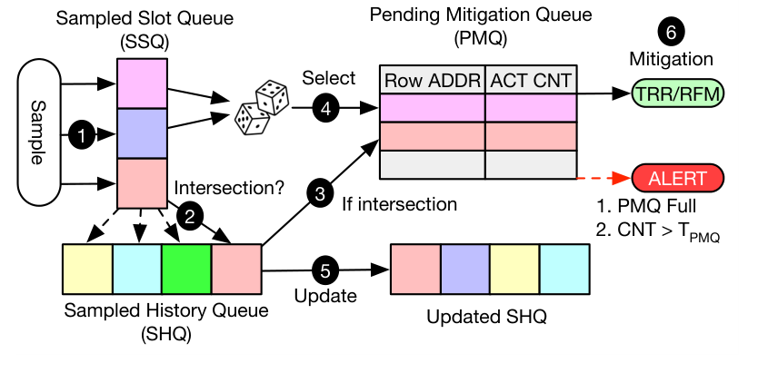
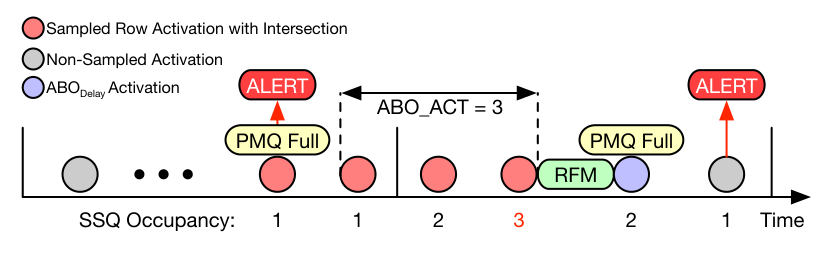

# Loaded Dice: Solving the Non-Selection Problem for Scalable Probabilistic RowHammer Defense

[返回图集](../README.md) · Loaded Dice · ISCA 2026 / arXiv v1 · 2张非实验图

研究对象：缓存、地址转换与DRAM系统 / PrISM DRAM行扰动防护构件

本页仅显示以下非实验图，不包含原论文全部图组。混合图在子图分离复核完成前暂不收录。

图像来自17页arXiv v1作者稿；按该版本的图号、指标和设置解读，不宣称与出版社PDF字节一致。 本图库当前收录2张非实验图：F3、F4。

版本许可依据：[来源](https://arxiv.org/abs/2605.17358v1)。源PDF SHA256：`b745ae38266961dad2a34a3bc191a9a4ae46480d9928817d7f1feb055ee6e712`。PDF不随库分发。

## 图号导航

[F3](#f3) · [F4](#f4)

## F3

**非实验图 · 框图、队列布局图**

[原文物理页 4](https://arxiv.org/pdf/2605.17358v1#page=4) · [许可证 CC BY 4.0](https://creativecommons.org/licenses/by/4.0/)

PrISM的采样、历史相交、队列与缓解路径示意；骰子为随机选择符号，不是实验图。

署名：Jeonghyun Woo, Junsu Kim, Aamer Jaleel, Prashant J. Nair. Loaded Dice: Solving the Non-Selection Problem for Scalable Probabilistic RowHammer Defense. Version: arXiv:2605.17358v1, 17 May 2026, 17 pages. Source: https://arxiv.org/pdf/2605.17358v1. CC BY 4.0: https://creativecommons.org/licenses/by/4.0/. Whole figure cropped from the specified exact source PDF and rasterized at 240 dpi; independent caption excluded and figure content unchanged. No relabeling or redrawing. No endorsement implied. Figure 3, physical PDF page 4.

修改说明：Whole figure cropped from the specified exact source PDF and rasterized at 240 dpi; independent caption excluded and figure content unchanged. No relabeling or redrawing. Exact crop rectangle in source PDF points: [313, 490, 563, 613]; RGB, alpha=false, annotations=true; output 834×411 pixels.

## F4

**非实验图 · 时间线**

[原文物理页 5](https://arxiv.org/pdf/2605.17358v1#page=5) · [许可证 CC BY 4.0](https://creativecommons.org/licenses/by/4.0/)

相邻窗口激活聚集与SSQ缓冲的示例时间线；ABO_ACT=3，非真实测得的时间序列。

署名：Jeonghyun Woo, Junsu Kim, Aamer Jaleel, Prashant J. Nair. Loaded Dice: Solving the Non-Selection Problem for Scalable Probabilistic RowHammer Defense. Version: arXiv:2605.17358v1, 17 May 2026, 17 pages. Source: https://arxiv.org/pdf/2605.17358v1. CC BY 4.0: https://creativecommons.org/licenses/by/4.0/. Whole figure cropped from the specified exact source PDF and rasterized at 240 dpi; independent caption excluded and figure content unchanged. No relabeling or redrawing. No endorsement implied. Figure 4, physical PDF page 5.

修改说明：Whole figure cropped from the specified exact source PDF and rasterized at 240 dpi; independent caption excluded and figure content unchanged. No relabeling or redrawing. Exact crop rectangle in source PDF points: [312, 230, 560, 307]; RGB, alpha=false, annotations=true; output 827×258 pixels.

