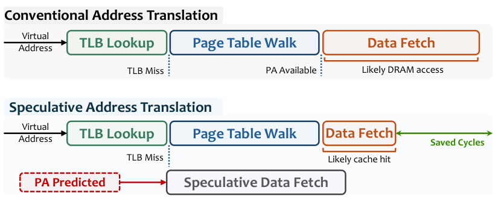
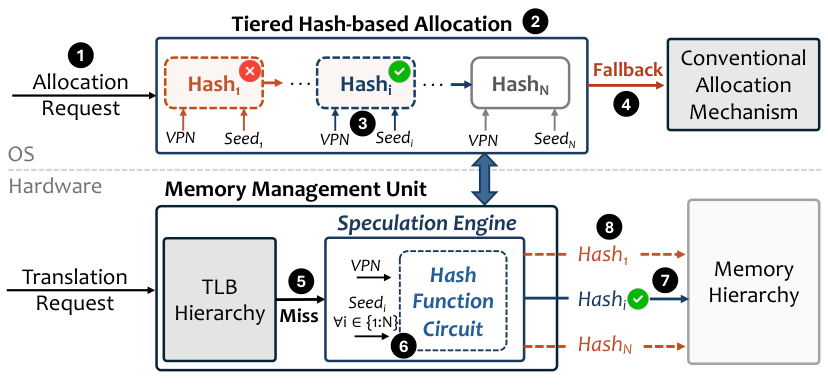
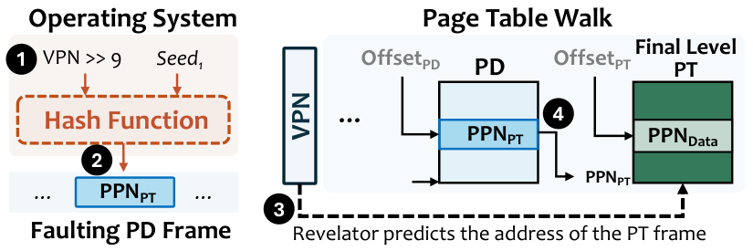
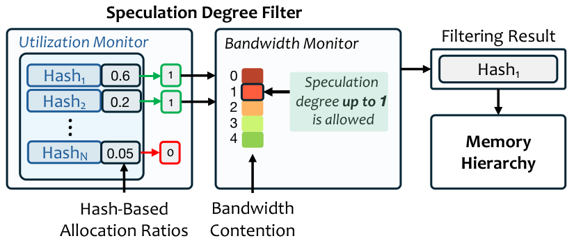
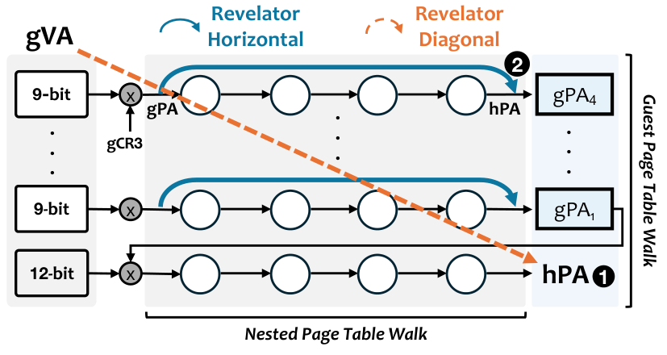
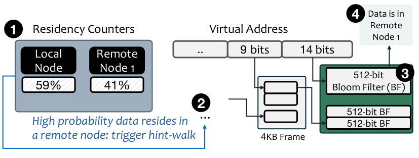

# Revelator: Rapid Data Fetching via System-Software-Guided Hash-based Speculative Address Translation

[返回图集](../README.md) · Revelator · arXiv v2 · 6个非实验图示条目

研究对象：缓存、地址转换与DRAM系统 / 软硬协同虚拟地址翻译子系统

可按总览、关键分配/过滤机制、虚拟化与NUMA扩展组织系统说明；示意时间线不是实测性能证据，也不是必须图模板。

F1 地址转换时序对照 → F4 硬件/OS总览 → F5 页表帧哈希分配 → F6 推测度过滤 → F8 虚拟化嵌套页表工作流 → F9 NUMA提示机制

Revelator · arXiv v2固定版本；不独立断言正式会议身份或出版商版本一致。本轮仅F1/F4/F5/F6/F8/F9，其余图未在本轮审核范围。许可为CC0 1.0，不是CC BY。

## F1

### 图 1

**非实验图 · 传统与推测地址转换时序对比图**

[原文物理页 3](https://arxiv.org/pdf/2508.02007v2#page=3) · [CC0 1.0](https://creativecommons.org/publicdomain/zero/1.0/)

对比 TLB、页表遍历、数据获取顺序；推测路径以预测地址提前启动数据获取。 横向阶段和虚线对齐展示重叠，Saved Cycles 为设计示意而非统计结果。 机制或架构示意，非实测性能结果；具体效果需阅读论文评估部分。 固定arXiv版本，不声称与出版社版一致；仅收录指定图，不代表其余图已审核或可再分发。

署名：Konstantinos Kanellopoulos, Konstantinos Sgouras, Harsh Songara, Andreas Kosmas Kakolyris, Vlad-Petru Nitu, Spiros Galanopoulos, Rahul Bera, Konstantina Koliogeorgi, Rakesh Kumar, and Onur Mutlu. Revelator: Rapid Data Fetching via System-Software-Guided Hash-based Speculative Address Translation. arXiv:2508.02007v2, 25 June 2026. Source: https://arxiv.org/abs/2508.02007v2. CC0 1.0: https://creativecommons.org/publicdomain/zero/1.0/. Cropped from exact version PDF and rasterized at 240 dpi; main caption excluded, diagram content unchanged. No endorsement implied.

修改说明：Cropped from exact version PDF and rasterized at 240 dpi; main caption excluded, diagram content unchanged.

## F4

### 图 4

**非实验图 · 硬件与操作系统协同总览图**

[原文物理页 5](https://arxiv.org/pdf/2508.02007v2#page=5) · [CC0 1.0](https://creativecommons.org/publicdomain/zero/1.0/)

OS 分层哈希分配与硬件推测引擎共享哈希规则，TLB miss 触发候选数据预取。 虚线区分 OS 与硬件层，编号连接分配、回退、推测和内存层级。 机制或架构示意，非实测性能结果；具体效果需阅读论文评估部分。 固定arXiv版本，不声称与出版社版一致；仅收录指定图，不代表其余图已审核或可再分发。

署名：Konstantinos Kanellopoulos, Konstantinos Sgouras, Harsh Songara, Andreas Kosmas Kakolyris, Vlad-Petru Nitu, Spiros Galanopoulos, Rahul Bera, Konstantina Koliogeorgi, Rakesh Kumar, and Onur Mutlu. Revelator: Rapid Data Fetching via System-Software-Guided Hash-based Speculative Address Translation. arXiv:2508.02007v2, 25 June 2026. Source: https://arxiv.org/abs/2508.02007v2. CC0 1.0: https://creativecommons.org/publicdomain/zero/1.0/. Cropped from exact version PDF and rasterized at 240 dpi; main caption excluded, diagram content unchanged. No endorsement implied.

修改说明：Cropped from exact version PDF and rasterized at 240 dpi; main caption excluded, diagram content unchanged.

## F5

### 图 5

**非实验图 · 页表帧哈希分配机制图**

[原文物理页 7](https://arxiv.org/pdf/2508.02007v2#page=7) · [CC0 1.0](https://creativecommons.org/publicdomain/zero/1.0/)

OS 利用虚拟页号哈希定位页表帧，硬件通过同一映射预测最终级页表地址。 左侧 OS 分配和右侧页表遍历通过页表帧地址连接。 机制或架构示意，非实测性能结果；具体效果需阅读论文评估部分。 固定arXiv版本，不声称与出版社版一致；仅收录指定图，不代表其余图已审核或可再分发。

署名：Konstantinos Kanellopoulos, Konstantinos Sgouras, Harsh Songara, Andreas Kosmas Kakolyris, Vlad-Petru Nitu, Spiros Galanopoulos, Rahul Bera, Konstantina Koliogeorgi, Rakesh Kumar, and Onur Mutlu. Revelator: Rapid Data Fetching via System-Software-Guided Hash-based Speculative Address Translation. arXiv:2508.02007v2, 25 June 2026. Source: https://arxiv.org/abs/2508.02007v2. CC0 1.0: https://creativecommons.org/publicdomain/zero/1.0/. Cropped from exact version PDF and rasterized at 240 dpi; main caption excluded, diagram content unchanged. No endorsement implied.

修改说明：Cropped from exact version PDF and rasterized at 240 dpi; main caption excluded, diagram content unchanged.

## F6

### 图 6

**非实验图 · 推测度过滤器设计图**

[原文物理页 7](https://arxiv.org/pdf/2508.02007v2#page=7) · [CC0 1.0](https://creativecommons.org/publicdomain/zero/1.0/)

利用率监视器和带宽监视器共同决定允许的推测哈希候选。 输入分配比例与带宽竞争经过滤后向内存层级发出候选；数值是工作示例。 机制或架构示意，非实测性能结果；具体效果需阅读论文评估部分。 固定arXiv版本，不声称与出版社版一致；仅收录指定图，不代表其余图已审核或可再分发。

署名：Konstantinos Kanellopoulos, Konstantinos Sgouras, Harsh Songara, Andreas Kosmas Kakolyris, Vlad-Petru Nitu, Spiros Galanopoulos, Rahul Bera, Konstantina Koliogeorgi, Rakesh Kumar, and Onur Mutlu. Revelator: Rapid Data Fetching via System-Software-Guided Hash-based Speculative Address Translation. arXiv:2508.02007v2, 25 June 2026. Source: https://arxiv.org/abs/2508.02007v2. CC0 1.0: https://creativecommons.org/publicdomain/zero/1.0/. Cropped from exact version PDF and rasterized at 240 dpi; main caption excluded, diagram content unchanged. No endorsement implied.

修改说明：Cropped from exact version PDF and rasterized at 240 dpi; main caption excluded, diagram content unchanged.

## F8

### 图 8

**非实验图 · 虚拟化嵌套页表推测流程图**

[原文物理页 8](https://arxiv.org/pdf/2508.02007v2#page=8) · [CC0 1.0](https://creativecommons.org/publicdomain/zero/1.0/)

嵌套页表遍历中的水平推测与对角推测连接客户虚拟、客户物理和主机物理地址。 两类虚线箭头突出可以重叠的转换路径。 机制或架构示意，非实测性能结果；具体效果需阅读论文评估部分。 固定arXiv版本，不声称与出版社版一致；仅收录指定图，不代表其余图已审核或可再分发。

署名：Konstantinos Kanellopoulos, Konstantinos Sgouras, Harsh Songara, Andreas Kosmas Kakolyris, Vlad-Petru Nitu, Spiros Galanopoulos, Rahul Bera, Konstantina Koliogeorgi, Rakesh Kumar, and Onur Mutlu. Revelator: Rapid Data Fetching via System-Software-Guided Hash-based Speculative Address Translation. arXiv:2508.02007v2, 25 June 2026. Source: https://arxiv.org/abs/2508.02007v2. CC0 1.0: https://creativecommons.org/publicdomain/zero/1.0/. Cropped from exact version PDF and rasterized at 240 dpi; main caption excluded, diagram content unchanged. No endorsement implied.

修改说明：Cropped from exact version PDF and rasterized at 240 dpi; main caption excluded, diagram content unchanged.

## F9

### 图 9

**非实验图 · NUMA推测与提示路径图**

[原文物理页 9](https://arxiv.org/pdf/2508.02007v2#page=9) · [CC0 1.0](https://creativecommons.org/publicdomain/zero/1.0/)

驻留计数器估计节点概率，远程节点 Bloom filter 提供提示并引导跨节点地址推测。 编号连接概率决策、提示查询和远程数据位置；图中百分比是说明性状态。 机制或架构示意，非实测性能结果；具体效果需阅读论文评估部分。 固定arXiv版本，不声称与出版社版一致；仅收录指定图，不代表其余图已审核或可再分发。

署名：Konstantinos Kanellopoulos, Konstantinos Sgouras, Harsh Songara, Andreas Kosmas Kakolyris, Vlad-Petru Nitu, Spiros Galanopoulos, Rahul Bera, Konstantina Koliogeorgi, Rakesh Kumar, and Onur Mutlu. Revelator: Rapid Data Fetching via System-Software-Guided Hash-based Speculative Address Translation. arXiv:2508.02007v2, 25 June 2026. Source: https://arxiv.org/abs/2508.02007v2. CC0 1.0: https://creativecommons.org/publicdomain/zero/1.0/. Cropped from exact version PDF and rasterized at 240 dpi; main caption excluded, diagram content unchanged. No endorsement implied.

修改说明：Cropped from exact version PDF and rasterized at 240 dpi; main caption excluded, diagram content unchanged.

