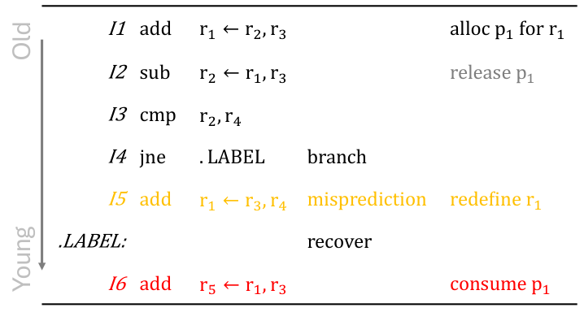
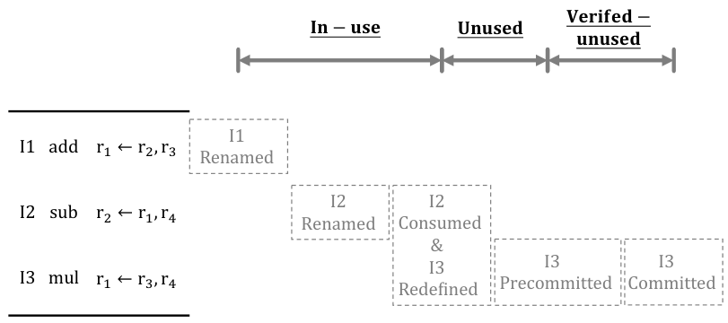
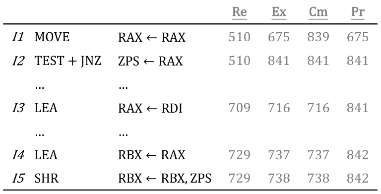
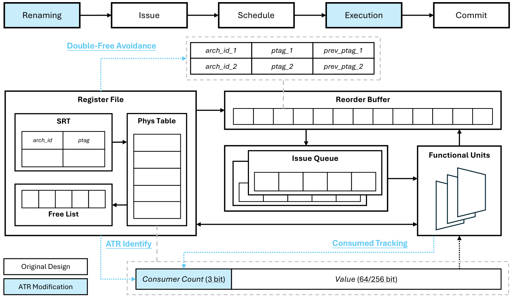
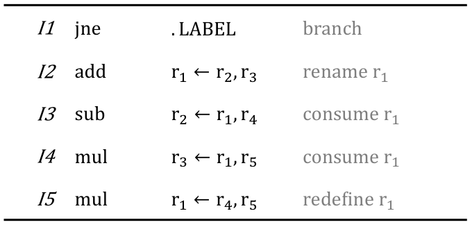
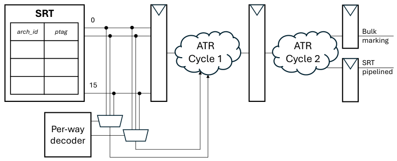

# ATR: Out-of-Order Register Release Exploiting Atomic Regions

[返回图集](../README.md) · ATR · MICRO 2025 · 6张非实验图

研究对象：CPU/GPU处理器与执行构件 / 乱序CPU物理寄存器管理单元

本页仅显示以下非实验图，不包含原论文全部图组。混合图在子图分离复核完成前暂不收录。

版本许可依据：[来源](https://hlitz.github.io/papers/atr.pdf#page=1)。源PDF SHA256：`6af8ca4e8c245d6a55d26cdd2f0400120a9ec05341494259097d4b327180b94a`。PDF不随库分发。

## 图号导航

[F2](#f2) · [F3](#f3) · [F5](#f5) · [F7](#f7) · [F8](#f8) · [F9](#f9)

## F2

**非实验图 · 推测释放错误复用示例**

[原文物理页 3](https://hlitz.github.io/papers/atr.pdf#page=3) · [许可证 CC BY 4.0](https://creativecommons.org/licenses/by/4.0/)

署名：Yinyuan Zhao, Surim Oh, Mingsheng Xu, Heiner Litz. ATR: Out-of-Order Register Release Exploiting Atomic Regions. MICRO 2025. DOI: https://doi.org/10.1145/3725843.3756135. Version: Frozen 14-page author-hosted MICRO 2025 conference-layout PDF, printed pages 705–718. Source: https://hlitz.github.io/papers/atr.pdf. CC BY 4.0: https://creativecommons.org/licenses/by/4.0/. Whole figures cropped from this exact PDF and rasterized at 240 dpi; captions excluded, all figure content unchanged. No endorsement implied.

修改说明：Whole figure cropped from the specified source PDF and rasterized at 240 dpi; numbered caption excluded, figure content unchanged.

## F3

**非实验图 · 寄存器生命周期时序**

[原文物理页 3](https://hlitz.github.io/papers/atr.pdf#page=3) · [许可证 CC BY 4.0](https://creativecommons.org/licenses/by/4.0/)

署名：Yinyuan Zhao, Surim Oh, Mingsheng Xu, Heiner Litz. ATR: Out-of-Order Register Release Exploiting Atomic Regions. MICRO 2025. DOI: https://doi.org/10.1145/3725843.3756135. Version: Frozen 14-page author-hosted MICRO 2025 conference-layout PDF, printed pages 705–718. Source: https://hlitz.github.io/papers/atr.pdf. CC BY 4.0: https://creativecommons.org/licenses/by/4.0/. Whole figures cropped from this exact PDF and rasterized at 240 dpi; captions excluded, all figure content unchanged. No endorsement implied.

修改说明：Whole figure cropped from the specified source PDF and rasterized at 240 dpi; numbered caption excluded, figure content unchanged.

## F5

**非实验图 · 指令执行周期实例**

[原文物理页 4](https://hlitz.github.io/papers/atr.pdf#page=4) · [许可证 CC BY 4.0](https://creativecommons.org/licenses/by/4.0/)

含 Re／Ex／Cm／Pr 周期数字的机制实例，归为非实验图，不表示没有数值。

署名：Yinyuan Zhao, Surim Oh, Mingsheng Xu, Heiner Litz. ATR: Out-of-Order Register Release Exploiting Atomic Regions. MICRO 2025. DOI: https://doi.org/10.1145/3725843.3756135. Version: Frozen 14-page author-hosted MICRO 2025 conference-layout PDF, printed pages 705–718. Source: https://hlitz.github.io/papers/atr.pdf. CC BY 4.0: https://creativecommons.org/licenses/by/4.0/. Whole figures cropped from this exact PDF and rasterized at 240 dpi; captions excluded, all figure content unchanged. No endorsement implied.

修改说明：Whole figure cropped from the specified source PDF and rasterized at 240 dpi; numbered caption excluded, figure content unchanged.

## F7

**非实验图 · 寄存器提前释放架构**

[原文物理页 6](https://hlitz.github.io/papers/atr.pdf#page=6) · [许可证 CC BY 4.0](https://creativecommons.org/licenses/by/4.0/)

署名：Yinyuan Zhao, Surim Oh, Mingsheng Xu, Heiner Litz. ATR: Out-of-Order Register Release Exploiting Atomic Regions. MICRO 2025. DOI: https://doi.org/10.1145/3725843.3756135. Version: Frozen 14-page author-hosted MICRO 2025 conference-layout PDF, printed pages 705–718. Source: https://hlitz.github.io/papers/atr.pdf. CC BY 4.0: https://creativecommons.org/licenses/by/4.0/. Whole figures cropped from this exact PDF and rasterized at 240 dpi; captions excluded, all figure content unchanged. No endorsement implied.

修改说明：Whole figure cropped from the specified source PDF and rasterized at 240 dpi; numbered caption excluded, figure content unchanged.

## F8

**非实验图 · 原子区域提前释放示例**

[原文物理页 6](https://hlitz.github.io/papers/atr.pdf#page=6) · [许可证 CC BY 4.0](https://creativecommons.org/licenses/by/4.0/)

署名：Yinyuan Zhao, Surim Oh, Mingsheng Xu, Heiner Litz. ATR: Out-of-Order Register Release Exploiting Atomic Regions. MICRO 2025. DOI: https://doi.org/10.1145/3725843.3756135. Version: Frozen 14-page author-hosted MICRO 2025 conference-layout PDF, printed pages 705–718. Source: https://hlitz.github.io/papers/atr.pdf. CC BY 4.0: https://creativecommons.org/licenses/by/4.0/. Whole figures cropped from this exact PDF and rasterized at 240 dpi; captions excluded, all figure content unchanged. No endorsement implied.

修改说明：Whole figure cropped from the specified source PDF and rasterized at 240 dpi; numbered caption excluded, figure content unchanged.

## F9

**非实验图 · 批量标记流水线**

[原文物理页 7](https://hlitz.github.io/papers/atr.pdf#page=7) · [许可证 CC BY 4.0](https://creativecommons.org/licenses/by/4.0/)

署名：Yinyuan Zhao, Surim Oh, Mingsheng Xu, Heiner Litz. ATR: Out-of-Order Register Release Exploiting Atomic Regions. MICRO 2025. DOI: https://doi.org/10.1145/3725843.3756135. Version: Frozen 14-page author-hosted MICRO 2025 conference-layout PDF, printed pages 705–718. Source: https://hlitz.github.io/papers/atr.pdf. CC BY 4.0: https://creativecommons.org/licenses/by/4.0/. Whole figures cropped from this exact PDF and rasterized at 240 dpi; captions excluded, all figure content unchanged. No endorsement implied.

修改说明：Whole figure cropped from the specified source PDF and rasterized at 240 dpi; numbered caption excluded, figure content unchanged.

