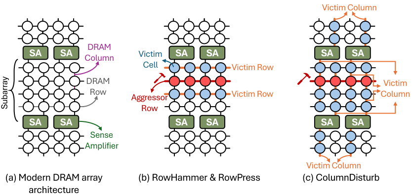
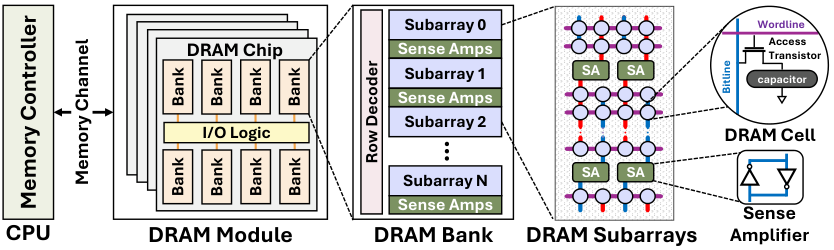

# ColumnDisturb: Understanding Column-based Read Disturbance in Real DRAM Chips and Implications for Future Systems

[返回图集](../README.md) · ColumnDisturb · MICRO 2025 · 2张非实验图

研究对象：缓存、地址转换与DRAM系统 / 真实DRAM芯片及列方向读扰动

本页仅显示以下非实验图，不包含原论文全部图组。混合图在子图分离复核完成前暂不收录。

版本许可依据：[来源](https://arxiv.org/abs/2510.14750v2)。源PDF SHA256：`907cc4bfa4b8cc3b3df9124bfd0c3b6eebbefd76ffa637ee96d27b8b93fceb09`。PDF不随库分发。

## 图号导航

[F1](#f1) · [F3](#f3)

## F1

**非实验图 · 行列扰动机制比较**

[原文物理页 2](https://arxiv.org/pdf/2510.14750#page=2) · [许可证 CC BY 4.0](https://creativecommons.org/licenses/by/4.0/)

署名：İsmail Emir Yüksel, Ataberk Olgun, F. Nisa Bostancı, Haocong Luo, A. Giray Yağlıkçı, Onur Mutlu. ColumnDisturb: Understanding Column-based Read Disturbance in Real DRAM Chips and Implications for Future Systems. MICRO 2025. DOI: https://doi.org/10.48550/arXiv.2510.14750. Version: arXiv:2510.14750v2, 17 October 2025; exact frozen extended author preprint, not assumed publisher-layout-identical. Source: https://arxiv.org/pdf/2510.14750. CC BY 4.0: https://creativecommons.org/licenses/by/4.0/. Whole figures cropped from this exact PDF and rasterized at 240 dpi; captions excluded, all figure content unchanged. No endorsement implied.

修改说明：Whole figure cropped from the specified source PDF and rasterized at 240 dpi; numbered caption excluded, figure content unchanged.

## F3

**非实验图 · DRAM层级与单元结构**

[原文物理页 3](https://arxiv.org/pdf/2510.14750#page=3) · [许可证 CC BY 4.0](https://creativecommons.org/licenses/by/4.0/)

署名：İsmail Emir Yüksel, Ataberk Olgun, F. Nisa Bostancı, Haocong Luo, A. Giray Yağlıkçı, Onur Mutlu. ColumnDisturb: Understanding Column-based Read Disturbance in Real DRAM Chips and Implications for Future Systems. MICRO 2025. DOI: https://doi.org/10.48550/arXiv.2510.14750. Version: arXiv:2510.14750v2, 17 October 2025; exact frozen extended author preprint, not assumed publisher-layout-identical. Source: https://arxiv.org/pdf/2510.14750. CC BY 4.0: https://creativecommons.org/licenses/by/4.0/. Whole figures cropped from this exact PDF and rasterized at 240 dpi; captions excluded, all figure content unchanged. No endorsement implied.

修改说明：Whole figure cropped from the specified source PDF and rasterized at 240 dpi; numbered caption excluded, figure content unchanged.

