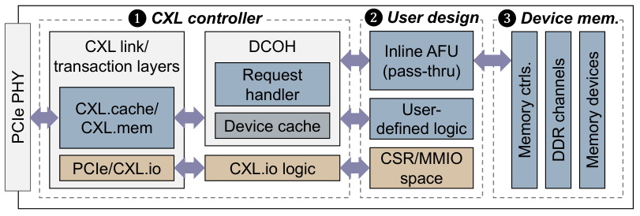
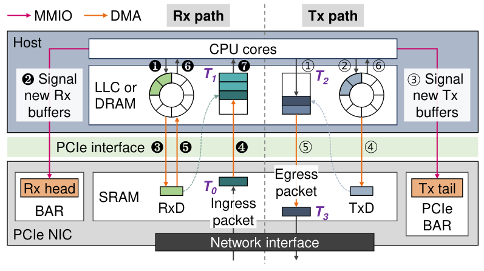
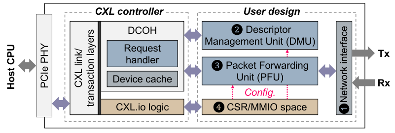
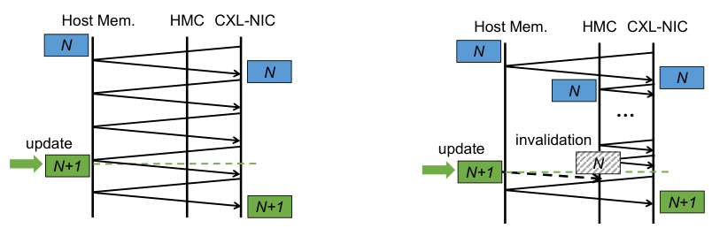
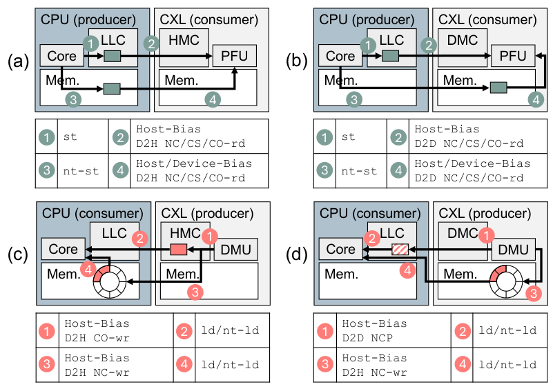
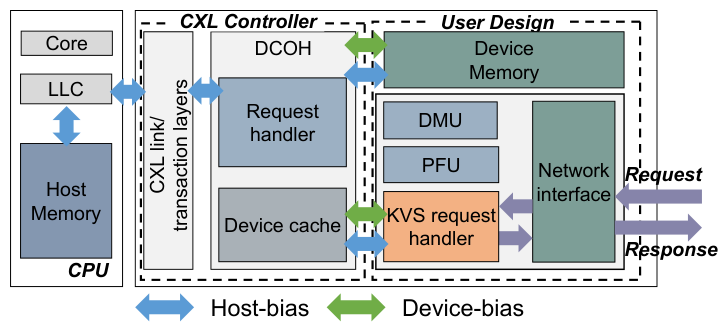

# Re-architecting End-host Networking with CXL: Coherence, Memory, and Offloading

[返回图库](../README.md) · CXL-NIC · MICRO 2025 · 6张非实验图

本图库当前收录6张非实验图：F1、F2、F5、F6、F8、F9。来源为15页作者托管ACM会议排版稿；不声称与出版社字节一致。仅限非商业使用，改编须以相同许可共享。

研究对象：互连、网络接口与数据通路 / CXL一致性网络接口与端主机数据通路

仅限非商业使用；改编作品须以 CC BY-NC-SA 4.0 相同许可共享。

源PDF SHA256：`9ec84fa467417d39daa8ebbec7ae15d359886b83b6064e0b8328b5b1926f8995`；[版本许可依据](https://saksham.web.illinois.edu/assets/pdf/cxl-nic.pdf#page=1)。PDF不随库分发。

## F1

CXL Type 1/2 设备架构

控制器、用户设计和可选设备内存的组成；Type 1 不含设备内存。

[原文页](https://saksham.web.illinois.edu/assets/pdf/cxl-nic.pdf#page=3) · [CC BY-NC-SA 4.0](https://creativecommons.org/licenses/by-nc-sa/4.0/)

仅限非商业使用；改编作品须以 CC BY-NC-SA 4.0 相同许可共享。

署名：Houxiang Ji, Yifan Yuan, Yang Zhou, Ipoom Jeong, Ren Wang, Saksham Agarwal, and Nam Sung Kim. Re-architecting End-host Networking with CXL: Coherence, Memory, and Offloading. MICRO 2025, pp. 1809–1823. DOI: https://doi.org/10.1145/3725843.3756102. © 2025 Copyright held by the owner/author(s). Source: https://saksham.web.illinois.edu/assets/pdf/cxl-nic.pdf. CC BY-NC-SA 4.0: https://creativecommons.org/licenses/by-nc-sa/4.0/. Whole figures boundary-cropped and rasterized at 240 dpi; overall captions excluded; internal labels unchanged. These image crops remain under CC BY-NC-SA 4.0: noncommercial use only and adaptations shared alike. No endorsement or warranties.

修改说明：Boundary-cropped whole figure and rasterized at 240 dpi; overall caption excluded, figure content unchanged. Image crops remain CC BY-NC-SA 4.0.

## F2

PCIe NIC 接收与发送数据通路

左 Rx、右 Tx，MMIO 与 DMA 的步骤和数据结构；T0–T3 是打点位置，不是实测曲线。

[原文页](https://saksham.web.illinois.edu/assets/pdf/cxl-nic.pdf#page=4) · [CC BY-NC-SA 4.0](https://creativecommons.org/licenses/by-nc-sa/4.0/)

仅限非商业使用；改编作品须以 CC BY-NC-SA 4.0 相同许可共享。

署名：Houxiang Ji, Yifan Yuan, Yang Zhou, Ipoom Jeong, Ren Wang, Saksham Agarwal, and Nam Sung Kim. Re-architecting End-host Networking with CXL: Coherence, Memory, and Offloading. MICRO 2025, pp. 1809–1823. DOI: https://doi.org/10.1145/3725843.3756102. © 2025 Copyright held by the owner/author(s). Source: https://saksham.web.illinois.edu/assets/pdf/cxl-nic.pdf. CC BY-NC-SA 4.0: https://creativecommons.org/licenses/by-nc-sa/4.0/. Whole figures boundary-cropped and rasterized at 240 dpi; overall captions excluded; internal labels unchanged. These image crops remain under CC BY-NC-SA 4.0: noncommercial use only and adaptations shared alike. No endorsement or warranties.

修改说明：Boundary-cropped whole figure and rasterized at 240 dpi; overall caption excluded, figure content unchanged. Image crops remain CC BY-NC-SA 4.0.

## F5

Type 1 CXL-NIC 架构

DMU、PFU、CSR/MMIO 与网络接口组成的架构及配置通路。

[原文页](https://saksham.web.illinois.edu/assets/pdf/cxl-nic.pdf#page=6) · [CC BY-NC-SA 4.0](https://creativecommons.org/licenses/by-nc-sa/4.0/)

仅限非商业使用；改编作品须以 CC BY-NC-SA 4.0 相同许可共享。

署名：Houxiang Ji, Yifan Yuan, Yang Zhou, Ipoom Jeong, Ren Wang, Saksham Agarwal, and Nam Sung Kim. Re-architecting End-host Networking with CXL: Coherence, Memory, and Offloading. MICRO 2025, pp. 1809–1823. DOI: https://doi.org/10.1145/3725843.3756102. © 2025 Copyright held by the owner/author(s). Source: https://saksham.web.illinois.edu/assets/pdf/cxl-nic.pdf. CC BY-NC-SA 4.0: https://creativecommons.org/licenses/by-nc-sa/4.0/. Whole figures boundary-cropped and rasterized at 240 dpi; overall captions excluded; internal labels unchanged. These image crops remain under CC BY-NC-SA 4.0: noncommercial use only and adaptations shared alike. No endorsement or warranties.

修改说明：Boundary-cropped whole figure and rasterized at 240 dpi; overall caption excluded, figure content unchanged. Image crops remain CC BY-NC-SA 4.0.

## F6

Tx 尾指针轮询时序示意

左 NC-read、右 CO-read，对照重复读取和缓存失效机制；无测量时间坐标，不据箭头间距推断时延。

[原文页](https://saksham.web.illinois.edu/assets/pdf/cxl-nic.pdf#page=6) · [CC BY-NC-SA 4.0](https://creativecommons.org/licenses/by-nc-sa/4.0/)

仅限非商业使用；改编作品须以 CC BY-NC-SA 4.0 相同许可共享。

署名：Houxiang Ji, Yifan Yuan, Yang Zhou, Ipoom Jeong, Ren Wang, Saksham Agarwal, and Nam Sung Kim. Re-architecting End-host Networking with CXL: Coherence, Memory, and Offloading. MICRO 2025, pp. 1809–1823. DOI: https://doi.org/10.1145/3725843.3756102. © 2025 Copyright held by the owner/author(s). Source: https://saksham.web.illinois.edu/assets/pdf/cxl-nic.pdf. CC BY-NC-SA 4.0: https://creativecommons.org/licenses/by-nc-sa/4.0/. Whole figures boundary-cropped and rasterized at 240 dpi; overall captions excluded; internal labels unchanged. These image crops remain under CC BY-NC-SA 4.0: noncommercial use only and adaptations shared alike. No endorsement or warranties.

修改说明：Boundary-cropped whole figure and rasterized at 240 dpi; overall caption excluded, figure content unchanged. Image crops remain CC BY-NC-SA 4.0.

## F8

内存布局与请求映射

四个作者标注面板 (a)–(d) 及对应请求表必须保留。(d) 第3步原文为 Host-Bias / D2H NC-wr；保留原文，不改为 D2D。

[原文页](https://saksham.web.illinois.edu/assets/pdf/cxl-nic.pdf#page=8) · [CC BY-NC-SA 4.0](https://creativecommons.org/licenses/by-nc-sa/4.0/)

仅限非商业使用；改编作品须以 CC BY-NC-SA 4.0 相同许可共享。

署名：Houxiang Ji, Yifan Yuan, Yang Zhou, Ipoom Jeong, Ren Wang, Saksham Agarwal, and Nam Sung Kim. Re-architecting End-host Networking with CXL: Coherence, Memory, and Offloading. MICRO 2025, pp. 1809–1823. DOI: https://doi.org/10.1145/3725843.3756102. © 2025 Copyright held by the owner/author(s). Source: https://saksham.web.illinois.edu/assets/pdf/cxl-nic.pdf. CC BY-NC-SA 4.0: https://creativecommons.org/licenses/by-nc-sa/4.0/. Whole figures boundary-cropped and rasterized at 240 dpi; overall captions excluded; internal labels unchanged. These image crops remain under CC BY-NC-SA 4.0: noncommercial use only and adaptations shared alike. No endorsement or warranties.

修改说明：Boundary-cropped whole figure and rasterized at 240 dpi; overall caption excluded, figure content unchanged. Image crops remain CC BY-NC-SA 4.0.

## F9

CXL-NIC 键值存储应用架构

KVS 请求处理器、设备内存与主机/设备偏置通路；这是架构，不是性能结果。

[原文页](https://saksham.web.illinois.edu/assets/pdf/cxl-nic.pdf#page=9) · [CC BY-NC-SA 4.0](https://creativecommons.org/licenses/by-nc-sa/4.0/)

仅限非商业使用；改编作品须以 CC BY-NC-SA 4.0 相同许可共享。

署名：Houxiang Ji, Yifan Yuan, Yang Zhou, Ipoom Jeong, Ren Wang, Saksham Agarwal, and Nam Sung Kim. Re-architecting End-host Networking with CXL: Coherence, Memory, and Offloading. MICRO 2025, pp. 1809–1823. DOI: https://doi.org/10.1145/3725843.3756102. © 2025 Copyright held by the owner/author(s). Source: https://saksham.web.illinois.edu/assets/pdf/cxl-nic.pdf. CC BY-NC-SA 4.0: https://creativecommons.org/licenses/by-nc-sa/4.0/. Whole figures boundary-cropped and rasterized at 240 dpi; overall captions excluded; internal labels unchanged. These image crops remain under CC BY-NC-SA 4.0: noncommercial use only and adaptations shared alike. No endorsement or warranties.

修改说明：Boundary-cropped whole figure and rasterized at 240 dpi; overall caption excluded, figure content unchanged. Image crops remain CC BY-NC-SA 4.0.

