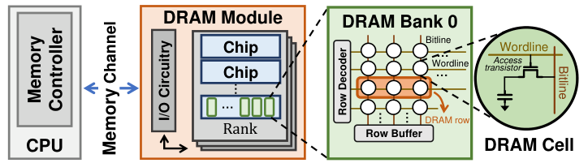

# Understanding and Mitigating Covert Channel and Side Channel Vulnerabilities Introduced by RowHammer Defenses

[返回图集](../README.md) · LeakyHammer · MICRO 2025 · 1张非实验图

研究对象：缓存、地址转换与DRAM系统 / DRAM RowHammer防护构件及其时间泄漏

本页仅显示以下非实验图，不包含原论文全部图组。混合图在子图分离复核完成前暂不收录。

版本许可依据：[来源](https://arxiv.org/abs/2503.17891v3)。源PDF SHA256：`1fec2fddd6a4bf24ecea6cae049dfff339fda969a1bc5c1909946c8acfd99e5d`。PDF不随库分发。

## 图号导航

[F1](#f1)

## F1

**非实验图 · DRAM层级结构**

[原文物理页 2](https://arxiv.org/pdf/2503.17891#page=2) · [许可证 CC BY 4.0](https://creativecommons.org/licenses/by/4.0/)

署名：F. Nisa Bostancı, Oğuzhan Canpolat, Ataberk Olgun, İsmail Emir Yüksel, Konstantinos Kanellopoulos, Mohammad Sadrosadati, A. Giray Yağlıkçı, Onur Mutlu. Understanding and Mitigating Covert Channel and Side Channel Vulnerabilities Introduced by RowHammer Defenses. MICRO 2025. DOI: https://doi.org/10.48550/arXiv.2503.17891. Version: arXiv:2503.17891v3, 16 October 2025; exact frozen author preprint. Source: https://arxiv.org/pdf/2503.17891. CC BY 4.0: https://creativecommons.org/licenses/by/4.0/. Whole figures cropped from this exact PDF and rasterized at 240 dpi; captions excluded, all figure content unchanged. No endorsement implied.

修改说明：Whole figure cropped from the specified source PDF and rasterized at 240 dpi; numbered caption excluded, figure content unchanged.

