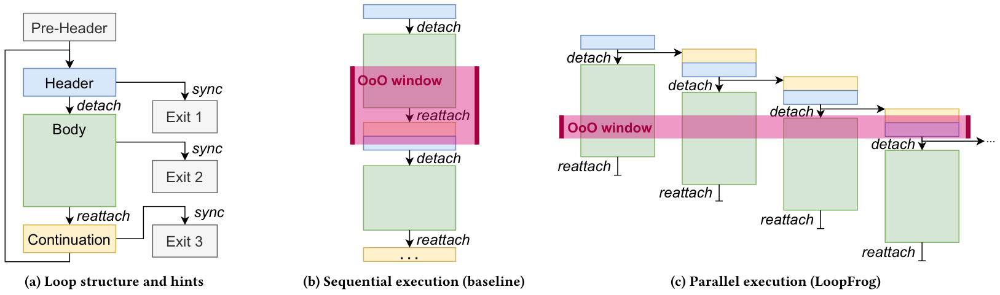
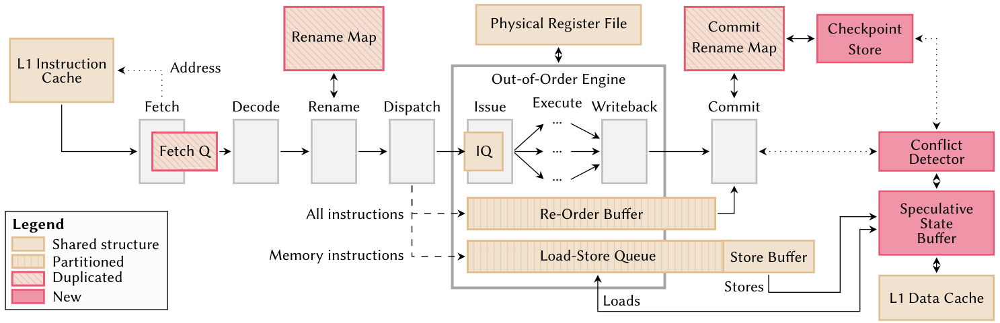
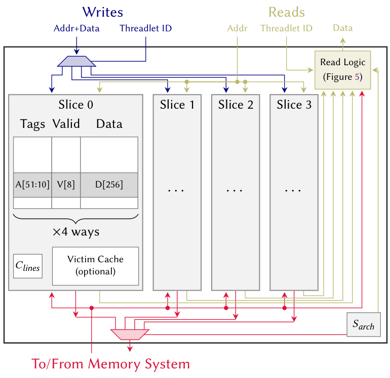
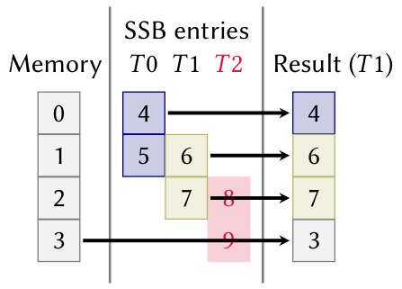

# LoopFrog: In-Core Hint-Based Loop Parallelization

[返回图集](../README.md) · LoopFrog · MICRO 2025 · 4张非实验图

研究对象：CPU/GPU处理器与执行构件 / 支持threadlet的单核乱序处理器

本页仅显示以下非实验图，不包含原论文全部图组。混合图在子图分离复核完成前暂不收录。

版本许可依据：[来源](https://www.cl.cam.ac.uk/~tmj32/papers/docs/erdos25-micro.pdf#page=1)。源PDF SHA256：`3dca51cd1254a234c5777483c0470ea07b2adc8f723813fade1131b239bd0cd4`。PDF不随库分发。

## 图号导航

[F2](#f2) · [F3](#f3) · [F4](#f4) · [F5](#f5)

## F2

**非实验图 · 循环结构与并行执行示意**

[原文物理页 3](https://www.cl.cam.ac.uk/~tmj32/papers/docs/erdos25-micro.pdf#page=3) · [许可证 CC BY 4.0](https://creativecommons.org/licenses/by/4.0/)

署名：Márton Erdős, Utpal Bora, Akshay Bhosale, Bob Lytton, Ali M. Zaidi, Alexandra W. Chadwick, Yuxin Guo, Giacomo Gabrielli, Timothy M. Jones. LoopFrog: In-Core Hint-Based Loop Parallelization. MICRO 2025. DOI: https://doi.org/10.1145/3725843.3756051. Version: Frozen 14-page MICRO 2025 author manuscript, numbered 1–14. Source: https://www.cl.cam.ac.uk/~tmj32/papers/docs/erdos25-micro.pdf. CC BY 4.0: https://creativecommons.org/licenses/by/4.0/. Whole figures cropped from this exact PDF and rasterized at 240 dpi; captions excluded, all figure content unchanged. No endorsement implied.

修改说明：Whole figure cropped from the specified source PDF and rasterized at 240 dpi; numbered caption excluded, figure content unchanged.

## F3

**非实验图 · 处理器流水线改造架构**

[原文物理页 5](https://www.cl.cam.ac.uk/~tmj32/papers/docs/erdos25-micro.pdf#page=5) · [许可证 CC BY 4.0](https://creativecommons.org/licenses/by/4.0/)

署名：Márton Erdős, Utpal Bora, Akshay Bhosale, Bob Lytton, Ali M. Zaidi, Alexandra W. Chadwick, Yuxin Guo, Giacomo Gabrielli, Timothy M. Jones. LoopFrog: In-Core Hint-Based Loop Parallelization. MICRO 2025. DOI: https://doi.org/10.1145/3725843.3756051. Version: Frozen 14-page MICRO 2025 author manuscript, numbered 1–14. Source: https://www.cl.cam.ac.uk/~tmj32/papers/docs/erdos25-micro.pdf. CC BY 4.0: https://creativecommons.org/licenses/by/4.0/. Whole figures cropped from this exact PDF and rasterized at 240 dpi; captions excluded, all figure content unchanged. No endorsement implied.

修改说明：Whole figure cropped from the specified source PDF and rasterized at 240 dpi; numbered caption excluded, figure content unchanged.

## F4

**非实验图 · 推测状态缓冲区架构**

[原文物理页 6](https://www.cl.cam.ac.uk/~tmj32/papers/docs/erdos25-micro.pdf#page=6) · [许可证 CC BY 4.0](https://creativecommons.org/licenses/by/4.0/)

署名：Márton Erdős, Utpal Bora, Akshay Bhosale, Bob Lytton, Ali M. Zaidi, Alexandra W. Chadwick, Yuxin Guo, Giacomo Gabrielli, Timothy M. Jones. LoopFrog: In-Core Hint-Based Loop Parallelization. MICRO 2025. DOI: https://doi.org/10.1145/3725843.3756051. Version: Frozen 14-page MICRO 2025 author manuscript, numbered 1–14. Source: https://www.cl.cam.ac.uk/~tmj32/papers/docs/erdos25-micro.pdf. CC BY 4.0: https://creativecommons.org/licenses/by/4.0/. Whole figures cropped from this exact PDF and rasterized at 240 dpi; captions excluded, all figure content unchanged. No endorsement implied.

修改说明：Whole figure cropped from the specified source PDF and rasterized at 240 dpi; numbered caption excluded, figure content unchanged.

## F5

**非实验图 · 推测值读取示例**

[原文物理页 6](https://www.cl.cam.ac.uk/~tmj32/papers/docs/erdos25-micro.pdf#page=6) · [许可证 CC BY 4.0](https://creativecommons.org/licenses/by/4.0/)

署名：Márton Erdős, Utpal Bora, Akshay Bhosale, Bob Lytton, Ali M. Zaidi, Alexandra W. Chadwick, Yuxin Guo, Giacomo Gabrielli, Timothy M. Jones. LoopFrog: In-Core Hint-Based Loop Parallelization. MICRO 2025. DOI: https://doi.org/10.1145/3725843.3756051. Version: Frozen 14-page MICRO 2025 author manuscript, numbered 1–14. Source: https://www.cl.cam.ac.uk/~tmj32/papers/docs/erdos25-micro.pdf. CC BY 4.0: https://creativecommons.org/licenses/by/4.0/. Whole figures cropped from this exact PDF and rasterized at 240 dpi; captions excluded, all figure content unchanged. No endorsement implied.

修改说明：Whole figure cropped from the specified source PDF and rasterized at 240 dpi; numbered caption excluded, figure content unchanged.

