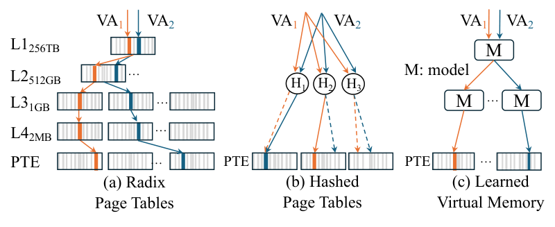
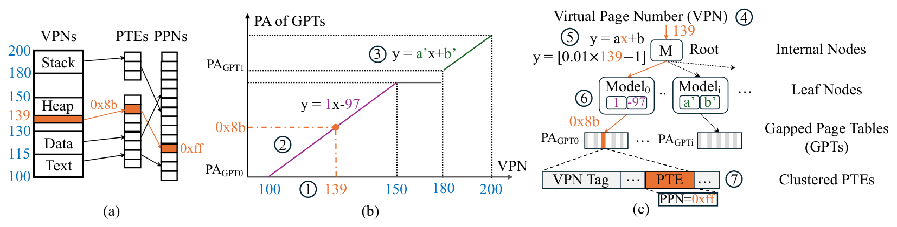
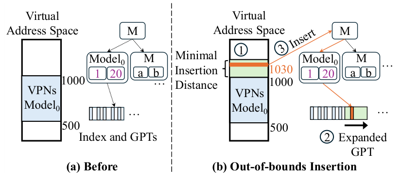
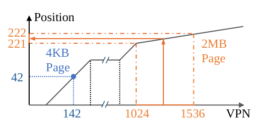
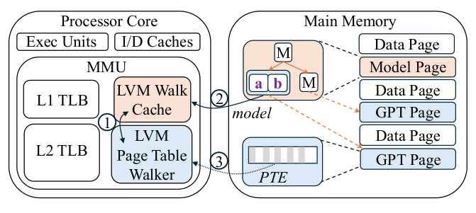
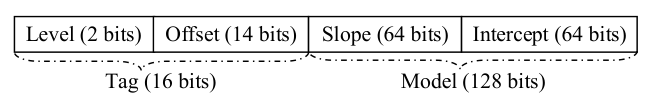

# Learning to Walk: Architecting Learned Virtual Memory Translation

[返回图集](../README.md) · LVM · MICRO 2025 · 6张非实验图

研究对象：缓存、地址转换与DRAM系统 / 学习式虚拟内存翻译子系统

本页仅显示以下非实验图，不包含原论文全部图组。混合图在子图分离复核完成前暂不收录。

版本许可依据：[来源](https://www.pdl.cmu.edu/PDL-FTP/BigLearning/kzhao-MICRO25.pdf#page=1)。源PDF SHA256：`e2d13f7b519648f18dbc4facf2857e6e58a375f742f5d0722ce28fd8f8a0f124`。PDF不随库分发。

## 图号导航

[F1](#f1) · [F4](#f4) · [F5](#f5) · [F6](#f6) · [F7](#f7) · [F8](#f8)

## F1

**非实验图 · 地址转换方案对比图**

[原文物理页 3](https://www.pdl.cmu.edu/PDL-FTP/BigLearning/kzhao-MICRO25.pdf#page=3) · [许可证 CC BY 4.0](https://creativecommons.org/licenses/by/4.0/)

署名：Kaiyang Zhao, Yuang Chen, Xenia Xu, Dan Schatzberg, Nastaran Hajinaza, Rupin Vakharwala, Andy Anderson, and Dimitrios Skarlatos. Learning to Walk: Architecting Learned Virtual Memory Translation. MICRO 2025. DOI: https://doi.org/10.1145/3725843.3756093. Copyright 2025 the owner/authors. Source: https://www.pdl.cmu.edu/PDL-FTP/BigLearning/kzhao-MICRO25.pdf. CC BY 4.0: https://creativecommons.org/licenses/by/4.0/. Figures cropped from the exact historical PDF and rasterized at 240 dpi; captions excluded and diagram content unchanged. No endorsement implied.

修改说明：Cropped from the paper and rasterized at 240 dpi; captions excluded and diagram content unchanged.

## F4

**非实验图 · LVM 地址转换示例图**

[原文物理页 5](https://www.pdl.cmu.edu/PDL-FTP/BigLearning/kzhao-MICRO25.pdf#page=5) · [许可证 CC BY 4.0](https://creativecommons.org/licenses/by/4.0/)

署名：Kaiyang Zhao, Yuang Chen, Xenia Xu, Dan Schatzberg, Nastaran Hajinaza, Rupin Vakharwala, Andy Anderson, and Dimitrios Skarlatos. Learning to Walk: Architecting Learned Virtual Memory Translation. MICRO 2025. DOI: https://doi.org/10.1145/3725843.3756093. Copyright 2025 the owner/authors. Source: https://www.pdl.cmu.edu/PDL-FTP/BigLearning/kzhao-MICRO25.pdf. CC BY 4.0: https://creativecommons.org/licenses/by/4.0/. Figures cropped from the exact historical PDF and rasterized at 240 dpi; captions excluded and diagram content unchanged. No endorsement implied.

修改说明：Cropped from the paper and rasterized at 240 dpi; captions excluded and diagram content unchanged.

## F5

**非实验图 · 插入操作前后对比图**

[原文物理页 8](https://www.pdl.cmu.edu/PDL-FTP/BigLearning/kzhao-MICRO25.pdf#page=8) · [许可证 CC BY 4.0](https://creativecommons.org/licenses/by/4.0/)

署名：Kaiyang Zhao, Yuang Chen, Xenia Xu, Dan Schatzberg, Nastaran Hajinaza, Rupin Vakharwala, Andy Anderson, and Dimitrios Skarlatos. Learning to Walk: Architecting Learned Virtual Memory Translation. MICRO 2025. DOI: https://doi.org/10.1145/3725843.3756093. Copyright 2025 the owner/authors. Source: https://www.pdl.cmu.edu/PDL-FTP/BigLearning/kzhao-MICRO25.pdf. CC BY 4.0: https://creativecommons.org/licenses/by/4.0/. Figures cropped from the exact historical PDF and rasterized at 240 dpi; captions excluded and diagram content unchanged. No endorsement implied.

修改说明：Cropped from the paper and rasterized at 240 dpi; captions excluded and diagram content unchanged.

## F6

**非实验图 · 页大小映射示意图**

[原文物理页 8](https://www.pdl.cmu.edu/PDL-FTP/BigLearning/kzhao-MICRO25.pdf#page=8) · [许可证 CC BY 4.0](https://creativecommons.org/licenses/by/4.0/)

署名：Kaiyang Zhao, Yuang Chen, Xenia Xu, Dan Schatzberg, Nastaran Hajinaza, Rupin Vakharwala, Andy Anderson, and Dimitrios Skarlatos. Learning to Walk: Architecting Learned Virtual Memory Translation. MICRO 2025. DOI: https://doi.org/10.1145/3725843.3756093. Copyright 2025 the owner/authors. Source: https://www.pdl.cmu.edu/PDL-FTP/BigLearning/kzhao-MICRO25.pdf. CC BY 4.0: https://creativecommons.org/licenses/by/4.0/. Figures cropped from the exact historical PDF and rasterized at 240 dpi; captions excluded and diagram content unchanged. No endorsement implied.

修改说明：Cropped from the paper and rasterized at 240 dpi; captions excluded and diagram content unchanged.

## F7

**非实验图 · LVM 硬件框图**

[原文物理页 9](https://www.pdl.cmu.edu/PDL-FTP/BigLearning/kzhao-MICRO25.pdf#page=9) · [许可证 CC BY 4.0](https://creativecommons.org/licenses/by/4.0/)

署名：Kaiyang Zhao, Yuang Chen, Xenia Xu, Dan Schatzberg, Nastaran Hajinaza, Rupin Vakharwala, Andy Anderson, and Dimitrios Skarlatos. Learning to Walk: Architecting Learned Virtual Memory Translation. MICRO 2025. DOI: https://doi.org/10.1145/3725843.3756093. Copyright 2025 the owner/authors. Source: https://www.pdl.cmu.edu/PDL-FTP/BigLearning/kzhao-MICRO25.pdf. CC BY 4.0: https://creativecommons.org/licenses/by/4.0/. Figures cropped from the exact historical PDF and rasterized at 240 dpi; captions excluded and diagram content unchanged. No endorsement implied.

修改说明：Cropped from the paper and rasterized at 240 dpi; captions excluded and diagram content unchanged.

## F8

**非实验图 · 页表遍历缓存条目布局图**

[原文物理页 9](https://www.pdl.cmu.edu/PDL-FTP/BigLearning/kzhao-MICRO25.pdf#page=9) · [许可证 CC BY 4.0](https://creativecommons.org/licenses/by/4.0/)

署名：Kaiyang Zhao, Yuang Chen, Xenia Xu, Dan Schatzberg, Nastaran Hajinaza, Rupin Vakharwala, Andy Anderson, and Dimitrios Skarlatos. Learning to Walk: Architecting Learned Virtual Memory Translation. MICRO 2025. DOI: https://doi.org/10.1145/3725843.3756093. Copyright 2025 the owner/authors. Source: https://www.pdl.cmu.edu/PDL-FTP/BigLearning/kzhao-MICRO25.pdf. CC BY 4.0: https://creativecommons.org/licenses/by/4.0/. Figures cropped from the exact historical PDF and rasterized at 240 dpi; captions excluded and diagram content unchanged. No endorsement implied.

修改说明：Cropped from the paper and rasterized at 240 dpi; captions excluded and diagram content unchanged.

