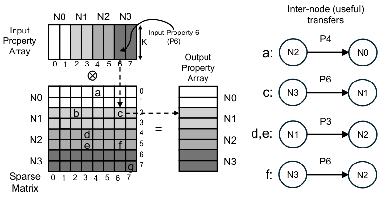
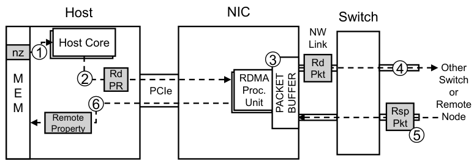
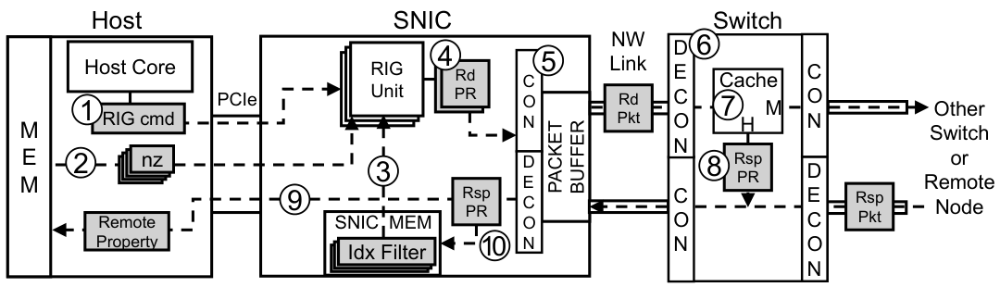
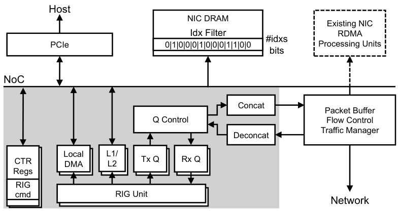
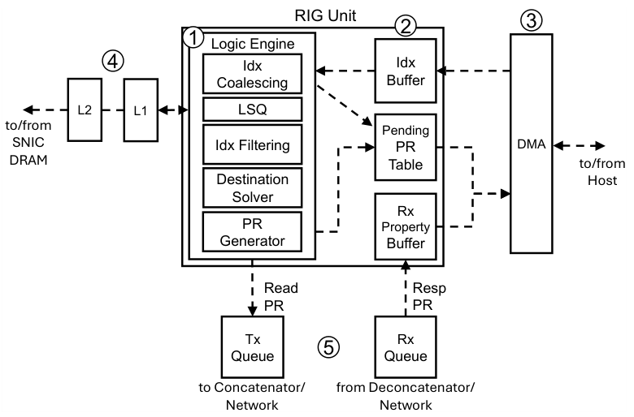
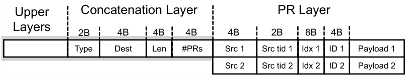
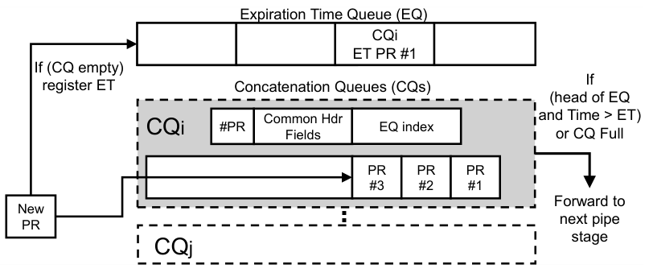
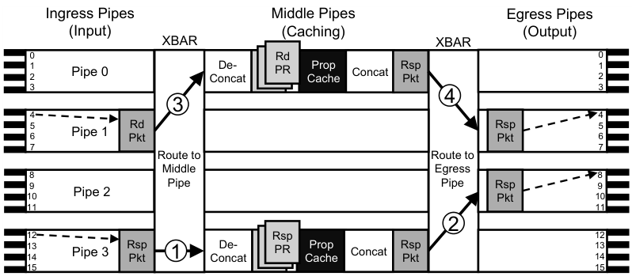
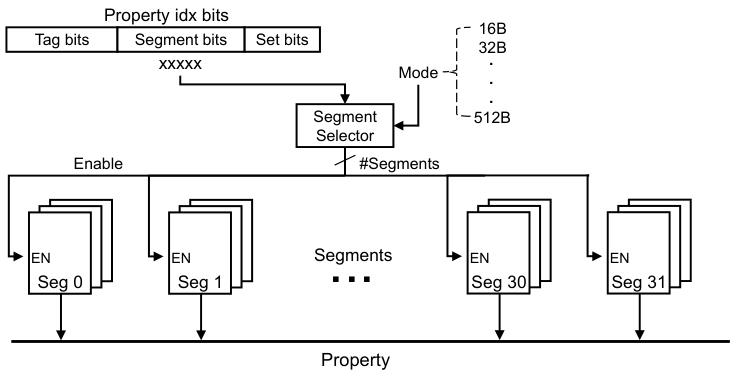
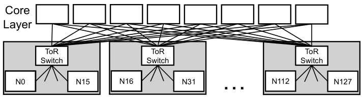

# NetSparse: In-Network Acceleration of Distributed Sparse Kernels

[返回图集](../README.md) · NetSparse · MICRO 2025 · 10张非实验图

研究对象：互连、网络接口与数据通路 / SNIC与交换机协同的稀疏通信数据通路

本页仅显示以下非实验图，不包含原论文全部图组。混合图在子图分离复核完成前暂不收录。

版本许可依据：[来源](https://gergerog.github.io/files/micro25-3.pdf#page=1)。源PDF SHA256：`9a5f238a17a19f6f87f1c77c9d33baeed75a6136649870240d9cec3bd556e547`。PDF不随库分发。

## 图号导航

[F1](#f1) · [F2](#f2) · [F3](#f3) · [F4](#f4) · [F5](#f5) · [F6](#f6) · [F7](#f7) · [F8](#f8) · [F9](#f9) · [F11](#f11)

## F1

**非实验图 · 稀疏核通信示意**

[原文物理页 2](https://gergerog.github.io/files/micro25-3.pdf#page=2) · [许可证 CC BY 4.0](https://creativecommons.org/licenses/by/4.0/)

署名：Gerasimos Gerogiannis, Dimitrios Merkouriadis, Charles Block, Annus Zulfiqar, Filippos Tofalos, Muhammad Shahbaz, Josep Torrellas. NetSparse: In-Network Acceleration of Distributed Sparse Kernels. MICRO 2025. DOI: https://doi.org/10.1145/3725843.3756076. Version: Exact preserved 17-page conference-layout author PDF. Source: https://gergerog.github.io/files/micro25-3.pdf. CC BY 4.0: https://creativecommons.org/licenses/by/4.0/. Whole figures cropped from this exact PDF and rasterized at 240 dpi; captions excluded, all figure content unchanged. No endorsement implied.

修改说明：Whole figure cropped from the specified source PDF and rasterized at 240 dpi; numbered caption excluded, figure content unchanged.

## F2

**非实验图 · 属性请求生命周期**

[原文物理页 3](https://gergerog.github.io/files/micro25-3.pdf#page=3) · [许可证 CC BY 4.0](https://creativecommons.org/licenses/by/4.0/)

署名：Gerasimos Gerogiannis, Dimitrios Merkouriadis, Charles Block, Annus Zulfiqar, Filippos Tofalos, Muhammad Shahbaz, Josep Torrellas. NetSparse: In-Network Acceleration of Distributed Sparse Kernels. MICRO 2025. DOI: https://doi.org/10.1145/3725843.3756076. Version: Exact preserved 17-page conference-layout author PDF. Source: https://gergerog.github.io/files/micro25-3.pdf. CC BY 4.0: https://creativecommons.org/licenses/by/4.0/. Whole figures cropped from this exact PDF and rasterized at 240 dpi; captions excluded, all figure content unchanged. No endorsement implied.

修改说明：Whole figure cropped from the specified source PDF and rasterized at 240 dpi; numbered caption excluded, figure content unchanged.

## F3

**非实验图 · NetSparse请求流程**

[原文物理页 5](https://gergerog.github.io/files/micro25-3.pdf#page=5) · [许可证 CC BY 4.0](https://creativecommons.org/licenses/by/4.0/)

署名：Gerasimos Gerogiannis, Dimitrios Merkouriadis, Charles Block, Annus Zulfiqar, Filippos Tofalos, Muhammad Shahbaz, Josep Torrellas. NetSparse: In-Network Acceleration of Distributed Sparse Kernels. MICRO 2025. DOI: https://doi.org/10.1145/3725843.3756076. Version: Exact preserved 17-page conference-layout author PDF. Source: https://gergerog.github.io/files/micro25-3.pdf. CC BY 4.0: https://creativecommons.org/licenses/by/4.0/. Whole figures cropped from this exact PDF and rasterized at 240 dpi; captions excluded, all figure content unchanged. No endorsement implied.

修改说明：Whole figure cropped from the specified source PDF and rasterized at 240 dpi; numbered caption excluded, figure content unchanged.

## F4

**非实验图 · 智能网卡架构**

[原文物理页 5](https://gergerog.github.io/files/micro25-3.pdf#page=5) · [许可证 CC BY 4.0](https://creativecommons.org/licenses/by/4.0/)

署名：Gerasimos Gerogiannis, Dimitrios Merkouriadis, Charles Block, Annus Zulfiqar, Filippos Tofalos, Muhammad Shahbaz, Josep Torrellas. NetSparse: In-Network Acceleration of Distributed Sparse Kernels. MICRO 2025. DOI: https://doi.org/10.1145/3725843.3756076. Version: Exact preserved 17-page conference-layout author PDF. Source: https://gergerog.github.io/files/micro25-3.pdf. CC BY 4.0: https://creativecommons.org/licenses/by/4.0/. Whole figures cropped from this exact PDF and rasterized at 240 dpi; captions excluded, all figure content unchanged. No endorsement implied.

修改说明：Whole figure cropped from the specified source PDF and rasterized at 240 dpi; numbered caption excluded, figure content unchanged.

## F5

**非实验图 · RIG单元微架构**

[原文物理页 6](https://gergerog.github.io/files/micro25-3.pdf#page=6) · [许可证 CC BY 4.0](https://creativecommons.org/licenses/by/4.0/)

署名：Gerasimos Gerogiannis, Dimitrios Merkouriadis, Charles Block, Annus Zulfiqar, Filippos Tofalos, Muhammad Shahbaz, Josep Torrellas. NetSparse: In-Network Acceleration of Distributed Sparse Kernels. MICRO 2025. DOI: https://doi.org/10.1145/3725843.3756076. Version: Exact preserved 17-page conference-layout author PDF. Source: https://gergerog.github.io/files/micro25-3.pdf. CC BY 4.0: https://creativecommons.org/licenses/by/4.0/. Whole figures cropped from this exact PDF and rasterized at 240 dpi; captions excluded, all figure content unchanged. No endorsement implied.

修改说明：Whole figure cropped from the specified source PDF and rasterized at 240 dpi; numbered caption excluded, figure content unchanged.

## F6

**非实验图 · 网络协议字段**

[原文物理页 7](https://gergerog.github.io/files/micro25-3.pdf#page=7) · [许可证 CC BY 4.0](https://creativecommons.org/licenses/by/4.0/)

署名：Gerasimos Gerogiannis, Dimitrios Merkouriadis, Charles Block, Annus Zulfiqar, Filippos Tofalos, Muhammad Shahbaz, Josep Torrellas. NetSparse: In-Network Acceleration of Distributed Sparse Kernels. MICRO 2025. DOI: https://doi.org/10.1145/3725843.3756076. Version: Exact preserved 17-page conference-layout author PDF. Source: https://gergerog.github.io/files/micro25-3.pdf. CC BY 4.0: https://creativecommons.org/licenses/by/4.0/. Whole figures cropped from this exact PDF and rasterized at 240 dpi; captions excluded, all figure content unchanged. No endorsement implied.

修改说明：Whole figure cropped from the specified source PDF and rasterized at 240 dpi; numbered caption excluded, figure content unchanged.

## F7

**非实验图 · 请求拼接队列机制**

[原文物理页 7](https://gergerog.github.io/files/micro25-3.pdf#page=7) · [许可证 CC BY 4.0](https://creativecommons.org/licenses/by/4.0/)

署名：Gerasimos Gerogiannis, Dimitrios Merkouriadis, Charles Block, Annus Zulfiqar, Filippos Tofalos, Muhammad Shahbaz, Josep Torrellas. NetSparse: In-Network Acceleration of Distributed Sparse Kernels. MICRO 2025. DOI: https://doi.org/10.1145/3725843.3756076. Version: Exact preserved 17-page conference-layout author PDF. Source: https://gergerog.github.io/files/micro25-3.pdf. CC BY 4.0: https://creativecommons.org/licenses/by/4.0/. Whole figures cropped from this exact PDF and rasterized at 240 dpi; captions excluded, all figure content unchanged. No endorsement implied.

修改说明：Whole figure cropped from the specified source PDF and rasterized at 240 dpi; numbered caption excluded, figure content unchanged.

## F8

**非实验图 · 交换机分组流**

[原文物理页 8](https://gergerog.github.io/files/micro25-3.pdf#page=8) · [许可证 CC BY 4.0](https://creativecommons.org/licenses/by/4.0/)

署名：Gerasimos Gerogiannis, Dimitrios Merkouriadis, Charles Block, Annus Zulfiqar, Filippos Tofalos, Muhammad Shahbaz, Josep Torrellas. NetSparse: In-Network Acceleration of Distributed Sparse Kernels. MICRO 2025. DOI: https://doi.org/10.1145/3725843.3756076. Version: Exact preserved 17-page conference-layout author PDF. Source: https://gergerog.github.io/files/micro25-3.pdf. CC BY 4.0: https://creativecommons.org/licenses/by/4.0/. Whole figures cropped from this exact PDF and rasterized at 240 dpi; captions excluded, all figure content unchanged. No endorsement implied.

修改说明：Whole figure cropped from the specified source PDF and rasterized at 240 dpi; numbered caption excluded, figure content unchanged.

## F9

**非实验图 · 分段属性缓存结构**

[原文物理页 9](https://gergerog.github.io/files/micro25-3.pdf#page=9) · [许可证 CC BY 4.0](https://creativecommons.org/licenses/by/4.0/)

署名：Gerasimos Gerogiannis, Dimitrios Merkouriadis, Charles Block, Annus Zulfiqar, Filippos Tofalos, Muhammad Shahbaz, Josep Torrellas. NetSparse: In-Network Acceleration of Distributed Sparse Kernels. MICRO 2025. DOI: https://doi.org/10.1145/3725843.3756076. Version: Exact preserved 17-page conference-layout author PDF. Source: https://gergerog.github.io/files/micro25-3.pdf. CC BY 4.0: https://creativecommons.org/licenses/by/4.0/. Whole figures cropped from this exact PDF and rasterized at 240 dpi; captions excluded, all figure content unchanged. No endorsement implied.

修改说明：Whole figure cropped from the specified source PDF and rasterized at 240 dpi; numbered caption excluded, figure content unchanged.

## F11

**非实验图 · 仿真网络拓扑**

[原文物理页 10](https://gergerog.github.io/files/micro25-3.pdf#page=10) · [许可证 CC BY 4.0](https://creativecommons.org/licenses/by/4.0/)

署名：Gerasimos Gerogiannis, Dimitrios Merkouriadis, Charles Block, Annus Zulfiqar, Filippos Tofalos, Muhammad Shahbaz, Josep Torrellas. NetSparse: In-Network Acceleration of Distributed Sparse Kernels. MICRO 2025. DOI: https://doi.org/10.1145/3725843.3756076. Version: Exact preserved 17-page conference-layout author PDF. Source: https://gergerog.github.io/files/micro25-3.pdf. CC BY 4.0: https://creativecommons.org/licenses/by/4.0/. Whole figures cropped from this exact PDF and rasterized at 240 dpi; captions excluded, all figure content unchanged. No endorsement implied.

修改说明：Whole figure cropped from the specified source PDF and rasterized at 240 dpi; numbered caption excluded, figure content unchanged.

