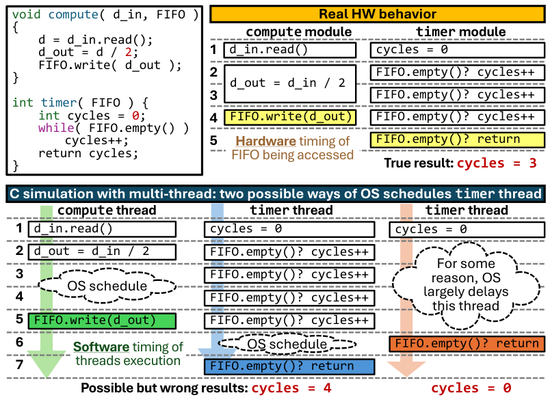
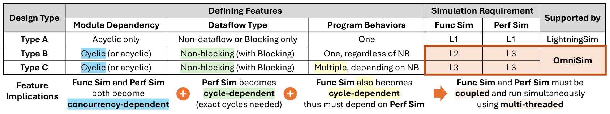
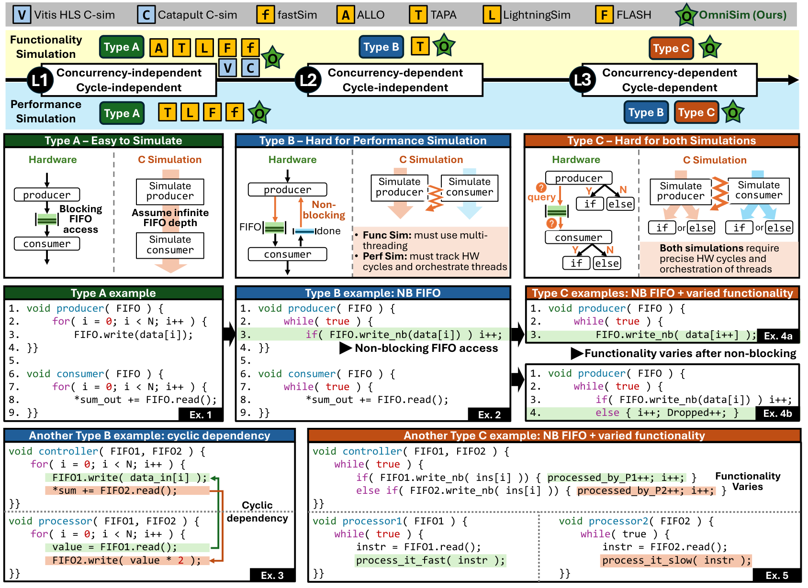
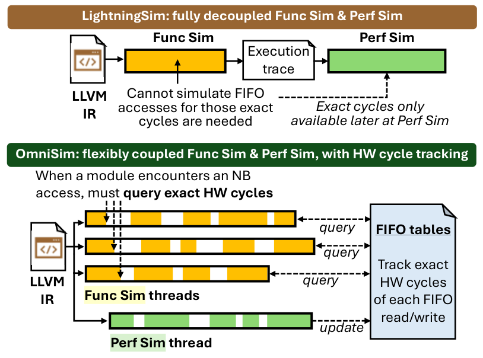
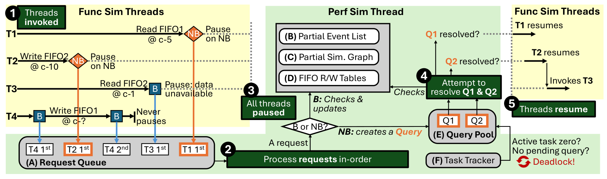

# OmniSim: Simulating Hardware with C Speed and RTL Accuracy for High-Level Synthesis Designs

[返回图集](../README.md) · OmniSim · MICRO 2025 · 5张非实验图

研究对象：模拟器与仿真平台 / HLS功能与周期联合模拟器

本页仅显示以下非实验图，不包含原论文全部图组。混合图在子图分离复核完成前暂不收录。

未收录图片不代表获得公开再分发许可。 本图库当前收录5张非实验图：F2、F3、F4、F5、F7。

版本许可依据：[来源](https://arxiv.org/abs/2508.19299v1)。源PDF SHA256：`1d25e3646769cb92b38c10ce9ef38e095a583ebd4e8adee588e9d25eb93e7b71`。PDF不随库分发。

## 图号导航

[F2](#f2) · [F3](#f3) · [F4](#f4) · [F5](#f5) · [F7](#f7)

## F2

**非实验图 · 硬件时序与线程调度对比图**

[原文物理页 2](https://arxiv.org/pdf/2508.19299v1#page=2) · [许可证 CC BY 4.0](https://creativecommons.org/licenses/by/4.0/)

署名：Rishov Sarkar, Cong Hao. OmniSim: Simulating Hardware with C Speed and RTL Accuracy for High-Level Synthesis Designs. MICRO 2025. DOI: https://doi.org/10.1145/3725843.3756033. Version: arXiv:2508.19299v1, 25 Aug 2025; MICRO 2025 conference-layout author manuscript. Copyright 2025 the owner/authors. Source: https://arxiv.org/pdf/2508.19299v1. CC BY 4.0: https://creativecommons.org/licenses/by/4.0/. Whole figures cropped from this exact PDF and rasterized at 240 dpi; numbered captions excluded, figure content unchanged. No endorsement implied.

修改说明：Whole figure cropped from the specified source PDF and rasterized at 240 dpi; numbered caption excluded, figure content unchanged.

## F3

**非实验图 · 数据流设计分类表**

[原文物理页 4](https://arxiv.org/pdf/2508.19299v1#page=4) · [许可证 CC BY 4.0](https://creativecommons.org/licenses/by/4.0/)

署名：Rishov Sarkar, Cong Hao. OmniSim: Simulating Hardware with C Speed and RTL Accuracy for High-Level Synthesis Designs. MICRO 2025. DOI: https://doi.org/10.1145/3725843.3756033. Version: arXiv:2508.19299v1, 25 Aug 2025; MICRO 2025 conference-layout author manuscript. Copyright 2025 the owner/authors. Source: https://arxiv.org/pdf/2508.19299v1. CC BY 4.0: https://creativecommons.org/licenses/by/4.0/. Whole figures cropped from this exact PDF and rasterized at 240 dpi; numbered captions excluded, figure content unchanged. No endorsement implied.

修改说明：Whole figure cropped from the specified source PDF and rasterized at 240 dpi; numbered caption excluded, figure content unchanged.

## F4

**非实验图 · 设计分类与代码示例图**

[原文物理页 4](https://arxiv.org/pdf/2508.19299v1#page=4) · [许可证 CC BY 4.0](https://creativecommons.org/licenses/by/4.0/)

署名：Rishov Sarkar, Cong Hao. OmniSim: Simulating Hardware with C Speed and RTL Accuracy for High-Level Synthesis Designs. MICRO 2025. DOI: https://doi.org/10.1145/3725843.3756033. Version: arXiv:2508.19299v1, 25 Aug 2025; MICRO 2025 conference-layout author manuscript. Copyright 2025 the owner/authors. Source: https://arxiv.org/pdf/2508.19299v1. CC BY 4.0: https://creativecommons.org/licenses/by/4.0/. Whole figures cropped from this exact PDF and rasterized at 240 dpi; numbered captions excluded, figure content unchanged. No endorsement implied.

修改说明：Whole figure cropped from the specified source PDF and rasterized at 240 dpi; numbered caption excluded, figure content unchanged.

## F5

**非实验图 · 仿真耦合方式对比图**

[原文物理页 6](https://arxiv.org/pdf/2508.19299v1#page=6) · [许可证 CC BY 4.0](https://creativecommons.org/licenses/by/4.0/)

署名：Rishov Sarkar, Cong Hao. OmniSim: Simulating Hardware with C Speed and RTL Accuracy for High-Level Synthesis Designs. MICRO 2025. DOI: https://doi.org/10.1145/3725843.3756033. Version: arXiv:2508.19299v1, 25 Aug 2025; MICRO 2025 conference-layout author manuscript. Copyright 2025 the owner/authors. Source: https://arxiv.org/pdf/2508.19299v1. CC BY 4.0: https://creativecommons.org/licenses/by/4.0/. Whole figures cropped from this exact PDF and rasterized at 240 dpi; numbered captions excluded, figure content unchanged. No endorsement implied.

修改说明：Whole figure cropped from the specified source PDF and rasterized at 240 dpi; numbered caption excluded, figure content unchanged.

## F7

**非实验图 · 线程协同执行流程图**

[原文物理页 9](https://arxiv.org/pdf/2508.19299v1#page=9) · [许可证 CC BY 4.0](https://creativecommons.org/licenses/by/4.0/)

署名：Rishov Sarkar, Cong Hao. OmniSim: Simulating Hardware with C Speed and RTL Accuracy for High-Level Synthesis Designs. MICRO 2025. DOI: https://doi.org/10.1145/3725843.3756033. Version: arXiv:2508.19299v1, 25 Aug 2025; MICRO 2025 conference-layout author manuscript. Copyright 2025 the owner/authors. Source: https://arxiv.org/pdf/2508.19299v1. CC BY 4.0: https://creativecommons.org/licenses/by/4.0/. Whole figures cropped from this exact PDF and rasterized at 240 dpi; numbered captions excluded, figure content unchanged. No endorsement implied.

修改说明：Whole figure cropped from the specified source PDF and rasterized at 240 dpi; numbered caption excluded, figure content unchanged.

