# Quartz: A Reconfigurable, Distributed-Memory Accelerator for Sparse Applications

[返回图集](../README.md) · Quartz · MICRO 2025 · 11张非实验图

研究对象：专用加速器与可重构/存内计算平台 / 分布式SRAM可重构稀疏加速器

本页仅显示以下非实验图，不包含原论文全部图组。混合图在子图分离复核完成前暂不收录。

版本许可依据：[来源](https://people.csail.mit.edu/emer/media/papers/2020s/2025/2025.10.micro.quartz.pdf#page=1)。源PDF SHA256：`4638759140da6560ae88754036577d228db83bd84dc80ab2aa6e67bcce1e55f0`。PDF不随库分发。

## 图号导航

[F2](#f2) · [F3](#f3) · [F4](#f4) · [F5](#f5) · [F6](#f6) · [F7](#f7) · [F8](#f8) · [F9](#f9) · [F10](#f10) · [F11](#f11) · [F12](#f12)

## F2

**非实验图 · 稀疏应用算法伪代码图**

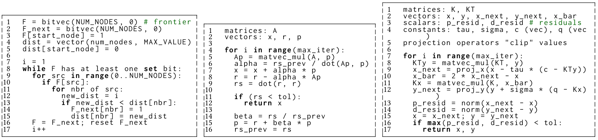

[原文物理页 3](https://people.csail.mit.edu/emer/media/papers/2020s/2025/2025.10.micro.quartz.pdf#page=3) · [许可证 CC BY 4.0](https://creativecommons.org/licenses/by/4.0/)

署名：Courtney Golden, Axel Feldmann, Joel S. Emer, Daniel Sanchez. Quartz: A Reconfigurable, Distributed-Memory Accelerator for Sparse Applications. MICRO 2025. DOI: https://doi.org/10.1145/3725843.3756035. Version: Exact frozen author-hosted ACM-layout conference manuscript; metadata timestamp does not establish a publication version; publisher binary equivalence not asserted. Source: https://people.csail.mit.edu/emer/media/papers/2020s/2025/2025.10.micro.quartz.pdf. CC BY 4.0: https://creativecommons.org/licenses/by/4.0/. Whole figures cropped from this exact PDF and rasterized at 240 dpi; captions excluded, all figure content unchanged. No endorsement implied.

修改说明：Whole figure cropped from the specified source PDF and rasterized at 240 dpi; numbered caption excluded, figure content unchanged.

## F3

**非实验图 · 分布式加速器芯粒架构图**

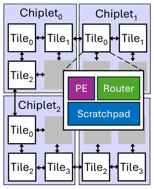

[原文物理页 4](https://people.csail.mit.edu/emer/media/papers/2020s/2025/2025.10.micro.quartz.pdf#page=4) · [许可证 CC BY 4.0](https://creativecommons.org/licenses/by/4.0/)

署名：Courtney Golden, Axel Feldmann, Joel S. Emer, Daniel Sanchez. Quartz: A Reconfigurable, Distributed-Memory Accelerator for Sparse Applications. MICRO 2025. DOI: https://doi.org/10.1145/3725843.3756035. Version: Exact frozen author-hosted ACM-layout conference manuscript; metadata timestamp does not establish a publication version; publisher binary equivalence not asserted. Source: https://people.csail.mit.edu/emer/media/papers/2020s/2025/2025.10.micro.quartz.pdf. CC BY 4.0: https://creativecommons.org/licenses/by/4.0/. Whole figures cropped from this exact PDF and rasterized at 240 dpi; captions excluded, all figure content unchanged. No endorsement implied.

修改说明：Whole figure cropped from the specified source PDF and rasterized at 240 dpi; numbered caption excluded, figure content unchanged.

## F4

**非实验图 · 任务生成与融合流程图**

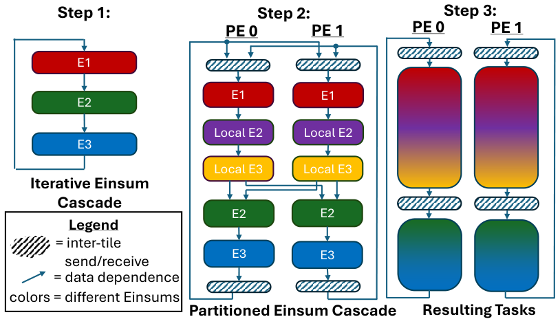

[原文物理页 4](https://people.csail.mit.edu/emer/media/papers/2020s/2025/2025.10.micro.quartz.pdf#page=4) · [许可证 CC BY 4.0](https://creativecommons.org/licenses/by/4.0/)

署名：Courtney Golden, Axel Feldmann, Joel S. Emer, Daniel Sanchez. Quartz: A Reconfigurable, Distributed-Memory Accelerator for Sparse Applications. MICRO 2025. DOI: https://doi.org/10.1145/3725843.3756035. Version: Exact frozen author-hosted ACM-layout conference manuscript; metadata timestamp does not establish a publication version; publisher binary equivalence not asserted. Source: https://people.csail.mit.edu/emer/media/papers/2020s/2025/2025.10.micro.quartz.pdf. CC BY 4.0: https://creativecommons.org/licenses/by/4.0/. Whole figures cropped from this exact PDF and rasterized at 240 dpi; captions excluded, all figure content unchanged. No endorsement implied.

修改说明：Whole figure cropped from the specified source PDF and rasterized at 240 dpi; numbered caption excluded, figure content unchanged.

## F5

**非实验图 · 稀疏矩阵向量乘示意图**

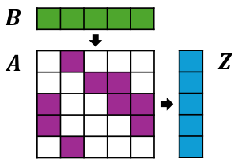

[原文物理页 5](https://people.csail.mit.edu/emer/media/papers/2020s/2025/2025.10.micro.quartz.pdf#page=5) · [许可证 CC BY 4.0](https://creativecommons.org/licenses/by/4.0/)

署名：Courtney Golden, Axel Feldmann, Joel S. Emer, Daniel Sanchez. Quartz: A Reconfigurable, Distributed-Memory Accelerator for Sparse Applications. MICRO 2025. DOI: https://doi.org/10.1145/3725843.3756035. Version: Exact frozen author-hosted ACM-layout conference manuscript; metadata timestamp does not establish a publication version; publisher binary equivalence not asserted. Source: https://people.csail.mit.edu/emer/media/papers/2020s/2025/2025.10.micro.quartz.pdf. CC BY 4.0: https://creativecommons.org/licenses/by/4.0/. Whole figures cropped from this exact PDF and rasterized at 240 dpi; captions excluded, all figure content unchanged. No endorsement implied.

修改说明：Whole figure cropped from the specified source PDF and rasterized at 240 dpi; numbered caption excluded, figure content unchanged.

## F6

**非实验图 · 分布式矩阵分区与计算图**

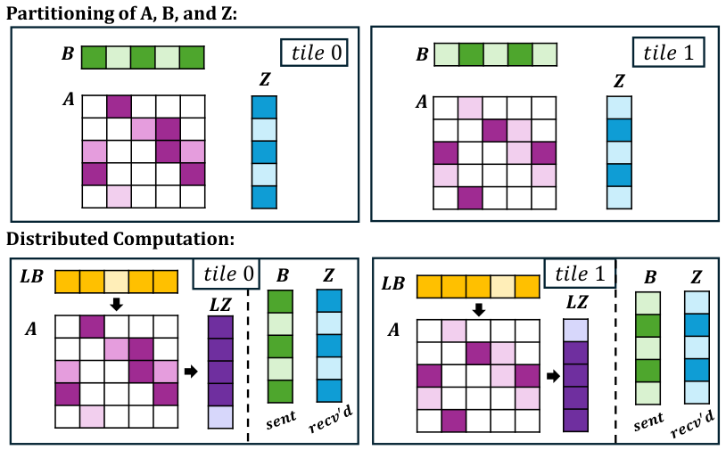

[原文物理页 5](https://people.csail.mit.edu/emer/media/papers/2020s/2025/2025.10.micro.quartz.pdf#page=5) · [许可证 CC BY 4.0](https://creativecommons.org/licenses/by/4.0/)

署名：Courtney Golden, Axel Feldmann, Joel S. Emer, Daniel Sanchez. Quartz: A Reconfigurable, Distributed-Memory Accelerator for Sparse Applications. MICRO 2025. DOI: https://doi.org/10.1145/3725843.3756035. Version: Exact frozen author-hosted ACM-layout conference manuscript; metadata timestamp does not establish a publication version; publisher binary equivalence not asserted. Source: https://people.csail.mit.edu/emer/media/papers/2020s/2025/2025.10.micro.quartz.pdf. CC BY 4.0: https://creativecommons.org/licenses/by/4.0/. Whole figures cropped from this exact PDF and rasterized at 240 dpi; captions excluded, all figure content unchanged. No endorsement implied.

修改说明：Whole figure cropped from the specified source PDF and rasterized at 240 dpi; numbered caption excluded, figure content unchanged.

## F7

**非实验图 · 计算瓦片微架构图**

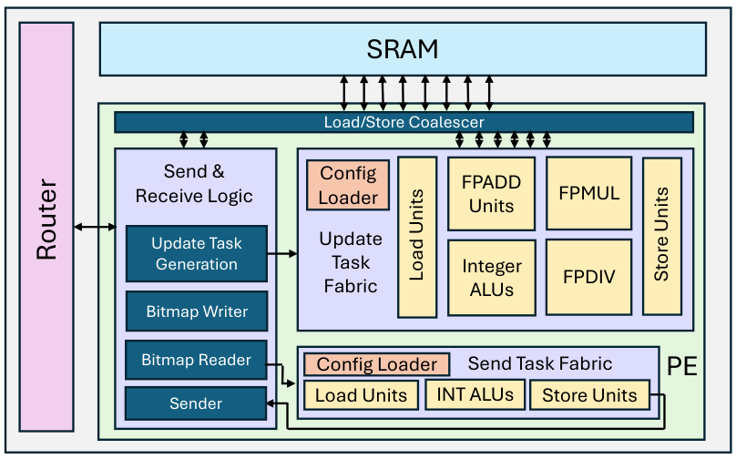

[原文物理页 7](https://people.csail.mit.edu/emer/media/papers/2020s/2025/2025.10.micro.quartz.pdf#page=7) · [许可证 CC BY 4.0](https://creativecommons.org/licenses/by/4.0/)

署名：Courtney Golden, Axel Feldmann, Joel S. Emer, Daniel Sanchez. Quartz: A Reconfigurable, Distributed-Memory Accelerator for Sparse Applications. MICRO 2025. DOI: https://doi.org/10.1145/3725843.3756035. Version: Exact frozen author-hosted ACM-layout conference manuscript; metadata timestamp does not establish a publication version; publisher binary equivalence not asserted. Source: https://people.csail.mit.edu/emer/media/papers/2020s/2025/2025.10.micro.quartz.pdf. CC BY 4.0: https://creativecommons.org/licenses/by/4.0/. Whole figures cropped from this exact PDF and rasterized at 240 dpi; captions excluded, all figure content unchanged. No endorsement implied.

修改说明：Whole figure cropped from the specified source PDF and rasterized at 240 dpi; numbered caption excluded, figure content unchanged.

## F8

**非实验图 · 可重构计算单元互连图**

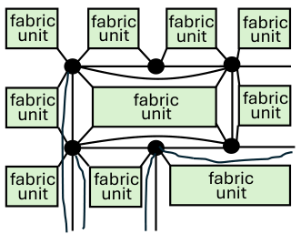

[原文物理页 7](https://people.csail.mit.edu/emer/media/papers/2020s/2025/2025.10.micro.quartz.pdf#page=7) · [许可证 CC BY 4.0](https://creativecommons.org/licenses/by/4.0/)

署名：Courtney Golden, Axel Feldmann, Joel S. Emer, Daniel Sanchez. Quartz: A Reconfigurable, Distributed-Memory Accelerator for Sparse Applications. MICRO 2025. DOI: https://doi.org/10.1145/3725843.3756035. Version: Exact frozen author-hosted ACM-layout conference manuscript; metadata timestamp does not establish a publication version; publisher binary equivalence not asserted. Source: https://people.csail.mit.edu/emer/media/papers/2020s/2025/2025.10.micro.quartz.pdf. CC BY 4.0: https://creativecommons.org/licenses/by/4.0/. Whole figures cropped from this exact PDF and rasterized at 240 dpi; captions excluded, all figure content unchanged. No endorsement implied.

修改说明：Whole figure cropped from the specified source PDF and rasterized at 240 dpi; numbered caption excluded, figure content unchanged.

## F9

**非实验图 · 广度优先搜索数据依赖图**

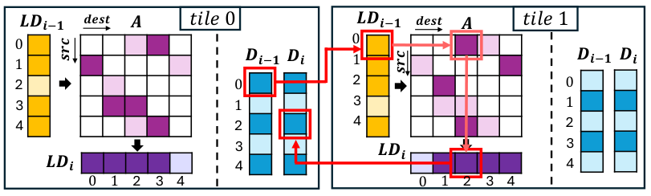

[原文物理页 8](https://people.csail.mit.edu/emer/media/papers/2020s/2025/2025.10.micro.quartz.pdf#page=8) · [许可证 CC BY 4.0](https://creativecommons.org/licenses/by/4.0/)

署名：Courtney Golden, Axel Feldmann, Joel S. Emer, Daniel Sanchez. Quartz: A Reconfigurable, Distributed-Memory Accelerator for Sparse Applications. MICRO 2025. DOI: https://doi.org/10.1145/3725843.3756035. Version: Exact frozen author-hosted ACM-layout conference manuscript; metadata timestamp does not establish a publication version; publisher binary equivalence not asserted. Source: https://people.csail.mit.edu/emer/media/papers/2020s/2025/2025.10.micro.quartz.pdf. CC BY 4.0: https://creativecommons.org/licenses/by/4.0/. Whole figures cropped from this exact PDF and rasterized at 240 dpi; captions excluded, all figure content unchanged. No endorsement implied.

修改说明：Whole figure cropped from the specified source PDF and rasterized at 240 dpi; numbered caption excluded, figure content unchanged.

## F10

**非实验图 · 行分区与轮转分区对比图**

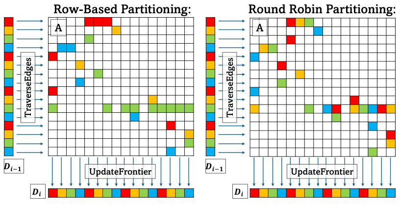

[原文物理页 8](https://people.csail.mit.edu/emer/media/papers/2020s/2025/2025.10.micro.quartz.pdf#page=8) · [许可证 CC BY 4.0](https://creativecommons.org/licenses/by/4.0/)

署名：Courtney Golden, Axel Feldmann, Joel S. Emer, Daniel Sanchez. Quartz: A Reconfigurable, Distributed-Memory Accelerator for Sparse Applications. MICRO 2025. DOI: https://doi.org/10.1145/3725843.3756035. Version: Exact frozen author-hosted ACM-layout conference manuscript; metadata timestamp does not establish a publication version; publisher binary equivalence not asserted. Source: https://people.csail.mit.edu/emer/media/papers/2020s/2025/2025.10.micro.quartz.pdf. CC BY 4.0: https://creativecommons.org/licenses/by/4.0/. Whole figures cropped from this exact PDF and rasterized at 240 dpi; captions excluded, all figure content unchanged. No endorsement implied.

修改说明：Whole figure cropped from the specified source PDF and rasterized at 240 dpi; numbered caption excluded, figure content unchanged.

## F11

**非实验图 · 超图分区示意图**

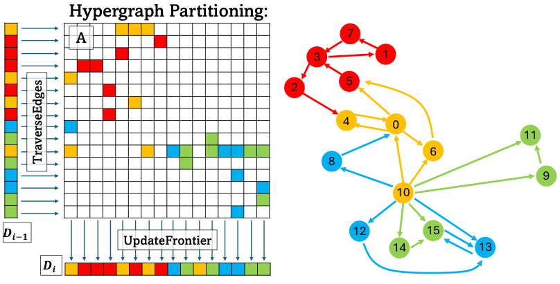

[原文物理页 9](https://people.csail.mit.edu/emer/media/papers/2020s/2025/2025.10.micro.quartz.pdf#page=9) · [许可证 CC BY 4.0](https://creativecommons.org/licenses/by/4.0/)

署名：Courtney Golden, Axel Feldmann, Joel S. Emer, Daniel Sanchez. Quartz: A Reconfigurable, Distributed-Memory Accelerator for Sparse Applications. MICRO 2025. DOI: https://doi.org/10.1145/3725843.3756035. Version: Exact frozen author-hosted ACM-layout conference manuscript; metadata timestamp does not establish a publication version; publisher binary equivalence not asserted. Source: https://people.csail.mit.edu/emer/media/papers/2020s/2025/2025.10.micro.quartz.pdf. CC BY 4.0: https://creativecommons.org/licenses/by/4.0/. Whole figures cropped from this exact PDF and rasterized at 240 dpi; captions excluded, all figure content unchanged. No endorsement implied.

修改说明：Whole figure cropped from the specified source PDF and rasterized at 240 dpi; numbered caption excluded, figure content unchanged.

## F12

**非实验图 · 两阶段图分区流程图**

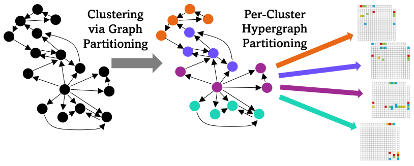

[原文物理页 9](https://people.csail.mit.edu/emer/media/papers/2020s/2025/2025.10.micro.quartz.pdf#page=9) · [许可证 CC BY 4.0](https://creativecommons.org/licenses/by/4.0/)

署名：Courtney Golden, Axel Feldmann, Joel S. Emer, Daniel Sanchez. Quartz: A Reconfigurable, Distributed-Memory Accelerator for Sparse Applications. MICRO 2025. DOI: https://doi.org/10.1145/3725843.3756035. Version: Exact frozen author-hosted ACM-layout conference manuscript; metadata timestamp does not establish a publication version; publisher binary equivalence not asserted. Source: https://people.csail.mit.edu/emer/media/papers/2020s/2025/2025.10.micro.quartz.pdf. CC BY 4.0: https://creativecommons.org/licenses/by/4.0/. Whole figures cropped from this exact PDF and rasterized at 240 dpi; captions excluded, all figure content unchanged. No endorsement implied.

修改说明：Whole figure cropped from the specified source PDF and rasterized at 240 dpi; numbered caption excluded, figure content unchanged.

