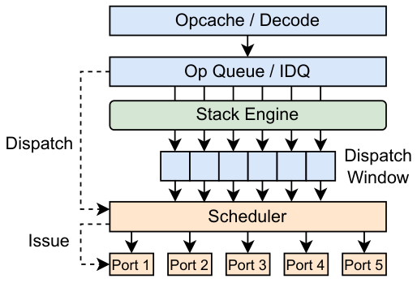
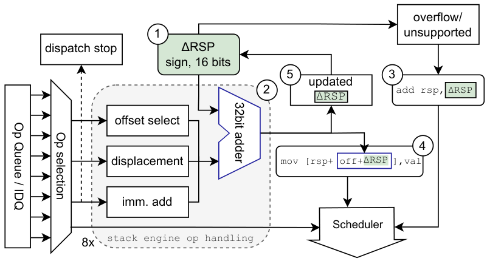
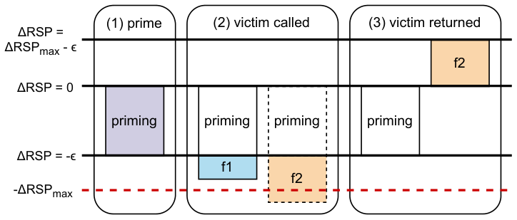

# One Flew over the Stack Engine’s Nest: Practical Microarchitectural Attacks on the Stack Engine

[返回图集](../README.md) · StackEngine · MICRO 2025 · 3张非实验图

研究对象：CPU/GPU处理器与执行构件 / 商用CPU栈引擎及其隐藏状态

本页仅显示以下非实验图，不包含原论文全部图组。混合图在子图分离复核完成前暂不收录。

版本许可依据：[来源](https://comsec-files.ethz.ch/papers/stackengine_micro25.pdf#page=1)。源PDF SHA256：`f62a2325db20fdb8c63628a33057d6c4d13f97441782ccfb68843d4e0063a322`。PDF不随库分发。

## 图号导航

[F1](#f1) · [F5](#f5) · [F6](#f6)

## F1

**非实验图 · 处理器流水线概览**

[原文物理页 3](https://comsec-files.ethz.ch/papers/stackengine_micro25.pdf#page=3) · [许可证 CC BY 4.0](https://creativecommons.org/licenses/by/4.0/)

署名：Silvan Niederer, Sandro Rüegge, Ali Hajiabadi, Kaveh Razavi. One Flew over the Stack Engine’s Nest: Practical Microarchitectural Attacks on the Stack Engine. MICRO 2025. DOI: https://doi.org/10.1145/3725843.3756058. Version: Exact preserved 14-page conference-layout author PDF. Source: https://comsec-files.ethz.ch/papers/stackengine_micro25.pdf. CC BY 4.0: https://creativecommons.org/licenses/by/4.0/. Whole figures cropped from this exact PDF and rasterized at 240 dpi; captions excluded, all figure content unchanged. No endorsement implied.

修改说明：Whole figure cropped from the specified source PDF and rasterized at 240 dpi; numbered caption excluded, figure content unchanged.

## F5

**非实验图 · 逆向机制结构图**

[原文物理页 8](https://comsec-files.ethz.ch/papers/stackengine_micro25.pdf#page=8) · [许可证 CC BY 4.0](https://creativecommons.org/licenses/by/4.0/)

从实验归纳的 Zen 5 结构示意，含结构参数。

署名：Silvan Niederer, Sandro Rüegge, Ali Hajiabadi, Kaveh Razavi. One Flew over the Stack Engine’s Nest: Practical Microarchitectural Attacks on the Stack Engine. MICRO 2025. DOI: https://doi.org/10.1145/3725843.3756058. Version: Exact preserved 14-page conference-layout author PDF. Source: https://comsec-files.ethz.ch/papers/stackengine_micro25.pdf. CC BY 4.0: https://creativecommons.org/licenses/by/4.0/. Whole figures cropped from this exact PDF and rasterized at 240 dpi; captions excluded, all figure content unchanged. No endorsement implied.

修改说明：Whole figure cropped from the specified source PDF and rasterized at 240 dpi; numbered caption excluded, figure content unchanged.

## F6

**非实验图 · 状态探测时序示意**

[原文物理页 9](https://comsec-files.ethz.ch/papers/stackengine_micro25.pdf#page=9) · [许可证 CC BY 4.0](https://creativecommons.org/licenses/by/4.0/)

署名：Silvan Niederer, Sandro Rüegge, Ali Hajiabadi, Kaveh Razavi. One Flew over the Stack Engine’s Nest: Practical Microarchitectural Attacks on the Stack Engine. MICRO 2025. DOI: https://doi.org/10.1145/3725843.3756058. Version: Exact preserved 14-page conference-layout author PDF. Source: https://comsec-files.ethz.ch/papers/stackengine_micro25.pdf. CC BY 4.0: https://creativecommons.org/licenses/by/4.0/. Whole figures cropped from this exact PDF and rasterized at 240 dpi; captions excluded, all figure content unchanged. No endorsement implied.

修改说明：Whole figure cropped from the specified source PDF and rasterized at 240 dpi; numbered caption excluded, figure content unchanged.

