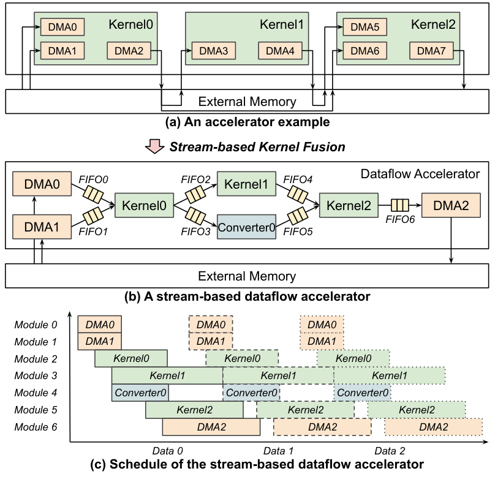
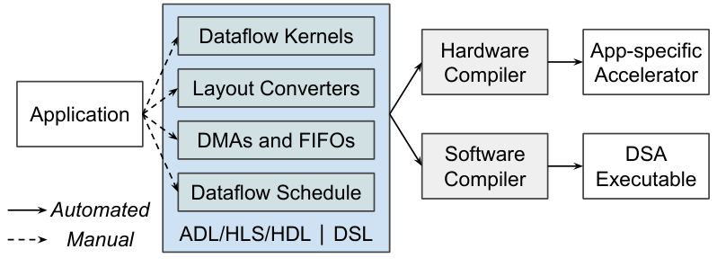
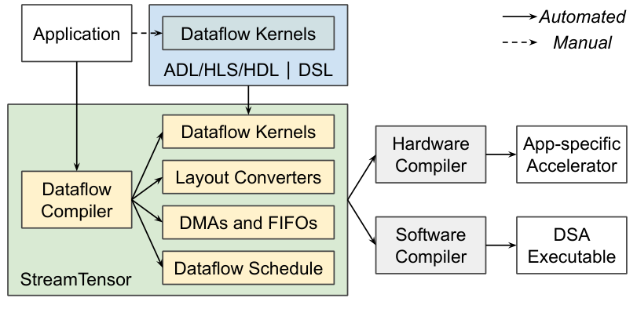
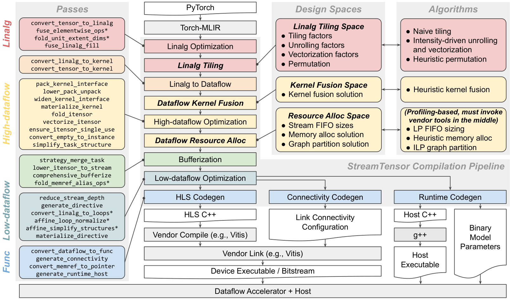
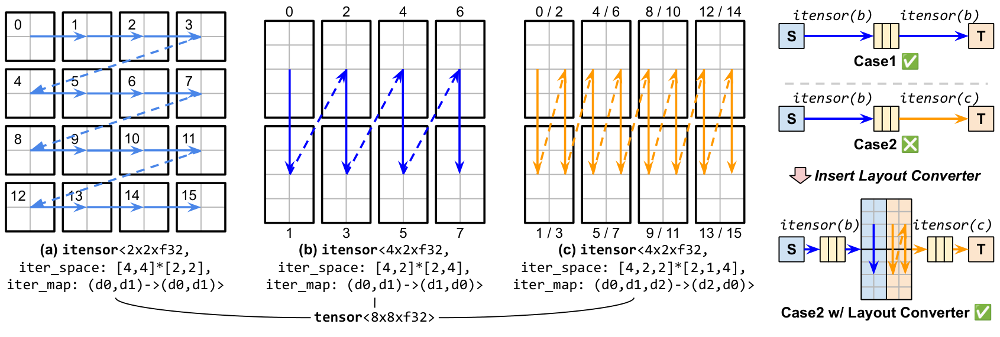
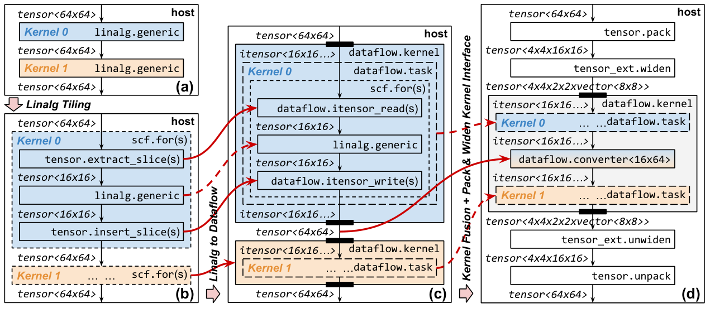
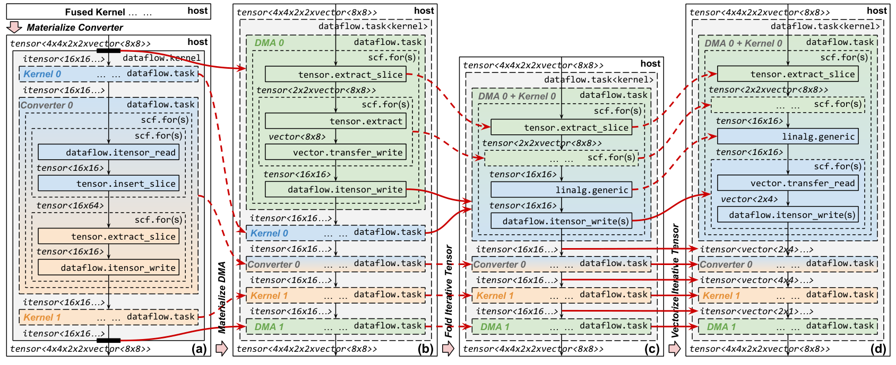
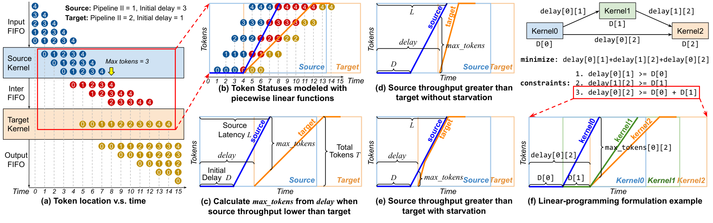

# StreamTensor: Make Tensors Stream in Dataflow Accelerators for LLMs

[返回图集](../README.md) · StreamTensor · MICRO 2025 · 8张非实验图

研究对象：编译器、语言与中间表示 / 流式张量编译器与itensor IR

本页仅显示以下非实验图，不包含原论文全部图组。混合图在子图分离复核完成前暂不收录。

版本许可依据：[来源](https://hanchenye.com/assets/pdfs/MICRO25_StreamTensor.pdf#page=1)。源PDF SHA256：`7e6ac34e9c492fd1c608e7b5c61db44ffc012f30b3a023eb2ae936a119008620`。PDF不随库分发。

## 图号导航

[F1](#f1) · [F2](#f2) · [F3](#f3) · [F4](#f4) · [F5](#f5) · [F6](#f6) · [F7](#f7) · [F8](#f8)

## F1

**非实验图 · 数据流加速器计算与调度图**

[原文物理页 1](https://hanchenye.com/assets/pdfs/MICRO25_StreamTensor.pdf#page=1) · [许可证 CC BY 4.0](https://creativecommons.org/licenses/by/4.0/)

署名：Hanchen Ye, Deming Chen. StreamTensor: Make Tensors Stream in Dataflow Accelerators for LLMs. MICRO 2025. DOI: https://doi.org/10.1145/3725843.3762817. Version: Exact frozen author-hosted conference-layout PDF; publisher binary equivalence not asserted. Source: https://hanchenye.com/assets/pdfs/MICRO25_StreamTensor.pdf. CC BY 4.0: https://creativecommons.org/licenses/by/4.0/. Whole figures cropped from this exact PDF and rasterized at 240 dpi; captions excluded, all figure content unchanged. No endorsement implied.

修改说明：Whole figure cropped from the specified source PDF and rasterized at 240 dpi; numbered caption excluded, figure content unchanged.

## F2

**非实验图 · 传统数据流加速器设计流程图**

[原文物理页 2](https://hanchenye.com/assets/pdfs/MICRO25_StreamTensor.pdf#page=2) · [许可证 CC BY 4.0](https://creativecommons.org/licenses/by/4.0/)

署名：Hanchen Ye, Deming Chen. StreamTensor: Make Tensors Stream in Dataflow Accelerators for LLMs. MICRO 2025. DOI: https://doi.org/10.1145/3725843.3762817. Version: Exact frozen author-hosted conference-layout PDF; publisher binary equivalence not asserted. Source: https://hanchenye.com/assets/pdfs/MICRO25_StreamTensor.pdf. CC BY 4.0: https://creativecommons.org/licenses/by/4.0/. Whole figures cropped from this exact PDF and rasterized at 240 dpi; captions excluded, all figure content unchanged. No endorsement implied.

修改说明：Whole figure cropped from the specified source PDF and rasterized at 240 dpi; numbered caption excluded, figure content unchanged.

## F3

**非实验图 · 数据流编译器设计流程图**

[原文物理页 3](https://hanchenye.com/assets/pdfs/MICRO25_StreamTensor.pdf#page=3) · [许可证 CC BY 4.0](https://creativecommons.org/licenses/by/4.0/)

署名：Hanchen Ye, Deming Chen. StreamTensor: Make Tensors Stream in Dataflow Accelerators for LLMs. MICRO 2025. DOI: https://doi.org/10.1145/3725843.3762817. Version: Exact frozen author-hosted conference-layout PDF; publisher binary equivalence not asserted. Source: https://hanchenye.com/assets/pdfs/MICRO25_StreamTensor.pdf. CC BY 4.0: https://creativecommons.org/licenses/by/4.0/. Whole figures cropped from this exact PDF and rasterized at 240 dpi; captions excluded, all figure content unchanged. No endorsement implied.

修改说明：Whole figure cropped from the specified source PDF and rasterized at 240 dpi; numbered caption excluded, figure content unchanged.

## F4

**非实验图 · 编译流程与设计空间图**

[原文物理页 4](https://hanchenye.com/assets/pdfs/MICRO25_StreamTensor.pdf#page=4) · [许可证 CC BY 4.0](https://creativecommons.org/licenses/by/4.0/)

署名：Hanchen Ye, Deming Chen. StreamTensor: Make Tensors Stream in Dataflow Accelerators for LLMs. MICRO 2025. DOI: https://doi.org/10.1145/3725843.3762817. Version: Exact frozen author-hosted conference-layout PDF; publisher binary equivalence not asserted. Source: https://hanchenye.com/assets/pdfs/MICRO25_StreamTensor.pdf. CC BY 4.0: https://creativecommons.org/licenses/by/4.0/. Whole figures cropped from this exact PDF and rasterized at 240 dpi; captions excluded, all figure content unchanged. No endorsement implied.

修改说明：Whole figure cropped from the specified source PDF and rasterized at 240 dpi; numbered caption excluded, figure content unchanged.

## F5

**非实验图 · 迭代张量布局与转换示意图**

[原文物理页 4](https://hanchenye.com/assets/pdfs/MICRO25_StreamTensor.pdf#page=4) · [许可证 CC BY 4.0](https://creativecommons.org/licenses/by/4.0/)

署名：Hanchen Ye, Deming Chen. StreamTensor: Make Tensors Stream in Dataflow Accelerators for LLMs. MICRO 2025. DOI: https://doi.org/10.1145/3725843.3762817. Version: Exact frozen author-hosted conference-layout PDF; publisher binary equivalence not asserted. Source: https://hanchenye.com/assets/pdfs/MICRO25_StreamTensor.pdf. CC BY 4.0: https://creativecommons.org/licenses/by/4.0/. Whole figures cropped from this exact PDF and rasterized at 240 dpi; captions excluded, all figure content unchanged. No endorsement implied.

修改说明：Whole figure cropped from the specified source PDF and rasterized at 240 dpi; numbered caption excluded, figure content unchanged.

## F6

**非实验图 · 张量分块与内核融合变换图**

[原文物理页 7](https://hanchenye.com/assets/pdfs/MICRO25_StreamTensor.pdf#page=7) · [许可证 CC BY 4.0](https://creativecommons.org/licenses/by/4.0/)

署名：Hanchen Ye, Deming Chen. StreamTensor: Make Tensors Stream in Dataflow Accelerators for LLMs. MICRO 2025. DOI: https://doi.org/10.1145/3725843.3762817. Version: Exact frozen author-hosted conference-layout PDF; publisher binary equivalence not asserted. Source: https://hanchenye.com/assets/pdfs/MICRO25_StreamTensor.pdf. CC BY 4.0: https://creativecommons.org/licenses/by/4.0/. Whole figures cropped from this exact PDF and rasterized at 240 dpi; captions excluded, all figure content unchanged. No endorsement implied.

修改说明：Whole figure cropped from the specified source PDF and rasterized at 240 dpi; numbered caption excluded, figure content unchanged.

## F7

**非实验图 · 数据流物化与向量化变换图**

[原文物理页 8](https://hanchenye.com/assets/pdfs/MICRO25_StreamTensor.pdf#page=8) · [许可证 CC BY 4.0](https://creativecommons.org/licenses/by/4.0/)

署名：Hanchen Ye, Deming Chen. StreamTensor: Make Tensors Stream in Dataflow Accelerators for LLMs. MICRO 2025. DOI: https://doi.org/10.1145/3725843.3762817. Version: Exact frozen author-hosted conference-layout PDF; publisher binary equivalence not asserted. Source: https://hanchenye.com/assets/pdfs/MICRO25_StreamTensor.pdf. CC BY 4.0: https://creativecommons.org/licenses/by/4.0/. Whole figures cropped from this exact PDF and rasterized at 240 dpi; captions excluded, all figure content unchanged. No endorsement implied.

修改说明：Whole figure cropped from the specified source PDF and rasterized at 240 dpi; numbered caption excluded, figure content unchanged.

## F8

**非实验图 · FIFO容量建模与优化示意图**

[原文物理页 10](https://hanchenye.com/assets/pdfs/MICRO25_StreamTensor.pdf#page=10) · [许可证 CC BY 4.0](https://creativecommons.org/licenses/by/4.0/)

署名：Hanchen Ye, Deming Chen. StreamTensor: Make Tensors Stream in Dataflow Accelerators for LLMs. MICRO 2025. DOI: https://doi.org/10.1145/3725843.3762817. Version: Exact frozen author-hosted conference-layout PDF; publisher binary equivalence not asserted. Source: https://hanchenye.com/assets/pdfs/MICRO25_StreamTensor.pdf. CC BY 4.0: https://creativecommons.org/licenses/by/4.0/. Whole figures cropped from this exact PDF and rasterized at 240 dpi; captions excluded, all figure content unchanged. No endorsement implied.

修改说明：Whole figure cropped from the specified source PDF and rasterized at 240 dpi; numbered caption excluded, figure content unchanged.

