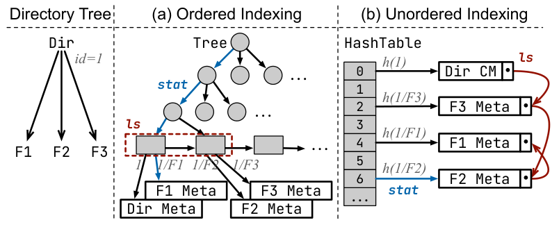
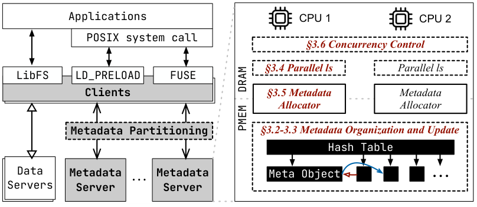

# Accelerating Distributed Filesystem Metadata Service via Decoupling Directory Semantics from Metadata Indexing

[返回图集](../README.md) · HMFS · SoCC 2025 · 2张非实验图

研究对象：文件、存储与缓存软件 / HMFS分布式文件系统元数据服务（SoCC 2025样本外补充）

SoCC 2025并非固定样本会议；本篇仅作100篇之外的补充，不计入该样本或其分类覆盖完成量。只收录 F1/F3，实验 F2 排除。

F1（物理第3页）对照目录枚举 ls 与元数据单项查找 stat；F3（物理第4页）定位元数据服务器内的哈希表和对象链接。

读图练习：F1(b) 中 stat 找到一个对象后，ls 为什么还需要另一套链接？在 F3 找出这两类结构所属的服务及持久内存区域。两张图连接的是机制与系统位置，不是一次请求的连续时间线。

版本许可依据：[精确作者 Git 文件](https://github.com/kurodes/SoCC25-HMFS/blob/f9b0759f32aaa4b0f64c3667eb25a4134c754492/Accelerating_Distributed_Filesystem_Metadata_Service_via_Decoupling_Directory_Semantics_from_Metadata_Indexing.pdf)，14页 PDF 首页明确 CC BY 4.0，DOI 10.1145/3772052.3772237。源 PDF SHA-256：`8ad56c6daa64712f821649fb456ac6c4a371aa8b83dceb910f5112a9b96260b5`；git blob：`a49547cfe340c49fc6ad139a4c152bf3d96ab138`。PDF不随库分发。

## 图号导航

[F1](#f1) · [F3](#f3)

## F1

**非实验图 · 目录语义与元数据索引解耦示意图**

[原文物理页 3](https://raw.githubusercontent.com/kurodes/SoCC25-HMFS/f9b0759f32aaa4b0f64c3667eb25a4134c754492/Accelerating_Distributed_Filesystem_Metadata_Service_via_Decoupling_Directory_Semantics_from_Metadata_Indexing.pdf#page=3) · [许可证 CC BY 4.0](https://creativecommons.org/licenses/by/4.0/)

沿同一目录中的文件对照 ls 与 stat：有序索引用范围查询支持目录枚举；HMFS 将单项查找交给哈希索引，将目录枚举交给元数据对象间的显式链接。图中的箭头表示查找或遍历关系，不是性能测量。 SoCC 2025样本外补充，不计入固定100篇样本或其分类覆盖完成量。

署名：Wenhao Lv, Hao Guo, Qing Wang, Youyou Lu, Jiwu Shu. Accelerating Distributed Filesystem Metadata Service via Decoupling Directory Semantics from Metadata Indexing. SoCC 2025. DOI: https://doi.org/10.1145/3772052.3772237. Copyright 2025 held by the owner/authors. Source: https://github.com/kurodes/SoCC25-HMFS/blob/f9b0759f32aaa4b0f64c3667eb25a4134c754492/Accelerating_Distributed_Filesystem_Metadata_Service_via_Decoupling_Directory_Semantics_from_Metadata_Indexing.pdf. Version: 14-page SoCC 2025 PDF in first-author repository commit f9b0759f32aaa4b0f64c3667eb25a4134c754492, blob a49547cfe340c49fc6ad139a4c152bf3d96ab138. CC BY 4.0: https://creativecommons.org/licenses/by/4.0/. Whole figure cropped from the exact author-hosted PDF and rasterized at 240 dpi; main caption excluded, all diagram content and subfigure labels retained; no redrawing. No endorsement implied.

修改说明：Whole figure cropped from the exact author-hosted PDF and rasterized at 240 dpi; main caption excluded, all diagram content and subfigure labels retained; no redrawing.

## F3

**非实验图 · 分布式文件系统元数据服务架构图**

[原文物理页 4](https://raw.githubusercontent.com/kurodes/SoCC25-HMFS/f9b0759f32aaa4b0f64c3667eb25a4134c754492/Accelerating_Distributed_Filesystem_Metadata_Service_via_Decoupling_Directory_Semantics_from_Metadata_Indexing.pdf#page=4) · [许可证 CC BY 4.0](https://creativecommons.org/licenses/by/4.0/)

从客户端与元数据分区进入元数据服务器，在展开区域找到 Hash Table 与 Meta Object，对照 F1 的查找和链接结构；再辨认并行 ls、分配器与并发控制。数据服务器承担文件数据，不能把元数据索引当作文件内容存储。 SoCC 2025样本外补充，不计入固定100篇样本或其分类覆盖完成量。

署名：Wenhao Lv, Hao Guo, Qing Wang, Youyou Lu, Jiwu Shu. Accelerating Distributed Filesystem Metadata Service via Decoupling Directory Semantics from Metadata Indexing. SoCC 2025. DOI: https://doi.org/10.1145/3772052.3772237. Copyright 2025 held by the owner/authors. Source: https://github.com/kurodes/SoCC25-HMFS/blob/f9b0759f32aaa4b0f64c3667eb25a4134c754492/Accelerating_Distributed_Filesystem_Metadata_Service_via_Decoupling_Directory_Semantics_from_Metadata_Indexing.pdf. Version: 14-page SoCC 2025 PDF in first-author repository commit f9b0759f32aaa4b0f64c3667eb25a4134c754492, blob a49547cfe340c49fc6ad139a4c152bf3d96ab138. CC BY 4.0: https://creativecommons.org/licenses/by/4.0/. Whole figure cropped from the exact author-hosted PDF and rasterized at 240 dpi; main caption excluded, all diagram content and subfigure labels retained; no redrawing. No endorsement implied.

修改说明：Whole figure cropped from the exact author-hosted PDF and rasterized at 240 dpi; main caption excluded, all diagram content and subfigure labels retained; no redrawing.
